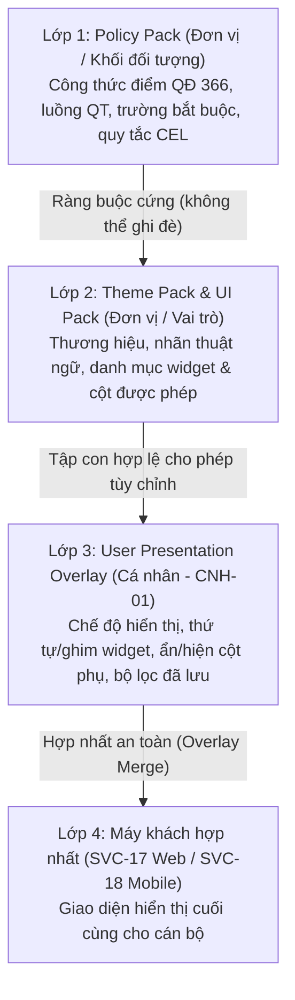

# Đề xuất thiết kế cá nhân hóa trình bày giao diện (CNH-01)

> **Trạng thái**: Đề xuất chờ duyệt kiến trúc (tiền đề cho `CNH-02`, `CNH-03`, `CNH-04`, `CNH-05`)
> **Mã công việc**: `CNH-01`
> **Phân hệ liên quan**: `MOD-08` (`config`, `SVC-10` `ui-pack-service`), `MOD-09` (`notify`), `SVC-17` (`web-frontend`), `SVC-18` (`mobile-app`)
> **Tài liệu gốc đối chiếu**:
> - Baseline: `/mnt/project-files/kien-truc-okr-kpi/src/00-co-so-thiet-ke-chung.md` (`ADR-05`, `NFR-01`, `NFR-11`, Mục 13 Quy ước API)
> - TL-01: `/mnt/project-files/kien-truc-okr-kpi/src/TL-01-thiet-ke-kien-truc.md` (Chương 7: Giao diện theo đơn vị — `Theme Pack`, `UI Pack`, `Policy Pack`, dòng 1775–2011; Mục 7.4 Khả năng tiếp cận và chế độ Đảng viên cao tuổi, dòng 1957–1964)
> - TL-02: `/mnt/project-files/kien-truc-okr-kpi/src/TL-02-quy-trinh-nghiep-vu.md` (`SCR-0002` Trang chủ theo vai trò, dòng 320–329; `QT-16` / `SCR-1603` Bảng điều khiển cá nhân, dòng 1621–1623, 1656–1660; `SCR-1803` Chọn chế độ giao diện Mặc định / Đảng viên cao tuổi, dòng 1765–1767)
> - TL-03: `/mnt/project-files/kien-truc-okr-kpi/src/TL-03-thiet-ke-csdl.md` (Mục 1.2 Bảy cột chung chuẩn, dòng 46–61; Mục 1.3 Phân loại dữ liệu `C0`–`C3`, dòng 63–79; `notify.channel_pref`, dòng 817; Mục 3.10 Schema `config` — `config.ui_pack`, `config.theme_pack`, `config.dashboard_def`, dòng 884–919)

---

## 1. Động lực và phân tích khoảng trống trong thiết kế hiện hành

### 1.1. Những gì bộ tài liệu TL-01..TL-04 đã quy định

Qua rà soát bốn tài liệu kiến trúc gốc, cơ chế cấu hình động và một số thành phần cá nhân hóa đã được định hình ở cấp đơn vị (`tenant` / `org_unit`) và một phần ở cấp người dùng:

| Thành phần trong TL gốc | Nguồn trích dẫn | Phạm vi hiện tại | Giới hạn hiện tại |
|---|---|---|---|
| **Ba gói cấu hình `Theme Pack`, `UI Pack`, `Policy Pack`** | TL-01 Chương 7, dòng 1775–1837; TL-03 Mục 3.10, dòng 892–906 | Gắn theo `tenant_id` và `org_unit_id` | Chỉ cho phép đơn vị tùy biến thương hiệu, nhãn thuật ngữ và bố cục chung; chưa có lớp phủ (overlay) cho từng `user_id`. |
| **Bố cục Trang chủ lắp ghép theo vai trò (`SCR-0002`)** | TL-01 dòng 1824–1837 (`layouts.home`); TL-02 dòng 320–329 (`SCR-0002`); `contracts/openapi/modules/config.yaml` (`getHomeLayout`) | Lắp ghép các thẻ (widget) theo vai trò của người dùng từ `ui-pack.layouts.home` | Mọi cán bộ cùng vai trò trong cùng đơn vị nhìn thấy thứ tự widget giống hệt nhau; chưa thể ghim widget hay dùng lên đầu hoặc ẩn widget phụ. |
| **Chế độ "Đảng viên cao tuổi" (`SCR-1803`, `NFR-11`)** | Baseline dòng 455 (`NFR-11`); TL-01 Mục 7.4 dòng 1957–1964; TL-02 `SCR-1803` dòng 1765–1767 | Bật `data-mode="elderly"`, chữ tối thiểu `18px`, vùng chạm tối thiểu `48×48px`, cờ `reducedSteps = true` (≤ 3 chạm) | Hiện `ThemeService` trên trình duyệt chỉ lưu vào `localStorage` (`vt.mode`). Khi cán bộ đổi máy tính hoặc đăng nhập trên ứng dụng di động (`SVC-18`), chế độ đã chọn không được đồng bộ. |
| **Bảng điều khiển cá nhân (`QT-16`, `SCR-1603`)** | TL-02 dòng 1621–1623, 1656–1660; TL-03 `config.dashboard_def` dòng 908 | Bảng `config.dashboard_def` đã có cột `share_scope = 'RIENG'` và `owner_id` để lưu bố cục biểu đồ riêng | Chưa có trường lưu bảng điều khiển nào là **mặc định khi mở màn hình** hoặc danh sách mã chỉ số KPI/OKR ghim nhanh của từng người dùng. |
| **Tùy chọn kênh thông báo (`notify.channel_pref`)** | TL-03 Mục 3.9 dòng 817 (`notify.channel_pref`) | Lưu cấu hình kênh nhận thông báo (`IN_APP`, `PUSH`, `EMAIL`, `SMS`) theo người dùng trừ thông báo bắt buộc (`is_mandatory`) | Nằm riêng ở schema `notify` (`MOD-09`); chưa có đầu mối hợp nhất với khung cài đặt cá nhân trên giao diện. |

### 1.2. Khoảng trống cần bổ sung (suy luận kiến trúc)

Từ thực tế vận hành của 6,5 triệu tài khoản và 300.000 người dùng đồng thời (`NFR-01`) thuộc 4 khối đối tượng (Đảng, Chính quyền, Mặt trận Tổ quốc & Đoàn thể, Doanh nghiệp Nhà nước), cán bộ thường xuyên làm việc với các bảng danh sách hàng trăm nhiệm vụ (`SCR-0201`, `SCR-0301`) và phiếu đánh giá (`SCR-0901`, `SCR-1001`). Việc thiếu lớp lưu trữ tùy chọn trình bày theo cá nhân dẫn tới 4 hạn chế:

1. **Mất trạng thái hiển thị khi chuyển thiết bị**: Cán bộ bật chế độ "Đảng viên cao tuổi" (`SCR-1803`) trên máy tính văn phòng nhưng khi mở ứng dụng di động (`SVC-18`) lại phải bật lại từ đầu.
2. **Thao tác lặp lại mỗi ngày trên danh sách công việc**: Mỗi lần vào danh sách nhiệm vụ, cán bộ phải chọn lại bộ lọc quen thuộc (ví dụ: *"Nhiệm vụ đơn vị tôi phụ trách sắp đến hạn trong tuần"*) và chỉnh lại độ rộng/ẩn bớt cột phụ.
3. **Bố cục Trang chủ chưa sát thói quen cá nhân**: Trong phạm vi các widget mà đơn vị (`UI Pack`) và vai trò cho phép, cán bộ theo dõi tổng hợp muốn ghim thẻ *"Tiến độ đơn vị"* lên đầu, trong khi cán bộ chuyên môn muốn đưa thẻ *"Nhiệm vụ cần báo cáo hôm nay"* lên vị trí đầu tiên.
4. **Nguy cơ phá vỡ bộ đệm `UI Pack` nếu trộn lẫn cấu hình**: Nếu nhúng trực tiếp tùy chọn cá nhân vào tệp JSON của `UI Pack` đơn vị, hệ thống sẽ mất khả năng lưu đệm dùng chung trên CDN/Redis theo `(tenant_id, org_unit_id, pack_version)` (TL-01 Chương 7).

Đề xuất này giải quyết trọn vẹn 4 khoảng trống trên bằng mô hình **Lớp phủ trình bày cá nhân (User Presentation Overlay)** đặt phía trên `UI Pack` của đơn vị, hoàn toàn tách biệt với `Policy Pack` và dữ liệu nghiệp vụ.

---

## 2. Nguyên tắc kiến trúc và ranh giới cá nhân hóa

### 2.1. Mô hình 4 lớp cấu hình giao diện (suy luận mở rộng từ TL-01 Chương 7)



### 2.2. Năm nhóm phạm vi ĐƯỢC PHÉP cá nhân hóa

| Mã nhóm (`pref_key`) | Nội dung được phép cá nhân hóa | Giới hạn kỹ thuật & Ràng buộc từ `UI Pack` |
|---|---|---|
| `ui.display` | Chế độ hiển thị `mode` (`default` / `elderly`), cờ `reducedSteps` (`true` / `false`), mật độ dòng `density` (`comfortable` / `compact`), hệ số phóng chữ `fontScale` (`1.0`–`1.5`), viền tương phản cao `highContrastStatus`. | Khi `mode = "elderly"`, hệ thống tự động cưỡng bức `reducedSteps = true`, `density = "comfortable"`, cỡ chữ ≥ `18px`, vùng chạm ≥ `48×48px` đúng chuẩn `NFR-11` và `SCR-1803`. |
| `ui.home.layout` | Sắp xếp thứ tự (`widgetOrder`), ghim lên đầu (`pinnedWidgets`, tối đa 6), thu gọn vùng (`collapsedSections`), hoặc ẩn (`hiddenWidgets`) các widget không bắt buộc trên Trang chủ `SCR-0002`. | Chỉ được thao tác trên tập widget đã được `UI Pack` của đơn vị và ma trận phân quyền cấp cho vai trò hiện tại. Các widget có cờ `mandatory: true` trong `UI Pack` (như cảnh báo nhiệm vụ quá hạn, việc cần xử lý khẩn) không thể bị ẩn. |
| `ui.table.<SCR-xxxx>` | Ẩn/hiện cột phụ (`visibleColumns`), đổi thứ tự cột (`columnOrder`), độ rộng cột (`columnWidths`), số dòng mỗi trang (`pageSize` ∈ `{10, 20, 50, 100, 200}`), sắp xếp mặc định (`defaultSort`), bộ lọc mặc định (`defaultSavedFilterId`). | Các cột bắt buộc pháp lý (`mandatoryColumns`, ví dụ: mã nhiệm vụ, tên nhiệm vụ, hạn hoàn thành, trạng thái) luôn được giữ lại dù cấu hình cá nhân yêu cầu ẩn. `pageSize` tối đa `200` theo Mục 13 baseline. |
| `ui.dashboard.default` | Chọn bảng điều khiển mở mặc định (`defaultDashboardId` trỏ tới `config.dashboard_def` chuẩn hoặc bản ghi có `share_scope = 'RIENG'` của chính người dùng), ghim tối đa 10 mã chỉ số (`pinnedKpiCodes`), kỳ mặc định (`THANG`/`QUY`/`NAM`). | Người dùng chỉ được trỏ tới `dashboard_def` thuộc cùng `tenant_id` mà mình có quyền xem hoặc do chính mình sở hữu (`owner_id = user_id`). |
| `config.saved_filter` *(bảng riêng)* | Lưu tối đa **20 bộ lọc đặt tên** trên mỗi màn hình danh sách (`SCR-0201`, `SCR-0301`, `SCR-0901`, `SCR-1001`…), đánh dấu 1 bộ lọc mặc định (`is_default = true`). | Chỉ lưu mã trạng thái, mã xếp loại, UUID đơn vị/kỳ, khoảng ngày, khoảng số (`SavedFilterCriteria`). Tuyệt đối không lưu chuỗi tìm kiếm tự do (`freeText`). |

> [!NOTE]
> Đối với tùy chọn kênh thông báo (`notify.channel_pref`), hệ thống giữ nguyên bảng `notify.channel_pref` của `MOD-09` (TL-03 dòng 817). Giao diện cài đặt cá nhân chỉ gom chung vào một màn hình trải nghiệm thống nhất và gọi API tương ứng hoặc đồng bộ cấu hình giờ yên lặng (`quietHours`).

### 2.3. Bảy bất biến TUYỆT ĐỐI KHÔNG ĐƯỢC cá nhân hóa

Để bảo đảm tính nghiêm minh của quy trình đánh giá cán bộ theo QĐ 366-QĐ/TW, NĐ 335/2025, NĐ 233/2026 và kiến trúc an toàn thông tin (TL-04), mọi thiết kế và mã nguồn của loạt task `CNH-01..05` phải tuân thủ 7 bất biến sau:

1. **Không thay đổi công thức tính điểm, trọng số và quy tắc xếp loại**: Cá nhân hóa không được can thiệp vào công thức tổng hợp điểm OKR/KPI, quy tắc làm tròn `HALF_UP`, điểm sàn hay ngưỡng xếp loại (`HTXSNV`, `HTTNV`, `HTNV`, `KHTNV`) trong `Policy Pack`.
2. **Không thay đổi luồng phê duyệt và máy trạng thái nghiệp vụ**: Không được bỏ bước, gộp bước phê duyệt trong `QT-00`..`QT-18` (kể cả khi bật `reducedSteps = true`; cờ `reducedSteps` chỉ gom gọn bước nhập liệu trên màn hình chứ không bỏ bước kiểm soát hay phê duyệt trên máy chủ).
3. **Không nới lỏng hoặc thay đổi quyền hạn (`OPA` / `RLS`)**: Mọi widget trên Trang chủ, bảng điều khiển cá nhân và bộ lọc đã lưu khi truy vấn dữ liệu đều đi qua bộ kiểm tra quyền `OPA` và chính sách `RLS` của PostgreSQL trên máy chủ (Quy tắc 6 `AGENTS.md`).
4. **Không ẩn trường bắt buộc hoặc quy tắc kiểm tra liên trường (`x-cel`)**: Trên biểu mẫu động (như Mẫu 1B ở `SCR-0901`), người dùng không được phép ẩn 9 tiêu chí chung, trường giải trình khi tự đề xuất khác mức tham khảo (`R-1B-03`), hay trường giải pháp đột phá khi đề xuất `HTXSNV` (`R-1B-02`).
5. **Không đổi bảng màu ngữ nghĩa của trạng thái và mức xếp loại**: Màu sắc hiển thị của các trạng thái chuẩn (`DA_GIAO`, `DANG_THUC_HIEN`, `CHO_NGHIEM_THU`, `DA_NGHIEM_THU`, `QUA_HAN`) và 4 mức xếp loại là ngôn ngữ thị giác thống nhất toàn hệ thống. Cá nhân chỉ được bật tăng độ tương phản viền/nhãn phụ (`highContrastStatus`), không được đổi màu trạng thái (ví dụ: không thể đổi màu đỏ của `QUA_HAN` thành màu xanh).
6. **Không lưu dữ liệu mật cấp `C2`/`C3` vào tùy chọn hoặc bộ lọc**: Các bảng `config.user_preference` và `config.saved_filter` được phân loại cứng ở mức **`C1` (Nội bộ)**. Nghiêm cấm lưu tên nhiệm vụ, nội dung nhận xét đánh giá cán bộ, họ tên cá nhân hoặc từ khóa tìm kiếm văn bản tự do vào cột `value` hay `criteria`.
7. **Không ghi đè cấu hình bắt buộc của đơn vị (`Theme Pack` / `UI Pack`)**: Người dùng không thể tự đổi quốc huy/biểu trưng đơn vị, tên gọi chính thức của cơ quan trong `Theme Pack`, hoặc tắt các thông báo/widget bắt buộc công vụ (`is_mandatory = true`).

---

## 3. Thiết kế cơ sở dữ liệu (Bổ sung Mục 3.10 TL-03 — Schema `config`)

### 3.1. Lý do đặt bảng tại schema `config` (so sánh với phương án `core.user_preference`)

Trong quá trình rà soát kiến trúc, hai vị trí đặt bảng đã được đặt lên bàn cân:

| Tiêu chí so sánh | Phương án A (Khuyến nghị): `config.user_preference` & `config.saved_filter` | Phương án B: `core.user_preference` |
|---|---|---|
| **Tính gắn kết miền nghiệp vụ (DDD)** | Rất cao: gắn liền với `config.ui_pack`, `config.theme_pack`, `config.dashboard_def` đều nằm trong schema `config` (`MOD-08` / `SVC-10` `ui-pack-service`). | Thấp hơn: schema `core` (`MOD-01`) chuyên trách định danh tài khoản (`core.account`), phiên đăng nhập và tổ chức, không giữ siêu dữ liệu bố cục màn hình (`SCR-xxxx`, `widget_id`). |
| **Hiệu năng hợp nhất bố cục (`getHomeLayout`)** | `SVC-10` (`ui-pack-service`) đọc cả `config.ui_pack` và `config.user_preference` trong cùng một schema/CSDL cấu hình để trả về bố cục đã hợp nhất với độ trễ < 10 ms. | Phải gọi chéo dịch vụ hoặc đọc chéo schema giữa `SVC-10` (`config`) và `core`. |
| **Tải đọc/ghi và cô lập sự cố** | Tách biệt hoàn toàn tải ghi tùy chọn giao diện khỏi bảng nhạy cảm `core.account`. | Làm tăng tải ghi và kích thước WAL trên schema `core`. |
| **Đồng bộ lộ trình thực thi** | Khớp trực tiếp với phạm vi tệp của `CNH-02` (`db/migrations/config/V*__user_preference.sql` và `contracts/openapi/modules/config.yaml`). | Đổi sang migration của `core` và hợp đồng `core.yaml`. |

**Kết luận thiết kế**: Chọn **Phương án A (`config.user_preference` và `config.saved_filter`)** làm thiết kế chuẩn.

### 3.2. Đặc tả bảng `config.user_preference` (suy luận bổ sung vào Mục 3.10 TL-03)

- **Mô tả**: Lưu trữ tùy chọn cá nhân hóa trình bày giao diện theo từng cặp `(tenant_id, user_id, pref_key)`.
- **Phân loại dữ liệu**: **`C1` (Nội bộ)** theo Mục 1.3 TL-03.
- **Ước lượng dung lượng**: Tối đa 6,5 triệu người dùng × trung bình 3 khóa/người dùng × ~1 KB/bản ghi ≈ 19,5 triệu dòng (~20 GB bao gồm chỉ mục), truy vấn luôn đi theo khóa chính/chỉ mục kết hợp `(tenant_id, user_id)`.

| Tên cột | Kiểu dữ liệu | Ràng buộc | Mô tả |
|---|---|---|---|
| `id` | `uuid` | `PRIMARY KEY DEFAULT uuidv7()` | Định danh bản ghi (chuẩn UUIDv7 sắp xếp theo thời gian — TL-03 Mục 1.2). |
| `tenant_id` | `uuid` | `NOT NULL` | Định danh đơn vị thuê bao (cột bắt buộc cho RLS). |
| `user_id` | `uuid` | `NOT NULL` | Định danh tài khoản người dùng (`core.account.id`). |
| `pref_key` | `varchar(100)` | `NOT NULL` | Khóa phân loại tùy chọn (`ui.display`, `ui.home.layout`, `ui.dashboard.default`, `ui.table.SCR-xxxx`, `notify.channel_pref`). |
| `value` | `jsonb` | `NOT NULL` | Giá trị cấu hình JSON tuân thủ `contracts/schemas/user-preference.schema.json`. Giới hạn kích thước ≤ 16 KB. |
| `value_schema_version` | `smallint` | `NOT NULL DEFAULT 1` | Phiên bản lược đồ của `value` để hỗ trợ nâng cấp cấu trúc không cần di trú toàn bảng. |
| `created_at` | `timestamptz` | `NOT NULL DEFAULT now()` | Thời điểm tạo bản ghi (UTC). |
| `created_by` | `uuid` | `NOT NULL` | Người tạo (bằng `user_id`). |
| `updated_at` | `timestamptz` | `NOT NULL DEFAULT now()` | Thời điểm cập nhật gần nhất (UTC). |
| `updated_by` | `uuid` | `NOT NULL` | Người cập nhật gần nhất. |
| `version_no` | `integer` | `NOT NULL DEFAULT 1` | Số phiên bản phục vụ khóa lạc quan (`If-Match` / `ETag`). |

### 3.3. Đặc tả bảng `config.saved_filter` (suy luận bổ sung vào Mục 3.10 TL-03)

- **Mô tả**: Lưu trữ các bộ lọc danh sách đã đặt tên của từng người dùng theo mã màn hình (`SCR-xxxx`).
- **Phân loại dữ liệu**: **`C1` (Nội bộ)** — chỉ chứa mã định danh, mã trạng thái, khoảng thời gian và khoảng số; không chứa văn bản tự do `C2`/`C3`.

| Tên cột | Kiểu dữ liệu | Ràng buộc | Mô tả |
|---|---|---|---|
| `id` | `uuid` | `PRIMARY KEY DEFAULT uuidv7()` | Định danh bộ lọc. |
| `tenant_id` | `uuid` | `NOT NULL` | Định danh đơn vị thuê bao. |
| `user_id` | `uuid` | `NOT NULL` | Chủ sở hữu bộ lọc (`core.account.id`). |
| `screen_code` | `varchar(32)` | `NOT NULL` | Mã màn hình áp dụng (ví dụ: `SCR-0201`, `SCR-0301`, `SCR-0901`). |
| `filter_name` | `varchar(120)` | `NOT NULL` | Tên gợi nhớ do người dùng đặt (ví dụ: *"Việc đến hạn tuần này"*). |
| `criteria` | `jsonb` | `NOT NULL` | Tiêu chí lọc tuân thủ `$defs/SavedFilterCriteria` trong `user-preference.schema.json` (≤ 8 KB). |
| `is_default` | `boolean` | `NOT NULL DEFAULT false` | Đánh dấu bộ lọc tự động kích hoạt khi mở màn hình `screen_code`. |
| `display_order` | `smallint` | `NOT NULL DEFAULT 0` | Thứ tự hiển thị trên thanh bộ lọc nhanh (`0`..`19`). |
| `created_at` | `timestamptz` | `NOT NULL DEFAULT now()` | Thời điểm tạo bản ghi (UTC). |
| `created_by` | `uuid` | `NOT NULL` | Người tạo. |
| `updated_at` | `timestamptz` | `NOT NULL DEFAULT now()` | Thời điểm cập nhật gần nhất (UTC). |
| `updated_by` | `uuid` | `NOT NULL` | Người cập nhật. |
| `version_no` | `integer` | `NOT NULL DEFAULT 1` | Số phiên bản phục vụ khóa lạc quan (`If-Match`). |

### 3.4. Phác thảo DDL và chính sách RLS chuẩn TL-03

```sql
-- Bảng 1: config.user_preference (Phân loại dữ liệu: C1)
CREATE TABLE config.user_preference (
    id                   uuid           NOT NULL DEFAULT uuidv7(),
    tenant_id            uuid           NOT NULL,
    user_id              uuid           NOT NULL,
    pref_key             varchar(100)  NOT NULL,
    value                jsonb         NOT NULL,
    value_schema_version smallint      NOT NULL DEFAULT 1,
    created_at           timestamptz   NOT NULL DEFAULT now(),
    created_by           uuid           NOT NULL,
    updated_at           timestamptz   NOT NULL DEFAULT now(),
    updated_by           uuid           NOT NULL,
    version_no           integer       NOT NULL DEFAULT 1,
    CONSTRAINT pk_user_preference PRIMARY KEY (id),
    CONSTRAINT uq_user_preference_tenant_user_key UNIQUE (tenant_id, user_id, pref_key),
    CONSTRAINT ck_user_preference_pref_key CHECK (
        pref_key ~ '^(ui\.display|ui\.home\.layout|ui\.dashboard\.default|ui\.table\.SCR-[0-9]{4}|notify\.channel_pref)$'
    ),
    CONSTRAINT ck_user_preference_value_object CHECK (jsonb_typeof(value) = 'object'),
    CONSTRAINT ck_user_preference_value_size CHECK (octet_length(value::text) <= 16384),
    CONSTRAINT ck_user_preference_schema_ver CHECK (value_schema_version >= 1)
);

CREATE INDEX idx_user_preference_tenant_user
    ON config.user_preference (tenant_id, user_id);

-- Bảng 2: config.saved_filter (Phân loại dữ liệu: C1)
CREATE TABLE config.saved_filter (
    id            uuid          NOT NULL DEFAULT uuidv7(),
    tenant_id     uuid          NOT NULL,
    user_id       uuid          NOT NULL,
    screen_code   varchar(32)   NOT NULL,
    filter_name   varchar(120)  NOT NULL,
    criteria      jsonb         NOT NULL,
    is_default    boolean       NOT NULL DEFAULT false,
    display_order smallint      NOT NULL DEFAULT 0,
    created_at    timestamptz   NOT NULL DEFAULT now(),
    created_by    uuid          NOT NULL,
    updated_at    timestamptz   NOT NULL DEFAULT now(),
    updated_by    uuid          NOT NULL,
    version_no    integer       NOT NULL DEFAULT 1,
    CONSTRAINT pk_saved_filter PRIMARY KEY (id),
    CONSTRAINT uq_saved_filter_name UNIQUE (tenant_id, user_id, screen_code, filter_name),
    CONSTRAINT ck_saved_filter_screen_code CHECK (screen_code ~ '^SCR-[0-9]{4}$'),
    CONSTRAINT ck_saved_filter_criteria_object CHECK (jsonb_typeof(criteria) = 'object'),
    CONSTRAINT ck_saved_filter_criteria_size CHECK (octet_length(criteria::text) <= 8192),
    CONSTRAINT ck_saved_filter_display_order CHECK (display_order BETWEEN 0 AND 19)
);

-- Mỗi người dùng chỉ có tối đa 1 bộ lọc mặc định trên mỗi màn hình
CREATE UNIQUE INDEX uq_saved_filter_one_default
    ON config.saved_filter (tenant_id, user_id, screen_code)
    WHERE is_default = true;

CREATE INDEX idx_saved_filter_lookup
    ON config.saved_filter (tenant_id, user_id, screen_code, display_order);

-- Bật Row-Level Security (RLS) cô lập đồng thời theo tenant_id VÀ chính chủ user_id
ALTER TABLE config.user_preference ENABLE ROW LEVEL SECURITY;
ALTER TABLE config.user_preference FORCE ROW LEVEL SECURITY;

CREATE POLICY rls_user_preference_owner ON config.user_preference
    USING (
        tenant_id = current_setting('app.current_tenant_id', true)::uuid
        AND user_id = current_setting('app.current_user_id', true)::uuid
    )
    WITH CHECK (
        tenant_id = current_setting('app.current_tenant_id', true)::uuid
        AND user_id = current_setting('app.current_user_id', true)::uuid
    );

ALTER TABLE config.saved_filter ENABLE ROW LEVEL SECURITY;
ALTER TABLE config.saved_filter FORCE ROW LEVEL SECURITY;

CREATE POLICY rls_saved_filter_owner ON config.saved_filter
    USING (
        tenant_id = current_setting('app.current_tenant_id', true)::uuid
        AND user_id = current_setting('app.current_user_id', true)::uuid
    )
    WITH CHECK (
        tenant_id = current_setting('app.current_tenant_id', true)::uuid
        AND user_id = current_setting('app.current_user_id', true)::uuid
    );
```

> [!IMPORTANT]
> Giới hạn **tối đa 20 bộ lọc đã lưu cho mỗi `(tenant_id, user_id, screen_code)`** được kiểm tra ở tầng dịch vụ ứng dụng (`MOD-08` trong giao dịch có khóa `SELECT count(*) ... FOR UPDATE` trên phạm vi người dùng) và trả mã lỗi Problem Details RFC 9457 (422 Unprocessable Entity) khi vượt ngưỡng.

---

## 4. Thiết kế hợp đồng API REST (`contracts/openapi/modules/config.yaml`)

### 4.1. Danh mục điểm cuối (Endpoint) tuân thủ Mục 13 Baseline

Tất cả các điểm cuối nằm dưới không gian đường dẫn `/api/v1/config/me/...` thuộc mô-đun `config` (`MOD-08`, `SVC-10` `ui-pack-service`) để đồng nhất với `/api/v1/ui/...` và `/api/v1/config/...` hiện có trong `contracts/openapi/modules/config.yaml`.

> *Ghi chú tương thích*: Trường hợp cổng API Gateway cần hỗ trợ bí danh `/api/v1/users/me/preferences`, cổng có thể ánh xạ nội bộ (rewrite) về `/api/v1/config/me/preferences`; tuy nhiên trên `@vt/api-client` và OpenAPI 3.1, đường dẫn chuẩn duy nhất là `/api/v1/config/me/preferences`.

| Phương thức & Đường dẫn | Mục đích | Header bắt buộc | Mã phản hồi & ETag |
|---|---|---|---|
| `GET /api/v1/config/me/preferences` | Lấy toàn bộ bản đồ tùy chọn của người dùng đang đăng nhập (kèm giá trị mặc định suy ra từ `UI Pack` nếu người dùng chưa lưu). | `Authorization`, `If-None-Match` *(tùy chọn)* | `200 OK` (kèm `ETag: "W/\"< composite_version >\""`), `304 Not Modified` |
| `PUT /api/v1/config/me/preferences/{prefKey}` | Tạo mới hoặc cập nhật một nhóm tùy chọn (`ui.display`, `ui.home.layout`, `ui.table.SCR-0201`…). | `Idempotency-Key` (UUID), `If-Match` (khi cập nhật bản ghi đã có) | `200 OK` / `201 Created` (kèm `ETag: "\"<version_no>\""`), `409 Conflict` (xung đột phiên bản đa thiết bị), `422 Unprocessable Entity` (sai JSON Schema hoặc vượt 16 KB) |
| `DELETE /api/v1/config/me/preferences/{prefKey}` | Xóa lớp phủ cá nhân của khóa `prefKey`, khôi phục hoàn toàn về mặc định của `UI Pack` đơn vị. | `If-Match` | `204 No Content`, `409 Conflict` |
| `GET /api/v1/config/me/saved-filters` | Lấy danh sách bộ lọc đã lưu theo `screenCode` (`?screenCode=SCR-0201&limit=20`). | `Authorization` | `200 OK` (tối đa 20 mục, sắp xếp theo `is_default DESC, display_order ASC`) |
| `POST /api/v1/config/me/saved-filters` | Tạo mới một bộ lọc đã lưu cho màn hình. | `Idempotency-Key` | `201 Created`, `422 Unprocessable Entity` (vượt quá 20 bộ lọc/màn hình hoặc chứa trường ngoài schema C1) |
| `PUT /api/v1/config/me/saved-filters/{filterId}` | Cập nhật tên, tiêu chí lọc, thứ tự hoặc cờ `is_default` của bộ lọc. | `Idempotency-Key`, `If-Match` | `200 OK`, `404 Not Found`, `409 Conflict`, `422 Unprocessable Entity` |
| `DELETE /api/v1/config/me/saved-filters/{filterId}` | Xóa một bộ lọc đã lưu. | `If-Match` | `204 No Content`, `404 Not Found`, `409 Conflict` |

### 4.2. Cấu trúc thông điệp JSON mẫu

**1. Phản hồi `GET /api/v1/config/me/preferences`:**

```json
{
  "userId": "0195f3a0-7c10-7000-8000-000000000123",
  "tenantId": "0195f3a0-0000-7000-8000-000000000001",
  "schemaVersion": 1,
  "items": {
    "ui.display": {
      "versionNo": 3,
      "updatedAt": "2026-10-20T04:30:00Z",
      "value": {
        "mode": "elderly",
        "reducedSteps": true,
        "density": "comfortable",
        "fontScale": 1.25,
        "highContrastStatus": true
      }
    },
    "ui.home.layout": {
      "versionNo": 2,
      "updatedAt": "2026-10-19T09:15:00Z",
      "value": {
        "baseUiPackVersion": "2026.10.1",
        "pinnedWidgets": ["vt.home.my-tasks-today", "vt.home.overdue-alerts"],
        "hiddenWidgets": ["vt.home.unit-news"],
        "widgetOrder": [
          { "id": "vt.home.overdue-alerts", "order": 0, "colSpan": 12 },
          { "id": "vt.home.my-tasks-today", "order": 1, "colSpan": 8 }
        ],
        "collapsedSections": []
      }
    }
  }
}
```

**2. Lỗi xung đột phiên bản `409 Conflict` (RFC 9457 Problem Details):**

```json
{
  "type": "https://mission.viettel.vn/problems/conflict-version",
  "title": "Xung đột phiên bản tùy chọn giao diện",
  "status": 409,
  "detail": "Tùy chọn đã được cập nhật từ một thiết bị khác. Vui lòng tải lại cấu hình mới nhất trước khi lưu.",
  "instance": "/api/v1/config/me/preferences/ui.display",
  "currentVersionNo": 4,
  "expectedVersionNo": 3
}
```

### 4.3. Thuật toán hợp nhất lớp phủ trên `GET /api/v1/ui/layouts/home` (`getHomeLayout`)

Điểm cuối `GET /api/v1/ui/layouts/home` (đã khai báo trong `contracts/openapi/modules/config.yaml` cho `SCR-0002`) được nâng cấp để thực hiện thuật toán hợp nhất 4 bước trên máy chủ (`SVC-10`):

1. **Bước 1 — Lấy danh sách widget cơ sở của đơn vị và vai trò**: Đọc `ui-pack.layouts.home` từ bộ đệm Redis/memory theo `(tenant_id, org_unit_id, role_codes)` của người dùng hiện tại. Tập này ký hiệu là $W_{\text{allowed}}$. Mỗi phần tử $w \in W_{\text{allowed}}$ có thuộc tính `mandatory: boolean` (mặc định `false`).
2. **Bước 2 — Đọc lớp phủ cá nhân**: Truy vấn khóa `pref_key = 'ui.home.layout'` của `(tenant_id, user_id)`. Nếu không tồn tại, trả ngay $W_{\text{allowed}}$ kèm cờ `isPersonalized: false`.
3. **Bước 3 — Lọc an toàn theo quyền và cờ bắt buộc**:
   - Bỏ qua mọi `widgetId` trong `pinnedWidgets`, `hiddenWidgets`, `widgetOrder` nếu `widgetId` **không thuộc** $W_{\text{allowed}}$ (trường hợp cán bộ vừa chuyển vị trí công tác hoặc đơn vị thu hồi widget trong `UI Pack` mới).
   - Loại bỏ khỏi `hiddenWidgets` mọi widget có `w.mandatory == true` (đảm bảo bất biến số 4 và số 7: không bao giờ ẩn được widget bắt buộc của đơn vị).
4. **Bước 4 — Sắp xếp ổn định**:
   - Đưa các widget trong `pinnedWidgets` lên đầu, tiếp theo là thứ tự trong `widgetOrder`, và cuối cùng là các widget mới phát sinh trong `UI Pack` chưa có trong lớp phủ cá nhân.
   - Đính kèm siêu dữ liệu `personalizationMeta: { hasOverlay: true, overlayVersionNo: 2, mandatoryWidgetIds: [...] }` để giao diện `SCR-0002` biết nút nào được phép ẩn/bỏ ghim và hiển thị nút *"Khôi phục bố cục mặc định của đơn vị"*.

---

## 5. Đánh giá tác động toàn hệ thống và Ngân sách hiệu năng

### 5.1. Tác động lên `MOD-08` (`SVC-10` `ui-pack-service`) và chiến lược Bộ đệm (CDN / ETag / IndexedDB)

Một yêu cầu sống còn của TL-01 Chương 7 là `UI Pack` của đơn vị phải được lưu đệm hiệu quả cho 300.000 người dùng đồng thời (`NFR-01`). Thiết kế này bảo toàn 100% cơ chế bộ đệm hiện hữu nhờ **tách đôi luồng lưu đệm**:

| Đối tượng lưu đệm | Phạm vi khóa (Cache Key) | Header HTTP & Lưu trữ trình duyệt | Tác động khi người dùng đổi tùy chọn cá nhân |
|---|---|---|---|
| **Gói `Theme Pack` & `UI Pack` của đơn vị** (`/api/v1/ui/packs/current`) | `uipack:{tenant_id}:{org_unit_id}:{pack_version}` (dùng chung cho hàng chục nghìn cán bộ cùng đơn vị) | `Cache-Control: private, max-age=3600`, `ETag: "\"pack-v12\""`, lưu trong `IndexedDB` của trình duyệt | **Không bị vô hiệu hóa (0% cache invalidation)** khi cá nhân thay đổi tùy chọn. |
| **Tùy chọn cá nhân** (`/api/v1/config/me/preferences`) | `userpref:{tenant_id}:{user_id}` (chỉ ~1–4 KB JSON) | `Cache-Control: private, no-cache`, `ETag: "W/\"v3\""`, lưu bản sao trong `localStorage` (`vt.prefs.v1`) | Chỉ cập nhật khóa Redis của đúng `user_id` đó và trả `ETag` mới; các lần tải trang sau nếu không đổi chỉ tốn phản hồi `304 Not Modified` (~200 byte). |

### 5.2. Tác động lên Phân hệ Web (`SVC-17`: `fe-shell`, `@vt/design-system`, remotes)

1. **`ThemeService` (`frontend/projects/design-system/src/lib/theme.service.ts`)**:
   - **Khởi tạo tức thì không chặn LCP**: Khi ứng dụng khởi động, `ThemeService` vẫn đọc đồng bộ `localStorage.getItem('vt.mode')` để gắn ngay thuộc tính `data-mode="elderly"` trên `<html>` trước lần vẽ đầu tiên (không gây nhấp nháy giao diện FOUC, giữ vững ngân sách `LCP ≤ 2,5 s` trên mạng 4G và `Shell ≤ 250 KB gzip` theo Quy tắc 10 `AGENTS.md`).
   - **Đồng bộ hai chiều sau đăng nhập**: Ngay sau khi xác thực OIDC hoàn tất, `UserPreferenceService` (tạo trong `CNH-03`) gọi `GET /api/v1/config/me/preferences` (có `If-None-Match`). Nếu máy chủ trả về chế độ khác với `localStorage` (do người dùng vừa đổi trên điện thoại), `ThemeService.setMode()` cập nhật lại signal `mode`, `reducedSteps` và ghi đè `localStorage`.
   - **Khi người dùng đổi chế độ tại `SCR-1803`**: Cập nhật ngay signal tại chỗ (phản hồi `INP < 50 ms`, đạt chuẩn `INP ≤ 200 ms`), đồng thời gửi bất đồng bộ `PUT /api/v1/config/me/preferences/ui.display` kèm `Idempotency-Key` và `If-Match`.
2. **Trang chủ `HomePage` (`SCR-0002` trong `fe-shell`)**:
   - Bổ sung chế độ *"Tùy chỉnh Trang chủ"* cho phép ghim/bỏ ghim, đổi thứ tự hoặc ẩn các widget có `mandatory = false`, cùng nút *"Khôi phục mặc định đơn vị"* (`DELETE /api/v1/config/me/preferences/ui.home.layout`).
   - Ở chế độ "Đảng viên cao tuổi" (`reducedSteps = true`), nút tùy chỉnh phức tạp được thu gọn thành thao tác đơn giản bằng nút bấm mũi tên Lên/Xuống (không bắt buộc kéo-thả chuột phức tạp, tuân thủ WCAG 2.1 AA).
3. **Các màn hình danh sách ở remote (`fe-task`, `fe-okr`, `fe-eval` — sẽ triển khai ở `CNH-04`)**:
   - Thành phần bảng dùng chung đọc `ui.table.<SCR-xxxx>` để khôi phục cột hiển thị, độ rộng cột, `pageSize` và tự động nạp danh sách `saved-filters` của màn hình đó.

### 5.3. Tác động lên Phân hệ Di động (`SVC-18` Flutter — chuỗi task `MOB-`)

- Ứng dụng di động (`SVC-18`) dùng chung hoàn toàn các điểm cuối `/api/v1/config/me/preferences` và `/api/v1/config/me/saved-filters`.
- Khi cán bộ bật chế độ "Đảng viên cao tuổi" trên Web (`SCR-1803`), lần mở ứng dụng di động tiếp theo sẽ nhận `ui.display.mode = "elderly"` và `reducedSteps = true` để tự động phóng chữ ≥ `18sp`, tăng chiều cao nút chạm ≥ `48dp` và rút gọn luồng báo cáo tiến độ còn ≤ 3 chạm.
- Đối với `ui.home.layout`, ứng dụng di động sử dụng chung danh sách `pinnedWidgets`, `hiddenWidgets` và thứ tự `order`, nhưng bỏ qua thuộc tính `colSpan` của lưới 12 cột máy tính để xếp chồng 1 cột dọc tự nhiên trên màn hình điện thoại.

### 5.4. Ma trận phân quyền (`RBAC`/`ABAC`) và An toàn thông tin (`SEC`)

- **Phân quyền truy cập API**: Mọi cán bộ đã xác thực hợp lệ (tất cả các vai trò trong `wiki/15a-ma-tran-phan-quyen.md`) đều có quyền đọc và ghi tùy chọn cá nhân của **chính mình** (`/api/v1/config/me/*`). Không vai trò nào (kể cả Quản trị đơn vị `ADMIN_DON_VI`) được sửa tùy chọn cá nhân của người khác; Quản trị đơn vị chỉ cấu hình `UI Pack` cấp đơn vị tại `SCR-1801`/`SCR-1802`.
- **Kiểm soát an toàn nội dung (TL-01 Mục CSP & Quy tắc 5 `AGENTS.md`)**:
  - Máy chủ kiểm tra nghiêm ngặt `value` và `criteria` bằng JSON Schema Draft 2020-12 (`contracts/schemas/user-preference.schema.json`) ở chế độ biên dịch tĩnh hoặc trình kiểm tra không sinh mã (`eval`/`new Function` bị cấm tuyệt đối).
  - Mọi `widgetId` trong `ui.home.layout` chỉ là mã định danh chuỗi đối chiếu với `WidgetRegistry` cố định đã biên dịch trong mã nguồn; không chấp nhận URL, HTML hay biểu thức động từ `user_preference`.

---

## 6. Danh mục quyết định kiến trúc và Mã định danh chờ cấp

Tuân thủ **Quy tắc 2 của `AGENTS.md`** (*Giữ nguyên mã định danh, không tự đặt mã mới trong dải đã cấp*), đề xuất này tái sử dụng tối đa các mã đã có (`SCR-0002`, `SCR-1603`, `SCR-1803`, `MOD-08`, `SVC-10`, `NFR-11`) và liệt kê các mục cần Kiến trúc sư trưởng phê duyệt trước khi thực thi `CNH-02..05`:

### 6.1. Các mã định danh đề xuất chờ cấp chính thức

| Loại mã | Ký hiệu tạm trong đề xuất | Ý nghĩa nghiệp vụ / kỹ thuật | Gợi ý dải mã khi phê duyệt |
|---|---|---|---|
| **Quy tắc nghiệp vụ (`BR`)** | `<chờ cấp mã: BR-CNH-01>` | Không cho phép ẩn các widget có cờ `mandatory = true` trong `UI Pack` hoặc các cột bắt buộc pháp lý trên bảng danh sách. | Bổ sung vào nhóm `BR-18-*` (Cấu hình hệ thống trong TL-02). |
| **Quy tắc nghiệp vụ (`BR`)** | `<chờ cấp mã: BR-CNH-02>` | Mỗi người dùng chỉ được lưu tối đa 20 bộ lọc (`config.saved_filter`) trên một màn hình `SCR-xxxx` và không được chứa từ khóa văn bản tự do (`C2`). | Bổ sung vào nhóm `BR-18-*`. |
| **Thông điệp giao diện (`MSG`)** | `<chờ cấp mã: MSG-CNH-01>` | *"Đã lưu tùy chọn hiển thị của đồng chí và đồng bộ trên các thiết bị."* | Bổ sung vào nhóm `MSG-18-*`. |
| **Thông điệp giao diện (`MSG`)** | `<chờ cấp mã: MSG-CNH-02>` | *"Đã khôi phục bố cục mặc định theo quy định của đơn vị."* | Bổ sung vào nhóm `MSG-18-*`. |
| **Thông điệp giao diện (`MSG`)** | `<chờ cấp mã: MSG-CNH-03>` | *"Đồng chí đã lưu tối đa 20 bộ lọc cho màn hình này. Vui lòng xóa bớt bộ lọc cũ trước khi tạo bộ lọc mới."* | Bổ sung vào nhóm `MSG-18-*`. |

### 6.2. Bảng câu hỏi mở trình phê duyệt (Checklist nghiệm thu `CNH-01`)

| STT | Nội dung cần chốt | Phương án khuyến nghị trong đề xuất này | Trạng thái |
|---|---|---|---|
| 1 | Vị trí schema của 2 bảng mới (`user_preference`, `saved_filter`) | Đặt tại schema **`config`** (`config.user_preference`, `config.saved_filter`) thuộc `MOD-08` để khớp với `config.ui_pack`, `config.dashboard_def` và lộ trình `CNH-02`. | Chờ duyệt |
| 2 | Không gian đường dẫn REST API | Đặt tại **`/api/v1/config/me/preferences`** và **`/api/v1/config/me/saved-filters`** trong `contracts/openapi/modules/config.yaml`. | Chờ duyệt |
| 3 | Giới hạn dung lượng và số lượng bản ghi | `config.user_preference.value` ≤ **16 KB**; `config.saved_filter.criteria` ≤ **8 KB** và tối đa **20 bộ lọc / màn hình / người dùng**. | Chờ duyệt |
| 4 | Chính sách bảo mật dữ liệu bộ lọc đã lưu | Phân loại **`C1`**, cấm lưu chuỗi tìm kiếm tự do (`freeText`) trong `saved_filter.criteria` để không phát sinh dữ liệu `C2` trong bảng cấu hình. | Chờ duyệt |
| 5 | Lộ trình mở khóa các công việc tiếp theo | Sau khi duyệt `CNH-01`: mở `CNH-02` (Migration Flyway + API `MOD-08`) → `CNH-03` (`fe-shell` đồng bộ `SCR-1803` & `SCR-0002`) → `CNH-04` (Cột & bộ lọc danh sách) → `CNH-05` (Kiểm thử E2E đa thiết bị). | Chờ duyệt |
