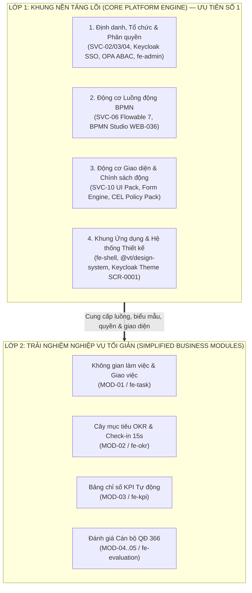

# Đề xuất Tái cấu trúc Trải nghiệm Người dùng (UX/UI), Ưu tiên Khung Nền tảng và Giải pháp Nghiệp vụ OKR/KPI Chuẩn Quốc tế kết hợp Quy định Việt Nam

> **Mã tài liệu**: `DX-UX-PLATFORM-2026`
> **Trạng thái**: Chính thức áp dụng (`YC-TK-11`, `YC-TK-12`, `YC-PT-18`)
> **Đối tượng áp dụng**: Toàn bộ phân hệ Web (`SVC-17`), Khung cấu hình (`SVC-06`, `SVC-10`), Quản trị (`SVC-02..04`), Theme Đăng nhập (`SCR-0001` / `WEB-020`) và các phân hệ nghiệp vụ (`MOD-01..06`).

---

## 1. Bối cảnh và Vấn đề hiện tại

Qua rà soát thực tế hệ thống đang chạy, trải nghiệm hiện tại bộc lộ 4 hạn chế lớn cần giải quyết triệt để:

1. **Giao diện và luồng thao tác quá phức tạp**: Người dùng bị ngợp bởi danh sách menu phẳng dài (10+ mục), nhiều trường thông tin kỹ thuật xuất hiện cùng lúc, thiếu sự phân lớp giữa **Tác nghiệp hằng ngày** (dành cho cán bộ, chuyên viên) và **Khung nền tảng & Quản trị** (dành cho quản trị viên, cán bộ tổ chức).
2. **Chưa tách bạch rõ ưu tiên phát triển Khung nền tảng (Platform Foundation)**: Để vận hành cho 6,5 triệu tài khoản thuộc nhiều loại hình cơ quan (Đảng, Chính quyền, Đoàn thể, Doanh nghiệp Nhà nước), hệ thống phải có **khung nền tảng cấu hình động** (luồng động BPMN, quản lý người dùng/tổ chức/ủy quyền, gói chính sách QĐ 366, gói giao diện SDUI/Form động) hoàn chỉnh trước khi mở rộng chi tiết từng màn hình nghiệp vụ.
3. **Giải pháp màn hình nghiệp vụ còn nặng tính nhập liệu hành chính**: Các màn hình Giao việc, OKR, KPI đang thiết kế theo kiểu biểu mẫu tĩnh truyền thống, khó dùng, chưa áp dụng các mẫu thiết kế hiện đại của thế giới để giảm tải nhập liệu và tự động hóa kế thừa dữ liệu.
4. **Hệ thống thị giác (Visual UI), CSS, Responsive và màn hình Đăng nhập (Keycloak) còn đơn điệu**: Thiếu điểm nhấn thương hiệu, độ tương phản và phân cấp thị giác (visual hierarchy) yếu, màn hình đăng nhập Keycloak đang dùng giao diện mặc định chưa được tùy biến theo chuẩn `SCR-0001`.

---

## 2. Tham chiếu Top 10 Hệ thống OKR/KPI & Quản trị Hiệu suất Hàng đầu Thế giới

Để xây dựng giải pháp vừa hiện đại, dễ dùng, vừa đáp ứng quy mô lớn, Mission chắt lọc tinh hoa từ **10 nền tảng hàng đầu thế giới**:

| STT | Nền tảng tham chiếu | Điểm mạnh cốt lõi (Best Practices) | Ứng dụng vào Hệ thống Mission |
|---|---|---|---|
| 1 | **Lattice** | Trải nghiệm đánh giá cán bộ (Performance Review) và mục tiêu gắn kết chặt chẽ trên một khung nhìn duy nhất; giao diện thẻ sạch, rõ tiến độ. | Áp dụng cho **Bàn làm việc trung tâm** và **Hồ sơ đánh giá cán bộ 360°**: gom kết quả OKR + KPI + Nhiệm vụ về một mặt phẳng tự tổng hợp điểm. |
| 2 | **15Five** | Cơ chế **Check-in nhanh hằng tuần** (15 phút khai báo, 5 phút lãnh đạo duyệt) với thanh trượt trực quan và chỉ báo cảm xúc/độ tự tin. | Áp dụng cho **Check-in OKR 15 giây**: dùng thanh trượt tiến độ + 3 trạng thái tự tin (*Đúng hướng / Có rủi ro / Chậm tiến độ*), không bắt mở biểu mẫu dài. |
| 3 | **Microsoft Viva Goals** | Sơ đồ cây liên kết mục tiêu (Alignment Tree) đa cấp rõ ràng, tự động cuộn tiến độ (Roll-up) từ cấp phòng ban lên cấp tổ chức. | Áp dụng cho **Cây mục tiêu OKR (`SCR-0201`)**: hiển thị liên kết Mục tiêu Đơn vị ↔ Mục tiêu Cá nhân dạng thẻ phân cấp thu gọn/mở rộng mượt mà. |
| 4 | **Workboard** | Bảng điều hành chiến lược (Executive Command Center) và bản đồ nhiệt (Heatmap) cho lãnh đạo cấp cao. | Áp dụng cho **Tổng quan điều hành**: thẻ KPI trọng tâm ở đầu trang (Hero Metrics) kèm cảnh báo sớm các đơn vị/nhiệm vụ quá hạn. |
| 5 | **Perdoo** | Phân biệt rạch ròi nhưng đặt cạnh nhau giữa **KPI** (duy trì vận hành chuẩn) và **OKR** (mục tiêu đột phá) trên một lộ trình chiến lược. | Giải quyết bài toán kết hợp **KPI định량** và **OKR mục tiêu** trong cùng kỳ đánh giá của cơ quan Nhà nước mà không gây nhầm lẫn khái niệm. |
| 6 | **Profit.co** | Thư viện mẫu chỉ số (KPI/OKR Library) và công thức tính điểm linh hoạt theo trọng số, ngưỡng đạt/vượt. | Áp dụng cho **Khung cấu hình Gói chính sách (`fe-config-studio`)**: cấu hình sẵn công thức quy đổi điểm và trần điểm theo QĐ 366-QĐ/TW. |
| 7 | **Betterworks** | Tự động thu thập minh chứng công việc liên tục (Continuous Performance) thay vì dồn vào cuối năm. | Áp dụng nguyên lý **Zero-Entry Evaluation**: nghiệm thu công việc hằng ngày (`MOD-01`) tự động tích lũy thành minh chứng KPI/OKR cuối kỳ (`MOD-04`). |
| 8 | **Leapsome** | Ma trận năng lực và quy trình hiệu chỉnh xếp loại (Calibration) trực quan theo tỷ lệ phân bổ. | Áp dụng cho **Hội đồng thẩm định & Xếp loại cán bộ**: kiểm soát tỷ lệ *Hoàn thành xuất sắc* theo đúng hạn mức quy định của đơn vị. |
| 9 | **Culture Amp** | Ngôn ngữ thiết kế nhân văn, hướng dẫn từng bước (Progressive Disclosure), giảm tối đa gánh nặng nhận thức. | Áp dụng cho chế độ **Đảng viên cao tuổi (`data-mode="elderly"`)** và nguyên tắc **≤ 3 chạm** cho mọi thao tác thường ngày. |
| 10 | **Linear / Asana** | Tốc độ phản hồi tức thì, lọc nhanh 1 chạm (Segmented Filter Pills), bàn phím tắt và ngăn chi tiết trượt ngang (Slide-over Drawer). | Áp dụng cho **Danh sách công việc (`SCR-0101`)**: lọc nhanh *Việc cần làm ngay / Chờ nghiệm thu / Quá hạn*, xử lý trực tiếp không cần tải lại trang. |

---

## 3. Kết hợp Tinh hoa Quốc tế với Quy định Đặc thù Việt Nam

Hệ thống phục vụ cơ quan Đảng, Nhà nước và tổ chức chính trị - xã hội nên không thể sao chép máy móc mô hình doanh nghiệp tư nhân, mà phải **ẩn sự phức tạp pháp lý vào tầng Động cơ Nền tảng (Platform Engine)** và **hiển thị sự đơn giản tối đa cho cán bộ sử dụng**:

| Quy định Việt Nam | Yêu cầu nghiệp vụ bắt buộc | Giải pháp UX/UI hiện đại trên Mission |
|---|---|---|
| **Quyết định 366-QĐ/TW** | Khung tiêu chí đánh giá theo nhóm chức danh, trần điểm từng phần, điều kiện cứng và điểm thưởng/điểm trừ. | Quản trị viên cấu hình trong **Gói chính sách (`Policy Pack`)** bằng bảng trực quan; cán bộ chỉ nhìn thấy **Thanh tiến độ điểm dự kiến** được máy chủ tự động tính sẵn. |
| **Nghị định 335/2025 & NĐ 233/2026** | Quy trình 4 mức xếp loại (*Hoàn thành xuất sắc, Hoàn thành tốt, Hoàn thành, Không hoàn thành*), tự đánh giá → cấp có thẩm quyền nhận xét → hội đồng → ký số lưu trữ. | Biểu diễn bằng **Thanh tiến trình 4 bước (Stepper)** giống Lattice; hệ thống tự động điền sẵn số liệu nhiệm vụ đã hoàn thành trong kỳ vào bản tự kiểm điểm. |
| **Ký số VGCA / Ban Cơ yếu (`SVC-09`)** | Các quyết định giao việc quan trọng và phiếu đánh giá cuối kỳ phải ký số USB Token / SIM PKI. | Tích hợp nút **Ký số 1 chạm** ngay trên ngăn phê duyệt kèm xác thực bước 2 (OTP Step-up), hỗ trợ ký lô nhiều hồ sơ cho lãnh đạo. |
| **Đa cấp đơn vị & Kiêm nhiệm (`ADR-05`)** | Một cán bộ có thể vừa giữ chức vụ chính quyền, vừa kiêm nhiệm công tác Đảng tại đơn vị khác. | Bộ chuyển ngữ cảnh **Đổi phân công (`Unit Switcher`)** ngay trên thanh Topbar; tự động đổi quyền, dữ liệu và giao diện theo vị trí đang chọn. |

---

## 4. Chiến lược Ưu tiên Phát triển: Khung Nền tảng Trước, Nghiệp vụ Sau (`YC-PT-18`)

Để hệ thống chạy bền vững và linh hoạt cho mọi đơn vị mà không phải sửa mã nguồn khi thay đổi quy chế, kiến trúc và lộ trình phát triển được chia làm **2 lớp rõ rệt**:

### 4.1. Các trụ cột của Lớp 1 — Khung Nền tảng Lõi (Tập trung hoàn thiện trước)
1. **Cổng Đăng nhập & Định danh Tập trung (`SCR-0001` / `WEB-020` / `SVC-02`)**:
   - Giao diện đăng nhập Keycloak tùy biến mang bản sắc Mission, hỗ trợ Đăng nhập SSO, VNeID Mức 2 và Xác thực bước 2 (OTP).
2. **Quản trị Tổ chức, Cán bộ, Kiêm nhiệm & Ủy quyền (`SVC-03`, `SVC-04`, `fe-admin`)**:
   - Quản lý cây đơn vị đa cấp (`unit_path`), phân công cán bộ, ủy quyền có thời hạn và kiểm soát truy cập theo ma trận OPA (`NEN-040`, `NEN-014`).
3. **Động cơ Luồng quy trình động (`SVC-06 workflow-service` & `fe-config-studio`)**:
   - Cho phép định nghĩa, chỉnh sửa và xuất bản quy trình phê duyệt (giao việc, nghiệm thu, thẩm định OKR, đánh giá cuối kỳ) bằng BPMN 2.0 mà không cần lập trình lại.
4. **Động cơ Gói chính sách & Giao diện động (`SVC-10 ui-pack-service`, `@vt/sdui`, `@vt/form-engine`, `@vt/cel`)**:
   - Quản lý biểu thức điều kiện CEL (`NEN-041`), cấu hình trọng số/trần điểm QĐ 366 và bố cục màn hình theo từng loại hình cơ quan (Tenant UI Pack).

### 4.2. Nguyên tắc thiết kế lại Lớp 2 — Các màn hình nghiệp vụ đơn giản, hiệu quả
- **Nguyên tắc 1 — Phân nhóm điều hướng 2 tầng rõ ràng**:
  - Nhóm **"Không gian làm việc"** (dành cho mọi cán bộ): *Bàn làm việc, Công việc, Mục tiêu OKR, Chỉ số KPI, Đánh giá cán bộ, Báo cáo*.
  - Nhóm **"Khung nền tảng & Quản trị"** (dành cho quản trị viên & cấu hình): *Cấu hình nghiệp vụ & Luồng động (`fe-config-studio`), Quản trị nền tảng (`fe-admin`)*.
- **Nguyên tắc 2 — Mỗi màn hình 1 mục tiêu chính (One Primary Action per Screen)**:
  - Đầu mỗi màn hình luôn có **Dải chỉ số tóm tắt (Summary Stat Strip)** giúp nắm bắt tình hình trong 3 giây (ví dụ: *Tổng số việc, Cần xử lý ngay, Chờ nghiệm thu, Tỷ lệ hoàn thành*).
  - Bảng dữ liệu sử dụng **Bộ lọc nhanh 1 chạm (Quick Filter Pills)** thay vì hộp tìm kiếm nâng cao rườm rà.
- **Nguyên tắc 3 — Tự động hóa tối đa (Zero-Entry)**:
  - Tiến độ Kết quả then chốt (KR) và Chỉ số KPI tự động cập nhật từ kết quả nghiệm thu công việc; cán bộ chỉ cần kéo thanh trượt xác nhận hoặc bổ sung nhận xét ngắn gọn.

---

## 5. Hệ thống Thị giác (Visual Design System) & Chuẩn Responsive Mới

1. **Bảng màu & Điểm nhấn thương hiệu (Brand & Semantic Palette)**:
   - **Màu chủ đạo (Primary Brand)**: Đỏ chính luận hiện đại (`#C8102E` → `#9E0B22`) kết hợp nền điều hướng tối sang trọng (`#0F172A` Slate Dark) tạo độ tương phản cao, chuyên nghiệp như Linear/Lattice.
   - **Màu ngữ nghĩa (Semantic Status)**:
     - *Hoàn thành / Đúng hướng*: Xanh lục ngọc (`#059669` / nền `#ECFDF5`).
     - *Đang thực hiện / Chờ nghiệm thu*: Xanh dương (`#2563EB` / nền `#EFF6FF`).
     - *Cảnh báo / Có rủi ro*: Vàng hổ phách (`#D97706` / nền `#FFFBEB`).
     - *Quá hạn / Không hoàn thành*: Đỏ cảnh báo (`#DC2626` / nền `#FEF2F2`).
2. **Cấu trúc Thẻ & Bề mặt (Card & Surface Hierarchy)**:
   - Nền trang xám lạnh dịu mắt (`#F1F5F9`), thẻ nội dung trắng tinh (`#FFFFFF`) có viền mảnh (`1px solid #E2E8F0`), bo góc `12px` và đổ bóng đa tầng tinh tế.
3. **Chuẩn Responsive đa thiết bị**:
   - **Desktop (`≥ 1024px`)**: Thanh bên cố định phân nhóm rõ ràng, bố cục lưới 12 cột, bảng dữ liệu đầy đủ.
   - **Tablet & Mobile (`< 1024px`)**: Thanh bên tự động thu gọn thành ngăn trượt (Off-canvas Drawer) có lớp phủ mờ, các thẻ chỉ số tự động co về 1–2 cột, nút thao tác đảm bảo vùng chạm tối thiểu `44×44px` (`48×48px` ở chế độ Đảng viên cao tuổi).
