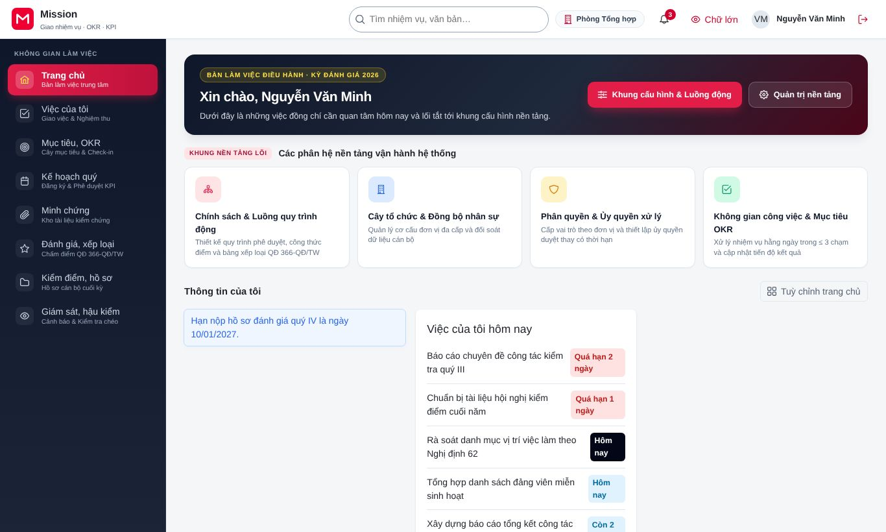
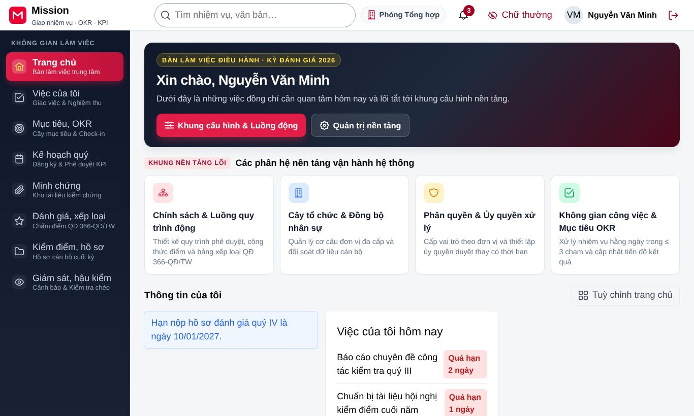

# Thao tác dùng chung cho mọi vai trò

<!-- SCR-0001 đăng nhập, chọn phân công; SCR-0002 trang chủ, đổi phân công, thông báo; NFR-11 chế độ Đảng viên cao tuổi; BR-00-02 xác thực bước lên khi ký số. -->

Phần này hướng dẫn những thao tác mà mọi người dùng đều cần biết, dù đồng chí giữ vai trò nào. Đó là đăng nhập, chọn đơn vị và vai trò làm việc, làm quen với trang chủ, xác thực nhiều lớp trước khi ký số, xem thông báo và bật chế độ dành cho Đảng viên cao tuổi.

## 1. Đăng nhập

Đồng chí mở địa chỉ hệ thống Mission mà đơn vị đã thông báo. Trình duyệt chuyển sang trang đăng nhập dùng chung của đơn vị. Tại đây, đồng chí có thể đăng nhập bằng một trong ba cách, tuỳ theo đơn vị đã bật cách nào:

- **Tài khoản cơ quan:** nhập tên đăng nhập và mật khẩu do bộ phận quản trị của đơn vị cấp.
- **Định danh điện tử VNeID:** dùng ứng dụng VNeID trên điện thoại để xác nhận.
- **Chứng thư số:** cắm thiết bị ký số hoặc dùng chữ ký số từ xa đã đăng ký.

Các vai trò được giao thao tác quan trọng (quản trị, thẩm định, quyết định, duyệt thứ hai) phải nhập thêm mã xác thực một lần hiện trên ứng dụng xác thực của điện thoại. Mã này đổi sau mỗi 30 giây, nên đồng chí nhập ngay khi mã vừa hiện. Nếu nhập sai mật khẩu nhiều lần liên tiếp, tài khoản bị khoá tạm thời để bảo vệ; khi đó đồng chí chờ ít phút rồi thử lại, hoặc liên hệ bộ phận hỗ trợ của đơn vị.

## 2. Chọn đơn vị và vai trò làm việc

Nếu đồng chí kiêm nhiệm ở nhiều đơn vị hoặc giữ nhiều chức vụ, sau khi đăng nhập hệ thống hiện hộp **Chọn phân công làm việc**. Mỗi dòng trong hộp là một phân công, gồm tên đơn vị và vai trò. Đồng chí chọn phân công phù hợp với việc định làm rồi bấm **Vào làm việc**. Những phân công có ghi chú "yêu cầu xác thực nhiều lớp" sẽ hỏi thêm mã xác thực trước khi vào.

Trong lúc làm việc, đồng chí có thể đổi sang phân công khác bằng nút tên đơn vị trên thanh trên cùng (nút **Đổi phân công**). Danh mục bên trái, trang chủ và các việc hiển thị đổi theo phân công đang chọn, vì mỗi phân công có phạm vi dữ liệu riêng.

## 3. Trang chủ "Việc của tôi hôm nay"

Trang chủ là nơi đồng chí bắt đầu mỗi ngày làm việc. Trang chủ tập hợp những việc cần làm ngay: nhiệm vụ sắp đến hạn hoặc đã chậm, kết quả then chốt cần check-in, hồ sơ chờ đồng chí duyệt và các thông báo mới. Nội dung trang chủ khác nhau theo vai trò. Ví dụ, lãnh đạo thấy hàng chờ phê duyệt, còn cán bộ thấy danh sách việc của mình.

Các thành phần chính của màn hình gồm:

- **Danh mục bên trái:** các phân hệ mà vai trò được dùng, như Việc của tôi, Mục tiêu và OKR, Kế hoạch quý, Minh chứng, Đánh giá và xếp loại. Phân hệ nào vai trò không có quyền thì không hiện.
- **Ô tìm kiếm** trên thanh trên cùng: gõ tên nhiệm vụ hoặc số hiệu văn bản để tìm nhanh.
- **Biểu tượng chuông:** số trên chuông là số thông báo chưa đọc. Bấm vào chuông để xem và đánh dấu đã đọc.
- **Nút Chữ lớn:** bật chế độ Đảng viên cao tuổi (xem mục 6).
- **Tên người dùng và nút thoát:** bấm nút thoát ở góc phải khi rời máy, nhất là khi dùng máy tính chung.

Đồng chí có thể sắp xếp lại các khối trên trang chủ bằng nút **Tuỳ chỉnh trang chủ**.

## 4. Xác thực nhiều lớp trước khi ký số

Một số thao tác có giá trị pháp lý, như ký số phiếu tự đánh giá, ký kết quả thẩm định, ký quyết định xếp loại, phê duyệt lệnh khoá kỳ. Trước các thao tác này, hệ thống hiện hộp **Xác thực nhiều lớp**. Đồng chí bấm **Xác thực**, nhập lại mật khẩu và mã xác thực một lần trong cửa sổ hiện ra. Sau khi xác thực thành công, thao tác được thực hiện tiếp mà không phải bấm lại. Lần xác thực có hiệu lực trong 15 phút, nên trong khoảng thời gian đó đồng chí không bị hỏi lại.

Khi ký số, hệ thống gửi yêu cầu tới ứng dụng ký số trên điện thoại (ví dụ MySign). Đồng chí mở ứng dụng và xác nhận. Màn hình Mission tự cập nhật khi chữ ký hoàn tất, đồng chí không cần tải lại trang.

## 5. Thông báo và thông điệp trên màn hình

Sau mỗi thao tác, hệ thống hiện một dòng thông báo ở đầu vùng nội dung, ví dụ "Đã lưu tiến độ." hoặc "Đã nộp phiếu tự đánh giá và ký số thành công". Thông báo màu đỏ cho biết thao tác chưa thực hiện được và nêu lý do, ví dụ thiếu thông tin bắt buộc hoặc dữ liệu vừa được người khác cập nhật. Khi gặp thông báo "Dữ liệu đã được người khác cập nhật", đồng chí tải lại trang để xem bản mới nhất rồi làm lại thao tác.

## 6. Chế độ Đảng viên cao tuổi

Chế độ Đảng viên cao tuổi giúp người lớn tuổi hoặc người khó nhìn chữ nhỏ dùng hệ thống dễ dàng hơn. Để bật, đồng chí bấm nút **Chữ lớn** trên thanh trên cùng. Khi đó:

- chữ và nút bấm to hơn, khoảng cách giữa các nút rộng hơn để bấm không nhầm;
- màn hình rút gọn, chỉ giữ những thông tin cần thiết nhất;
- một số bước được làm tự động, ví dụ phiếu tự đánh giá tự lưu nên không còn nút lưu nháp riêng;
- các việc thường ngày như cập nhật tiến độ hay check-in làm được trong không quá ba lần bấm.

Để trở về giao diện thường, đồng chí bấm nút **Chữ thường** ở cùng vị trí. Hệ thống ghi nhớ lựa chọn này cho lần đăng nhập sau.

## 7. Khi cần hỗ trợ

Nếu không thấy chức năng mà mình cần, trước hết đồng chí kiểm tra đã chọn đúng phân công làm việc chưa (mục 2). Nếu vẫn không thấy, có thể đồng chí chưa được cấp vai trò tương ứng; khi đó đồng chí liên hệ cán bộ quản trị hệ thống của đơn vị. Với lỗi kỹ thuật như trang không mở được hoặc ký số không thành công nhiều lần, đồng chí liên hệ bộ phận hỗ trợ của đơn vị qua đầu mối đã được thông báo. Khi báo lỗi, đồng chí nên ghi lại thời điểm, tên màn hình và nội dung thông báo hiện trên màn hình để việc kiểm tra được nhanh hơn.
