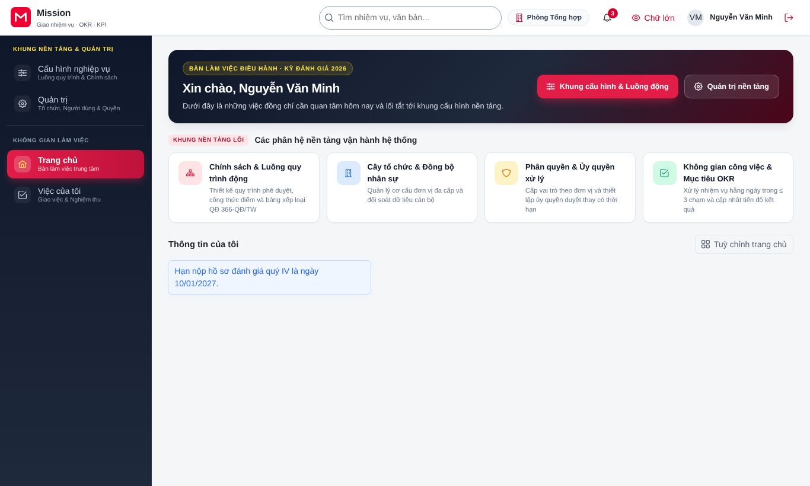
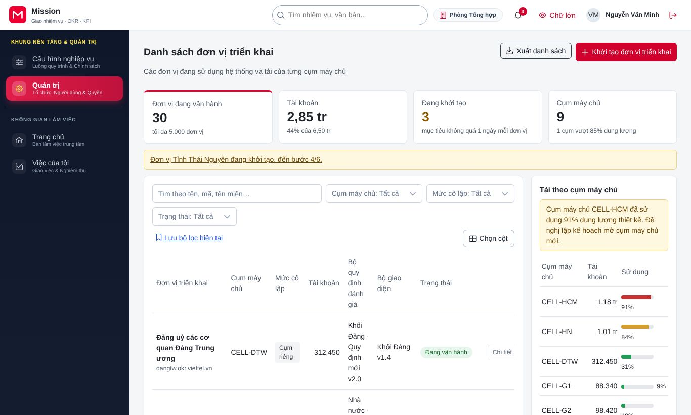
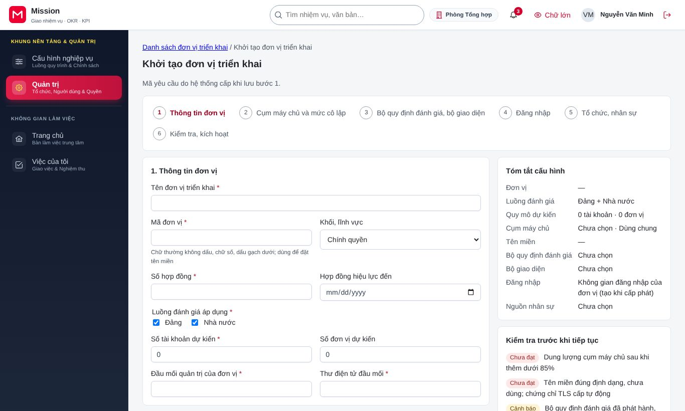
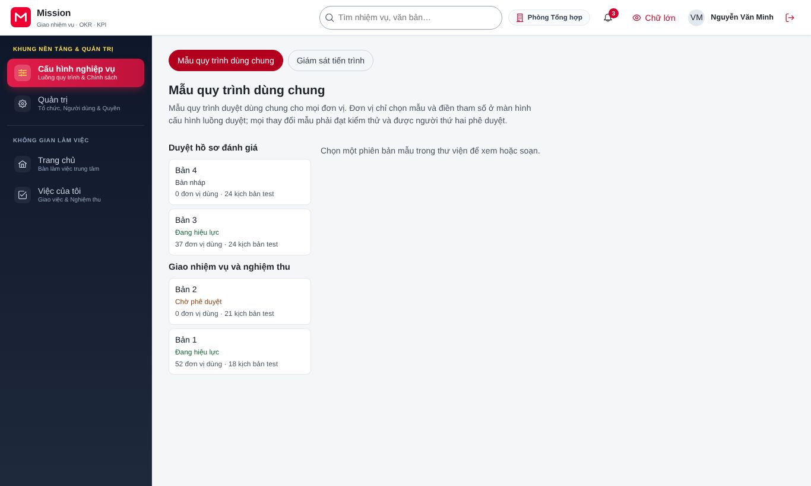
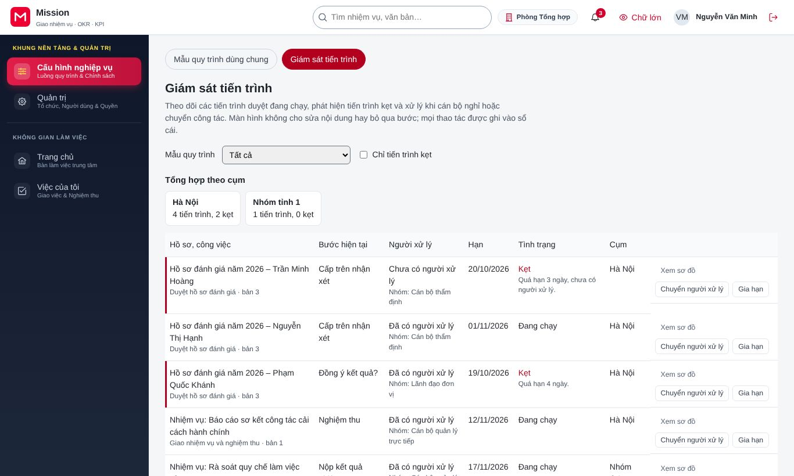

# Hướng dẫn cho quản trị nền tảng

<!-- AC-01 platform_admin · QT-01, QT-15 · SCR-0101, SCR-0102, SCR-1505, SCR-1506 · phạm vi toàn nền tảng (N). -->

Tài liệu này dành cho đội ngũ vận hành nền tảng Mission. Quản trị nền tảng không làm nghiệp vụ đánh giá của bất kỳ đơn vị nào. Công việc của vai trò gồm: khởi tạo đơn vị triển khai mới (một tỉnh, một bộ, ngành hoặc một cơ quan dùng hệ thống), theo dõi các đơn vị đang vận hành, xây dựng và phát hành mẫu quy trình dùng chung, và hỗ trợ các đơn vị khi một quy trình bị kẹt. Trước khi đọc tiếp, đồng chí nên xem phần [Thao tác dùng chung](00-thao-tac-dung-chung.md). Vai trò này luôn phải xác thực nhiều lớp khi đăng nhập.

## 1. Vai trò của đồng chí trong hệ thống

Mỗi đơn vị triển khai có dữ liệu, tài khoản và giao diện riêng, tách biệt với đơn vị khác. Quản trị nền tảng tạo ra "khung" ban đầu cho đơn vị: tên, cấp hành chính, nơi đặt dữ liệu, gói dịch vụ. Sau đó đồng chí bàn giao cho quản trị đơn vị để họ khai báo đăng nhập và nhập cơ cấu tổ chức. Đồng chí không xem được nội dung nghiệp vụ của đơn vị (nhiệm vụ, phiếu đánh giá, minh chứng); đồng chí chỉ thấy các số liệu vận hành như số người dùng, tải và trạng thái.

Ngoài ra, quản trị nền tảng giữ thư viện mẫu quy trình dùng chung, ví dụ quy trình duyệt kế hoạch hay quy trình khoá kỳ đánh giá. Các đơn vị chọn mẫu từ thư viện này và chỉ điều chỉnh tham số, nên một mẫu sai có thể ảnh hưởng nhiều đơn vị. Vì vậy mỗi lần phát hành mẫu phải qua kiểm thử và được người duyệt thứ hai đồng ý.

## 2. Việc thường ngày

### 2.1. Theo dõi danh sách đơn vị triển khai

Sau khi đăng nhập, trang chủ của đồng chí hiện tình hình chung của nền tảng.

Đồng chí vào **Quản trị**, chọn **Đơn vị triển khai** để xem danh sách. Mỗi dòng ghi tên đơn vị, cấp, trạng thái (đang khởi tạo, đang vận hành, tạm dừng), số người dùng và nơi đặt dữ liệu. Đồng chí lọc theo trạng thái hoặc theo cụm máy chủ, bấm **Lưu bộ lọc hiện tại** để dùng lại lần sau, và bấm **Xuất danh sách** để tải danh sách về máy. Tệp xuất được chuẩn bị ở chế độ nền; khi xong, hệ thống gửi thông báo kèm đường tải.

### 2.2. Khởi tạo một đơn vị triển khai mới

Đồng chí mở màn hình **Khởi tạo đơn vị triển khai** từ danh sách. Màn hình gồm sáu bước, hiện ở dải bước phía trên; khung **Tóm tắt cấu hình** bên cạnh tổng hợp những gì đã khai, và khung **Kiểm tra trước khi tiếp tục** báo các mục còn thiếu. Đồng chí bấm nút **Tiếp tục** ở cuối mỗi bước để sang bước sau.

1. **Thông tin đơn vị:** tên, mã hành chính, cấp, đầu mối liên hệ.
2. **Gói dịch vụ và quy mô:** số tài khoản dự kiến, các phân hệ được dùng.
3. **Cụm máy chủ và mức cô lập:** chọn nơi đặt dữ liệu và mức tách biệt phù hợp với mức độ bảo mật của đơn vị. Kết thúc bước này, hệ thống bắt đầu cấp phát. Việc cấp phát chạy tự động qua nhiều bước; màn hình hiện tiến độ từng bước, đồng chí không cần chờ tại chỗ.
4. **Khai báo đăng nhập:** thường do quản trị đơn vị làm. Đồng chí chỉ hỗ trợ khi đơn vị yêu cầu.
5. **Nhập tổ chức ban đầu:** cũng thường do quản trị đơn vị làm, bằng tệp Excel hoặc đồng bộ từ hệ thống nhân sự.
6. **Kích hoạt:** khi bốn bước trước đã đạt, đồng chí bấm **Kích hoạt** để đơn vị chuyển sang vận hành. Thao tác này yêu cầu xác thực nhiều lớp.

Nếu đơn vị đề nghị dừng khi còn đang khởi tạo, đồng chí bấm **Huỷ yêu cầu khởi tạo**. Hệ thống tự thu hồi các tài nguyên đã cấp phát.

### 2.3. Xây dựng và phát hành mẫu quy trình

Đồng chí vào **Cấu hình nghiệp vụ**, chọn **Mẫu quy trình**. Thư viện **Mẫu quy trình dùng chung** liệt kê từng mẫu, ví dụ duyệt hồ sơ đánh giá hay giao nhiệm vụ và nghiệm thu, với phiên bản, trạng thái, số đơn vị đang dùng và số kịch bản kiểm thử.

Trình tự xây dựng một phiên bản mẫu mới như sau:

1. Mở mẫu và soạn trên sơ đồ quy trình: thêm bước, nhánh, người xử lý và thời hạn. Hệ thống kiểm tra sơ đồ ngay khi soạn và đánh dấu chỗ chưa hợp lệ, ví dụ một nhánh không có điểm kết thúc.
2. Khai báo tham số mà đơn vị được phép điều chỉnh, ví dụ số ngày xử lý của từng bước.
3. Chạy kiểm thử bộ kịch bản kiểm thử của mẫu. Mọi kịch bản phải đạt.
4. Gửi đề nghị phát hành. Đề nghị được chuyển cho người duyệt thứ hai; đồng chí không tự phát hành mẫu do chính mình soạn.
5. Sau khi được duyệt, hệ thống triển khai mẫu lần lượt lên từng cụm máy chủ. Đồng chí theo dõi tiến độ ở cột trạng thái. Nếu một cụm gặp lỗi, hệ thống tự đưa cụm đó về phiên bản trước.

### 2.4. Hỗ trợ khi một quy trình bị kẹt

Đồng chí vào **Cấu hình nghiệp vụ**, chọn **Giám sát tiến trình**. Màn hình liệt kê các tiến trình đang chạy theo từng mẫu và đánh dấu tiến trình bị kẹt, ví dụ chờ một người đã nghỉ hưu hoặc quá hạn lâu.

Bảng **Tổng hợp theo cụm** cho biết số tiến trình đang chạy và bị kẹt ở từng cụm máy chủ. Khi bấm **Xem sơ đồ** trên một tiến trình, đồng chí xem sơ đồ với bước hiện tại được tô màu. Nếu được đơn vị đề nghị, đồng chí có thể **Chuyển người xử lý** của bước đang chờ sang người khác hoặc **Gia hạn**. Thông thường việc này do quản trị đơn vị tự làm; quản trị nền tảng chỉ can thiệp khi đơn vị không tự xử lý được, và mọi thao tác đều được ghi nhật ký.

## 3. Câu hỏi thường gặp

**Tôi có xem được phiếu đánh giá hay nhiệm vụ của một đơn vị để hỗ trợ không?** Không. Quản trị nền tảng chỉ thấy số liệu vận hành. Khi cần kiểm tra nội dung nghiệp vụ, quản trị đơn vị hoặc người có thẩm quyền của đơn vị phải thực hiện.

**Vì sao tôi không bấm được nút phát hành mẫu quy trình?** Mẫu quy trình chỉ được phát hành khi có người duyệt thứ hai đồng ý, và người duyệt không được là người soạn. Đồng chí gửi đề nghị phát hành rồi chờ người duyệt thứ hai.

**Việc khởi tạo dừng ở một bước và báo lỗi thì làm gì?** Đồng chí xem nội dung lỗi ở bước đó. Hệ thống tự thử lại các lỗi tạm thời; với lỗi không tự khắc phục được, đồng chí huỷ yêu cầu khởi tạo để hệ thống thu hồi tài nguyên, rồi khởi tạo lại sau khi đã xử lý nguyên nhân.

## 4. Liên hệ hỗ trợ

Khi cần phối hợp với một đơn vị triển khai, đồng chí liên hệ đầu mối đã khai ở bước một của màn hình khởi tạo. Sự cố vận hành nền tảng được xử lý theo quy trình trực sự cố của đội vận hành.
