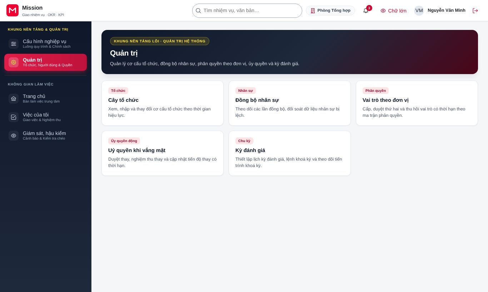
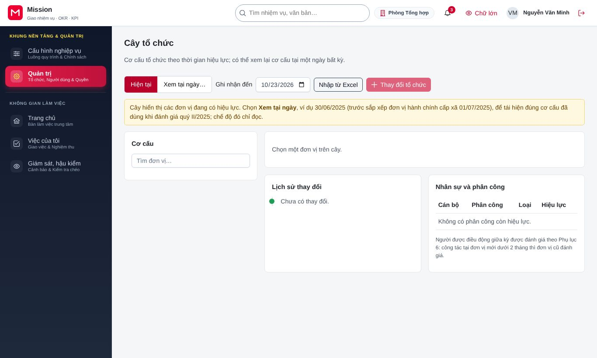
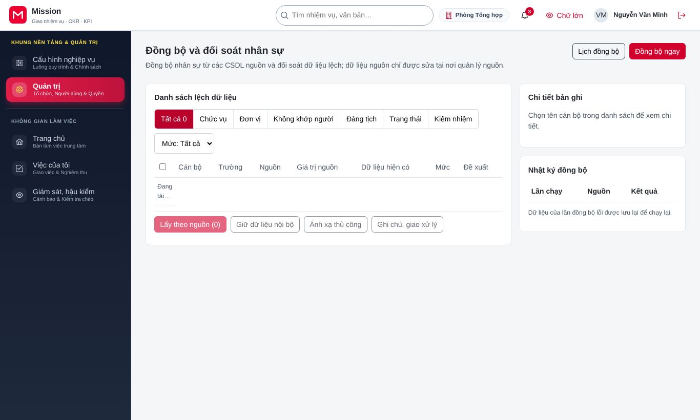
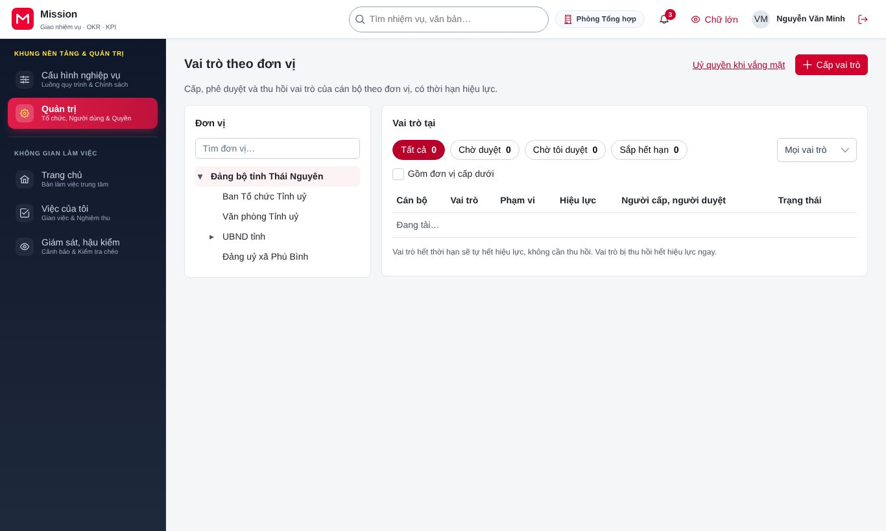
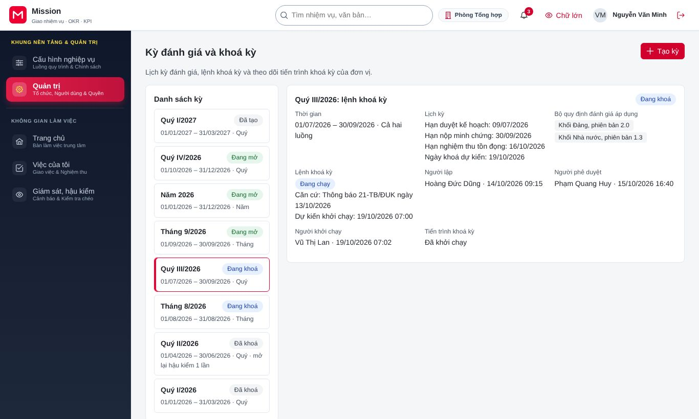
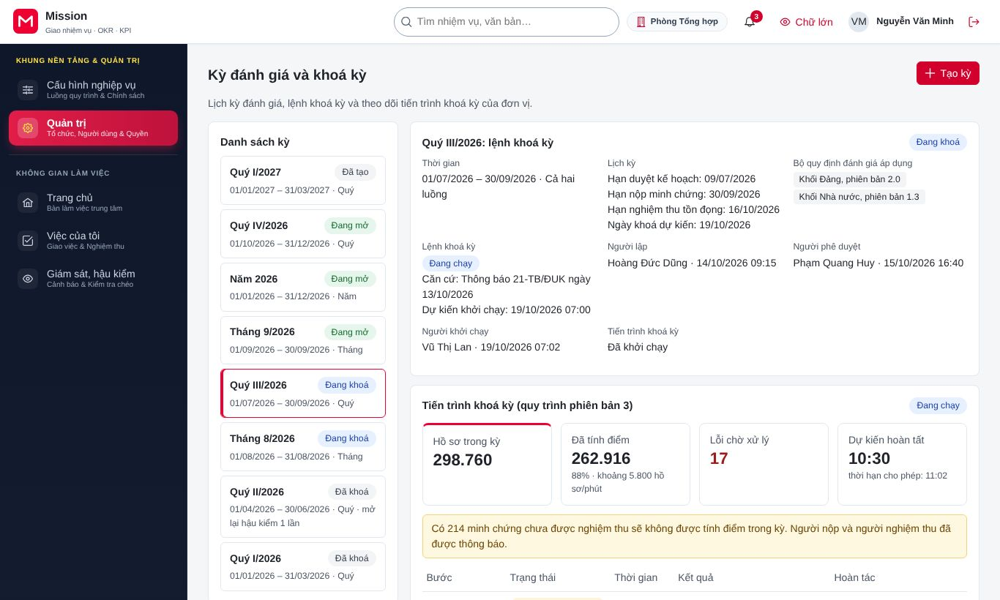
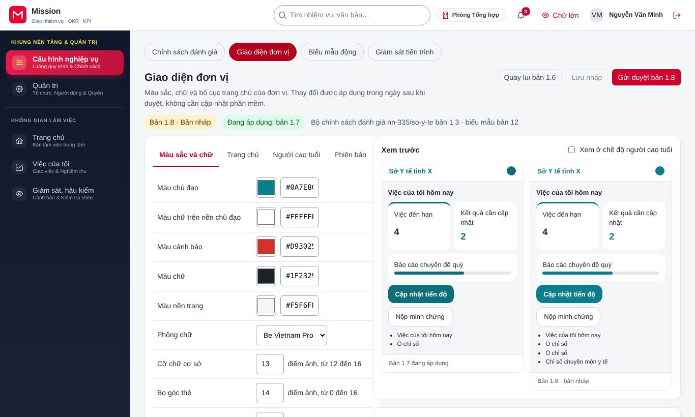
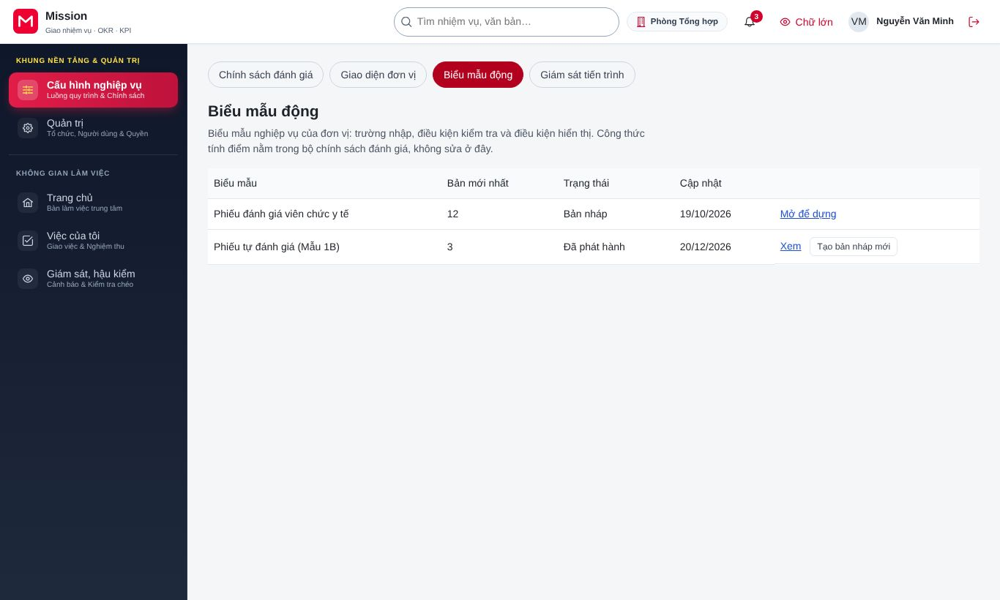

# Hướng dẫn cho quản trị đơn vị triển khai

<!-- AC-02 tenant_admin · QT-01, QT-02, QT-08, QT-15, QT-18 · SCR-0102 bước 4-5, SCR-0103..0107, SCR-0801, SCR-1506, SCR-1801, SCR-1802 · phạm vi toàn đơn vị (Tn). -->

Tài liệu này dành cho cán bộ quản trị hệ thống của một tỉnh, bộ, ngành hoặc cơ quan dùng Mission. Công việc của vai trò gồm: duy trì cơ cấu tổ chức và đồng bộ nhân sự, cấp và thu hồi vai trò, tổ chức kỳ đánh giá và khoá kỳ, xử lý quy trình bị kẹt, tuỳ chỉnh giao diện và biểu mẫu của đơn vị. Trước khi đọc tiếp, đồng chí nên xem phần [Thao tác dùng chung](00-thao-tac-dung-chung.md). Vai trò này luôn phải xác thực nhiều lớp khi đăng nhập.

## 1. Vai trò của đồng chí trong hệ thống

Quản trị đơn vị bảo đảm mọi người dùng trong đơn vị thấy đúng việc của mình: đúng đơn vị, đúng chức vụ, đúng quyền. Đồng chí không chấm điểm hay quyết định xếp loại; đồng chí chuẩn bị nền tảng để các vai trò nghiệp vụ làm việc. Một số thao tác nhạy cảm, như cấp vai trò quyết định xếp loại hoặc huỷ kỳ đang khoá, cần người thứ hai duyệt, nên đồng chí sẽ thấy các thao tác đó ở trạng thái chờ duyệt sau khi gửi.

## 2. Việc khi bắt đầu triển khai

Sau khi quản trị nền tảng tạo đơn vị, đồng chí làm hai bước bàn giao trên màn hình khởi tạo: khai báo cách đăng nhập (tài khoản cơ quan, VNeID, chứng thư số) rồi bấm **Kiểm tra kết nối**; sau đó nhập tổ chức ban đầu bằng tệp Excel hoặc kết nối hệ thống quản lý nhân sự. Khi hai bước này đạt, quản trị nền tảng kích hoạt đơn vị.

## 3. Việc thường ngày

### 3.1. Trang quản trị

Đồng chí vào **Quản trị** ở danh mục bên trái. Trang quản trị tập hợp các việc đang chờ: dòng lệch nhân sự, đề nghị cấp vai trò chờ duyệt, vai trò sắp hết hạn, tiến trình bị kẹt.

### 3.2. Cơ cấu tổ chức

Đồng chí chọn **Cây tổ chức** để xem cơ cấu đơn vị, các thẻ **Lịch sử thay đổi** và **Nhân sự và phân công**. Bấm **Xem tại ngày…** để xem cơ cấu tại một thời điểm trong quá khứ, hữu ích khi đối chiếu kết quả đánh giá của kỳ trước.

- Bấm **Nhập từ Excel** để nạp hoặc cập nhật cây theo tệp mẫu. Hệ thống kiểm tra tệp và báo dòng lỗi trước khi ghi.
- Bấm **Thay đổi tổ chức** để thành lập, sáp nhập, chia tách hoặc giải thể đơn vị. Đồng chí chọn ngày hiệu lực và căn cứ quyết định. Khi sáp nhập, nhiệm vụ và người dùng của đơn vị cũ được chuyển sang đơn vị mới theo ngày hiệu lực.

Màn hình này cũng có mục quản lý khoá phục hồi của tổ chức, dùng khi một người mất thiết bị và cần khôi phục quyền đọc nội dung mật (ví dụ khiếu nại). Mỗi lần khôi phục phải ghi biên bản và được lưu trong nhật ký khôi phục.

### 3.3. Đồng bộ nhân sự

Đồng chí chọn **Đồng bộ và đối soát nhân sự** để xem lần đồng bộ gần nhất với cơ sở dữ liệu cán bộ, công chức, viên chức và cơ sở dữ liệu đảng viên, cùng danh sách dòng lệch cần đối soát. Các thẻ phía trên chia dòng lệch theo loại: chức vụ, đơn vị, không khớp người, đảng tịch, trạng thái, kiêm nhiệm.

Đồng chí bấm **Đồng bộ ngay** khi cần cập nhật ngay, hoặc đặt **Lịch đồng bộ** định kỳ. Với mỗi dòng lệch (ví dụ chức vụ trong Mission khác hệ thống nhân sự), đồng chí chọn một trong ba cách: lấy theo nguồn, giữ thông tin nội bộ, hoặc ghép thủ công với hồ sơ đúng. Khi cần đơn vị cấp dưới kiểm tra, đồng chí giao dòng lệch cho cán bộ tổ chức của đơn vị đó.

### 3.4. Cấp và thu hồi vai trò

Đồng chí chọn **Vai trò theo đơn vị**. Các bộ lọc **Chờ tôi duyệt** và **Sắp hết hạn** giúp tìm nhanh việc cần làm.

Để cấp vai trò:

1. Bấm **Cấp vai trò**, chọn người nhận và vai trò.
2. Chọn đơn vị phạm vi (người đó được thao tác trên dữ liệu đơn vị nào) và thời hạn hiệu lực.
3. Ghi căn cứ (quyết định phân công) rồi gửi.

Vai trò quyết định xếp loại, duyệt thứ hai và quản trị nghiệp vụ cần một người khác duyệt mới có hiệu lực. Người đề nghị không tự duyệt được đề nghị của mình. Hệ thống cũng không cho một người giữ cùng lúc hai vai trò mâu thuẫn, ví dụ vừa thẩm định vừa quyết định trên cùng hồ sơ.

Để thu hồi, đồng chí bấm **Thu hồi** trên dòng vai trò và ghi lý do (bắt buộc). Bấm vào tên một người để xem hồ sơ quyền đầy đủ: vai trò hiện hành, uỷ quyền đã giao và đã nhận, lịch sử thay đổi; có thể xuất lịch sử ra tệp. Mục **Uỷ quyền** cho đồng chí xem các uỷ quyền khi vắng mặt đang hiệu lực trong đơn vị.

### 3.5. Kỳ đánh giá và khoá kỳ

Đồng chí chọn **Kỳ đánh giá** để xem danh sách kỳ và lệnh khoá kỳ.

Trình tự tổ chức một kỳ như sau:

1. Bấm **Tạo kỳ**, chọn loại kỳ (tháng, quý, năm), thời gian và lịch ngày nghỉ, ngày làm bù.
2. Đến hạn khoá, bấm **Lập lệnh khoá kỳ**. Lệnh được chuyển cho lãnh đạo phê duyệt.
3. Khi lệnh đã được phê duyệt, bấm **Khởi chạy**. Hệ thống chạy sáu bước: kiểm tra tiền điều kiện, khoá kỳ, tính điểm hàng loạt, sinh mẫu và bảng chấm điểm, ký số lô, hoàn tất.

Trong lúc chạy, đồng chí có thể bấm **Tạm dừng sau bước hiện tại**, hoặc chạy lại các hồ sơ bị lỗi. Nếu phát hiện sai sót nghiêm trọng, đồng chí bấm **Huỷ và hoàn tác toàn bộ**, ghi **Lý do huỷ** rồi bấm **Gửi đề nghị huỷ**. Đề nghị huỷ cần người duyệt thứ hai đồng ý, và chỉ huỷ được trước khi bước sinh mẫu và bảng chấm điểm hoàn tất.

### 3.6. Xử lý quy trình bị kẹt

Mục **Giám sát tiến trình** liệt kê các quy trình đang chạy trong đơn vị (duyệt kế hoạch, duyệt OKR, thẩm định…) và đánh dấu quy trình bị kẹt. Khi một cán bộ nghỉ phép dài hoặc chuyển công tác, đồng chí **Chuyển người xử lý** của bước đang chờ sang người khác, hoặc **Gia hạn** khi cần thêm thời gian.

### 3.7. Giao diện và biểu mẫu của đơn vị

Đồng chí vào **Cấu hình nghiệp vụ**, chọn **Giao diện**. Các thẻ **Màu sắc và chữ**, **Trang chủ**, **Người cao tuổi**, **Phiên bản** cho phép chỉnh màu, biểu trưng, bố cục trang chủ theo vai trò và cách hiển thị ở chế độ chữ lớn. Khung xem trước bên phải cập nhật ngay.

Sau khi chỉnh, đồng chí bấm **Lưu nháp**, rồi **Gửi duyệt**. Bản giao diện chỉ được áp dụng cho người dùng sau khi được duyệt. Nếu bản mới gây khó dùng, đồng chí bấm **Quay lui** về bản trước ở thẻ **Phiên bản**.

Mục **Biểu mẫu động** (nút **Tạo bản nháp mới**) cho phép dựng biểu mẫu nhập liệu riêng của đơn vị (ví dụ thêm trường vào phiếu đăng ký nhiệm vụ), chạy bộ kiểm thử biểu mẫu và đưa biểu mẫu vào bản giao diện nháp.

## 4. Câu hỏi thường gặp

**Tôi cấp vai trò quyết định xếp loại nhưng người nhận chưa dùng được.** Vai trò này cần người thứ hai duyệt. Đồng chí kiểm tra đề nghị ở bộ lọc trạng thái chờ duyệt và nhắc người duyệt.

**Hệ thống từ chối cấp vai trò và báo xung đột.** Người nhận đang giữ một vai trò không được kiêm cùng vai trò mới trong cùng phạm vi. Đồng chí thu hồi vai trò cũ hoặc chọn phạm vi khác.

**Kỳ đã khoá nhưng phát hiện sai, có mở lại được không?** Sau khi khoá kỳ hoàn tất, việc mở lại chỉ thực hiện qua yêu cầu mở lại kỳ của cơ quan kiểm tra hoặc cơ quan tổ chức cán bộ, có hai cấp phê duyệt. Quản trị đơn vị không tự mở lại kỳ.

## 5. Liên hệ hỗ trợ

Vướng mắc về nghiệp vụ đánh giá, đồng chí trao đổi với cơ quan tổ chức cán bộ của đơn vị. Lỗi kỹ thuật hoặc yêu cầu thay đổi gói dịch vụ, đồng chí liên hệ đội vận hành nền tảng qua đầu mối đã thống nhất khi triển khai.
