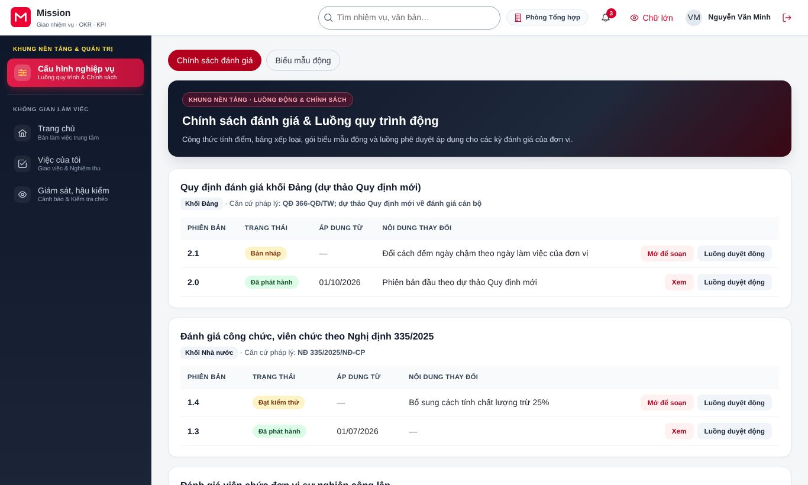
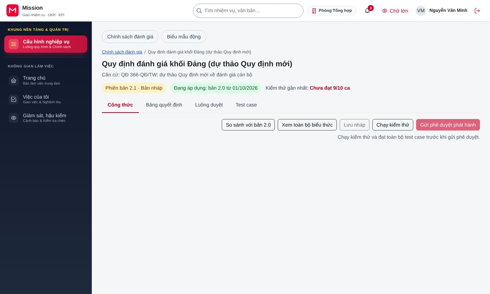
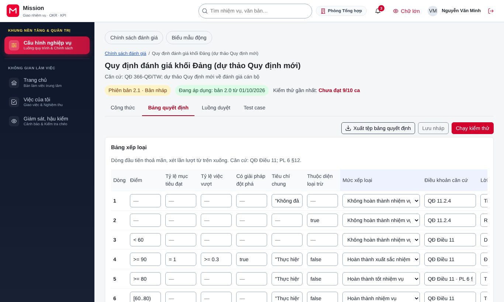
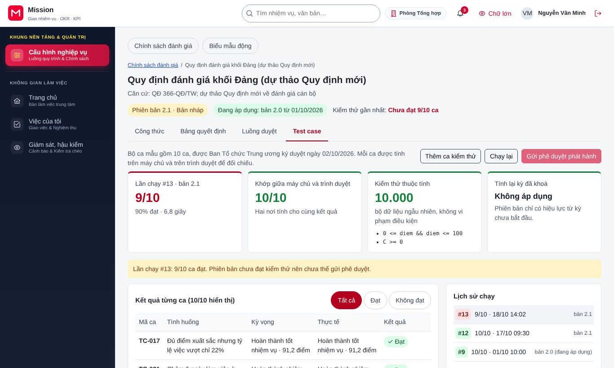
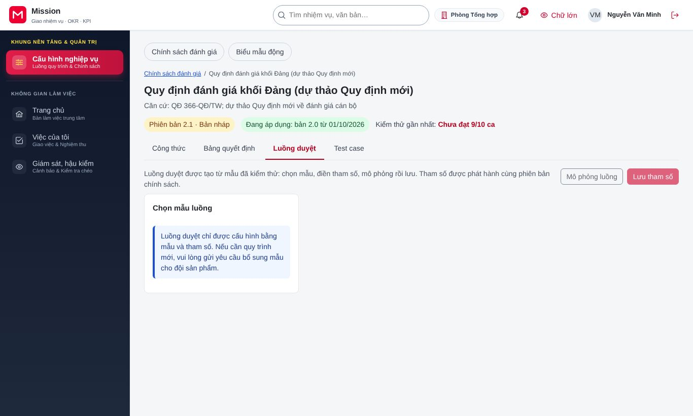
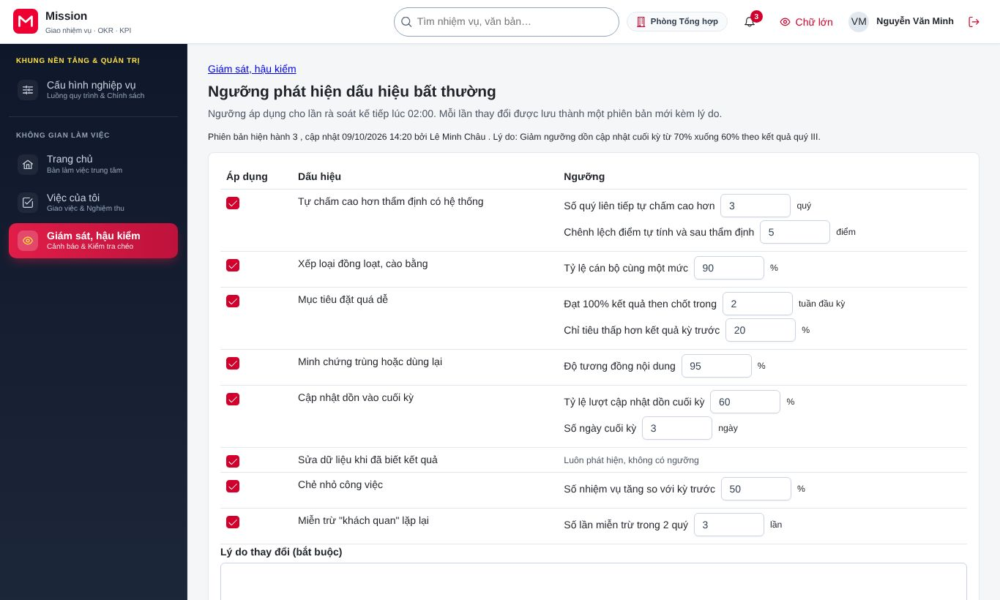
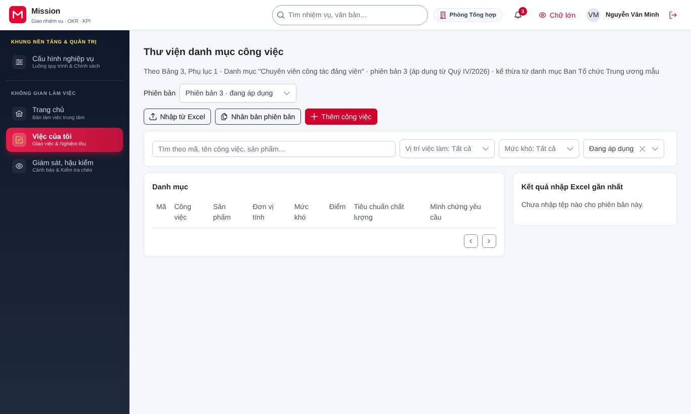

# Hướng dẫn cho quản trị nghiệp vụ

<!-- AC-03 policy_author · QT-04, QT-14, QT-15 · SCR-0401, SCR-1401 (ngưỡng), SCR-1501..1504, SCR-1802 · phạm vi toàn đơn vị (Tn). -->

Tài liệu này dành cho cán bộ cấu hình nghiệp vụ đánh giá của đơn vị, thường thuộc cơ quan tổ chức cán bộ hoặc văn phòng. Công việc của vai trò gồm: soạn công thức tính điểm và bảng xếp loại theo quy định đánh giá mà đơn vị áp dụng, kiểm thử bằng các hồ sơ mẫu, chọn luồng duyệt, đặt ngưỡng phát hiện dấu hiệu bất thường và duy trì thư viện danh mục công việc. Trước khi đọc tiếp, đồng chí nên xem phần [Thao tác dùng chung](00-thao-tac-dung-chung.md).

## 1. Vai trò của đồng chí trong hệ thống

Điểm số và mức xếp loại của từng cán bộ được hệ thống tính tự động theo một bộ chính sách đánh giá. Quản trị nghiệp vụ là người soạn bộ chính sách đó, nhưng không tự phát hành được. Mỗi phiên bản chính sách phải chạy đạt bộ ca kiểm thử, sau đó cấp có thẩm quyền xem kết quả kiểm thử và ký số phê duyệt. Cách làm này bảo đảm một thay đổi công thức không âm thầm làm sai kết quả của hàng nghìn người. Chính sách chỉ áp dụng từ kỳ ghi trên phiên bản, không tính lại các kỳ đã khoá.

## 2. Soạn và phát hành chính sách đánh giá

### 2.1. Chọn bộ chính sách

Đồng chí vào **Cấu hình nghiệp vụ**, chọn **Chính sách đánh giá**. Màn hình liệt kê các bộ chính sách của đơn vị, ví dụ quy định đánh giá khối Đảng, đánh giá công chức, viên chức theo Nghị định 335/2025, đánh giá viên chức đơn vị sự nghiệp công lập. Mỗi bộ có các phiên bản: đang áp dụng, dự thảo, đã thay thế.

Đồng chí mở phiên bản dự thảo để soạn. Phiên bản có bốn thẻ, tương ứng bốn mục dưới đây.

### 2.2. Công thức tính điểm

Thẻ công thức hiện công thức điểm của nhiệm vụ theo ba tiêu chí số lượng, chất lượng, tiến độ, các tham số (trọng số, hệ số) và cách tổng hợp điểm.

1. Sửa tham số hoặc biểu thức. Bấm **Xem toàn bộ biểu thức** khi cần xem đầy đủ.
2. Xem khung **Xem trước với hồ sơ mẫu** để thấy ngay điểm của một hồ sơ mẫu thay đổi thế nào.
3. Bấm **So sánh với bản** trước để đối chiếu thay đổi với phiên bản đang áp dụng.
4. Bấm **Lưu nháp**.

### 2.3. Bảng xếp loại

Thẻ bảng quyết định chứa các quy tắc xếp loại: **Bảng xếp loại** theo ngưỡng điểm và điều kiện, **Quy tắc mức cuối cùng**, **Quy tắc người đứng đầu** (mức của người đứng đầu gắn với kết quả của đơn vị) và **Mẫu câu giải thích** mà cán bộ sẽ đọc trong vết tính của mình.

Đồng chí bấm **Thêm dòng** để thêm quy tắc, chèn các biến như điểm, ngưỡng điểm, tỷ lệ mục tiêu đạt, có giải pháp đột phá vào mẫu câu giải thích. Bấm **Xuất tệp bảng quyết định** khi cần gửi bảng cho bộ phận pháp chế rà soát.

### 2.4. Ca kiểm thử

Thẻ ca kiểm thử chứa các hồ sơ mẫu với kết quả mong đợi (bộ ca chuẩn). Mỗi lần sửa công thức hoặc bảng xếp loại, đồng chí bấm **Chạy lại** để chạy toàn bộ ca.

Bộ lọc **Đạt** và **Không đạt** giúp tìm ca sai. Mục **Lịch sử chạy** cho biết kết quả từng lần chạy. Bấm **Thêm ca kiểm thử** khi quy định mới có trường hợp chưa có ca, ví dụ người được miễn đánh giá do nghỉ chế độ.

### 2.5. Luồng duyệt

Thẻ luồng duyệt cho phép **Chọn mẫu luồng** từ thư viện dùng chung và đặt tham số áp dụng cho khối, kể từ kỳ nào (ví dụ số ngày thẩm định). Bấm **Mô phỏng luồng** để xem hồ sơ đi qua những bước nào, rồi bấm **Lưu tham số**.

### 2.6. Gửi phê duyệt phát hành

Khi mọi ca kiểm thử đã đạt, đồng chí bấm **Gửi phê duyệt phát hành**. Cấp có thẩm quyền nhận đề nghị kèm kết quả kiểm thử và ký số. Sau khi được ký, phiên bản chuyển sang áp dụng từ kỳ đã ghi.

## 3. Ngưỡng phát hiện dấu hiệu bất thường

Hệ thống tự phát hiện các dấu hiệu bất thường, ví dụ tỷ lệ Hoàn thành xuất sắc của một đơn vị cao bất thường so với bình quân, hoặc một người nghiệm thu chấm gần như toàn bộ ở mức cao nhất. Đồng chí vào **Giám sát, hậu kiểm**, chọn **Ngưỡng phát hiện** để đặt ngưỡng.

Sau khi chỉnh, đồng chí bấm **Lưu phiên bản mới**. Nếu muốn bỏ các chỉnh sửa chưa lưu, bấm **Khôi phục giá trị đang áp dụng**. Cảnh báo được chuyển cho cơ quan kiểm tra và cơ quan tổ chức cán bộ xử lý; quản trị nghiệp vụ không xem nội dung cảnh báo.

## 4. Thư viện danh mục công việc

Danh mục công việc là các đầu việc mẫu mà người quản lý chọn khi lập kế hoạch quý, mỗi đầu việc kèm sản phẩm, tiêu chuẩn chất lượng và thời hạn chuẩn. Đồng chí vào **Việc của tôi**, chọn **Danh mục công việc**.

- Bấm **Thêm công việc** để thêm một đầu việc, hoặc **Sửa** trên một dòng.
- Bấm **Nhập từ Excel** để nạp nhiều đầu việc theo tệp mẫu; khối **Kết quả nhập Excel gần nhất** báo dòng lỗi.
- Bấm **Nhân bản phiên bản** khi bước sang năm mới hoặc quy định thay đổi. Kế hoạch đã lập vẫn giữ phiên bản danh mục cũ.

## 5. Biểu mẫu động

Khi quy định mới cần thêm trường nhập liệu, ví dụ một tiêu chí riêng trong phiếu tự đánh giá, đồng chí dựng biểu mẫu ở **Cấu hình nghiệp vụ**, mục **Biểu mẫu động**, lưu nháp và chạy bộ kiểm thử biểu mẫu. Quản trị đơn vị đưa biểu mẫu vào bản giao diện và gửi duyệt.

## 6. Câu hỏi thường gặp

**Tôi sửa công thức, vì sao điểm của kỳ đang đánh giá không đổi?** Thay đổi chỉ có hiệu lực khi phiên bản được ký phát hành, và chỉ áp dụng từ kỳ ghi trên phiên bản. Kỳ đã khoá không bị tính lại.

**Một ca kiểm thử không đạt nhưng tôi cho rằng kết quả mong đợi của ca đã cũ.** Đồng chí sửa kết quả mong đợi của ca kèm căn cứ quy định, rồi chạy lại. Người phê duyệt sẽ thấy cả thay đổi này khi xem kết quả kiểm thử.

**Tôi có tự phát hành được không khi lãnh đạo đã đồng ý miệng?** Không. Phát hành chính sách luôn cần chữ ký số của cấp có thẩm quyền trên hệ thống.

## 7. Liên hệ hỗ trợ

Vướng mắc về cách hiểu quy định, đồng chí trao đổi với cơ quan tổ chức cán bộ và bộ phận pháp chế. Lỗi kỹ thuật khi soạn hoặc chạy kiểm thử, đồng chí liên hệ quản trị đơn vị.
