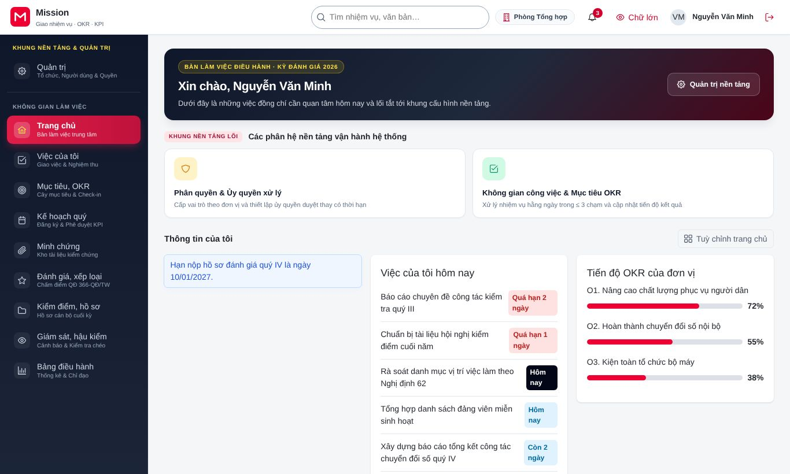
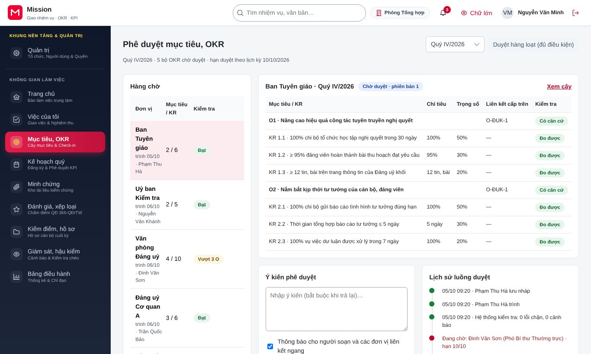
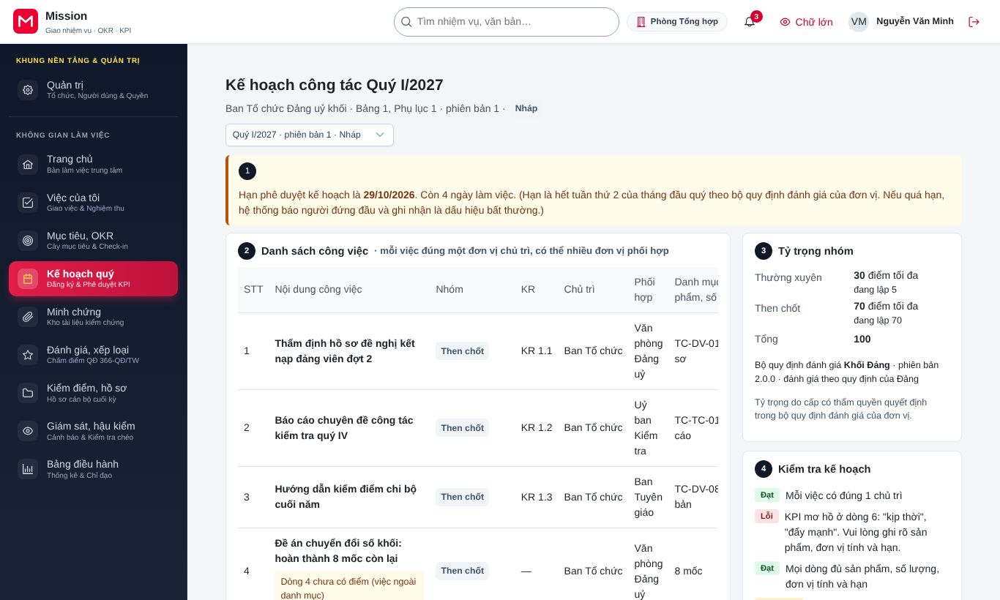
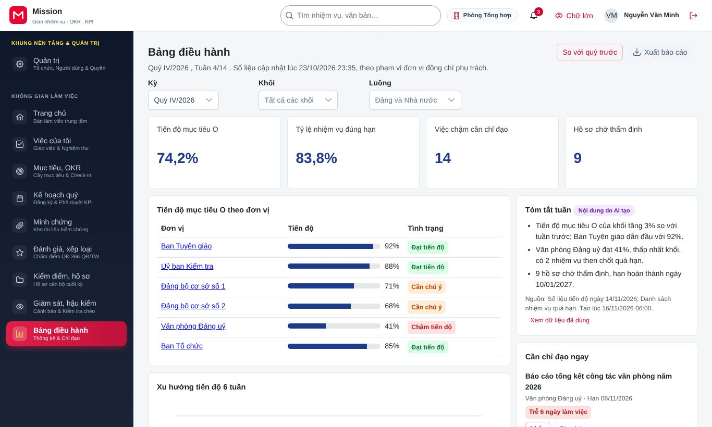
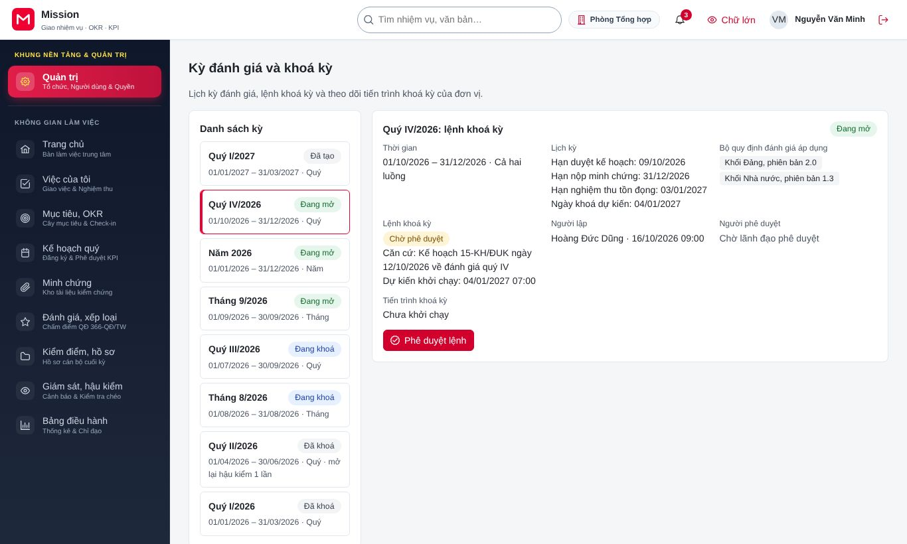
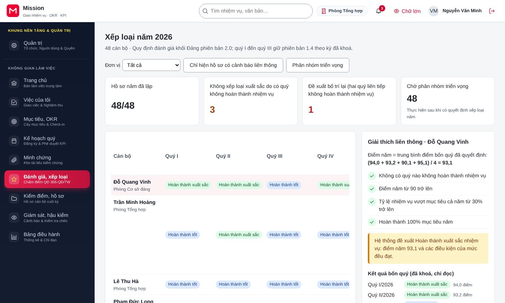
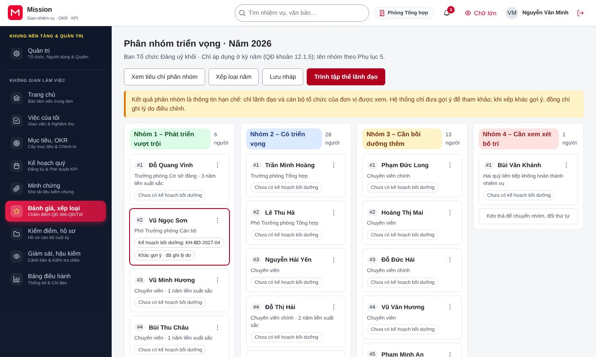
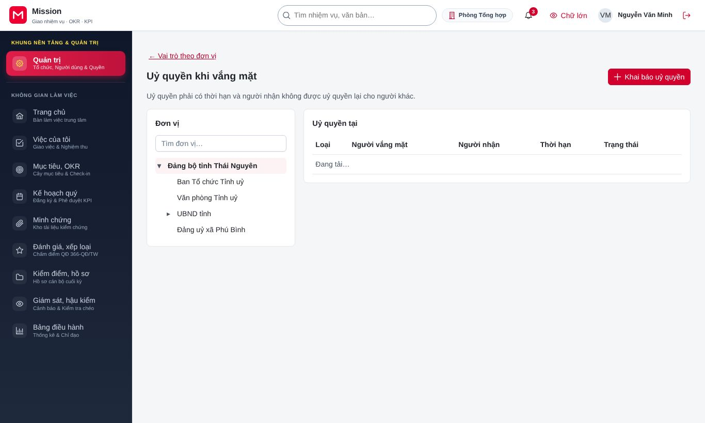

# Hướng dẫn cho lãnh đạo, người đứng đầu

<!-- AC-04 leader · QT-02, QT-03, QT-04, QT-06, QT-08, QT-10, QT-11, QT-16 · SCR-0105/0107, SCR-0201, SCR-0203, SCR-0402/0403, SCR-0601, SCR-0801 duyệt lệnh, SCR-1001, SCR-1002, SCR-1101, SCR-1601..1603. -->

Tài liệu này dành cho bí thư, thủ trưởng và lãnh đạo đơn vị. Công việc của vai trò gồm: phê duyệt mục tiêu và kết quả then chốt (OKR), duyệt và ký kế hoạch công tác quý, theo dõi điều hành qua bảng điều hành, phê duyệt lệnh khoá kỳ đánh giá, xem tổng hợp xếp loại năm, phân nhóm cán bộ triển vọng và uỷ quyền khi vắng mặt. Trước khi đọc tiếp, đồng chí nên xem phần [Thao tác dùng chung](00-thao-tac-dung-chung.md).

## 1. Vai trò của đồng chí trong hệ thống

Lãnh đạo nhìn thấy toàn bộ đơn vị mình phụ trách và các đơn vị cấp dưới. Hệ thống tập trung những việc cần lãnh đạo quyết định vào hàng chờ trên trang chủ, để đồng chí không phải tìm trong từng phân hệ. Mỗi phê duyệt có giá trị pháp lý đều được ký số. Nếu đồng chí cũng có nhiệm vụ cá nhân và phải tự đánh giá, đồng chí đọc thêm tài liệu [Cán bộ](ac-06-can-bo.md).

## 2. Việc thường ngày

### 2.1. Trang chủ của lãnh đạo

Trang chủ hiện hàng chờ phê duyệt (OKR, kế hoạch, đề nghị gia hạn), các việc chậm cần chỉ đạo và tóm tắt tiến độ mục tiêu.

### 2.2. Phê duyệt mục tiêu, OKR

Đồng chí vào **Mục tiêu, OKR**, chọn **Phê duyệt**. Bên trái là **Hàng chờ** các bộ OKR đã trình, bên phải là nội dung bộ OKR đang chọn kèm kết quả kiểm tra tự động (KR có đo được không, có liên kết lên mục tiêu cấp trên không) và **Lịch sử luồng duyệt**.

1. Đọc mục tiêu và các KR. Có thể mở cây mục tiêu ở chế độ chỉ đọc để xem bộ OKR nằm ở đâu trong mục tiêu chung.
2. Ghi **Ý kiến phê duyệt** nếu cần.
3. Bấm **Phê duyệt**, hoặc **Trả lại để sửa** kèm ý kiến.

Khi nhiều bộ OKR đã đạt mọi kiểm tra tự động, đồng chí bấm **Duyệt hàng loạt (đủ điều kiện)** để duyệt một lần. Những bộ còn cảnh báo không nằm trong lần duyệt hàng loạt và cần xem riêng.

Đồng chí cũng xem được cây mục tiêu của đơn vị ở các dạng **Cây**, **Bảng**, **Bản đồ liên kết**, lịch sử check-in của từng KR và xuất mẫu báo cáo OKR.

### 2.3. Duyệt kế hoạch công tác quý

Người quản lý trực tiếp gửi kế hoạch quý của đơn vị lên lãnh đạo. Đồng chí vào **Kế hoạch quý**.

Kế hoạch gồm danh sách công việc (mỗi việc có đúng một đơn vị chủ trì), tỷ trọng các nhóm việc và phần kiểm tra kế hoạch. Đồng chí so sánh với phiên bản trước khi kế hoạch là bản điều chỉnh, rồi trả lại kèm ý kiến hoặc duyệt và ký số kế hoạch.

### 2.4. Bảng điều hành

Đồng chí vào **Bảng điều hành** để xem tiến độ mục tiêu theo đơn vị, xu hướng sáu tuần, tóm tắt tuần và danh sách **Cần chỉ đạo ngay**.

- Bấm **So với quý trước** để so sánh.
- Với việc chậm, bấm **Nhắc** để gửi lời nhắc người chủ trì, hoặc **Giao lại** để chuyển cho người khác trong phạm vi.
- Phần tóm tắt tuần do trợ lý AI soạn. Bấm **Xem dữ liệu đã dùng** để biết tóm tắt dựa trên những số liệu nào trước khi dùng.
- Bấm **Xuất báo cáo** để tải báo cáo.

Từ một con số trên bảng, đồng chí có thể lần theo chuỗi truy vết xuống tới nhiệm vụ và minh chứng, hoặc ngược lên mục tiêu. Mỗi lần mở tệp minh chứng đều được ghi nhật ký truy cập. Đồng chí cũng có thể tự dựng bảng theo dõi riêng và chia sẻ cho cá nhân, đơn vị hoặc toàn hệ thống.

### 2.5. Duyệt đề nghị gia hạn, điều chỉnh nhiệm vụ

Khi đề nghị gia hạn hoặc điều chỉnh thuộc thẩm quyền lãnh đạo, đồng chí nhận thông báo. Trên trang chi tiết nhiệm vụ, đồng chí chọn nguyên nhân, chấp nhận hoặc từ chối đề nghị.

## 3. Việc cuối kỳ

### 3.1. Phê duyệt lệnh khoá kỳ

Đến hạn khoá kỳ, quản trị đơn vị lập lệnh khoá và chuyển lãnh đạo. Đồng chí vào **Quản trị**, chọn **Kỳ đánh giá**, mở kỳ có lệnh chờ phê duyệt.

Đồng chí kiểm tra kết quả kiểm tra tiền điều kiện (số hồ sơ còn thiếu minh chứng, số việc chưa nghiệm thu), rồi bấm **Phê duyệt lệnh** và xác thực nhiều lớp. Sau đó quản trị đơn vị khởi chạy khoá kỳ. Người lập lệnh không tự phê duyệt lệnh của mình.

### 3.2. Tổng hợp xếp loại năm

Đồng chí vào **Đánh giá, xếp loại**, chọn **Xếp loại năm**. Màn hình tổng hợp kết quả bốn quý, mức năm và giải thích.

Đánh dấu **Chỉ hiện hồ sơ có cảnh báo liên thông** để xem những người có kết quả lệch giữa các quý hoặc giữa luồng Đảng và luồng Nhà nước. Bấm **Giải thích liên thông** để đọc lý do.

### 3.3. Phân nhóm cán bộ triển vọng

Đồng chí vào **Đánh giá, xếp loại**, chọn **Phân nhóm triển vọng**. Danh sách hiện cán bộ theo từng nhóm kèm tiêu chí.

1. Kéo thả thẻ của từng người để chuyển nhóm hoặc đổi thứ tự. Nếu không dùng chuột, đồng chí bấm nút ba chấm (⋮) cạnh tên người đó rồi chọn **Đưa lên trên**, **Đưa xuống dưới** hoặc **Chuyển sang** nhóm phù hợp.
2. Ghi **Lý do điều chỉnh** (bắt buộc khi khác đề xuất ban đầu).
3. Bấm **Lưu nháp**, rồi **Trình tập thể lãnh đạo** và xác nhận **Trình**.

### 3.4. Hội nghị kiểm điểm

Khi đơn vị tổ chức hội nghị kiểm điểm, đồng chí tải dự thảo bản kiểm điểm để góp ý. Nếu chủ trì hội nghị, đồng chí bấm kết thúc hội nghị để khởi động việc ký biên bản.

## 4. Uỷ quyền khi vắng mặt

Khi đi công tác hoặc nghỉ dài ngày, đồng chí uỷ quyền để công việc không bị dừng. Đồng chí vào **Quản trị**, chọn **Uỷ quyền khi vắng mặt**, bấm **Khai báo uỷ quyền**.

Đồng chí chọn người nhận, loại uỷ quyền (duyệt thay, nghiệm thu thay, check-in kết quả then chốt thay) và thời hạn. Uỷ quyền tự hết hiệu lực khi đến hạn; đồng chí có thể thu hồi trước hạn. Uỷ quyền không chuyển được quyền quyết định xếp loại.

## 5. Câu hỏi thường gặp

**Vì sao một bộ OKR không nằm trong lần duyệt hàng loạt?** Bộ đó còn cảnh báo từ kiểm tra tự động, ví dụ KR chưa có chỉ số đo. Đồng chí mở riêng để xem và quyết định.

**Tóm tắt tuần do AI soạn có chính xác không?** Tóm tắt chỉ để tham khảo. Đồng chí bấm **Xem dữ liệu đã dùng** để đối chiếu, và mọi quyết định vẫn dựa trên số liệu gốc.

**Tôi phê duyệt nhầm lệnh khoá kỳ thì làm thế nào?** Khi khoá kỳ đang chạy, quản trị đơn vị có thể đề nghị huỷ và hoàn tác toàn bộ, cần người duyệt thứ hai đồng ý, trước khi bước sinh mẫu và bảng chấm điểm hoàn tất.

## 6. Liên hệ hỗ trợ

Vướng mắc nghiệp vụ, đồng chí trao đổi với cơ quan tổ chức cán bộ của đơn vị. Lỗi kỹ thuật, văn phòng hoặc thư ký của đồng chí liên hệ quản trị đơn vị.
