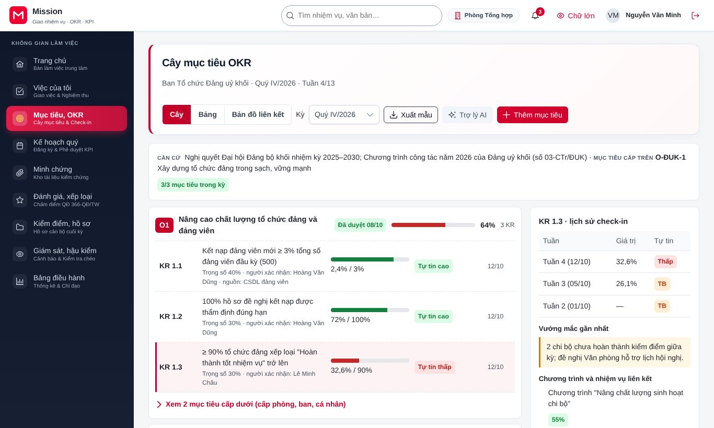
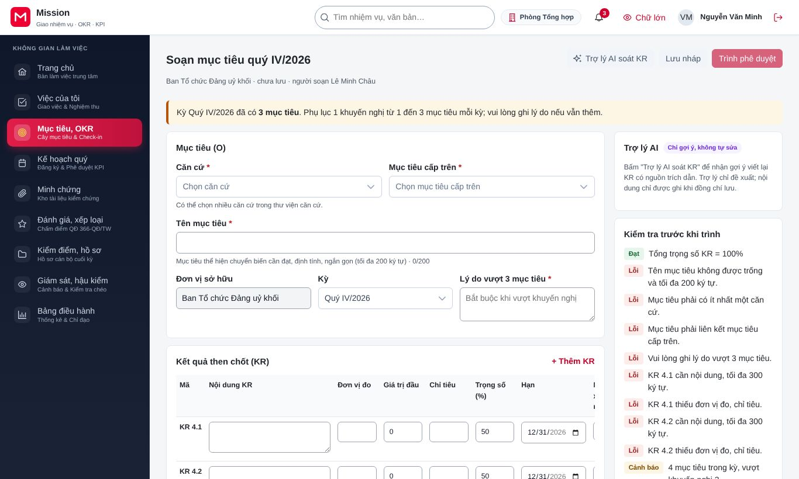
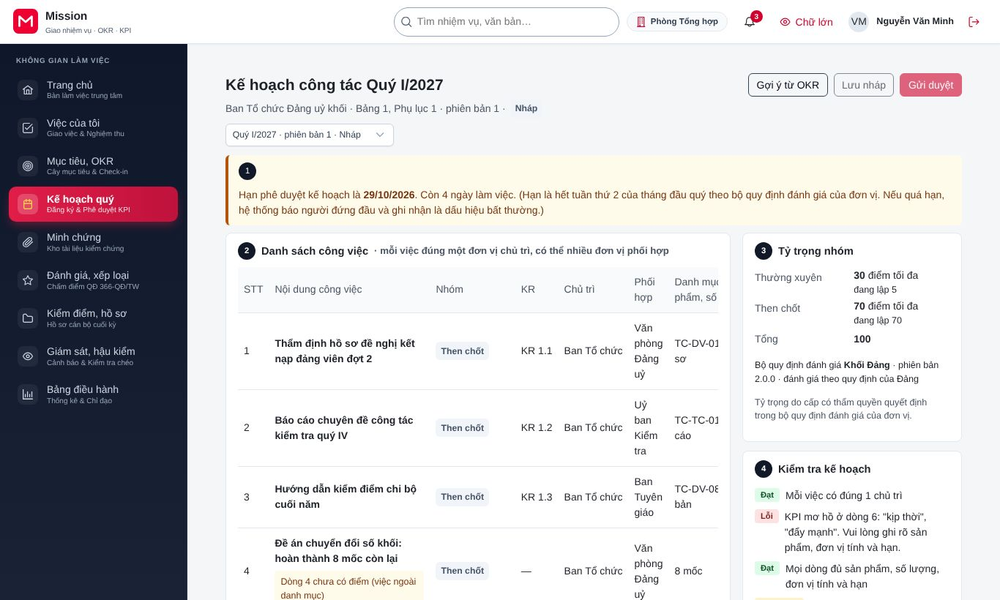
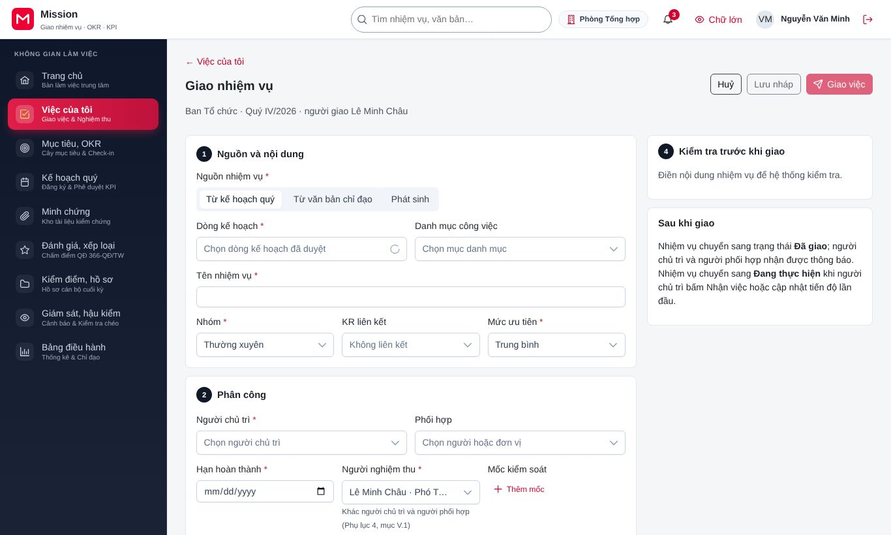
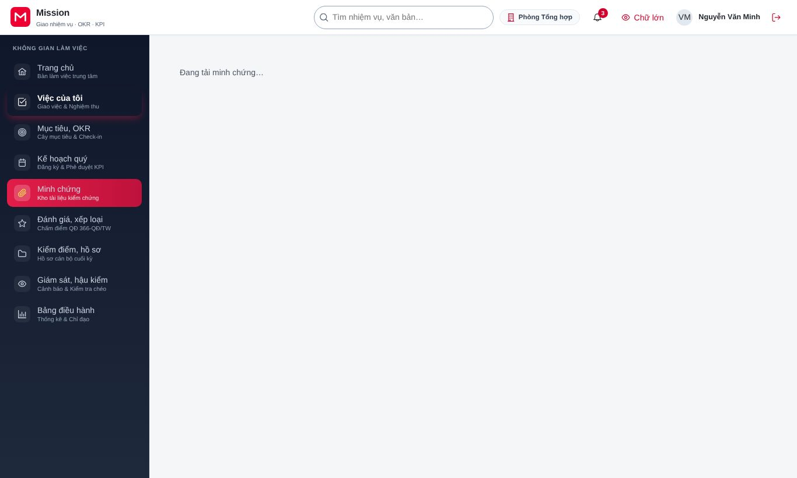
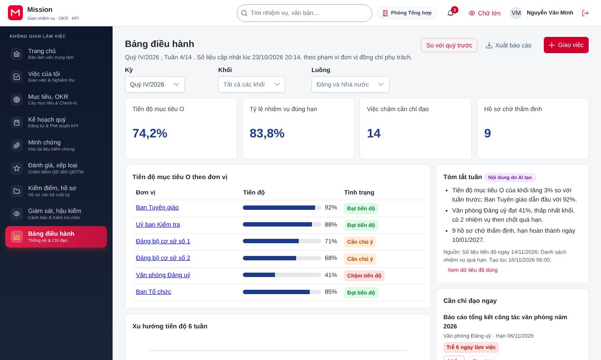
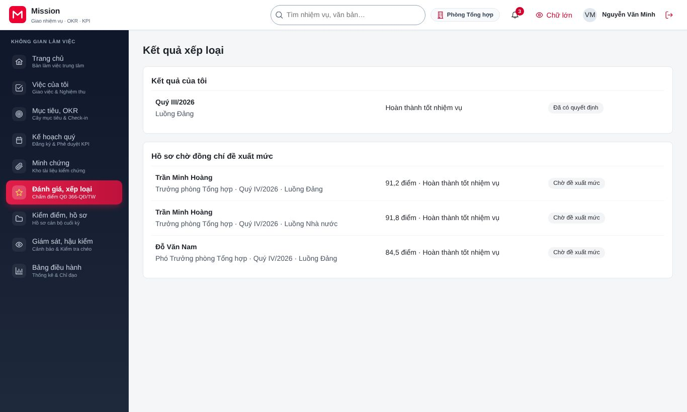

# Hướng dẫn cho cán bộ quản lý trực tiếp

<!-- AC-05 manager · QT-02, QT-03, QT-04, QT-05, QT-06, QT-07, QT-09, QT-16, QT-17 · SCR-0201..0202, SCR-0301, SCR-0401..0402, SCR-0501..0502, SCR-0601, SCR-0703, SCR-0901, SCR-0903, SCR-1601..1603, SCR-1701 · hành trình HT-09, HT-13, HT-17, HT-26. -->

Tài liệu này dành cho trưởng phòng, trưởng ban, người giao việc và nghiệm thu sản phẩm cho cán bộ trong đơn vị. Công việc của vai trò gồm: soạn mục tiêu và kết quả then chốt (OKR) của đơn vị, lập kế hoạch công tác quý, giao nhiệm vụ (kể cả nhiệm vụ trích từ văn bản chỉ đạo), xử lý điểm nghẽn và đề nghị gia hạn, nghiệm thu sản phẩm, ghi mức đề xuất xếp loại cuối kỳ và theo dõi tiến độ của đơn vị. Trước khi đọc tiếp, đồng chí nên xem phần [Thao tác dùng chung](00-thao-tac-dung-chung.md). Đồng chí cũng có nhiệm vụ cá nhân, nên đọc thêm tài liệu [Cán bộ](ac-06-can-bo.md).

## 1. Vai trò của đồng chí trong hệ thống

Người quản lý trực tiếp là mắt xích nối mục tiêu của đơn vị với việc hằng ngày của từng cán bộ. Chất lượng nghiệm thu của đồng chí quyết định trực tiếp điểm kết quả thực hiện nhiệm vụ của cán bộ, vì hệ thống tính điểm từ chính mức chất lượng đồng chí xác nhận. Đồng chí thao tác trên dữ liệu của đơn vị mình; với cán bộ ngoài đơn vị, đồng chí chỉ làm được khi được giao làm người nghiệm thu của nhiệm vụ cụ thể.

## 2. Đầu kỳ: mục tiêu và kế hoạch

### 2.1. Soạn mục tiêu, OKR của đơn vị

Đồng chí vào **Mục tiêu, OKR**. Cây mục tiêu hiện mục tiêu của cấp trên và đơn vị, có thể xem dạng **Cây**, **Bảng** hoặc **Bản đồ liên kết**.

Bấm **Thêm mục tiêu** để mở màn hình soạn.

1. Ghi mục tiêu và chọn mục tiêu cấp trên mà mục tiêu này đóng góp.
2. Bấm **+ Thêm KR** cho từng kết quả then chốt: chỉ số đo, giá trị đầu kỳ, giá trị đích, người phụ trách. Phần **Phân rã** cho phép chia đích xuống đơn vị cấp dưới, nút **Chia đều** chia nhanh theo tỷ lệ bằng nhau.
3. Bấm **Trợ lý AI soát KR** để trợ lý chỉ ra KR mơ hồ hoặc khó đo. Trợ lý chỉ gợi ý, không tự sửa; đồng chí chọn dùng hay bỏ từng gợi ý.
4. Xem khối **Kiểm tra trước khi trình**, sửa các mục còn cảnh báo.
5. Bấm **Lưu nháp**, rồi **Trình phê duyệt** để gửi lãnh đạo.

### 2.2. Lập kế hoạch công tác quý

Đồng chí vào **Kế hoạch quý**. Kế hoạch gồm danh sách công việc, tỷ trọng các nhóm việc và phần kiểm tra kế hoạch.

1. Bấm **Gợi ý từ OKR** để hệ thống đề xuất các việc cần làm cho từng KR, hoặc sao chép từ kế hoạch quý trước.
2. Bấm **Thêm từ danh mục** để chọn đầu việc mẫu kèm sản phẩm và tiêu chuẩn chất lượng, hoặc **Thêm việc ngoài danh mục** khi chưa có mẫu phù hợp.
3. Với mỗi việc, chọn đúng một đơn vị chủ trì và các đơn vị phối hợp.
4. Kiểm tra tỷ trọng nhóm và phần kiểm tra kế hoạch, rồi bấm **Lưu nháp** và **Gửi duyệt**.

Khi kế hoạch đã được duyệt mà cần thay đổi, đồng chí tạo bản điều chỉnh. Bản điều chỉnh mang số phiên bản mới và cũng phải gửi duyệt lại.

## 3. Việc thường ngày

### 3.1. Giao nhiệm vụ

Đồng chí vào **Việc của tôi**, chọn **Giao nhiệm vụ**. Màn hình gồm bốn bước.

1. **Nguồn và nội dung:** chọn nguồn **Từ kế hoạch quý**, **Từ văn bản chỉ đạo** hoặc **Phát sinh**, rồi ghi nội dung. Hệ thống cảnh báo nếu đã có nhiệm vụ gần giống, để tránh giao trùng.
2. **Phân công:** chọn người chủ trì, người phối hợp và người nghiệm thu.
3. **Sản phẩm và tiêu chuẩn:** ghi sản phẩm phải nộp, tiêu chuẩn chất lượng và hạn. Bấm **Thêm mốc** khi nhiệm vụ có nhiều mốc.
4. **Kiểm tra trước khi giao:** xem lại toàn bộ, rồi bấm **Giao việc**.

Có thể bấm **Lưu nháp** ở bất kỳ bước nào. Lãnh đạo có thẩm quyền còn có thể giao đồng loạt một nhiệm vụ cho nhiều đơn vị.

### 3.2. Văn bản đến

Văn bản chỉ đạo từ hệ thống văn phòng điện tử được chuyển vào **Việc của tôi**, mục **Văn bản đến**. Hệ thống tự trích các nhiệm vụ có trong văn bản.

Ở thẻ **Chờ xử lý**, đồng chí mở từng văn bản, sửa, gộp hoặc bỏ các nhiệm vụ được trích, xác nhận từng nhiệm vụ, rồi giao các nhiệm vụ đã xác nhận. Văn bản không phát sinh nhiệm vụ thì chọn bỏ qua; văn bản đó chuyển sang thẻ **Đã bỏ qua**.

### 3.3. Xử lý điểm nghẽn và đề nghị

Khi cán bộ báo điểm nghẽn hoặc gửi đề nghị gia hạn, điều chỉnh, đồng chí nhận thông báo. Trên trang chi tiết nhiệm vụ:

- Với điểm nghẽn: giao người xử lý, đặt hạn xử lý và đóng điểm nghẽn khi đã giải quyết.
- Với đề nghị: chọn nguyên nhân (chủ quan hay khách quan), rồi chấp nhận hoặc từ chối. Nguyên nhân được dùng khi tính điểm tiến độ, nên đồng chí chọn đúng thực tế.

### 3.4. Nghiệm thu sản phẩm

Khi cán bộ nộp sản phẩm, nhiệm vụ hiện trong hàng chờ nghiệm thu của đồng chí. Màn hình nghiệm thu gồm bốn phần đánh số.

1. **Minh chứng:** bấm **Mở tệp** để xem. Hệ thống kiểm tra tệp không bị sửa đổi sau khi nộp. Mỗi lần mở được ghi nhật ký truy cập.
2. **Đối chiếu tiêu chuẩn chất lượng:** đánh giá sản phẩm theo từng tiêu chuẩn đã ghi khi giao việc.
3. **Mức chất lượng:** chọn một trong năm mức.
4. **Xem trước điểm:** hệ thống tính thử điểm của nhiệm vụ theo mức đồng chí chọn.

Sau đó đồng chí bấm **Xác nhận nghiệm thu**, hoặc **Yêu cầu bổ sung** kèm nội dung cần bổ sung, hoặc **Từ chối** khi sản phẩm không đạt. Lưu ý minh chứng chưa được nghiệm thu trước khi khoá kỳ không được tính điểm trong kỳ đó, nên đồng chí xử lý hàng chờ đều đặn.

### 3.5. Check-in kết quả then chốt của đơn vị

Đồng chí check-in các KR mình phụ trách giống như cán bộ (xem tài liệu [Cán bộ](ac-06-can-bo.md), mục check-in), ngay từ cây mục tiêu bằng nút **Check-in KR**. Đồng chí cũng xem được lịch sử check-in của các KR trong đơn vị.

### 3.6. Bảng điều hành của đơn vị

Mục **Bảng điều hành** cho thấy tiến độ mục tiêu, xu hướng và danh sách việc cần chỉ đạo của đơn vị. Đồng chí bấm **Nhắc** để nhắc người chủ trì việc chậm, **Giao lại** để chuyển nhiệm vụ cho người khác, **Xem dữ liệu đã dùng** để kiểm tra phần tóm tắt do AI soạn, và **Xuất báo cáo** để tải báo cáo.

## 4. Việc cuối kỳ

### 4.1. Xem kết quả và ghi mức đề xuất

Sau khi cán bộ nộp phiếu tự đánh giá, đồng chí vào **Đánh giá, xếp loại**, chọn **Kết quả xếp loại** để xem phiếu của từng người trong đơn vị: điểm hệ thống tính, vết tính, mức tự đề xuất.

Trên phiếu xếp loại của từng người, đồng chí chọn **Mức đề xuất** và bấm **Ghi mức đề xuất**. Mức đề xuất của người quản lý trực tiếp là một căn cứ để cơ quan tổ chức cán bộ thẩm định và cấp có thẩm quyền quyết định.

### 4.2. Hội nghị kiểm điểm và giải trình

Khi đơn vị tổ chức hội nghị kiểm điểm, đồng chí tải dự thảo bản kiểm điểm của cán bộ để góp ý. Khi có khiếu nại liên quan đến nghiệm thu của mình, đồng chí có thể được yêu cầu giải trình và gửi giải trình trên màn hình xử lý khiếu nại.

## 5. Câu hỏi thường gặp

**Tôi chọn sai mức chất lượng khi nghiệm thu thì sửa thế nào?** Sau khi xác nhận, mức chất lượng không tự sửa được, vì đã là căn cứ tính điểm. Nếu trước khoá kỳ, đồng chí liên hệ quản trị đơn vị để được hướng dẫn; sau khoá kỳ, việc điều chỉnh chỉ thực hiện qua khiếu nại hoặc yêu cầu mở lại kỳ.

**Vì sao tôi không chọn được một cán bộ của phòng khác làm người chủ trì?** Đồng chí chỉ giao việc trong phạm vi đơn vị mình. Với việc cần phòng khác chủ trì, đồng chí đưa phòng đó vào làm đơn vị phối hợp hoặc đề nghị lãnh đạo giao.

**Hệ thống cảnh báo nhiệm vụ gần giống, tôi có phải bỏ không?** Không bắt buộc. Cảnh báo giúp tránh giao trùng; nếu đó là nhiệm vụ khác thật, đồng chí tiếp tục giao.

## 6. Liên hệ hỗ trợ

Vướng mắc nghiệp vụ, đồng chí trao đổi với lãnh đạo đơn vị hoặc cơ quan tổ chức cán bộ. Lỗi kỹ thuật, đồng chí liên hệ quản trị đơn vị qua đầu mối đã được thông báo.
