# Hướng dẫn cho cán bộ, công chức, viên chức, đảng viên

<!-- AC-06 member · QT-05, QT-06, QT-03, QT-07, QT-09, QT-12 · SCR-0002, SCR-0503, SCR-0601, SCR-0602, SCR-0301, SCR-0202, SCR-0701, SCR-0901, SCR-0903, SCR-1201, SCR-1101 · hành trình HT-01, HT-09, HT-17, HT-25, HT-27. -->

Tài liệu này dành cho mọi cán bộ, công chức, viên chức và đảng viên có nhiệm vụ được giao trên hệ thống Mission. Đây là vai trò đông người dùng nhất. Công việc của vai trò gồm: nhận và cập nhật tiến độ nhiệm vụ, check-in kết quả then chốt, nộp sản phẩm và minh chứng để được nghiệm thu, tự đánh giá cuối kỳ, xem kết quả xếp loại và gửi khiếu nại khi chưa đồng ý với kết quả. Trước khi đọc tiếp, đồng chí nên xem phần [Thao tác dùng chung](00-thao-tac-dung-chung.md) để biết cách đăng nhập và bật chế độ chữ lớn.

## 1. Vai trò của đồng chí trong hệ thống

Mỗi nhiệm vụ đồng chí được giao đều gắn với kế hoạch công tác quý của đơn vị hoặc với một kết quả then chốt (KR) trong bộ mục tiêu. Khi đồng chí cập nhật tiến độ và nộp sản phẩm, người quản lý trực tiếp nghiệm thu chất lượng. Đến cuối kỳ, hệ thống tự tính điểm kết quả thực hiện nhiệm vụ từ chính những sản phẩm đã được nghiệm thu. Vì vậy, cập nhật đều đặn và nộp minh chứng đúng hạn là cách tốt nhất để kết quả đánh giá phản ánh đúng công sức của đồng chí. Đồng chí chỉ xem và sửa được dữ liệu của chính mình; kế hoạch và mục tiêu của đơn vị thì đồng chí được xem để biết việc của mình đóng góp vào đâu.

## 2. Việc thường ngày

### 2.1. Xem việc của tôi

Đồng chí bấm **Việc của tôi** ở danh mục bên trái, hoặc bấm **Xem tất cả việc của tôi** trên trang chủ. Màn hình liệt kê mọi nhiệm vụ đồng chí chủ trì hoặc phối hợp.

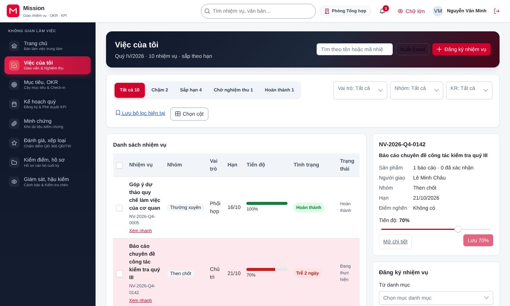

Các nút lọc phía trên danh sách giúp đồng chí tìm nhanh việc cần làm trước: **Chậm** là việc đã quá hạn, **Sắp hạn** là việc sắp đến hạn, **Chờ nghiệm thu** là việc đã nộp sản phẩm và đang chờ người quản lý xác nhận. Đồng chí có thể gõ tên nhiệm vụ vào ô tìm kiếm, bấm **Xem nhanh** để xem tóm tắt một việc mà không rời danh sách, hoặc bấm **Xuất Excel** để tải danh sách về máy.

Khi được giao việc mới, nhiệm vụ hiện với nút **Nhận việc**. Đồng chí bấm nút này để xác nhận đã nhận; nhiệm vụ chuyển sang trạng thái đang thực hiện. Nếu đồng chí muốn đề xuất một việc chưa có trong kế hoạch, bấm **Đăng ký nhiệm vụ**, điền nội dung rồi bấm **Gửi đăng ký** để người quản lý xem xét.

### 2.2. Cập nhật tiến độ

Đồng chí bấm vào tên nhiệm vụ để mở trang chi tiết. Trang chi tiết có các thẻ Tổng quan, Tiến độ, Điểm nghẽn, Sản phẩm và minh chứng, Đề nghị, Lịch sử, cùng các nút thao tác ở phía trên.

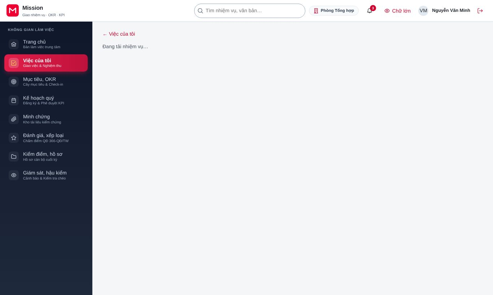

Để cập nhật tiến độ, đồng chí làm theo các bước sau:

1. Bấm **Cập nhật tiến độ**. Hộp cập nhật hiện ra, cho biết phần trăm lần trước.
2. Kéo thanh **Tiến độ** tới phần trăm hiện tại. Có thể dùng phím mũi tên trái, phải để chỉnh từng nấc.
3. Ghi ngắn gọn **Kết quả đã làm** kể từ lần cập nhật trước.
4. Bấm nút **Lưu** (nút hiện kèm phần trăm mới, ví dụ "Lưu 70%"). Thông báo "Đã lưu tiến độ." xác nhận việc cập nhật thành công.

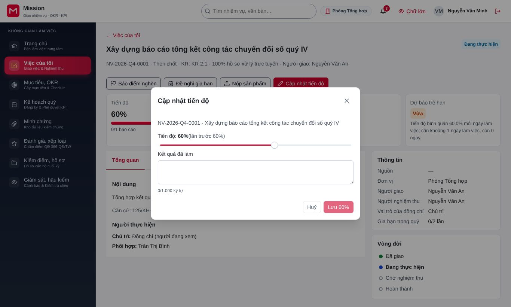

Nếu có nhiều việc cần cập nhật cùng lúc, đồng chí dùng nút **Cập nhật tiến độ hàng loạt** trên màn hình Việc của tôi, nhập phần trăm cho từng việc rồi lưu một lần. Trang chủ cũng có lối cập nhật nhanh cho các việc sắp đến hạn.

### 2.3. Báo điểm nghẽn và đề nghị gia hạn

Khi gặp vướng mắc vượt quá khả năng tự giải quyết, đồng chí bấm **Báo điểm nghẽn** trên trang chi tiết, mô tả vướng mắc và người cần hỗ trợ. Người quản lý nhận được thông báo để xử lý.

Khi không thể hoàn thành đúng hạn hoặc cần điều chỉnh nội dung, đồng chí bấm **Đề nghị gia hạn**. Trong hộp đề nghị, đồng chí chọn loại đề nghị (gia hạn, điều chỉnh, tạm dừng hoặc huỷ), nêu lý do, đính kèm tài liệu nếu có. Hệ thống cho xem trước hệ quả của đề nghị, ví dụ hạn mới ảnh hưởng thế nào đến tiến độ chung, trước khi đồng chí gửi. Khi đề nghị còn chờ duyệt, đồng chí có thể rút lại ở thẻ **Đề nghị**. Mỗi nhiệm vụ chỉ được gia hạn một số lần nhất định trong quý; số lần còn lại hiện ở khối Thông tin của trang chi tiết.

### 2.4. Check-in kết quả then chốt

Nếu đồng chí phụ trách một kết quả then chốt (KR), đồng chí cần check-in định kỳ để cập nhật số liệu. Đồng chí vào **Mục tiêu, OKR**, chọn **Check-in**, hoặc bấm vào thông báo nhắc check-in trên trang chủ.

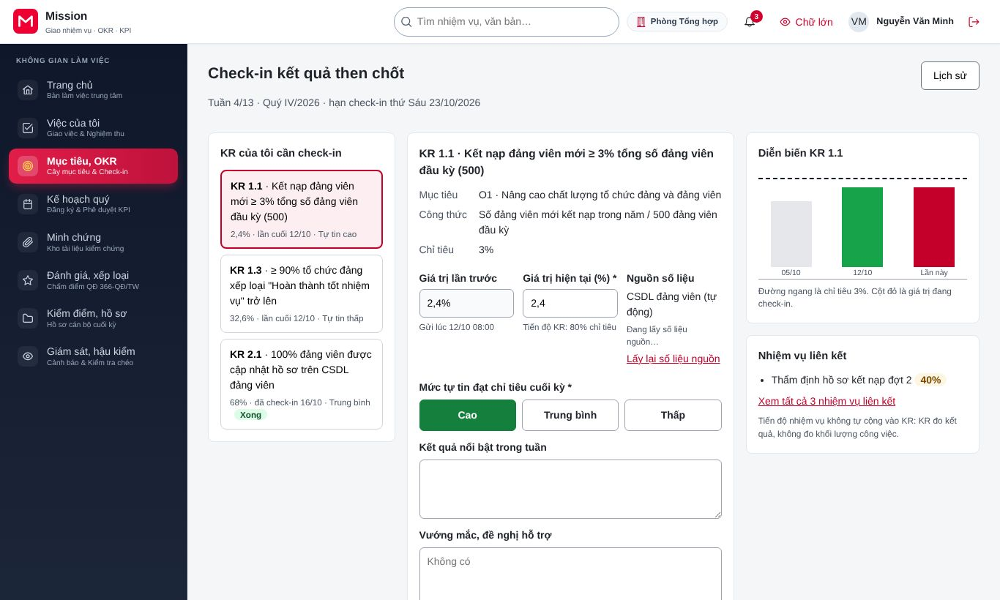

Các bước check-in như sau:

1. Chọn KR trong danh sách **KR của tôi cần check-in**.
2. Nhập giá trị đạt được. Với KR lấy số liệu từ hệ thống khác, bấm **Lấy lại số liệu nguồn** để điền tự động. Nếu đồng chí nhập con số khác số liệu nguồn, hệ thống yêu cầu ghi lý do.
3. Chọn mức tự tin hoàn thành KR và ghi nhận xét ngắn.
4. Bấm **Gửi check-in**. Nếu giá trị mới chênh lệch lớn so với lần trước, hệ thống hỏi lại để tránh nhập nhầm; đồng chí kiểm tra rồi bấm **Vẫn gửi** nếu số liệu đúng.

Đồng chí có thể bấm **Lưu nháp** để lưu lại và gửi sau, hoặc bấm **Lịch sử** để xem các lần check-in trước.

### 2.5. Soạn mục tiêu cá nhân

Đầu kỳ, nếu đơn vị yêu cầu, đồng chí soạn mục tiêu và kết quả then chốt cá nhân trong phân hệ **Mục tiêu, OKR**. Trợ lý AI ở mục **Trợ lý AI** có thể gợi ý cách viết KR rõ ràng, đo được; trợ lý chỉ gợi ý, đồng chí quyết định dùng hay bỏ từng gợi ý. Soạn xong, đồng chí bấm **Trình phê duyệt** để gửi lãnh đạo duyệt.

### 2.6. Nộp sản phẩm và minh chứng

Khi hoàn thành nhiệm vụ hoặc một mốc của nhiệm vụ, đồng chí bấm **Nộp sản phẩm** trên trang chi tiết. Màn hình nộp minh chứng gồm các bước đánh số.

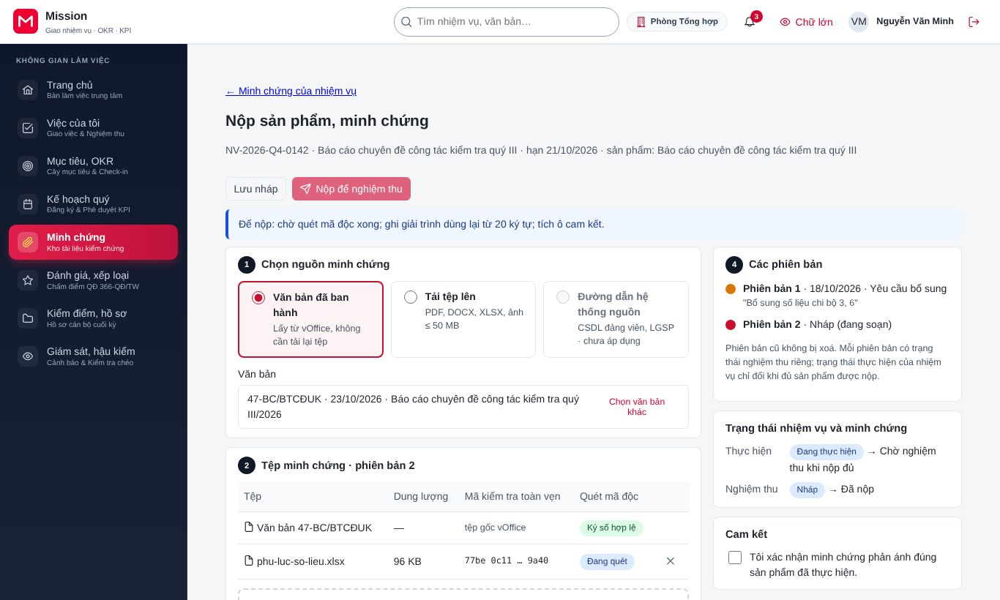

1. **Chọn nguồn minh chứng:** tải tệp từ máy hoặc chọn văn bản đã có trên hệ thống văn phòng điện tử.
2. **Tệp minh chứng:** kiểm tra tệp đã tải đủ. Tệp lớn được tải theo từng phần; nếu mạng chập chờn, hệ thống tự gửi lại phần còn thiếu.
3. Đánh dấu ô **Cam kết** xác nhận minh chứng là trung thực.
4. Bấm **Nộp để nghiệm thu**. Nhiệm vụ chuyển sang chờ nghiệm thu.

Nếu chưa xong, đồng chí bấm **Lưu nháp** để lưu lại. Khi người nghiệm thu yêu cầu bổ sung, đồng chí nhận thông báo, mở lại màn hình này, tải phiên bản mới và nộp lại; các phiên bản trước vẫn được lưu ở mục **Các phiên bản**.

## 3. Việc cuối kỳ

### 3.1. Tự đánh giá

Khi kỳ đánh giá được khoá, hệ thống tạo phiếu tự đánh giá cho từng người và gửi thông báo. Đồng chí vào **Đánh giá, xếp loại**, màn hình mở thẳng **Phiếu tự đánh giá** của kỳ hiện tại. Đầu phiếu ghi hạn nộp và số ngày làm việc còn lại.

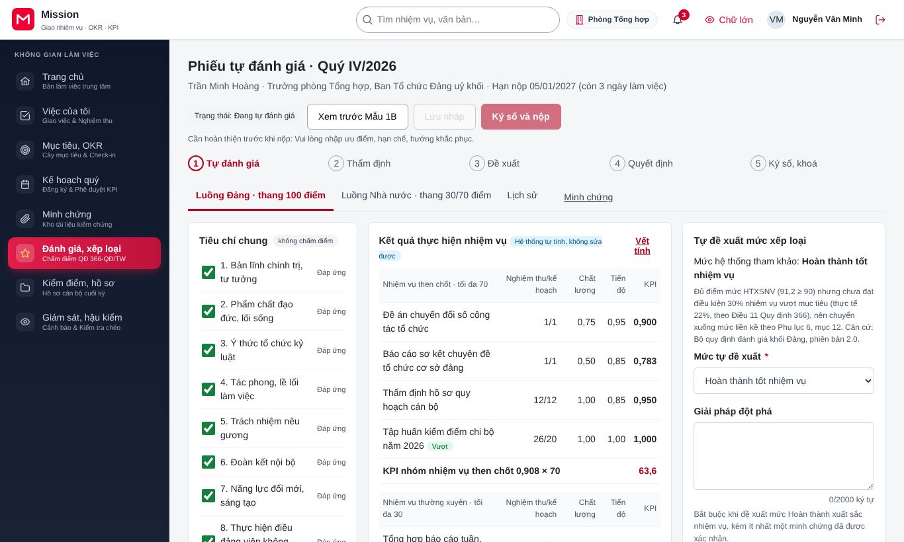

Phiếu gồm các phần sau, đồng chí điền lần lượt từ trên xuống:

1. **Tiêu chí chung không chấm điểm:** đánh dấu các tiêu chí đồng chí đáp ứng. Hệ thống tự quy đổi tỷ lệ đáp ứng ra mức tiêu chí chung.
2. **Kết quả thực hiện nhiệm vụ:** phần này do hệ thống tự tính từ các nhiệm vụ đã được nghiệm thu, đồng chí không sửa được. Bấm **Vết tính** để xem cách tính từng con số.
3. **Tự đề xuất mức xếp loại:** chọn mức trong ô **Mức tự đề xuất**. Hệ thống hiện mức tham khảo kèm giải thích. Nếu đồng chí chọn mức khác mức tham khảo, phải ghi **Giải trình khi khác mức tham khảo**. Nếu đề xuất mức Hoàn thành xuất sắc nhiệm vụ, phải mô tả **Giải pháp đột phá** và gắn ít nhất một minh chứng đã được xác nhận.
4. **Ưu điểm, hạn chế, hướng khắc phục:** phần bắt buộc, đồng chí tự nhận xét ngắn gọn.

Đồng chí có thể bấm **Xem trước Mẫu 1B** để xem phiếu theo mẫu in, và chuyển giữa thẻ luồng Đảng và luồng Nhà nước nếu đồng chí được đánh giá theo cả hai luồng. Phiếu tự lưu nháp sau mỗi 30 giây; đồng chí cũng có thể bấm **Lưu nháp** bất cứ lúc nào.

Khi đã điền đủ, đồng chí bấm **Ký số và nộp**, xác thực nhiều lớp và xác nhận chữ ký trên ứng dụng ký số. Thông báo "Đã nộp phiếu tự đánh giá và ký số thành công" xác nhận phiếu đã chuyển sang bước thẩm định.

Nếu cơ quan tổ chức cán bộ trả lại phiếu để bổ sung, đồng chí nhận thông báo kèm lý do. Đồng chí mở lại phiếu, sửa theo yêu cầu, rồi bấm **Ký số và nộp** lần nữa.

### 3.2. Xem kết quả xếp loại

Sau khi cấp có thẩm quyền quyết định, đồng chí nhận thông báo. Đồng chí vào **Đánh giá, xếp loại**, chọn **Kết quả xếp loại**, rồi bấm vào kỳ có ghi "Đã có quyết định".

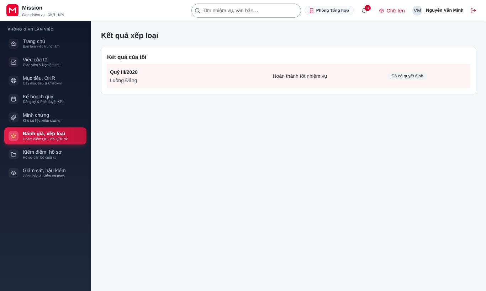

Phiếu xếp loại cá nhân ghi mức được quyết định và thời hạn khiếu nại. Thẻ **Vết tính** giải thích từng điểm số và điều kiện của từng mức xếp loại. Bấm **Tải Mẫu 1B (PDF/A)** để tải bản đã ký số về máy.

### 3.3. Gửi khiếu nại hoặc bảo lưu ý kiến

Nếu chưa đồng ý với kết quả, trong thời hạn khiếu nại đồng chí bấm **Gửi khiếu nại** trên phiếu xếp loại.

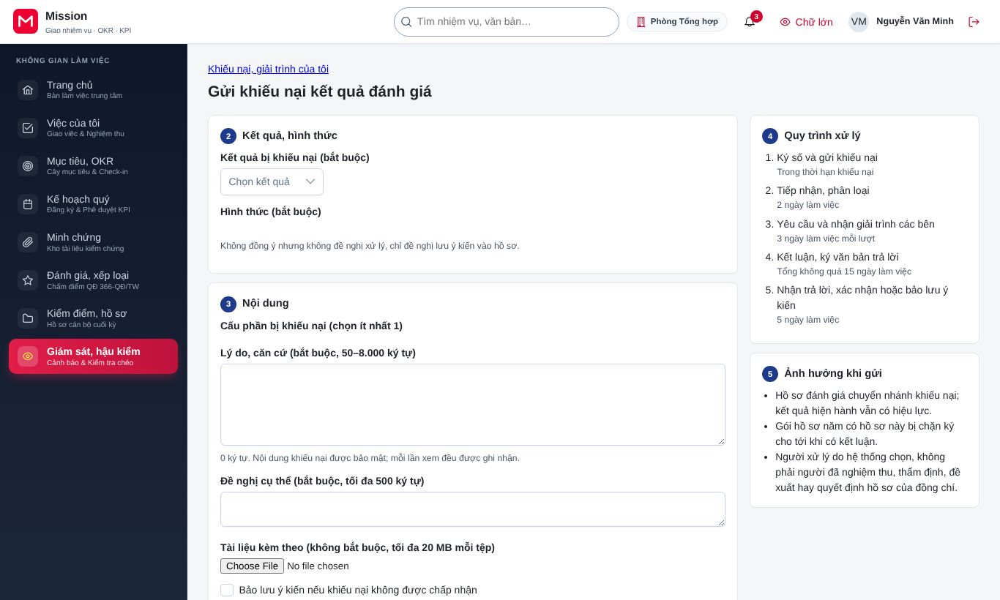

1. Chọn hình thức: **Khiếu nại**, **Giải trình bổ sung** hoặc **Bảo lưu ý kiến**.
2. Chọn nội dung chưa đồng ý, ví dụ điểm chất lượng của một nhiệm vụ then chốt hoặc mức xếp loại.
3. Trình bày nội dung và đính kèm tài liệu. Nội dung khiếu nại được mã hoá, chỉ người có thẩm quyền xử lý mới đọc được.
4. Xem phần quy trình xử lý và ảnh hưởng khi gửi, rồi bấm **Ký số và gửi**.

Đồng chí theo dõi khiếu nại ở **Giám sát, hậu kiểm**, mục **Khiếu nại, giải trình của tôi**. Đồng chí có thể rút khiếu nại khi chưa có kết luận.

### 3.4. Hội nghị kiểm điểm

Khi đơn vị tổ chức hội nghị kiểm điểm trên hệ thống, đồng chí vào **Kiểm điểm, hồ sơ** để gửi dự thảo bản kiểm điểm của mình, tải dự thảo của người khác để góp ý. Nếu được phân công làm thư ký hội nghị, đồng chí ghi ý kiến tại hội nghị và sinh biên bản ngay trên màn hình hội nghị.

## 4. Chế độ Đảng viên cao tuổi

Chế độ này dành cho đảng viên cao tuổi hoặc người cần chữ to, ít thao tác. Đồng chí bấm nút **Chữ lớn** trên thanh trên cùng để bật, bấm **Chữ thường** để tắt.

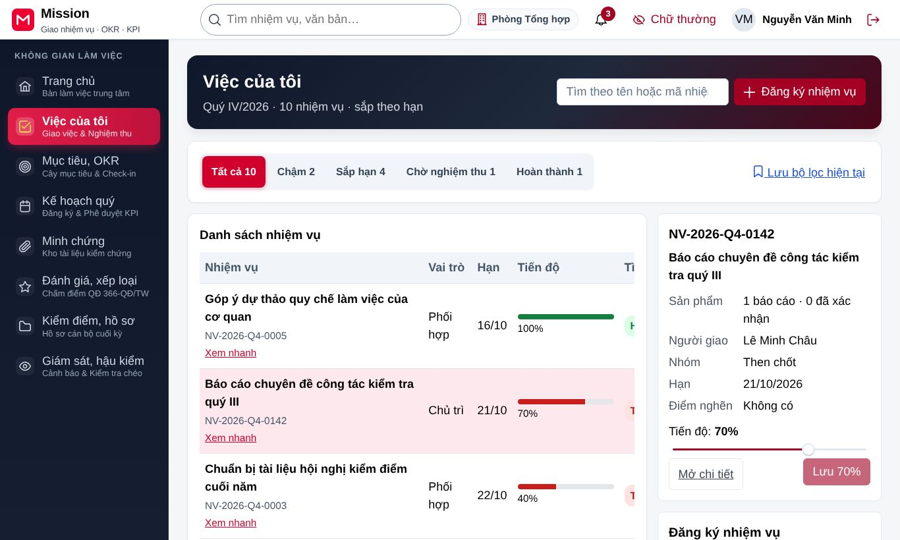

Ở chế độ này, ba việc thường ngày đều làm được trong không quá ba lần bấm:

- **Cập nhật tiến độ:** từ trang chủ bấm vào việc cần cập nhật (lần 1), kéo thanh tiến độ (lần 2), bấm **Lưu** (lần 3).
- **Check-in kết quả then chốt:** từ thông báo nhắc check-in bấm vào KR (lần 1), nhập giá trị (lần 2), bấm **Gửi check-in** (lần 3).
- **Xem việc của tôi:** bấm **Việc của tôi** ở danh mục bên trái (lần 1).

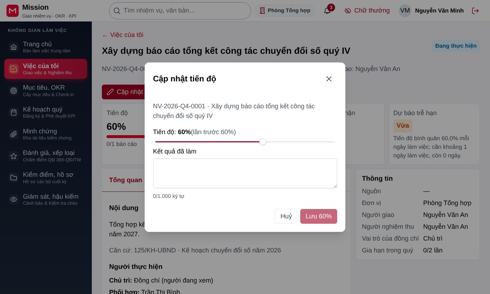

Phiếu tự đánh giá ở chế độ này được rút gọn: phiếu tự lưu nên không còn nút **Lưu nháp**, các cột phụ được ẩn, và thẻ lịch sử không hiện. Đồng chí chỉ cần đánh dấu tiêu chí, viết phần tự nhận xét, rồi bấm **Ký số và nộp**.

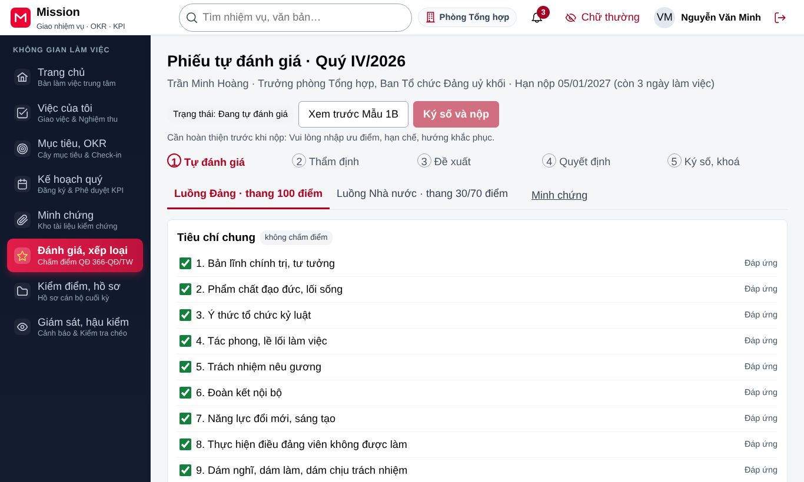

## 5. Câu hỏi thường gặp

**Tôi lưu tiến độ nhưng hệ thống báo dữ liệu đã được người khác cập nhật. Tôi phải làm gì?** Thông báo này xuất hiện khi người phối hợp hoặc người quản lý vừa sửa cùng nhiệm vụ. Đồng chí tải lại trang để xem bản mới nhất, rồi cập nhật lại tiến độ. Hệ thống làm vậy để không ghi đè mất cập nhật của người khác.

**Vì sao tôi không sửa được phần kết quả thực hiện nhiệm vụ trong phiếu tự đánh giá?** Phần này do hệ thống tự tính từ các sản phẩm đã được nghiệm thu, theo công thức của quy định đánh giá mà đơn vị áp dụng. Nếu đồng chí thấy một nhiệm vụ bị tính chưa đúng, hãy xem **Vết tính** để biết căn cứ, sau đó trao đổi với người quản lý trực tiếp hoặc gửi khiếu nại sau khi có kết quả.

**Ký số không thành công thì sao?** Đồng chí kiểm tra điện thoại đã nhận yêu cầu ký trên ứng dụng ký số chưa. Nếu dịch vụ ký số tạm thời gián đoạn, hệ thống báo lỗi và giữ nguyên phiếu; đồng chí thử lại sau ít phút, nội dung đã điền không bị mất.

**Minh chứng nộp chưa được nghiệm thu đến khi khoá kỳ thì có được tính không?** Minh chứng chưa được nghiệm thu trước khi khoá kỳ không được tính điểm trong kỳ đó. Người nộp và người nghiệm thu đều được thông báo. Vì vậy, đồng chí nên nộp sớm và nhắc người nghiệm thu khi gần hết hạn.

**Tôi kiêm nhiệm ở hai đơn vị, làm sao thấy việc của từng nơi?** Đồng chí bấm nút tên đơn vị trên thanh trên cùng để đổi phân công làm việc. Việc của tôi hiển thị theo phân công đang chọn.

## 6. Liên hệ hỗ trợ

Khi cần giúp đỡ về nghiệp vụ, như cách tính điểm hay thời hạn nộp, đồng chí hỏi người quản lý trực tiếp hoặc cán bộ tổ chức của đơn vị. Khi gặp lỗi kỹ thuật, đồng chí liên hệ bộ phận hỗ trợ của đơn vị qua đầu mối đã được thông báo, kèm thời điểm, tên màn hình và nội dung thông báo lỗi.
