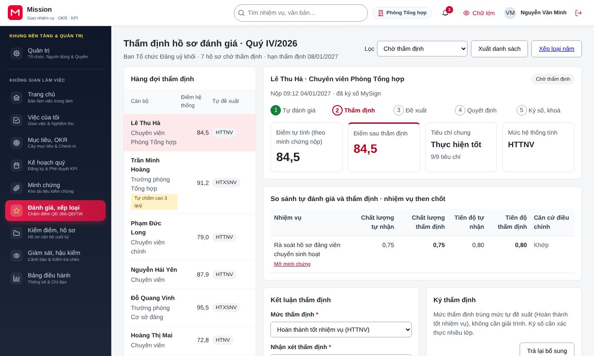
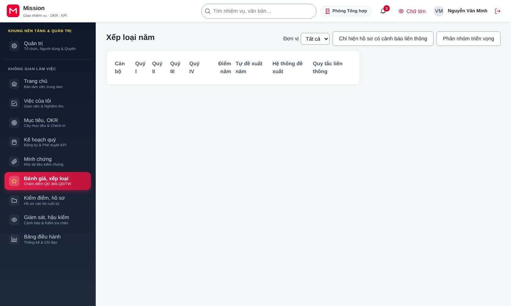
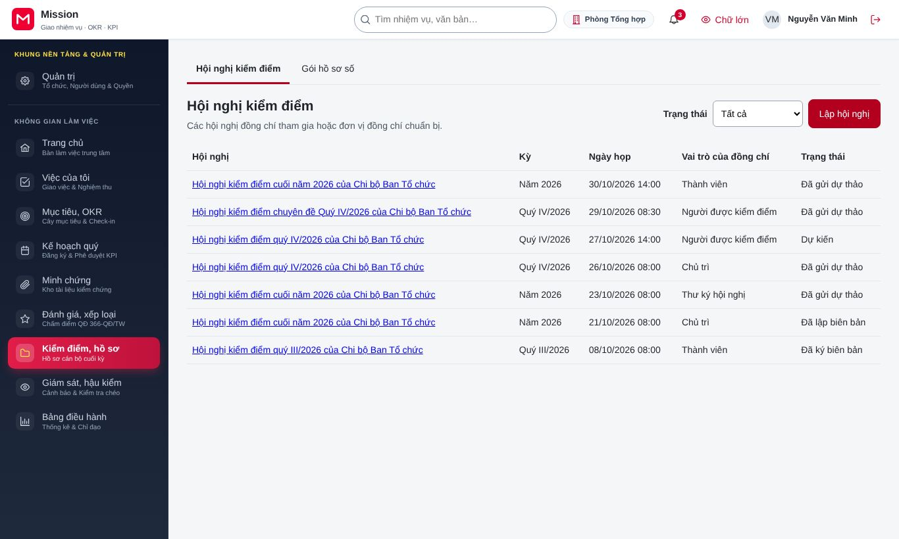
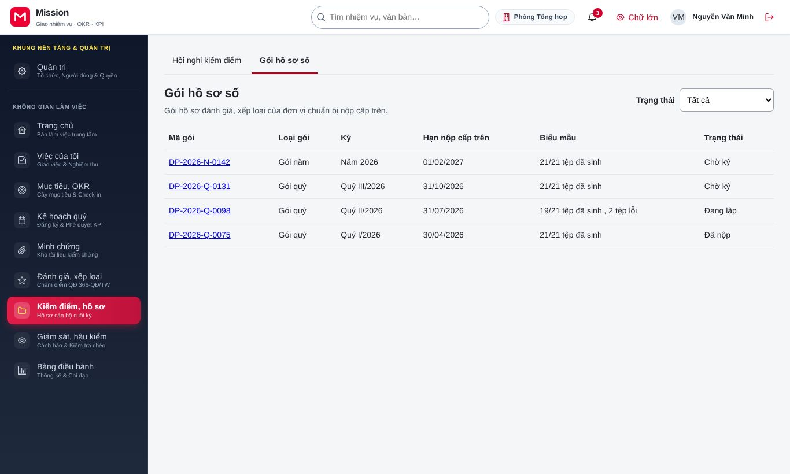
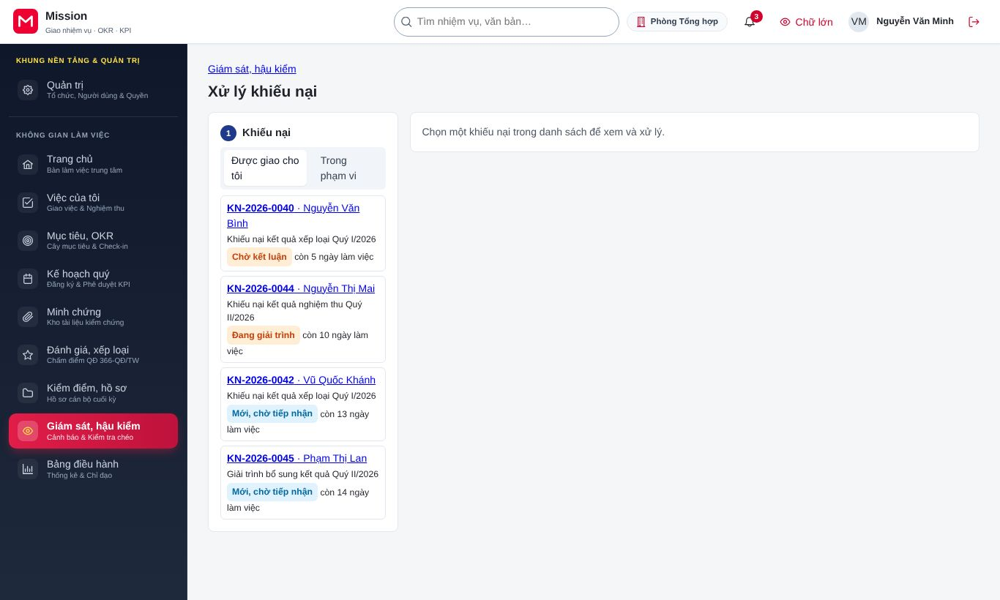
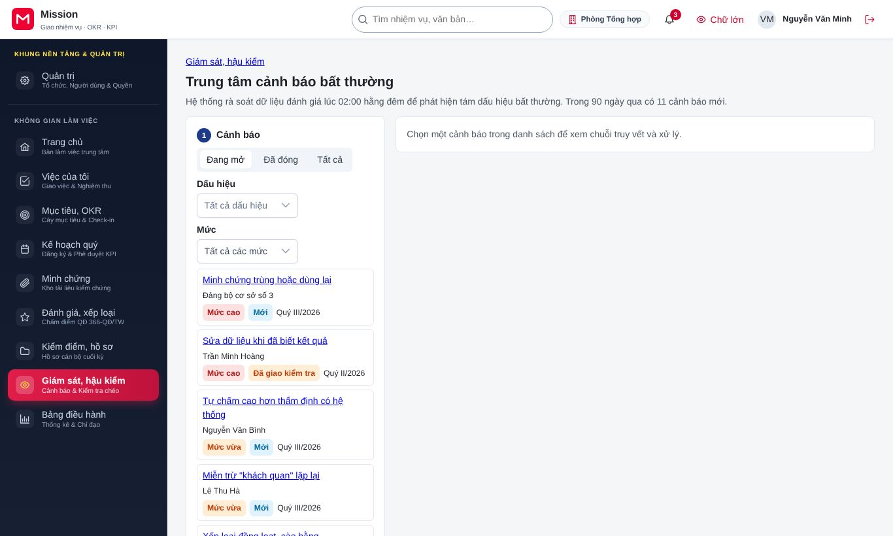

# Hướng dẫn cho cơ quan tổ chức cán bộ

<!-- AC-07 appraiser · QT-09, QT-10, QT-11, QT-12, QT-13, QT-14 · SCR-0902, SCR-0903, SCR-1001, SCR-1002, SCR-1101, SCR-1102, SCR-1202, SCR-1301 tạo, SCR-1302 tra cứu, SCR-1401, SCR-1603 · hành trình HT-26, HT-28. -->

Tài liệu này dành cho cán bộ cơ quan tổ chức cán bộ (ban tổ chức, phòng tổ chức cán bộ, bộ phận nội vụ). Công việc của vai trò gồm: thẩm định hồ sơ đánh giá, tổng hợp xếp loại năm, phân nhóm cán bộ triển vọng, chuẩn bị hội nghị kiểm điểm, lập gói hồ sơ số, xử lý khiếu nại, xử lý cảnh báo bất thường và đề nghị mở lại kỳ khi cần. Trước khi đọc tiếp, đồng chí nên xem phần [Thao tác dùng chung](00-thao-tac-dung-chung.md). Vai trò này luôn phải xác thực nhiều lớp khi đăng nhập.

## 1. Vai trò của đồng chí trong hệ thống

Cơ quan tổ chức cán bộ đứng giữa người được đánh giá và cấp quyết định. Đồng chí kiểm tra hồ sơ có đủ căn cứ không, mức đề xuất có phù hợp quy định không, rồi ký số kết quả thẩm định để chuyển cấp có thẩm quyền quyết định. Đồng chí xem được minh chứng của cán bộ trong phạm vi phụ trách; mỗi lần mở tệp minh chứng đều được ghi nhật ký truy cập, và tệp xuất danh sách không chứa thông tin cá nhân nhạy cảm. Theo nguyên tắc tách vai trò, người thẩm định không đồng thời là người quyết định trên cùng hồ sơ.

## 2. Thẩm định hồ sơ đánh giá

Đồng chí vào **Đánh giá, xếp loại**, chọn **Thẩm định**. Hàng đợi liệt kê hồ sơ đã nộp, kèm hạn thẩm định và các cảnh báo.

1. Chọn hồ sơ để xem chi tiết: phiếu tự đánh giá, điểm hệ thống tính và vết tính, mức đề xuất của người quản lý trực tiếp, minh chứng.
2. Nếu hồ sơ thiếu căn cứ, bấm **Trả lại bổ sung**, ghi **Lý do trả lại bổ sung** và bấm **Xác nhận trả lại**. Cán bộ nhận thông báo để bổ sung và nộp lại.
3. Nếu hồ sơ đủ, chọn **Mức thẩm định**, ghi **Nhận xét thẩm định**.
4. Bấm **Ký số và chuyển đề xuất**, xác thực nhiều lớp và ký trên ứng dụng ký số. Hồ sơ chuyển sang cấp có thẩm quyền quyết định.

Đồng chí có thể xuất danh sách hàng đợi để theo dõi ngoài hệ thống.

## 3. Tổng hợp xếp loại năm

Đồng chí vào **Đánh giá, xếp loại**, chọn **Xếp loại năm** để xem tổng hợp bốn quý và mức năm của từng người.

Đánh dấu **Chỉ hiện hồ sơ có cảnh báo liên thông** để tập trung vào những người có kết quả lệch, bấm **Giải thích liên thông** để đọc lý do. Từ màn hình này, đồng chí chuyển hồ sơ sang thẩm định năm, và với cán bộ hai năm liền chưa hoàn thành nhiệm vụ, bấm **Lập đề xuất bố trí lại**.

Ở mục **Phân nhóm triển vọng**, đồng chí chuẩn bị danh sách phân nhóm theo tiêu chí, kéo thả xếp nhóm, ghi lý do và lưu nháp để lãnh đạo xem và trình tập thể.

## 4. Hội nghị kiểm điểm

Đồng chí vào **Kiểm điểm, hồ sơ**, chọn **Hội nghị kiểm điểm**, bấm **Lập hội nghị**.

Đồng chí chọn đơn vị, thời gian, người chủ trì, thư ký và thành phần. Cán bộ gửi dự thảo bản kiểm điểm lên hội nghị, thành viên tải dự thảo để góp ý. Khi được phân công làm thư ký, đồng chí ghi ý kiến tại hội nghị và sinh biên bản ngay trên màn hình.

## 5. Gói hồ sơ số

Sau khi có quyết định xếp loại, đồng chí vào **Kiểm điểm, hồ sơ**, chọn **Gói hồ sơ số**.

Màn hình theo dõi việc sinh các biểu mẫu của từng người. Nếu một biểu mẫu sinh lỗi, đồng chí bấm sinh lại. Khi đủ, đồng chí tải gói nén kèm danh mục tệp. Với cán bộ thuộc diện cấp trên quản lý, đồng chí gửi gói con riêng cho cấp trên. Cấp có thẩm quyền ký số gói trước khi nộp.

## 6. Xử lý khiếu nại

Đồng chí vào **Giám sát, hậu kiểm**, chọn **Xử lý khiếu nại**. Bộ lọc **Được giao cho tôi** và **Trong phạm vi** giúp tìm khiếu nại cần xử lý.

1. Tiếp nhận khiếu nại, hoặc quyết định không thụ lý kèm lý do khi khiếu nại không đủ điều kiện.
2. Yêu cầu bên liên quan (thường là người quản lý trực tiếp) giải trình.
3. Tính thử điều chỉnh để biết kết quả thay đổi thế nào nếu chấp nhận khiếu nại, và xem dự thảo văn bản trả lời.
4. Nếu kết luận cần sửa kết quả của kỳ đã khoá, tạo yêu cầu mở lại kỳ từ kết luận khiếu nại.

Văn bản trả lời do cấp có thẩm quyền ký số. Nội dung khiếu nại được mã hoá, chỉ người được giao xử lý mới đọc được.

## 7. Cảnh báo bất thường

Đồng chí vào **Giám sát, hậu kiểm**, chọn **Cảnh báo**. Các thẻ **Đang mở** và **Đã đóng** chia cảnh báo theo tình trạng; khối phân bố 90 ngày cho thấy xu hướng.

Với mỗi cảnh báo, đồng chí xem chuỗi bằng chứng và mở sổ cái để đối chiếu. Nếu dấu hiệu có lý do chính đáng, đồng chí xác nhận hợp lệ kèm giải thích; nếu cần xác minh, đồng chí giao kiểm tra. Đồng chí cũng tra cứu được sổ cái ghi nhận các thao tác quan trọng.

## 8. Yêu cầu mở lại kỳ

Khi phát hiện sai sót trong kỳ đã khoá, đồng chí vào **Giám sát, hậu kiểm**, chọn **Hậu kiểm, mở lại kỳ**, tạo yêu cầu mở lại: chọn hồ sơ và nhóm dữ liệu được phép sửa, tính thử ảnh hưởng, rồi gửi. Yêu cầu cần hai cấp phê duyệt. Đồng chí có thể huỷ yêu cầu của mình trước khi đủ phê duyệt.

## 9. Câu hỏi thường gặp

**Tôi trả lại hồ sơ, hạn thẩm định có bị tính tiếp không?** Thời gian cán bộ bổ sung hồ sơ không tính vào hạn thẩm định của đồng chí.

**Vì sao tôi không ký được quyết định xếp loại cho hồ sơ mình đã thẩm định?** Theo nguyên tắc tách vai trò, người thẩm định không quyết định trên cùng hồ sơ. Hồ sơ phải do cấp có thẩm quyền quyết định ký.

**Tôi mở minh chứng có bị ghi lại không?** Có. Mọi lần mở tệp minh chứng đều được ghi nhật ký, cơ quan kiểm tra có thể tra cứu.

## 10. Liên hệ hỗ trợ

Vướng mắc về quy định đánh giá, đồng chí trao đổi với lãnh đạo cơ quan tổ chức cán bộ. Lỗi kỹ thuật, đồng chí liên hệ quản trị đơn vị.
