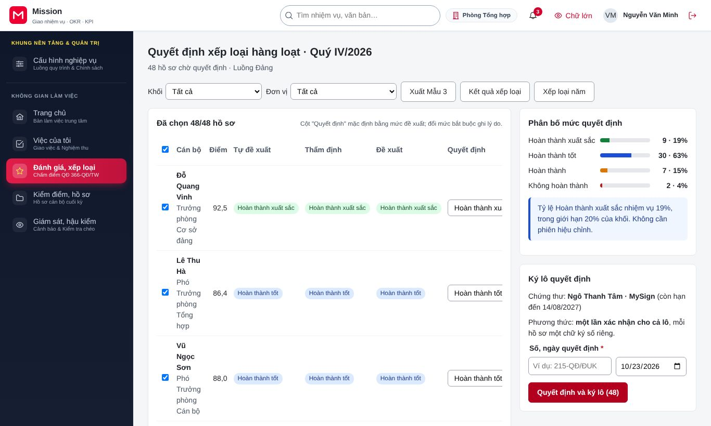
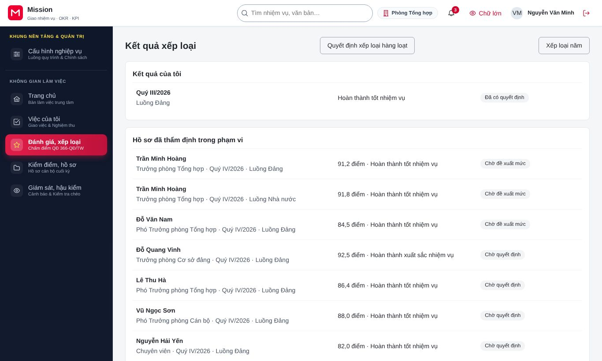
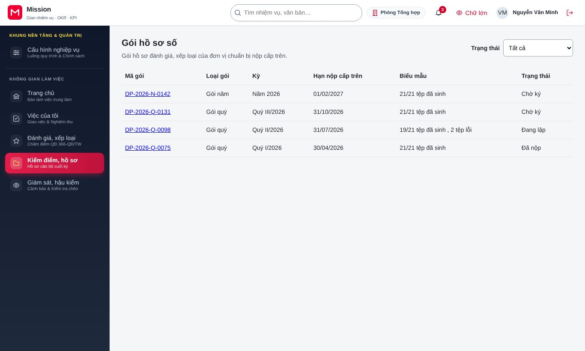
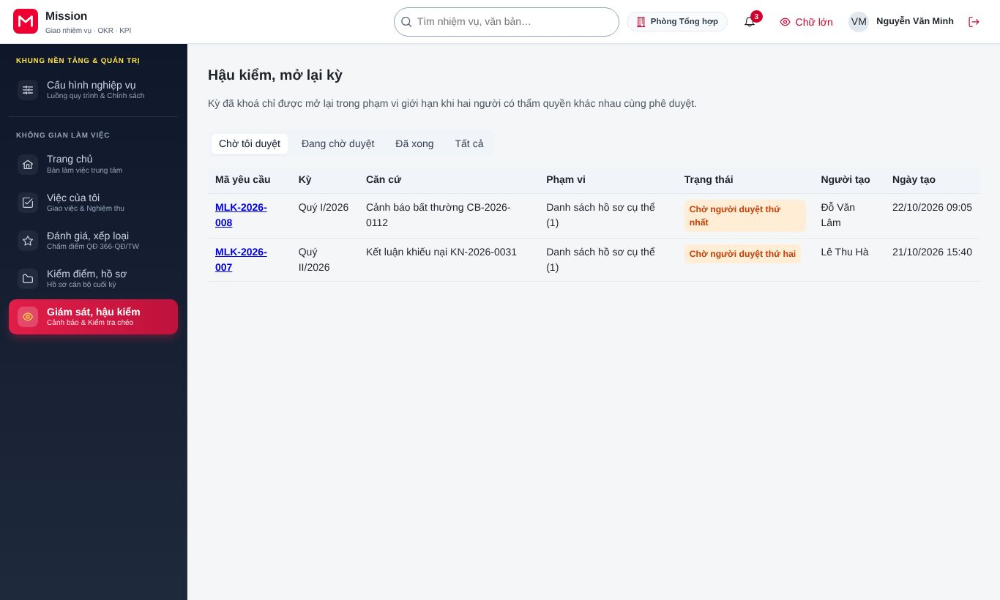
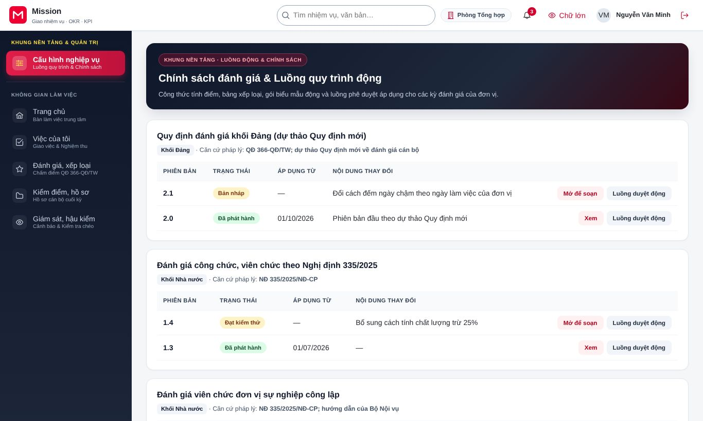

# Hướng dẫn cho cấp có thẩm quyền quyết định

<!-- AC-08 decider · QT-09, QT-10, QT-12, QT-13, QT-14 · SCR-0903, SCR-0904, SCR-1001, SCR-1102 ký gói, SCR-1202 ký trả lời, SCR-1301 duyệt 1, SCR-1503 ký duyệt · hành trình HT-27. -->

Tài liệu này dành cho người có thẩm quyền ký quyết định xếp loại cán bộ. Công việc của vai trò gồm: quyết định xếp loại và ký lô, ký số gói hồ sơ, ký văn bản trả lời khiếu nại, phê duyệt thứ nhất yêu cầu mở lại kỳ và ký phê duyệt phát hành chính sách đánh giá. Trước khi đọc tiếp, đồng chí nên xem phần [Thao tác dùng chung](00-thao-tac-dung-chung.md). Vai trò này luôn phải xác thực nhiều lớp khi đăng nhập và trước mỗi lần ký.

## 1. Vai trò của đồng chí trong hệ thống

Cấp có thẩm quyền quyết định là bước cuối của quy trình đánh giá. Mọi thao tác của đồng chí đều ký số, có giá trị pháp lý và không sửa được sau khi ký; nếu cần điều chỉnh, phải đi qua khiếu nại hoặc yêu cầu mở lại kỳ. Vai trò này được cấp có thời hạn và phải qua duyệt thứ hai khi cấp.

## 2. Quyết định xếp loại hàng loạt

Đồng chí vào **Đánh giá, xếp loại**, chọn **Quyết định**. Màn hình liệt kê hồ sơ đã thẩm định chờ quyết định, kèm phân bố các mức xếp loại.

1. Xem phân bố mức để biết tỷ lệ từng mức có phù hợp quy định không.
2. Mở hồ sơ khi cần xem chi tiết. Nếu đồng chí quyết định khác mức thẩm định, đổi mức và ghi lý do.
3. Chọn các hồ sơ cần quyết định, ghi **Số quyết định** và **Ngày quyết định**.
4. Bấm **Quyết định và ký lô**, xác thực nhiều lớp và ký trên ứng dụng ký số. Nút ghi số hồ sơ đang chọn.
5. Theo dõi tiến độ ký lô. Khi lô chưa hoàn tất, đồng chí có thể huỷ lô.

Bấm **Xuất Mẫu 3** để tải danh sách tổng hợp kết quả xếp loại theo mẫu.

Đồng chí xem được phiếu xếp loại của từng người với vết tính và tải bản đã ký.

Mục **Xếp loại năm** cho đồng chí xem tổng hợp bốn quý và giải thích mức năm.

## 3. Ký gói hồ sơ số

Đồng chí vào **Kiểm điểm, hồ sơ**, chọn **Gói hồ sơ số**. Khi cơ quan tổ chức cán bộ đã chuẩn bị đủ biểu mẫu, đồng chí xem, tải gói để kiểm tra, rồi ký số gói và nộp cấp trên.

## 4. Ký văn bản trả lời khiếu nại

Sau khi cơ quan tổ chức cán bộ xử lý khiếu nại, dự thảo văn bản trả lời được chuyển cho đồng chí. Đồng chí đọc kết luận và ký số văn bản trả lời. Người khiếu nại nhận văn bản qua hệ thống.

## 5. Phê duyệt yêu cầu mở lại kỳ

Đồng chí vào **Giám sát, hậu kiểm**, chọn **Hậu kiểm, mở lại kỳ**. Bộ lọc **Chờ tôi duyệt** liệt kê yêu cầu cần đồng chí xem.

Mỗi yêu cầu ghi lý do, hồ sơ và nhóm dữ liệu được phép sửa, kết quả tính thử ảnh hưởng. Đồng chí phê duyệt (phê duyệt thứ nhất, có xác thực nhiều lớp và ký số) hoặc từ chối. Kỳ chỉ mở lại khi người duyệt thứ hai cũng đồng ý.

## 6. Ký phê duyệt phát hành chính sách đánh giá

Khi quản trị nghiệp vụ gửi phê duyệt một phiên bản chính sách, đồng chí nhận thông báo. Đồng chí vào **Cấu hình nghiệp vụ**, mở phiên bản chính sách, xem kết quả chạy các ca kiểm thử và những thay đổi so với bản đang áp dụng, rồi ký số phê duyệt phát hành.

## 7. Câu hỏi thường gặp

**Tôi ký lô nhưng một số hồ sơ báo lỗi.** Các hồ sơ lỗi không được ký, các hồ sơ còn lại vẫn hoàn tất. Đồng chí xem lý do, xử lý rồi ký lại phần còn lại.

**Có sửa được quyết định đã ký không?** Không sửa trực tiếp. Điều chỉnh chỉ thực hiện qua khiếu nại hoặc yêu cầu mở lại kỳ với hai cấp phê duyệt.

**Tôi có phải ký từng hồ sơ một không?** Không. Đồng chí chọn nhiều hồ sơ và ký một lần bằng chữ ký lô.

## 8. Liên hệ hỗ trợ

Vướng mắc về hồ sơ, đồng chí trao đổi với cơ quan tổ chức cán bộ. Sự cố ký số, đồng chí liên hệ quản trị đơn vị hoặc nhà cung cấp dịch vụ ký số.
