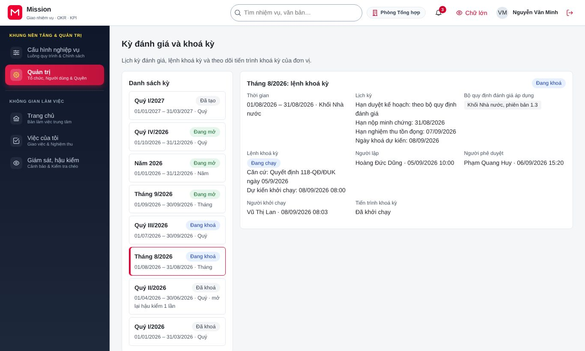
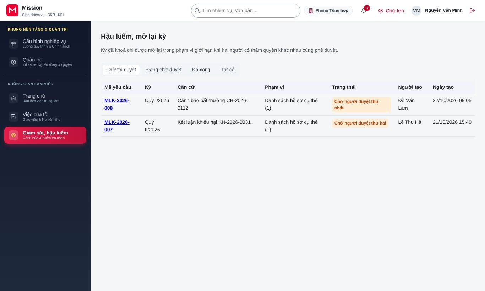
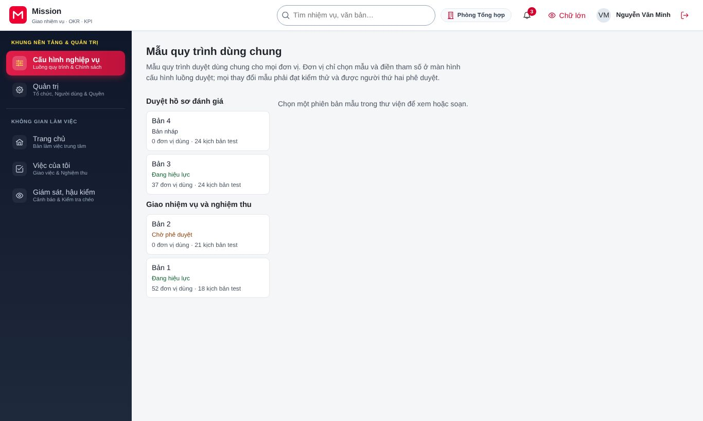

# Hướng dẫn cho người duyệt thứ hai

<!-- AC-09 second_approver · nguyên tắc bốn mắt · QT-08, QT-13, QT-15 · SCR-0801 duyệt huỷ, SCR-1301 duyệt 2, SCR-1505 phê duyệt mẫu luồng · hành trình HT-24. -->

Tài liệu này dành cho người được giao duyệt lần hai các thao tác cần hai người cùng đồng ý. Công việc của vai trò gồm: duyệt huỷ và hoàn tác một lần khoá kỳ, phê duyệt thứ hai yêu cầu mở lại kỳ và phê duyệt phát hành mẫu quy trình dùng chung. Trước khi đọc tiếp, đồng chí nên xem phần [Thao tác dùng chung](00-thao-tac-dung-chung.md). Vai trò này luôn phải xác thực nhiều lớp khi đăng nhập và trước mỗi lần duyệt.

## 1. Vai trò của đồng chí trong hệ thống

Một số thao tác ảnh hưởng tới kết quả của nhiều người hoặc của nhiều đơn vị, nên không được để một người tự quyết. Hệ thống yêu cầu người thứ hai, độc lập với người đề nghị, xem xét và đồng ý. Đồng chí không duyệt được đề nghị do chính mình lập. Mỗi lần duyệt hoặc từ chối đều được ký số và ghi vào sổ cái.

## 2. Duyệt huỷ và hoàn tác khoá kỳ

Khi quản trị đơn vị phát hiện sai sót trong lúc khoá kỳ đang chạy và gửi đề nghị huỷ, đồng chí nhận thông báo. Đồng chí vào **Quản trị**, chọn **Kỳ đánh giá**, mở kỳ có đề nghị huỷ.

Đồng chí đọc lý do huỷ, xem tiến trình đã chạy tới bước nào, rồi bấm **Duyệt huỷ và hoàn tác** và xác thực nhiều lớp. Hệ thống hoàn tác các bước đã chạy theo thứ tự ngược lại. Chỉ huỷ được khi bước sinh mẫu và bảng chấm điểm chưa hoàn tất; sau thời điểm đó, sai sót phải xử lý bằng yêu cầu mở lại kỳ.

## 3. Phê duyệt thứ hai yêu cầu mở lại kỳ

Đồng chí vào **Giám sát, hậu kiểm**, chọn **Hậu kiểm, mở lại kỳ**, lọc **Chờ tôi duyệt**.

Yêu cầu đến tay đồng chí khi cấp có thẩm quyền đã phê duyệt thứ nhất. Đồng chí kiểm tra lý do, phạm vi dữ liệu được phép sửa và kết quả tính thử ảnh hưởng. Nếu đồng ý, đồng chí phê duyệt (có xác thực nhiều lớp và ký số), kỳ được mở lại cho đúng các hồ sơ và nhóm dữ liệu đã ghi. Nếu không đồng ý, đồng chí từ chối kèm lý do.

## 4. Phê duyệt phát hành mẫu quy trình

Đồng chí vào **Cấu hình nghiệp vụ**, chọn **Mẫu quy trình**. Mẫu có đề nghị phát hành hiện ở trạng thái chờ duyệt.

Đồng chí xem các thay đổi so với phiên bản trước và kết quả chạy kịch bản kiểm thử. Nếu đạt, đồng chí phê duyệt phát hành và ký số gói mẫu; mẫu sau đó được triển khai lần lượt lên các cụm máy chủ.

## 5. Câu hỏi thường gặp

**Vì sao tôi không thấy nút duyệt trên một đề nghị?** Đề nghị đó do chính đồng chí lập, hoặc chưa qua bước phê duyệt thứ nhất. Hệ thống không cho người đề nghị tự duyệt.

**Tôi duyệt huỷ khoá kỳ, dữ liệu có bị mất không?** Không. Hệ thống hoàn tác về trạng thái trước khi khoá kỳ, dữ liệu của cán bộ vẫn giữ nguyên để khoá lại sau khi sửa sai sót.

## 6. Liên hệ hỗ trợ

Khi cần làm rõ một đề nghị, đồng chí liên hệ trực tiếp người đề nghị có tên trên màn hình. Lỗi kỹ thuật, đồng chí liên hệ quản trị đơn vị.
