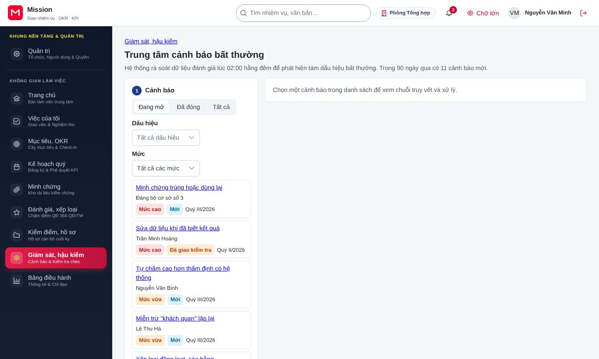
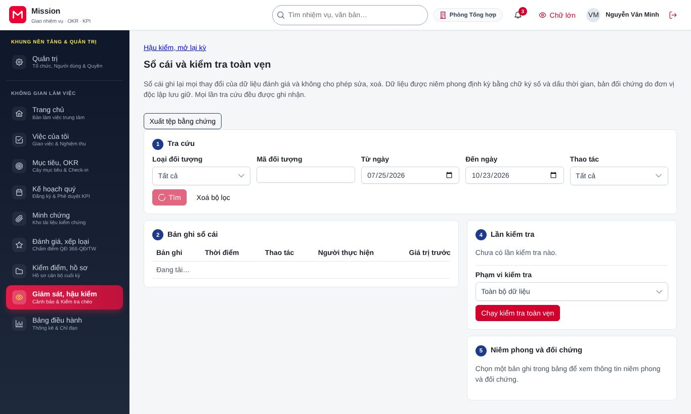
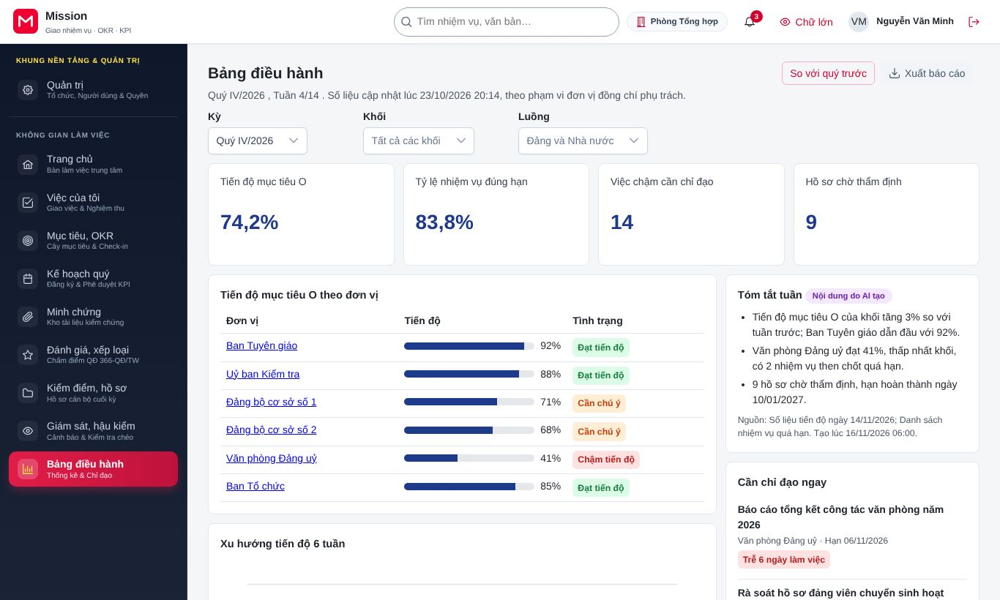
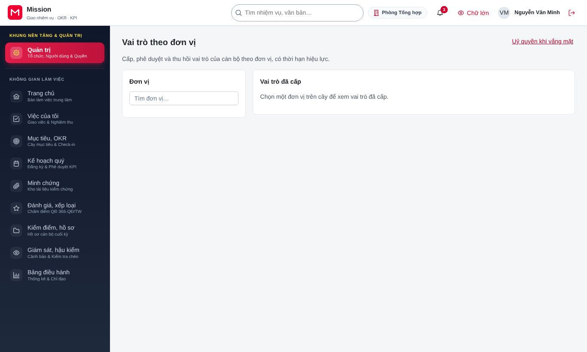
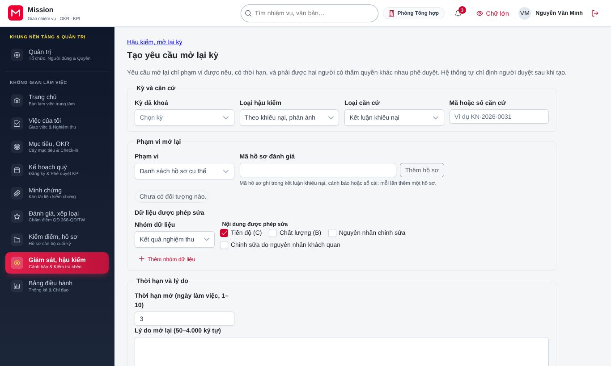

# Hướng dẫn cho cơ quan kiểm tra, giám sát

<!-- AC-10 inspector · QT-13, QT-14 · SCR-0103..0107 chỉ xem, SCR-0601 xem, SCR-0801 xem, SCR-1301 tạo, SCR-1302, SCR-1401 kết luận, SCR-1601 xem, SCR-1603 · hành trình HT-28, HT-29. -->

Tài liệu này dành cho cán bộ ủy ban kiểm tra, thanh tra và các cơ quan giám sát. Công việc của vai trò gồm: theo dõi và kết luận cảnh báo bất thường, tra cứu và kiểm tra toàn vẹn sổ cái, lần theo chuỗi truy vết từ điểm số tới minh chứng, xem hồ sơ quyền của người dùng và tạo yêu cầu mở lại kỳ khi phát hiện vi phạm. Trước khi đọc tiếp, đồng chí nên xem phần [Thao tác dùng chung](00-thao-tac-dung-chung.md). Vai trò này luôn phải xác thực nhiều lớp khi đăng nhập.

## 1. Vai trò của đồng chí trong hệ thống

Cơ quan kiểm tra có quyền xem rộng nhưng chủ yếu là chỉ đọc: đồng chí xem được cơ cấu tổ chức, vai trò đã cấp, uỷ quyền, tiến trình khoá kỳ, chi tiết nhiệm vụ và bảng điều hành, nhưng không sửa các dữ liệu đó. Mọi thao tác quan trọng trên hệ thống được ghi vào sổ cái nối chuỗi, nên đồng chí kiểm tra được dữ liệu có bị sửa ngoài quy trình hay không. Mỗi lần đồng chí mở tệp minh chứng cũng được ghi nhật ký.

## 2. Cảnh báo bất thường

Đồng chí vào **Giám sát, hậu kiểm**, chọn **Cảnh báo**. Các thẻ **Đang mở**, **Đã đóng** và khối phân bố 90 ngày giúp nắm tình hình.

1. Mở cảnh báo để xem dấu hiệu, chuỗi bằng chứng và các bản ghi sổ cái liên quan.
2. Xác nhận hợp lệ kèm giải thích, hoặc giao kiểm tra cho cán bộ xác minh.
3. Sau khi xác minh, ghi kết luận kiểm tra. Nếu kết luận có vi phạm làm sai kết quả đánh giá, đồng chí tạo yêu cầu mở lại kỳ ngay từ kết luận.

## 3. Sổ cái và kiểm tra toàn vẹn

Đồng chí vào **Giám sát, hậu kiểm**, chọn **Sổ cái**. Màn hình gồm phần tra cứu, danh sách bản ghi, kết quả kiểm tra toàn vẹn, các lần kiểm tra và phần niêm phong, đối chứng.

- Nhập điều kiện tra cứu (người thao tác, loại thao tác, khoảng thời gian) và bấm **Tìm**. Bấm vào một bản ghi để xem chi tiết, hoặc các liên kết "cùng kỳ đánh giá", "cùng hồ sơ" để xem các bản ghi liên quan.
- Chạy kiểm tra toàn vẹn để hệ thống xác minh không bản ghi nào bị sửa hay xoá. Kết quả được lưu ở mục các lần kiểm tra.
- Phần niêm phong và đối chứng cho biết các mốc niêm phong định kỳ đã được neo ra bên ngoài, dùng để đối chiếu độc lập.
- Bấm **Xuất tệp bằng chứng** để tải các bản ghi kèm chữ ký, phục vụ hồ sơ kiểm tra.

## 4. Chuỗi truy vết từ điểm tới minh chứng

Từ **Bảng điều hành** hoặc từ phiếu xếp loại, đồng chí lần theo chuỗi truy vết: điểm số, nhiệm vụ, sản phẩm đã nghiệm thu, minh chứng, và ngược lên mục tiêu của đơn vị. Đồng chí xuất chuỗi bằng chứng ra tệp để lưu hồ sơ.

## 5. Hồ sơ quyền của người dùng

Đồng chí vào **Quản trị**, chọn **Vai trò theo đơn vị** để xem vai trò đã cấp, và bấm vào tên một người để xem hồ sơ quyền: vai trò hiện hành, uỷ quyền đã giao và đã nhận, lịch sử thay đổi. Đồng chí xuất lịch sử quyền ra tệp khi cần. Màn hình này giúp kiểm tra một thao tác có được thực hiện bởi đúng người có quyền tại thời điểm đó hay không.

## 6. Tạo yêu cầu mở lại kỳ

Đồng chí vào **Giám sát, hậu kiểm**, chọn **Hậu kiểm, mở lại kỳ**, tạo yêu cầu mới.

1. Ghi lý do và căn cứ (kết luận kiểm tra).
2. Bấm **Thêm hồ sơ** để chọn hồ sơ cần mở lại, **Thêm nhóm dữ liệu** để giới hạn phần dữ liệu được phép sửa.
3. Xem kết quả tính thử ảnh hưởng.
4. Bấm **Tạo yêu cầu**. Yêu cầu cần cấp có thẩm quyền phê duyệt thứ nhất và người duyệt thứ hai phê duyệt.

Đồng chí có thể huỷ yêu cầu của mình trước khi đủ phê duyệt.

## 7. Câu hỏi thường gặp

**Kiểm tra toàn vẹn báo không đạt thì làm gì?** Đồng chí xem bản ghi bị phát hiện bất thường, xuất tệp bằng chứng, rồi báo cáo theo quy chế kiểm tra. Kết quả kiểm tra đã được lưu, không ai sửa được.

**Tôi có sửa được dữ liệu sai mà mình phát hiện không?** Không. Cơ quan kiểm tra chỉ kết luận và tạo yêu cầu mở lại kỳ; việc sửa do người có trách nhiệm thực hiện sau khi yêu cầu được phê duyệt.

## 8. Liên hệ hỗ trợ

Vướng mắc nghiệp vụ, đồng chí trao đổi với lãnh đạo cơ quan kiểm tra. Lỗi kỹ thuật, đồng chí liên hệ quản trị đơn vị.
