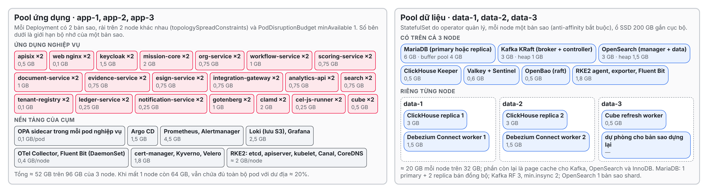
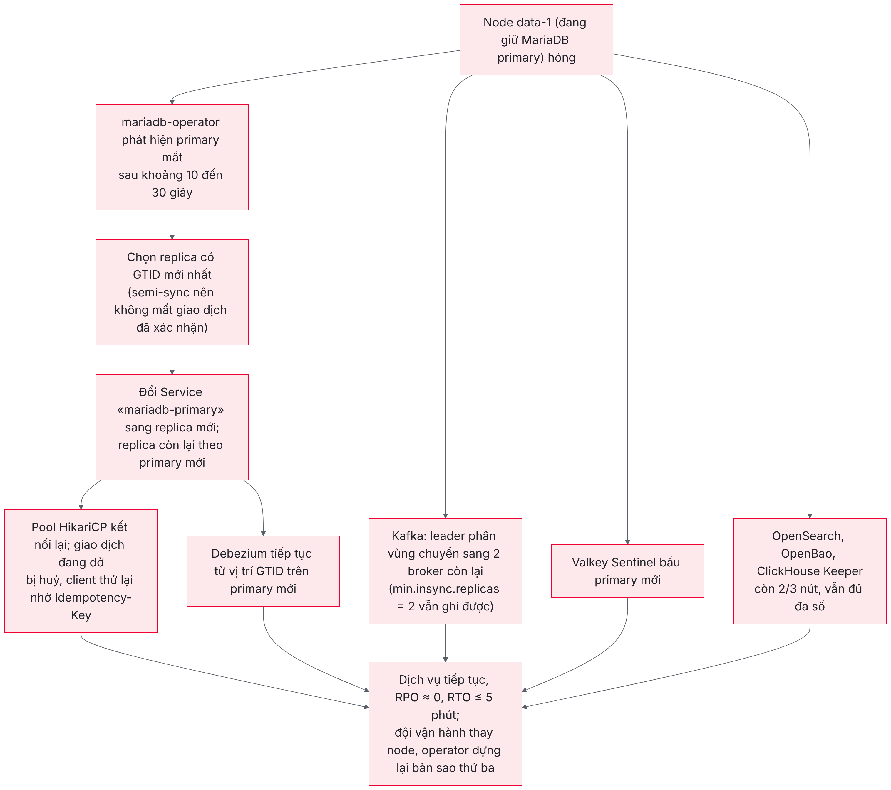

# Thông tin tài liệu {-}

## Kiểm soát phiên bản {-}

| Phiên bản | Ngày | Người thực hiện | Nội dung thay đổi |
|---|---|---|---|
| 1.0 | 26/10/2026 | Nhóm kiến trúc hạ tầng và vận hành | Bản đầu: cấu hình tối thiểu một nút cho mỗi thành phần, Docker Compose trên ba máy ảo |
| 1.1 | 26/10/2026 | Nhóm kiến trúc hạ tầng và vận hành | Viết lại theo chỉ đạo của chủ đầu tư: không dùng cấu hình đơn nút mà dùng mô hình production đầy đủ tính sẵn sàng cao, định cỡ vừa với quy mô 100 người dùng. Chuyển sang cụm Kubernetes RKE2 sáu node, mọi thành phần có ít nhất hai bản sao, MariaDB một primary và hai replica bán đồng bộ, bổ sung môi trường staging, GitOps, hành vi khi sự cố, tính lại chi phí. Bản 1.0 được lưu ở thư mục `ban-cu` |

## Tài liệu liên quan {-}

| Mã | Tên tài liệu | Quan hệ với TL-06 |
|---|---|---|
| Baseline | Cơ sở thiết kế chung | Danh mục SVC, MOD, EVT, NFR, quy ước API mục 13; TL-06 giữ nguyên toàn bộ mã định danh |
| TL-01 | Thiết kế kiến trúc chi tiết | Kiến trúc lai modular monolith, microservice và cell; TL-06 triển khai một cell đơn cho một đơn vị |
| TL-03 | Thiết kế CSDL và đồng bộ dữ liệu | Schema, bảng, outbox, CDC; TL-06 chương 5 ánh xạ sang MariaDB |
| TL-04 | Triển khai, hiệu năng, dự phòng và ATTT | Mô hình đám mây riêng (mục 2.1), biện pháp SEC, quy trình OPS, kịch bản DR |
| TL-05 | Định cỡ hệ thống theo các quy mô triển khai | Hồ sơ `compact`, `S`, `M`, `L`; TL-06 đề xuất thêm hồ sơ `mini` nhỏ hơn `compact` nhưng giữ cùng nguyên tắc sẵn sàng |
| Repo `mission-web` | Umbrella chart `deploy/charts/vt-platform`, tệp `values-private.yaml`, thư mục `sizing/`, chart từng service, Argo CD ở `deploy/argocd`, compose dev ở `infra/dev` | TL-06 dùng đúng các chart này; chỉ thêm tệp `values-sizing-mini.yaml` và thay chart CSDL |

## Quyết định đầu vào {-}

Tài liệu được lập theo yêu cầu của anh Hoàng Khắc Hiếu ngày 26/10/2026 với bốn quyết định đầu vào. Một là quy mô triển khai một đơn vị, 100 người dùng, hạ tầng thuê trên Viettel Cloud. Hai là hệ thống phải theo **mô hình production**: không phải cấu hình tối thiểu kiểu đơn nút, mà là cấu hình có sẵn sàng cao, không có điểm hỏng đơn trên đường xử lý nghiệp vụ, chỉ định cỡ vừa với 100 người dùng. Ba là cơ sở dữ liệu quan hệ dùng MariaDB thay PostgreSQL; quyết định này chỉ áp dụng cho TL-06, không đổi stack của TL-01 đến TL-05. Bốn là sản phẩm bàn giao là tệp PDF, có sơ đồ được vẽ thật. Các lựa chọn công nghệ còn lại do nhóm thiết kế tự quyết theo quy tắc YC-PT-18 và ghi rõ lý do trong tài liệu.

# Giới thiệu

## Mục đích của tài liệu

Bộ tài liệu TL-01 đến TL-05 mô tả nền tảng ở quy mô quốc gia: 6,5 triệu tài khoản, 300.000 người dùng đồng thời, nhiều cell, nhiều trung tâm dữ liệu. Một đơn vị khoảng một trăm cán bộ, viên chức, chẳng hạn một sở, một trường, một bệnh viện, cũng cần dùng nền tảng này như một hệ thống chính thức: dữ liệu đánh giá cán bộ có giá trị pháp lý, phiếu được ký số, hệ thống phải chạy liên tục trong các đợt đánh giá. Với đơn vị như vậy, kiến trúc quốc gia là quá lớn, nhưng một cấu hình thử nghiệm đơn nút lại không đủ tin cậy.

TL-06 là thiết kế triển khai mức thấp (Low-Level Design, LLD) cho điểm cân bằng đó. Tài liệu mô tả một môi trường production thật sự: mọi thành phần có bản sao dự phòng, mất một máy ảo bất kỳ thì hệ thống vẫn phục vụ, cập nhật phiên bản không làm gián đoạn người dùng, có sao lưu ra ngoài, có môi trường staging để thử trước, có giám sát và quy trình vận hành. Đồng thời mọi con số được định cỡ cho 100 người dùng (có dư địa tới khoảng 2.000), không dư thừa như hồ sơ quốc gia.

Tài liệu trả lời bốn nhóm câu hỏi: hệ thống được bố trí lên những máy nào và các thành phần nói chuyện với nhau ra sao; dùng những công nghệ nào, phiên bản nào; mỗi máy cần bao nhiêu vCPU, bộ nhớ, ổ đĩa, mạng chia thế nào, sao lưu và bảo mật làm ra sao; và chi phí thuê hạ tầng trên Viettel Cloud khoảng bao nhiêu. Vì chủ đầu tư chọn MariaDB trong khi mã nguồn hiện tại viết cho PostgreSQL, chương 5 mô tả thiết kế MariaDB có sẵn sàng cao và chương 6 xác định phạm vi chuyển đổi mã nguồn.

## Phạm vi

TL-06 bao trùm môi trường production của một đơn vị (cụm Kubernetes sáu node, cân bằng tải, mạng riêng ảo, kho đối tượng), môi trường staging thu nhỏ, máy quản trị, cùng các quy trình triển khai, sao lưu, khôi phục, ứng phó sự cố và vận hành. Tài liệu không bao trùm môi trường phát triển (đã có ở `infra/dev`), trợ lý AI và OCR (tắt bằng cờ tính năng vì không có GPU), và các hệ thống bên ngoài như CA ký số, hệ thống văn bản, cơ sở dữ liệu cán bộ (chỉ mô tả điểm kết nối).

## Giả định đầu vào

| Mã | Giả định | Giá trị | Căn cứ |
|---|---|---|---|
| GT-01 | Số tài khoản | 100 cán bộ, viên chức; định cỡ dư tới khoảng 2.000 | Yêu cầu của chủ đầu tư; dư địa để đơn vị mở rộng mà không đổi kiến trúc |
| GT-02 | Người dùng đồng thời giờ cao điểm | Thiết kế 100 (toàn bộ người dùng cùng thao tác ngày hạn nộp) | Kịch bản xấu nhất cho đơn vị nhỏ |
| GT-03 | Số tenant | 1 | Mô hình cell đơn của bản cài đám mây riêng (TL-04 mục 2.1, TL-05 chương 9) |
| GT-04 | Minh chứng | 8 tệp mỗi người mỗi quý, trung bình 1 MB, giữ ít nhất 10 năm | Baseline mục 3.1, NFR-09 |
| GT-05 | Khả dụng | 99,9% mỗi tháng (khoảng 43 phút gián đoạn), cập nhật phiên bản không gián đoạn | NFR-04 của cell SaaS |
| GT-06 | Khôi phục | Mất một máy ảo: RPO ≈ 0, RTO ≤ 5 phút (tự động). Mất cả vùng: RPO ≤ 15 phút, RTO ≤ 8 giờ | NFR-05 trong cùng trung tâm; nới RTO khi mất vùng vì chỉ có một vùng |
| GT-07 | Hạ tầng | Viettel Cloud, một vùng, máy ảo gói T2.Gen, các máy ảo cùng vai trò đặt trên máy chủ vật lý khác nhau | Yêu cầu của chủ đầu tư |
| GT-08 | CSDL quan hệ | MariaDB 11.8 LTS, một primary và hai replica bán đồng bộ | Yêu cầu của chủ đầu tư; mục 5.1 giải thích chọn topo |
| GT-09 | Trợ lý AI, OCR | Tắt | Không cần GPU ở quy mô này |
| GT-10 | Truy cập | Qua Internet bằng HTTPS, có thể giới hạn theo dải IP của đơn vị | Cán bộ làm việc tại cơ quan và từ xa |

## Cách đọc tài liệu

Chương 2 giải thích tải thật của 100 người và vì sao cấu hình vẫn cần sáu node. Chương 3 trình bày kiến trúc triển khai bằng sơ đồ tổng thể, sơ đồ bố trí pod, luồng xử lý, luồng sự kiện và hành vi khi một node hỏng. Chương 4 là danh mục công nghệ. Chương 5 thiết kế MariaDB, chương 6 phạm vi chuyển đổi mã nguồn. Chương 7 cấu hình hạ tầng Viettel Cloud. Chương 8 sao lưu, khôi phục và dự phòng thảm hoạ. Chương 9 an toàn thông tin. Chương 10 triển khai, giám sát và vận hành. Chương 11 chi phí. Chương 12 so sánh với bản đầy đủ và rủi ro chấp nhận. Chương 13 đường mở rộng. Phụ lục chứa tệp cấu hình mẫu và nguồn giá.

Người lập dự toán có thể đọc mục 7.1 rồi chuyển sang chương 11. Người cài đặt nên đọc chương 3, 5, 7, 8, 10 và phụ lục. Người thẩm định nên đọc chương 2, 6 và 12.

# Mô hình tải và nguyên tắc định cỡ

## Tải thật của một đơn vị 100 người

Áp dụng định luật Little như baseline mục 3.1: 100 người dùng đồng thời với thời gian suy nghĩ trung bình 20 giây giữa hai yêu cầu tạo khoảng 5 yêu cầu mỗi giây tại cổng API; nhân hệ số đột biến 2 của ngày hạn nộp được 10 yêu cầu mỗi giây. Tỷ lệ đọc ghi 80/20 cho khoảng 2 yêu cầu ghi mỗi giây và khoảng 3 sự kiện mỗi giây vào Kafka. Luồng duyệt BPMN chỉ có khoảng 1.600 user task mỗi quý. Minh chứng khoảng 3,2 GB mỗi năm, dữ liệu nghiệp vụ dưới 5 GB mỗi năm.

| Đại lượng | TL-06 (100 người, dư tới 2.000) | Hồ sơ `compact` (TL-05) |
|---|---|---|
| Tài khoản thiết kế | 100 đến 2.000 | 50.000 |
| Người dùng đồng thời | 100 | 2.500 |
| Yêu cầu mỗi giây ở đỉnh đột biến | khoảng 10 | khoảng 250 |
| Sự kiện Kafka mỗi giây | khoảng 3 | khoảng 75 |
| vCPU cần cho xử lý nghiệp vụ ở đỉnh | dưới 4 | khoảng 80 |
| Số node | 6 (3 ứng dụng + 3 dữ liệu) | 6 (3 hội tụ + 3 dữ liệu) |

## Vì sao vẫn cần sáu node

Bảng trên cho thấy năng lực xử lý không phải ràng buộc: bốn vCPU là đủ cho toàn bộ tải nghiệp vụ. Cấu hình được quyết định bởi hai ràng buộc khác.

Ràng buộc thứ nhất là **bộ nhớ thường trú**. Hệ thống có khoảng 20 loại pod ứng dụng, trong đó mười service Java mỗi bản sao chiếm 0,75 đến 2 GB dù không có tải, cộng Keycloak, ClamAV, Gotenberg. Với hai bản sao cho mỗi loại, tầng ứng dụng cần khoảng 35 GB; cộng nền tảng của cụm (Kubernetes, Argo CD, Prometheus, Loki) khoảng 17 GB, tổng khoảng 52 GB. Các con số này lấy từ giới hạn `mem_limit` và `-Xmx` đang chạy thật ở môi trường dev, đã qua đợt kiểm thử toàn bộ chức năng ngày 25 và 26/10/2026.

Ràng buộc thứ hai là **quy tắc sẵn sàng**. Mỗi hệ dữ liệu có cơ chế đồng thuận (MariaDB bán đồng bộ, Kafka KRaft, OpenSearch, OpenBao raft, ClickHouse Keeper, Valkey Sentinel, etcd của Kubernetes) cần ít nhất ba nút để mất một nút vẫn còn đa số. Tầng ứng dụng phải chịu được mất một node mà phần còn lại vẫn chứa đủ mọi pod. Ba node ứng dụng 32 GB cho 96 GB, khi mất một node còn 64 GB, vẫn chứa được 52 GB với dư địa khoảng 20%. Hai node ứng dụng thì không đủ, vì mất một node còn 32 GB nhỏ hơn 52 GB, và etcd hai nút không chịu được mất nút nào. Ba node dữ liệu là số nhỏ nhất cho đa số ba.

Như vậy sáu node là cấu hình nhỏ nhất thoả mãn yêu cầu production, và mỗi node chỉ cần cỡ trung bình (8 vCPU, 32 GB). Đây chính là điểm khác cơ bản với bản 1.0: số node do yêu cầu sẵn sàng quyết định, kích thước node do tải quyết định.

## Nguyên tắc định cỡ

Nguyên tắc thứ nhất là **cùng mã nguồn, cùng Helm chart với bản đầy đủ**. Hệ thống triển khai bằng umbrella chart `deploy/charts/vt-platform` với tệp mô hình `values-private.yaml` (đám mây riêng, một cell) như TL-04 mục 2.1, cộng một tệp hồ sơ năng lực mới `sizing/values-sizing-mini.yaml` (phụ lục A). Không có nhánh mã riêng cho đơn vị, ngoại trừ phần truy cập CSDL phải chuyển sang MariaDB ở chương 6.

Nguyên tắc thứ hai là **không có điểm hỏng đơn trên đường nghiệp vụ**. Mọi Deployment có tối thiểu hai bản sao trên hai node khác nhau và `PodDisruptionBudget` giữ ít nhất một bản sao khi bảo trì. Mọi hệ dữ liệu có ba bản sao trên ba node dữ liệu. Cân bằng tải và kho đối tượng dùng dịch vụ có dự phòng của Viettel Cloud.

Nguyên tắc thứ ba là **bản sao cố định thay cho co giãn**. Ở 10 yêu cầu mỗi giây, co giãn tự động theo tải không mang lại lợi ích; số bản sao được đặt cố định 2 (tối đa 3 để KEDA, HPA có chỗ khi tính điểm hàng loạt cuối kỳ). Cụm không dùng Cluster Autoscaler.

Nguyên tắc thứ tư là **giữ nguyên kiểm soát an toàn thông tin**: OIDC với OTP, OPA, mã hoá phong bì dữ liệu C2 bằng OpenBao, sổ cái chuỗi băm, quét mã độc, nhật ký kiểm toán, NetworkPolicy mặc định từ chối, ảnh container có chữ ký.

Nguyên tắc thứ năm là **bỏ những gì chỉ phục vụ nhiều cell hoặc nhiều tenant**: vùng điều phối toàn cục, cell router, Istio, Thanos, Ceph, bản sao ấm ở trung tâm dữ liệu thứ hai. Chương 12 liệt kê chi tiết và biện pháp bù.

# Kiến trúc triển khai

## Sơ đồ tổng thể

Hình 3.1 trình bày kiến trúc tổng thể. Toàn bộ hệ thống nằm trong một VPC trên Viettel Cloud. Người dùng truy cập qua cân bằng tải công khai bằng HTTPS; cân bằng tải chia đều yêu cầu tới APISIX chạy trên ba node ứng dụng và tự loại node không khoẻ. Cụm Kubernetes RKE2 gồm hai pool: pool ứng dụng ba node (đồng thời chạy control plane và etcd), pool dữ liệu ba node có taint riêng để chỉ các hệ dữ liệu được đặt lên. Minh chứng, phiếu và bản sao lưu nằm trong Object Storage của Viettel Cloud, ngoài các máy ảo. VM-OPS là cửa duy nhất để quản trị viên vào hệ thống qua VPN, đồng thời chứa kho ảnh Harbor. VM-STAGING là bản thu nhỏ để chạy thử mọi bản phát hành trước khi đưa lên production.

{width=16.5cm}

Control plane chạy chung trên ba node ứng dụng thay vì ba máy riêng là một lựa chọn có chủ ý cho quy mô này. RKE2 hỗ trợ node vừa là server vừa chạy workload; etcd ba thành viên vẫn chịu được mất một node. Phần tài nguyên của control plane (khoảng 2 GB mỗi node) đã được tính vào tổng 52 GB ở mục 2.2. Tách control plane ra ba máy riêng sẽ thêm khoảng 6 triệu đồng mỗi tháng mà không tăng độ sẵn sàng ở quy mô này.

## Bố trí pod trên các node

Hình 3.2 liệt kê các pod và giới hạn bộ nhớ của từng bản sao. Trên pool ứng dụng, mỗi Deployment có hai bản sao, được `topologySpreadConstraints` rải trên hai node khác nhau. OPA chạy dạng sidecar trong từng pod nghiệp vụ như thiết kế ở wiki 20 (OPA cùng pod), nên quyết định phân quyền không đi qua mạng. Trên pool dữ liệu, mỗi hệ dữ liệu là một StatefulSet do operator quản lý, mỗi node đúng một bản sao nhờ anti-affinity bắt buộc, ổ đĩa dữ liệu là ổ SSD gắn cục bộ của node.

{width=16.5cm}

Mỗi node dữ liệu dùng khoảng 20 GB cho các tiến trình trên 32 GB, phần còn lại là bộ đệm hệ điều hành cho Kafka, OpenSearch và tệp InnoDB. ClickHouse chỉ có hai bản sao vì là kho phân tích có thể dựng lại từ CDC, còn ClickHouse Keeper có ba thành viên để giữ đa số. Debezium Connect có hai worker để khi một worker hỏng, connector tự chuyển sang worker còn lại.

## Luồng xử lý một yêu cầu

Hình 3.3 mô tả một thao tác ghi điển hình, ví dụ cán bộ cập nhật tiến độ nhiệm vụ. Trình duyệt tải giao diện qua cân bằng tải và APISIX, đăng nhập Keycloak theo luồng OIDC Authorization Code có PKCE và OTP. Mỗi lời gọi API mang token và `Idempotency-Key` theo quy ước API mục 13. APISIX kiểm chữ ký JWT, áp giới hạn tốc độ, chuyển tới một trong hai bản sao của mission-core. mission-core hỏi OPA sidecar, ghi bảng nghiệp vụ và bảng outbox trong cùng giao dịch trên MariaDB primary, rồi trả kết quả kèm `ETag`.

{width=16.5cm}

Ở 10 yêu cầu mỗi giây, các chỉ tiêu NFR-03 (API đọc p95 ≤ 300 ms, ghi p95 ≤ 800 ms) được đáp ứng với dư địa lớn. Ghi bán đồng bộ sang replica thêm khoảng 1 đến 2 mili giây mỗi giao dịch trong cùng vùng, không ảnh hưởng tới trải nghiệm.

## Luồng sự kiện và đồng bộ dữ liệu

Hình 3.4 mô tả cơ chế outbox và CDC giữ nguyên từ TL-03, chỉ thay nguồn đọc từ WAL của PostgreSQL sang binlog của MariaDB. Debezium đọc binlog ROW của primary, dùng Outbox EventRouter phát sự kiện CloudEvents vào Kafka theo mã EVT; các consumer là scoring-service, ledger-service, notification-service và bộ lập chỉ mục tìm kiếm. Một connector thứ hai đọc các bảng phân tích, giả danh hoá bằng plugin `TenantPseudonymize` có sẵn trong repo, ghi vào topic `cdc.*` để ClickHouse nạp, Cube tính chỉ số, analytics-api phục vụ bảng điều hành. Mọi topic có hệ số nhân bản 3 và `min.insync.replicas` bằng 2.

{width=15.5cm}

## Hành vi khi một node hỏng

Hình 3.5 mô tả điều xảy ra khi node dữ liệu đang giữ MariaDB primary hỏng, là tình huống nặng nhất. mariadb-operator phát hiện primary mất trong khoảng 10 đến 30 giây, chọn replica có GTID mới nhất làm primary (vì sao chép bán đồng bộ nên giao dịch đã xác nhận với ứng dụng không bị mất), chuyển Service `mariadb-primary` sang primary mới. Pool kết nối của các service kết nối lại; giao dịch đang dở bị huỷ và được client thử lại an toàn nhờ `Idempotency-Key`. Song song, Kafka chuyển leader phân vùng sang hai broker còn lại, Valkey Sentinel bầu primary mới, OpenSearch, OpenBao và ClickHouse Keeper vẫn còn đa số. Khi node ứng dụng hỏng, Kubernetes dựng lại các bản sao trên hai node còn lại trong vài phút, còn bản sao thứ hai trên node khác vẫn phục vụ suốt thời gian đó.

{width=14cm}

# Danh mục công nghệ

## Bảng công nghệ và phiên bản

Cột phiên bản ghi đúng phiên bản đang dùng trong repo, trừ các thành phần vận hành Kubernetes và MariaDB là phần mới của TL-06. Mọi thành phần dùng giấy phép mã nguồn mở, không phát sinh phí bản quyền.

| Lớp | Công nghệ | Phiên bản | Giấy phép | Vai trò |
|---|---|---|---|---|
| Hệ điều hành | Ubuntu Server LTS | 24.04 | Tự do | Hệ điều hành cả chín máy ảo |
| Kubernetes | RKE2 | 1.33 (dòng còn hỗ trợ) | Apache 2.0 | Cụm production sáu node, cấu hình CIS mặc định; staging dùng k3s một node |
| Mạng cụm | Canal (Calico + Flannel, có sẵn trong RKE2) | theo RKE2 | Apache 2.0 | Mạng pod, NetworkPolicy mặc định từ chối |
| Ingress | Apache APISIX | 3.13 | Apache 2.0 | Cổng API SVC-01, hai bản sao, cấu hình tĩnh từ ConfigMap |
| GitOps | Argo CD | 2.x | Apache 2.0 | Đồng bộ chart `vt-platform` từ kho Git (ứng dụng gốc ở `deploy/argocd`) |
| Chính sách cụm | Kyverno | 1.x | Apache 2.0 | Chỉ chạy ảnh có chữ ký cosign, chặn pod đặc quyền |
| Chứng thư | cert-manager | 1.x | Apache 2.0 | Chứng thư TLS nội bộ, xoay vòng tự động |
| Lưu trữ khối | local-path-provisioner hoặc OpenEBS LocalPV | 0.0.x / 4.x | Apache 2.0 | Ổ SSD cục bộ cho hệ dữ liệu; nhân bản do chính hệ dữ liệu đảm nhận |
| Sao lưu cụm | Velero | 1.x | Apache 2.0 | Sao lưu tài nguyên Kubernetes ra Object Storage |
| Giao diện | Angular, PrimeNG, Native Federation, Formly, cel-js | 21 | MIT | `fe-shell` và các remote, phục vụ qua nginx |
| Định danh | Keycloak | 26.4 | Apache 2.0 | SSO, OTP, hai bản sao cụm Infinispan |
| Phân quyền | Open Policy Agent | 1.4 | Apache 2.0 | Sidecar trong từng pod nghiệp vụ |
| Bí mật, khoá | OpenBao | 2.2 | MPL 2.0 | Ba nút raft, KEK cho mã hoá phong bì C2 |
| Lõi nghiệp vụ | Java 21, Spring Boot 3.5, Spring Modulith | 21 LTS, 3.5 | Apache 2.0 | mission-core và các service Java |
| Luồng duyệt | Flowable nhúng | 7.x | Apache 2.0 | BPMN, DMN, saga |
| Service Go | Go | 1.23 | BSD | tenant-registry, ledger-service, notification-service |
| CSDL quan hệ | **MariaDB Community Server** | **11.8 LTS** | GPL 2.0 | Một primary, hai replica bán đồng bộ |
| Vận hành CSDL | **mariadb-operator** | 0.38 trở lên | MIT | Sao chép, tự chuyển primary, sao lưu vật lý ra S3 |
| Di trú lược đồ | Flyway | theo `platform-bom` | Apache 2.0 | Chạy dạng Job trước mỗi lần cập nhật |
| Bộ đệm | Valkey + Sentinel | 8 | BSD | Một primary, hai replica, ba Sentinel |
| Sự kiện | Apache Kafka KRaft qua Strimzi | 3.9 / Strimzi 0.4x | Apache 2.0 | Ba broker kiêm controller |
| CDC | Debezium (KafkaConnect của Strimzi) | 3.x | Apache 2.0 | MariaDB connector, Outbox EventRouter, hai worker |
| Lược đồ sự kiện | Apicurio Registry | 3.3 | Apache 2.0 | Kho `kafkasql`, hai bản sao |
| Tìm kiếm | OpenSearch qua opensearch-operator | 2.19 | Apache 2.0 | Ba nút, có `analysis-icu` |
| Phân tích | ClickHouse qua Altinity operator, ClickHouse Keeper, Cube | 25.8, 1.3 | Apache 2.0 | Hai bản sao ClickHouse, ba Keeper |
| Kho đối tượng | Object Storage của Viettel Cloud (giao diện S3) | – | Dịch vụ | Minh chứng, phiếu, sao lưu, log lưu trữ |
| Dựng tài liệu, quét mã độc | Gotenberg 8, ClamAV 1.4 | 8, 1.4 | Apache 2.0, GPL 2.0 | Hai bản sao mỗi loại |
| Quan sát | OpenTelemetry Collector, Prometheus, Alertmanager, Loki, Grafana | 0.119, 3.1, 3.3, 11.5 | Apache 2.0, AGPL | Metric, log (lưu S3), cảnh báo |
| Kho ảnh | Harbor | 2.x | Apache 2.0 | Trên VM-OPS, sao chép ảnh đã ký từ CI |
| VPN quản trị | WireGuard | theo nhân Ubuntu | GPL 2.0 | Kênh quản trị duy nhất |

## Lý do chọn một số công nghệ

**Kubernetes RKE2 thay Docker Compose.** Yêu cầu production có sẵn sàng cao kéo theo những việc mà Docker Compose không làm được: dựng lại tự động bản sao của một máy hỏng trên máy khác, cập nhật cuốn chiếu không gián đoạn, rải bản sao trên nhiều máy, chính sách mạng giữa các pod. Repo đã có đầy đủ Helm chart cho từng service, umbrella chart `vt-platform`, hồ sơ `compact` và ứng dụng Argo CD, nên dùng Kubernetes là tái sử dụng chứ không phải xây mới. RKE2 được chọn vì là bản phân phối Kubernetes đầy đủ, mã nguồn mở, có cấu hình CIS mặc định, cài trên máy ảo thường mà không phụ thuộc dịch vụ quản lý của nhà cung cấp. Nếu Viettel Cloud cung cấp dịch vụ Kubernetes quản lý sẵn, đơn vị có thể dùng thay RKE2 mà không đổi gì ở tầng chart.

**MariaDB với mariadb-operator, topo primary và replica bán đồng bộ.** Chủ đầu tư chọn MariaDB. Nhánh 11.8 LTS có kiểu `UUID` gốc, cột sinh có chỉ mục, phân vùng gốc, `JSON_TABLE`, `SKIP LOCKED`, đủ để thay phần lớn tính năng PostgreSQL mà mã đang dùng. mariadb-operator (giấy phép MIT) quản lý sao chép, tự chuyển primary khi hỏng và sao lưu vật lý bằng `mariabackup` ra S3 qua tài nguyên `Backup` và `PhysicalBackup`, nên không cần MaxScale (MaxScale dùng giấy phép BSL, giới hạn sử dụng production). Lý do không chọn Galera được giải thích ở mục 5.1.

**Object Storage của Viettel Cloud thay MinIO hay Ceph.** Ở 100 người, dữ liệu minh chứng chỉ vài GB mỗi năm; vận hành một cụm lưu trữ đối tượng phân tán riêng là không đáng. Dịch vụ của nhà cung cấp có sẵn dự phòng và nằm ngoài vùng sự cố của máy ảo. Điều kiện là dịch vụ hỗ trợ Object Lock theo chuẩn S3 để bảo đảm minh chứng và bản sao lưu không bị sửa xoá; nếu Viettel Cloud chưa hỗ trợ, phương án thay là MinIO phân tán bốn ổ (hai ổ trên mỗi node data-1, data-2) với Object Lock, thêm khoảng 2 GB bộ nhớ mỗi node.

**Ký số qua dịch vụ ký từ xa.** esign-service dùng bộ kết nối MySign hoặc Viettel-CA đã có trong SVC-10, khoá ký nằm ở HSM của CA, đơn vị không phải mua HSM. Dấu thời gian lấy từ TSA của CA.

# Thiết kế cơ sở dữ liệu MariaDB

## Topo sẵn sàng cao

MariaDB có hai cách tạo sẵn sàng cao phổ biến: cụm Galera ghi nhiều nút, và sao chép primary sang replica. TL-06 chọn **một primary và hai replica, sao chép bán đồng bộ theo GTID**, do mariadb-operator quản lý. Lý do không chọn Galera là ba đặc điểm của Galera xung đột với mã hiện tại: Galera không hỗ trợ khoá tư vấn `GET_LOCK()` một cách nhất quán giữa các nút, trong khi 22 tệp mã đang dùng khoá tư vấn cho job định kỳ; giao dịch ghi đồng thời vào cùng dòng trên hai nút bị huỷ khi chứng nhận (certification conflict), làm phát sinh lỗi khó đoán ở hàng đợi `SKIP LOCKED`; và Debezium chỉ nên đọc binlog từ một nút cố định.

Với bán đồng bộ (`rpl_semi_sync_master_enabled`), primary chỉ xác nhận giao dịch với ứng dụng khi ít nhất một replica đã nhận sự kiện binlog, nên khi primary hỏng, replica được chọn có đủ mọi giao dịch đã xác nhận; RPO bằng không. Ứng dụng luôn ghi và đọc qua Service `mariadb-primary`; Service `mariadb-secondary` dành cho truy vấn chỉ đọc nặng (báo cáo, xuất dữ liệu) và cho tác vụ sao lưu, để không tải primary. Khi primary hỏng, operator chuyển vai trò và cập nhật Service trong khoảng 10 đến 30 giây; khi chuyển chủ động (bảo trì node), thời gian gián đoạn ghi dưới 5 giây.

## Bố trí database

Mỗi schema PostgreSQL được ánh xạ thành một database MariaDB cùng tên, giữ quy ước tài khoản `mig_`, `svc_`, `cdc_` của TL-03, nên ranh giới sở hữu dữ liệu và quy tắc ArchUnit của mission-core không đổi.

| Database MariaDB | Nguồn PostgreSQL | Chủ sở hữu |
|---|---|---|
| `okr`, `task`, `product`, `appraisal`, `policy`, `dossier`, `oversight`, `config` | 8 schema của mission-core (MOD-01 đến MOD-08) | mission-core |
| `org_replica`, `modulith`, `keyring` | schema phụ của mission-core | mission-core |
| `org` | schema `org` | org-service |
| `flowable` | database `flowable` | workflow-service |
| `scoring`, `docgen`, `evidence`, `esign`, `integ`, `notify` | schema cùng tên | service cùng tên |
| `registry` | schema `registry` | tenant-registry |
| `ledger` | database `ledger` | ledger-service, tài khoản chỉ `INSERT`, `SELECT` |
| `keycloak` | database `keycloak` | Keycloak |

Tổng cộng khoảng 22 database trong một cụm, dùng chung buffer pool. Bản đầy đủ tách sáu cụm PostgreSQL (`pg-core`, `pg-flowable`, `pg-platform`, `pg-iam`, `pg-ledger`, `pg-secure`); ở quy mô này, gộp một cụm như hồ sơ `compact` của TL-05 đã làm, mỗi database vẫn có tài khoản riêng, `max_user_connections` riêng và `max_statement_time` 30 giây để một service không chiếm hết tài nguyên.

## Cấu hình instance

Mỗi bản sao chạy trên một node dữ liệu, thư mục dữ liệu và binlog trên ổ SSD cục bộ định dạng XFS. Các tham số chính (tệp đầy đủ ở phụ lục B):

| Tham số | Giá trị | Lý do |
|---|---|---|
| `character_set_server`, `collation_server` | `utf8mb4`, `utf8mb4_uca1400_vietnamese_ai_ci` | Tiếng Việt có dấu; sắp xếp, tìm kiếm theo quy tắc tiếng Việt |
| `innodb_buffer_pool_size` | 4G | Chứa trọn dữ liệu nóng (dưới 20 GB tổng dữ liệu trong 3 năm) |
| `innodb_flush_log_at_trx_commit`, `sync_binlog` | 1, 1 | Không mất giao dịch đã xác nhận |
| `transaction_isolation` | `READ-COMMITTED` | Cùng mức mặc định của PostgreSQL mà mã giả định |
| `binlog_format`, `binlog_row_image`, `binlog_row_metadata` | `ROW`, `FULL`, `FULL` | Bắt buộc cho Debezium và khôi phục tới thời điểm |
| `gtid_strict_mode`, `log_slave_updates` | `ON`, `ON` | Chuyển primary không lệch vị trí; Debezium đọc tiếp sau khi chuyển |
| `rpl_semi_sync_master_enabled`, `rpl_semi_sync_slave_enabled`, `rpl_semi_sync_master_timeout` | `ON`, `ON`, 10000 ms | Bán đồng bộ; quá 10 giây không replica nào xác nhận thì tạm hạ xuống bất đồng bộ và phát cảnh báo |
| `binlog_expire_logs_seconds` | 604800 | Binlog cũ đã có trong kho sao lưu |
| `max_connections` | 500 | Ngân sách mục 5.4 cộng dư |
| `sql_mode` | `STRICT_TRANS_TABLES,ERROR_FOR_DIVISION_BY_ZERO,NO_ENGINE_SUBSTITUTION,NO_ZERO_DATE` | Hành vi chặt như PostgreSQL |
| `require_secure_transport` | `ON` | Mọi kết nối qua TLS (chứng thư do cert-manager cấp) |
| `default_time_zone` | `+00:00` | Lưu theo UTC |

## Ngân sách kết nối

MariaDB dùng thread pool, không cần bộ gộp kết nối ngoài như PgBouncer. Pool HikariCP được hạ so với bản đầy đủ vì tải thấp, nhưng nhân hai vì mỗi service có hai bản sao.

| Thành phần | Bản sao | Kết nối mỗi bản sao | Tổng |
|---|---|---|---|
| mission-core (8 DataSource, `task` 8, các module khác 4) | 2 | 36 | 72 |
| 9 service Java khác | 2 | 10 | 180 |
| 3 service Go | 2 | 8 | 48 |
| Keycloak | 2 | 15 | 30 |
| Flowable (pool riêng trong workflow-service) | 2 | 10 | 20 |
| Debezium, sao lưu, exporter, quản trị | – | – | 30 |
| **Tổng** | | | **380** |

`max_connections=500` để dư khoảng 30% cho lúc cập nhật cuốn chiếu, khi bản sao mới và cũ của một service cùng tồn tại.

## Tài khoản, phân quyền và cách ly tenant

Tài khoản `mig_<db>` có quyền DDL, chỉ Job Flyway dùng khi triển khai. `svc_<db>` có quyền DML trên database của mình; `svc_ledger` không có `UPDATE`, `DELETE`. `cdc_mission` có `REPLICATION SLAVE`, `REPLICATION CLIENT`, `BINLOG MONITOR` và `SELECT` trên bảng outbox, bảng phân tích. Mọi tài khoản bắt buộc TLS; mật khẩu sinh ngẫu nhiên, lưu trong OpenBao và đưa vào pod qua Secret, không ghi vào Git hay tài liệu.

MariaDB không có Row Level Security. Cách ly tenant ở TL-06 dựa vào hai lớp: về cấu trúc, cụm chỉ có một tenant nên không có dữ liệu tenant khác để lộ; về mã, bộ lọc tenant ở Hibernate, điều kiện `tenant_id` bắt buộc trong truy vấn viết tay và phép kiểm tĩnh trong pipeline (mục 6.3). Cột `tenant_id` được giữ ở mọi bảng để sau này nhập dữ liệu vào hệ thống nhiều tenant mà không biến đổi.

## Phân vùng và lưu giữ

Các bảng outbox và nhật ký được phân vùng `RANGE` theo tháng bằng phân vùng gốc của MariaDB, với một `EVENT` định kỳ tạo trước phân vùng ba tháng tới và gỡ phân vùng quá hạn. Outbox giữ 7 ngày; nhật ký kiểm toán và sổ cái giữ ít nhất 10 năm theo NFR-09, không bao giờ bị gỡ, chỉ lưu trữ lạnh bằng bản sao lưu.

# Phạm vi chuyển đổi mã nguồn từ PostgreSQL sang MariaDB

## Hiện trạng phụ thuộc

Mã nguồn hiện tại viết cho PostgreSQL 17 và dùng sâu các tính năng riêng của PostgreSQL. Bảng sau là kết quả khảo sát repo `mission-web` ngày 26/10/2026 (đếm tệp, không tính thư mục `target`). Chuyển sang MariaDB là một hạng mục phát triển thật sự, không chỉ đổi chuỗi kết nối.

| Phụ thuộc PostgreSQL | Số tệp | Nơi xuất hiện |
|---|---|---|
| Tệp migration SQL (Flyway) | 165 tệp, khoảng 23.200 dòng | `backend/**/db/migration`, `services-go/**/db/migration` |
| Row Level Security | 34 tệp bật RLS, 44 tệp tạo chính sách | Hầu hết schema nghiệp vụ |
| `set_config` / `current_setting('app.tenant_id')` | 88 tệp migration, 55 tệp mã | Chính sách RLS, bộ đặt ngữ cảnh tenant |
| Kiểu `jsonb` | 60 tệp migration, 109 tệp mã | Policy Pack, biểu mẫu động, payload sự kiện |
| Hàm, trigger PL/pgSQL | 29 tệp `plpgsql`, 19 tệp `CREATE TRIGGER` | Bất biến, phiên bản, chuỗi băm |
| `EXCLUDE USING gist`, `tstzrange`, `daterange`, `btree_gist` | 8, 8 và 3 tệp | Cây tổ chức hai trục thời gian, kỳ không chồng lấn |
| `pg_partman`, `PARTITION BY` | 11 và 25 tệp | Outbox, nhật ký, lịch sử |
| Mảng `text[]`, `uuid[]` | 11 tệp | Danh sách đơn vị, vai trò |
| `INSERT … ON CONFLICT` | 2 tệp migration, 81 tệp mã | Idempotency, upsert |
| Khoá tư vấn `pg_advisory_*` | 22 tệp mã | Khoá cho job định kỳ |
| `FOR UPDATE SKIP LOCKED` | 17 tệp mã | Hàng đợi trong CSDL |
| `LISTEN` / `pg_notify` | 2 tệp mã | Thông báo nội bộ |
| SQL viết tay (JDBC, native query, pgx) | khoảng 280 tệp | Java và Go |
| Kiểm thử dùng `PostgreSQLContainer` | 80 tệp | Kiểm thử tích hợp |
| Driver Go `pgx` | 4 module | tenant-registry, notification, ledger, outbox-replay |
| Cấu hình hạ tầng | Keycloak `KC_DB=postgres`, Apicurio `postgresql`, Debezium PostgreSQL connector, chart `data-pg` (CloudNativePG) | `infra/dev`, `deploy/charts` |

## Cách thay thế từng tính năng

Nguyên tắc chung là thay ở thư viện dùng chung (`vt-platform-starter`, `vt-db-migration`, `vtplatform` của Go) trước để các service hưởng lợi mà không sửa rải rác.

| Tính năng PostgreSQL | Thay thế trên MariaDB 11.8 | Mức công việc |
|---|---|---|
| `jsonb`, chỉ mục GIN | Kiểu `JSON` có `JSON_VALID`, truy vấn `JSON_VALUE`, `JSON_EXTRACT`; trường hay lọc tách thành cột sinh có chỉ mục | Vừa |
| RLS và `set_config` | Bỏ chính sách RLS; bộ lọc tenant Hibernate; biến phiên `@app_tenant_id` cho trigger cần ngữ cảnh | Vừa, tập trung ở `vt-platform-starter` |
| PL/pgSQL, trigger | Viết lại bằng cú pháp thủ tục MariaDB (`SIGNAL SQLSTATE`); một số bất biến chuyển lên tầng ứng dụng | Lớn |
| `EXCLUDE USING gist` với khoảng thời gian | Hai cột `valid_from`, `valid_to`; trigger kiểm chồng lấn kèm khoá dòng thực thể cha; bảng `WITH SYSTEM VERSIONING` cho lịch sử | Lớn |
| `pg_partman` | Phân vùng `RANGE` gốc và `EVENT` định kỳ | Nhỏ |
| Mảng | Cột `JSON` chứa mảng hoặc bảng con | Vừa |
| `ON CONFLICT` | `INSERT … ON DUPLICATE KEY UPDATE`, `INSERT IGNORE` | Vừa, phần lớn qua lớp idempotency dùng chung |
| `uuid` | Kiểu `UUID` gốc; UUIDv7 sinh ở ứng dụng như hiện tại | Nhỏ |
| `timestamptz` | `TIMESTAMP(6)` lưu UTC (tới năm 2106 từ MariaDB 11.5) hoặc `DATETIME(6)` quy ước UTC | Nhỏ |
| `pg_advisory_lock` | `GET_LOCK()` trên primary (chạy đúng vì chỉ có một nút ghi) hoặc khoá trên Valkey | Nhỏ |
| `SKIP LOCKED` | Có sẵn từ MariaDB 10.6 | Gần như không đổi |
| `LISTEN/NOTIFY` | Valkey Pub/Sub hoặc sự kiện Kafka | Nhỏ |
| Driver Go `pgx` | `go-sql-driver/mysql` với `database/sql` | Vừa |
| Kiểm thử tích hợp | `MariaDBContainer` của Testcontainers | Vừa |
| Debezium | `io.debezium.connector.mariadb.MariaDbConnector` | Nhỏ |
| Keycloak | `KC_DB=mariadb` (hỗ trợ chính thức) | Rất nhỏ |
| Flowable | `database-type=mysql`, lược đồ Flowable cho MySQL tạo bằng Flyway | Nhỏ, chạy lại kiểm thử luồng duyệt |
| Apicurio | Kho `kafkasql` | Rất nhỏ |
| Spring Modulith, Hibernate | `spring-modulith-starter-jdbc` cho MySQL/MariaDB; `MariaDBDialect` | Nhỏ |
| Chart `data-pg` | Thay bằng chart mới tạo tài nguyên `MariaDB`, `Database`, `User`, `Grant`, `Backup` của mariadb-operator | Vừa |
| Kết nối Valkey | Cấu hình Sentinel cho Spring (`spring.data.redis.sentinel`) và client chuyển đổi dự phòng cho service Go (suy luận: cần kiểm tra mã Go hiện chỉ dùng một địa chỉ) | Nhỏ |

## Thay RLS bằng kiểm soát ở tầng ứng dụng

RLS là lớp phòng thủ chiều sâu mà TL-04 và wiki 17, 20 nhắc tới nhiều lần, nên cách thay cần rõ ràng. TL-06 áp ba biện pháp: `vt-platform-starter` gắn bộ lọc tenant cho mọi thực thể có cột `tenant_id` và tự đặt giá trị từ token đã xác thực, thực thể không có cột này phải khai báo ngoại lệ có lý do; một phép kiểm tĩnh trong pipeline (cùng kiểu quy tắc Semgrep về tenant đã có ở `backend/semgrep`) chặn build khi truy vấn viết tay đọc bảng có `tenant_id` mà thiếu điều kiện; và về cấu trúc, đơn vị chạy trên cụm riêng. Khi chuyển sang mô hình nhiều tenant dùng chung (chương 13), hệ thống phải quay về PostgreSQL có RLS.

## Ước tính khối lượng và cách tổ chức

Ước tính sơ bộ (suy luận từ số tệp ở mục 6.1) là khoảng 6 đến 9 tuần công cho hai kỹ sư backend, chia bốn gói: thư viện dùng chung khoảng 1 tuần; viết lại 165 tệp migration khoảng 3 đến 4 tuần, nặng nhất là cây tổ chức hai trục thời gian, sổ cái, Policy Pack; sửa truy vấn trong khoảng 280 tệp mã và 4 module Go khoảng 2 đến 3 tuần; hạ tầng (chart mariadb-operator, Keycloak, Flowable, Debezium, Apicurio) và chạy lại toàn bộ hành trình kiểm thử khoảng 1 tuần. Nhóm thiết kế khuyến nghị duy trì hai bộ migration song song (`db/migration/postgresql`, `db/migration/mariadb`) với mã ứng dụng trung lập CSDL, chấp nhận chi phí lâu dài là mỗi thay đổi lược đồ phải viết và kiểm thử hai lần.

## Phương án dự phòng về CSDL

Vì phạm vi chuyển đổi lớn, tài liệu ghi nhận phương án dự phòng để chủ đầu tư cân nhắc khi lập kế hoạch: dùng PostgreSQL 17 với CloudNativePG (chart `data-pg` có sẵn) trên chính ba node dữ liệu, cùng cấu hình máy ảo, cùng chi phí, không phải chuyển đổi mã. Mọi chương còn lại áp dụng nguyên vẹn. Phương án chính vẫn là MariaDB như yêu cầu.

# Cấu hình hạ tầng trên Viettel Cloud

## Máy ảo

Bảng sau quy cấu hình về các gói T2.Gen đang có giá tham khảo công khai (phụ lục D). Các máy cùng vai trò phải được đặt trên các máy chủ vật lý khác nhau (chính sách anti-affinity hoặc nhóm máy chủ của Viettel Cloud); nếu vùng có nhiều vùng sẵn sàng (availability zone), rải ba node mỗi pool lên ba vùng.

| Máy ảo | Số lượng | vCPU | RAM | Ổ hệ điều hành | Ổ dữ liệu | Gói gần nhất |
|---|---|---|---|---|---|---|
| app-1..3 (pool ứng dụng, control plane) | 3 | 8 | 32 GB | 160 GB SSD | – | T2.Gen 06 |
| data-1..3 (pool dữ liệu) | 3 | 8 | 32 GB | 160 GB SSD | 200 GB SSD, IOPS cao | T2.Gen 06 + ổ gắn thêm |
| VM-OPS (bastion, VPN, Harbor) | 1 | 4 | 16 GB | 100 GB SSD | 200 GB cho Harbor | T2.Gen 04 + ổ gắn thêm |
| VM-STAGING (k3s một node) | 1 | 8 | 32 GB | 160 GB SSD | – | T2.Gen 06 |
| **Tổng** | **8** | **60** | **240 GB** | **1.220 GB** | **800 GB** | |

Cách tính ổ dữ liệu 200 GB mỗi node dữ liệu: MariaDB khoảng 40 GB (dữ liệu 3 năm cộng binlog 7 ngày), Kafka 30 GB, OpenSearch 20 GB, ClickHouse 20 GB, OpenBao và Keeper vài GB; tổng khoảng 110 GB, chọn 200 GB để dư gần gấp đôi. Node ứng dụng không cần ổ dữ liệu vì không có PersistentVolume; ổ hệ điều hành 160 GB đủ cho ảnh container (khoảng 30 GB) và log tạm.

## Mạng

Hình 7.1 mô tả mạng. VPC dùng dải `10.30.0.0/16`, chia bốn subnet: quản trị `10.30.0.0/24`, ứng dụng `10.30.1.0/24`, dữ liệu `10.30.2.0/24`, staging `10.30.3.0/24`. Chỉ cân bằng tải (TCP 443) và VM-OPS (UDP 51820 của WireGuard, chỉ mở cho dải IP của đơn vị) có IP công khai. Các máy còn lại ra Internet qua NAT Gateway để kéo bản vá, gọi CA ký số, TSA, SMTP.

{width=14.5cm}

| Security Group | Chiều vào cho phép | Nguồn | Mục đích |
|---|---|---|---|
| SG-LB | TCP 443 | Internet hoặc dải IP của đơn vị | Người dùng |
| SG-OPS | UDP 51820 | Dải IP công khai của đơn vị | VPN quản trị |
| SG-APP | TCP 8443 | SG-LB | Lưu lượng người dùng tới APISIX (NodePort cố định) |
| SG-APP | TCP 6443, 9345, 22 | SG-OPS, SG-APP, SG-DATA | API Kubernetes, đăng ký node RKE2, quản trị |
| SG-APP, SG-DATA | TCP 10250, UDP 8472, TCP 2379–2380 (chỉ giữa SG-APP), TCP 9099 | SG-APP, SG-DATA | kubelet, VXLAN của Canal, etcd, kiểm tra sức khoẻ CNI |
| SG-DATA | Mọi cổng dịch vụ dữ liệu chỉ đi qua mạng pod (VXLAN); không mở cổng dịch vụ trên IP của node | – | Truy cập dữ liệu đi qua NetworkPolicy, không đi thẳng tới node |
| SG-DATA | TCP 22 | SG-OPS | Quản trị |
| SG-STG | TCP 22, 443, 6443 | SG-OPS | Quản trị, thử nghiệm staging |

Trong cụm, NetworkPolicy mặc định từ chối mọi luồng, chỉ mở theo từng cặp (ví dụ chỉ pod của mission-core được tới Service `mariadb-primary` cổng 3306 với tài khoản của nó). Chiều ra của cụm chỉ mở TCP 443 qua NAT tới danh sách đích cho phép và TCP 587 tới máy chủ thư của đơn vị.

## Tên miền, chứng thư và cân bằng tải

Đơn vị cần một tên miền con, ví dụ `okr.<tên-miền-đơn-vị>.gov.vn`, trỏ tới IP của cân bằng tải. Chứng thư TLS công cộng gắn ở cân bằng tải; đoạn từ cân bằng tải tới APISIX dùng TLS nội bộ do cert-manager cấp. Keycloak đặt `KC_HOSTNAME` đúng tên miền công khai vì token mang `iss` theo địa chỉ đăng nhập. Cân bằng tải kiểm tra sức khoẻ `/healthz` của APISIX trên ba node mỗi 5 giây, loại node sau 2 lần lỗi liên tiếp, bật giữ phiên không cần thiết vì ứng dụng không giữ trạng thái phiên ở máy chủ.

## Môi trường staging

VM-STAGING chạy k3s một node với cùng chart `vt-platform`, tệp `values-sizing-mini.yaml` ghi đè số bản sao về 1 và MariaDB một nút. Mỗi bản phát hành được Argo CD đồng bộ lên staging trước, chạy bộ hành trình kiểm thử đầu cuối (`frontend/e2e`) và phép thử migration trên bản sao dữ liệu đã giả danh hoá; chỉ khi đạt mới được phê duyệt lên production. Staging không chứa dữ liệu thật chưa giả danh hoá.

# Sao lưu, khôi phục và dự phòng thảm hoạ

## Chiến lược

Sẵn sàng cao trong cụm bảo vệ trước hỏng máy, nhưng không bảo vệ trước xoá nhầm, lỗi phần mềm làm hỏng dữ liệu, mã độc tống tiền hay mất cả vùng. Sao lưu là lớp bảo vệ cho các tình huống đó. Hình 8.1 minh hoạ các luồng sao lưu: mọi hệ dữ liệu có trạng thái gốc được sao lưu ra Object Storage; các hệ dẫn xuất (Kafka, OpenSearch, ClickHouse) được dựng lại từ MariaDB; cấu hình cụm nằm trong Git và được Velero sao lưu.

{width=16cm}

## Lịch sao lưu và thời gian giữ

| Đối tượng | Phương pháp | Tần suất | Giữ |
|---|---|---|---|
| MariaDB, đầy đủ | Tài nguyên `PhysicalBackup` của mariadb-operator (`mariabackup` từ replica), nén, mã hoá | 01:00 hằng ngày | 35 bản ngày, 12 bản tháng, 10 bản năm |
| MariaDB, binlog | Đẩy binlog đã đóng lên S3 (`FLUSH BINARY LOGS` mỗi 5 phút) | Mỗi 5 phút | 35 ngày |
| MariaDB, logic | `mariadb-dump` từng database (để khôi phục chọn lọc một bảng) | Hằng tuần | 8 bản |
| Minh chứng, phiếu | Object Storage có phiên bản và Object Lock; sao chép sang bucket thứ hai (hoặc vùng thứ hai nếu có) | Liên tục | ≥ 10 năm |
| OpenBao | `bao operator raft snapshot save`, mã hoá | Hằng ngày và sau mỗi lần xoay khoá | 90 ngày |
| Tài nguyên Kubernetes | Velero (manifest, Secret mã hoá) | Hằng ngày | 30 ngày |
| Cấu hình triển khai | Kho Git ngoài cụm là nguồn sự thật; Argo CD đồng bộ | Mỗi thay đổi | Theo lịch sử Git |
| Kafka, OpenSearch, ClickHouse | Không sao lưu riêng; dựng lại từ outbox, CDC, lập chỉ mục lại | – | – |

Khoá giải mã bản sao lưu được giữ ở OpenBao và một bản ngoại tuyến do lãnh đạo đơn vị giữ, vì mất OpenBao cùng lúc mất dữ liệu thì không còn cách giải mã. Bucket sao lưu bật Object Lock chế độ tuân thủ 35 ngày để chống mã độc tống tiền. Mỗi tuần một bản đầy đủ (dưới 20 GB) được tải về nơi lưu ngoài Viettel Cloud, ví dụ máy chủ lưu trữ tại trụ sở đơn vị.

## Mục tiêu và kịch bản khôi phục

| Sự cố | Cách khôi phục | RPO | RTO |
|---|---|---|---|
| Một pod lỗi | Kubernetes khởi động lại; bản sao còn lại vẫn phục vụ | 0 | Không gián đoạn |
| Hỏng một node ứng dụng | Pod dựng lại trên hai node còn lại; etcd còn 2/3 | 0 | Không gián đoạn, đủ bản sao sau vài phút |
| Hỏng một node dữ liệu | Chuyển primary tự động (hình 3.5); các hệ dữ liệu khác còn đa số; thay node, operator dựng lại bản sao | ≈ 0 | ≤ 5 phút gián đoạn ghi; đủ dự phòng sau khi thay node (vài giờ) |
| Cập nhật phiên bản | Cập nhật cuốn chiếu, PDB giữ ít nhất 1 bản sao | 0 | Không gián đoạn (trừ migration khoá bảng, có thông báo trước) |
| Xoá nhầm dữ liệu | Khôi phục bản đầy đủ gần nhất vào cụm tạm, áp binlog tới trước thời điểm xoá, chép dữ liệu cần thiết về | Tới từng giao dịch | 2 đến 4 giờ |
| Hỏng cả cụm (lỗi cấu hình, nâng cấp Kubernetes thất bại) | Dựng cụm mới bằng RKE2, Argo CD đồng bộ từ Git, khôi phục MariaDB và OpenBao từ S3 | ≤ 5 phút | ≤ 4 giờ |
| Mất cả vùng Viettel Cloud | Dựng hạ tầng ở vùng còn lại theo cùng tài liệu, khôi phục từ bucket sao chép hoặc bản ngoài nhà cung cấp | ≤ 15 phút (bucket liên vùng) đến 7 ngày (bản tuần) | ≤ 8 giờ |
| Mã độc tống tiền | Cô lập, dựng hạ tầng mới, khôi phục từ bucket có Object Lock | ≤ 15 phút | ≤ 8 giờ |

## Diễn tập

Mỗi quý đơn vị diễn tập hai việc. Thứ nhất là diễn tập chuyển đổi dự phòng: tắt có kiểm soát node đang giữ MariaDB primary ngoài giờ hành chính, đo thời gian gián đoạn ghi và xác nhận Debezium, Kafka, Valkey hoạt động lại. Thứ hai là diễn tập khôi phục: dựng MariaDB từ S3 trên VM-STAGING tới một thời điểm ngẫu nhiên trong tuần trước, đối chiếu số dòng các bảng chính và toàn vẹn chuỗi băm sổ cái bằng công cụ của ledger-service. Kết quả ghi vào sổ vận hành theo quy trình OPS-18 của TL-04.

# An toàn thông tin

## Mức áp dụng

Bản đầy đủ đề xuất hồ sơ cấp độ 4 theo Nghị định 85/2016 và Thông tư 12/2022. Hệ thống nội bộ một đơn vị 100 người thường được đề xuất cấp độ 2 hoặc 3 tuỳ tính chất dữ liệu (suy luận, cần đơn vị chuyên trách an toàn thông tin của chủ quản xác định). TL-06 thiết kế đáp ứng yêu cầu kỹ thuật cấp độ 3.

## Các biện pháp theo lớp

| Lớp | Biện pháp ở TL-06 | So với bản đầy đủ |
|---|---|---|
| Biên mạng | Chỉ cân bằng tải và VM-OPS có IP công khai; Security Group mặc định từ chối; giới hạn tốc độ ở APISIX; chống DDoS của Viettel Cloud; tuỳ chọn WAF của nhà cung cấp | Thiếu WAF Coraza trong APISIX (có thể bật lại bằng plugin) |
| Quản trị | WireGuard khoá riêng từng người; SSH chỉ bằng khoá; truy cập Kubernetes bằng OIDC của Keycloak với vai trò RBAC theo người; nhật ký kiểm toán API Kubernetes bật | Thiếu PAM, ghi phiên |
| Xác thực | OIDC Code + PKCE; **OTP bắt buộc cho mọi tài khoản** (môi trường dev đang tắt OTP, production phải bật); chính sách mật khẩu đầy đủ; step-up cho ký và phê duyệt | Giống, thiếu VNeID nếu chưa kết nối |
| Phân quyền | OPA sidecar với chính sách sinh từ ma trận phân quyền; giao diện chỉ hiện chức năng có quyền | Giống |
| Cách ly | Cụm riêng một tenant; NetworkPolicy mặc định từ chối; bộ lọc tenant ở ứng dụng | Thay RLS (mục 6.3) |
| Mã hoá khi truyền | TLS ở biên và từ LB tới APISIX; TLS bắt buộc tới MariaDB, Kafka, OpenSearch, Valkey, OpenBao | Thiếu mTLS tự động giữa mọi pod của Istio ambient |
| Mã hoá khi lưu | Mã hoá phong bì C2 bằng KEK trong OpenBao; ổ dữ liệu mã hoá (dịch vụ của Viettel Cloud nếu có, nếu không dùng LUKS); bản sao lưu mã hoá; Secret Kubernetes mã hoá trong etcd | Thiếu HSM riêng |
| Toàn vẹn | Sổ cái chuỗi băm, niêm phong Merkle, TSA; minh chứng SHA-256 và Object Lock | Giống |
| Ký số | Ký từ xa qua CA có HSM được cấp phép | Thiếu HSM riêng của cell |
| Chuỗi cung ứng | Ảnh dựng từ CI có quét lỗ hổng, ký cosign; Kyverno chặn ảnh không có chữ ký; ghim theo digest | Giống |
| Bí mật | OpenBao là nguồn; Secret đưa vào pod qua External Secrets Operator hoặc Vault Agent; không ghi bí mật vào Git, wiki, log | Giống |
| Nhật ký, kiểm toán | Nhật ký kiểm toán nghiệp vụ trong CSDL và sổ cái; log tập trung ở Loki có che dữ liệu nhạy cảm, giữ 90 ngày nóng, 1 năm trong S3; có thể đẩy sang SIEM của chủ quản | Thiếu SOC riêng |
| Vá lỗi | `unattended-upgrades` cho Ubuntu; nâng RKE2 theo bản vá mỗi quý; ảnh container theo bản phát hành | Giống |

## Bảng kiểm trước khi vận hành chính thức

Trước khi mở cho người dùng, đội triển khai đi qua bảng kiểm và lưu bằng chứng vào hồ sơ nghiệm thu: OTP đã bật và kiểm bằng tài khoản thử; chế độ dữ liệu giả lập (`WEB_USE_MOCK_API`) đã tắt; không có tài khoản và dữ liệu thử của dev trong realm và CSDL; mọi mật khẩu quản trị là giá trị ngẫu nhiên mới; OpenBao chạy chế độ raft ba nút, không chạy chế độ `-dev` như môi trường dev; esign-service và TSA trỏ tới nhà cung cấp thật thay bộ giả lập và SoftHSM; Kyverno từ chối một ảnh không ký khi thử; NetworkPolicy chặn một luồng không khai báo khi thử; một lần chuyển primary và một lần khôi phục thử đã thành công; quét lỗ hổng của đơn vị chủ quản không còn lỗ hổng mức cao.

# Triển khai, giám sát và vận hành

## Quy trình phát hành theo GitOps

Hình 10.1 mô tả đường đi của một bản phát hành. Pipeline Jenkins hiện có dựng ảnh, chạy kiểm thử, quét lỗ hổng, ký cosign; Harbor trên VM-OPS sao chép ảnh đã ký. Kho Git cấu hình chứa umbrella chart `vt-platform` với ba tầng giá trị `values-private.yaml`, `values-sizing-mini.yaml` và tệp riêng của đơn vị. Argo CD đồng bộ lên staging trước; sau khi bộ hành trình kiểm thử đạt và hai người phê duyệt, Argo CD đồng bộ lên production. Mỗi lần đồng bộ chạy Job Flyway với tài khoản `mig_*` trước (hook `PreSync`), rồi cập nhật cuốn chiếu từng Deployment với `maxUnavailable: 0`, `maxSurge: 1`, để luôn có ít nhất hai bản sao sẵn sàng. Quay lui bằng cách đồng bộ lại commit trước; nếu migration không tương thích ngược, khôi phục CSDL tới thời điểm trước khi đồng bộ.

{width=9cm}

Migration phải tuân thủ quy tắc mở rộng rồi thu hẹp (expand and contract): thêm cột, bảng mới ở bản phát hành này, chỉ xoá cột cũ ở bản sau khi không còn mã nào dùng, để bản cũ và bản mới chạy song song được trong lúc cập nhật cuốn chiếu.

## Giám sát và cảnh báo

Ngăn xếp quan sát chạy trong cụm: OTel Collector dạng DaemonSet, Prometheus giữ metric 15 ngày, Loki lưu log vào Object Storage, Grafana, Alertmanager gửi cảnh báo qua thư và nhóm chat. VM-OPS chạy thêm một bộ kiểm tra từ ngoài cụm (blackbox exporter) gọi trang đăng nhập và API sức khoẻ mỗi phút, để vẫn cảnh báo được khi cả cụm hỏng.

Tập cảnh báo tối thiểu: Deployment có ít hơn 2 bản sao sẵn sàng quá 5 phút; node `NotReady`; tỷ lệ 5xx ở APISIX trên 2% trong 5 phút; độ trễ p95 vượt NFR-03 trong 10 phút; MariaDB mất bán đồng bộ, độ trễ sao chép trên 30 giây, hoặc vừa chuyển primary; Kafka có phân vùng thiếu bản sao; độ trễ consumer trên 1.000 bản ghi hoặc connector Debezium không `RUNNING`; OpenSearch, ClickHouse Keeper, OpenBao mất đa số; đĩa trên 80%; bộ nhớ khả dụng dưới 10%; sao lưu không thành công trong 26 giờ hoặc binlog chưa đẩy trong 30 phút; chứng thư còn dưới 21 ngày; kiểm tra ngoài cụm thất bại 3 lần liên tiếp.

## Vận hành định kỳ

| Tần suất | Công việc |
|---|---|
| Hằng ngày | Xem bảng tổng quan Grafana, hộp cảnh báo, kết quả sao lưu |
| Hằng tuần | Kiểm bản vá đã áp; xem truy vấn chậm; tải bản sao lưu đầy đủ ra ngoài nhà cung cấp |
| Hằng tháng | Rà tài khoản và quyền quản trị; xoay mật khẩu tài khoản dịch vụ; kiểm xu hướng dung lượng |
| Hằng quý | Diễn tập chuyển primary và khôi phục; nâng bản vá RKE2 cuốn chiếu từng node; xoay KEK |
| Cuối kỳ đánh giá | Đóng băng phát hành (lịch đóng băng có sẵn ở `deploy/argocd/lich-dong-bang`); sao lưu thủ công trước và sau khi khoá kỳ |

## Nhân lực vận hành

Mô hình production trên Kubernetes cần một kỹ sư hệ thống của đơn vị thành thạo Linux, Kubernetes ở mức vận hành (kubectl, Helm, Argo CD), sao lưu khôi phục MariaDB, đọc Grafana; ước tính 8 đến 12 giờ mỗi tuần sau giai đoạn ổn định, có hỗ trợ của nhà cung cấp giải pháp khi nâng cấp phiên bản. Đây là chi phí ẩn quan trọng nhất của mô hình production so với cấu hình đơn nút, và cần tính vào quyết định đầu tư.

# Chi phí ước tính

## Giá tham khảo đã tra được

Viettel IDC không công bố bảng giá đầy đủ trên trang công khai. Giá máy chủ ảo gói T2.Gen lấy từ trang tổng hợp giá whtop.com (cập nhật 20/04/2026) và trang đại lý Viettel, chưa ghi rõ đã gồm thuế giá trị gia tăng. Giá ổ gắn thêm, Object Storage, cân bằng tải, NAT Gateway và snapshot **chưa tra được giá công khai**, nên được ghi là giả định để thay bằng báo giá chính thức.

| Gói | Cấu hình | Giá tham khảo mỗi tháng |
|---|---|---|
| T2.Gen 04 | 4 vCPU, 16 GB, 100 GB SSD | 2.000.000 đ |
| T2.Gen 05 | 8 vCPU, 16 GB, 120 GB SSD | 2.450.000 đ |
| T2.Gen 06 | 8 vCPU, 32 GB, 160 GB SSD | 4.100.000 đ |
| T2.Gen 07 | 16 vCPU, 32 GB, 200 GB SSD | 5.000.000 đ |
| T2.Gen 08 | 16 vCPU, 64 GB, 240 GB SSD | 8.300.000 đ |
| T2.Gen 09 | 32 vCPU, 96 GB, 300 GB SSD | 13.000.000 đ |

## Dự toán

| Hạng mục | Cấu hình | Thành tiền tháng (đ) | Căn cứ |
|---|---|---|---|
| Pool ứng dụng | 3 × T2.Gen 06 | 12.300.000 | Giá tham khảo |
| Pool dữ liệu | 3 × T2.Gen 06 | 12.300.000 | Giá tham khảo |
| Ổ dữ liệu pool dữ liệu | 3 × 200 GB SSD, khoảng 2.000 đ/GB | 1.200.000 | **Giả định** |
| VM-OPS | T2.Gen 04 + 200 GB | 2.400.000 | Giá tham khảo + **giả định** ổ |
| Cân bằng tải | 1 bộ, 1 IP | 500.000 | **Giả định** |
| NAT Gateway | 1 | 300.000 | **Giả định** |
| Object Storage | khoảng 500 GB (minh chứng, sao lưu, log) | 500.000 | **Giả định** |
| Snapshot ổ hệ điều hành | hằng ngày, giữ 7 bản | 1.000.000 | **Giả định** |
| **Cộng production** | | **khoảng 30,5 triệu** | |
| VM-STAGING | T2.Gen 06 | 4.100.000 | Giá tham khảo |
| **Tổng mỗi tháng** | | **khoảng 34,6 triệu** | |
| **Tổng mỗi năm** | | **khoảng 415 triệu** | Chưa gồm VAT nếu giá tham khảo chưa gồm VAT |

Các khoản chưa tính: chứng thư TLS, thuê bao ký số từ xa cho người ký phiếu, WAF, SMS, và nhân lực vận hành (mục 10.4). Sai số dự toán khoảng cộng trừ 30% cho tới khi có báo giá chính thức, chủ yếu do các khoản giả định. Giá thuê dài hạn hoặc theo hợp đồng khung của Viettel IDC thường thấp hơn giá niêm yết.

## Các phương án điều chỉnh chi phí

Có ba cách giảm chi phí mà vẫn giữ mô hình production, mỗi cách có đánh đổi. Một là bỏ VM-STAGING (giảm khoảng 4,1 triệu mỗi tháng) và dùng một namespace staging trong cụm production; đánh đổi là bản phát hành lỗi có thể ảnh hưởng tài nguyên chung, nên không khuyến nghị. Hai là dùng ba node hội tụ T2.Gen 08 (16 vCPU, 64 GB) chạy cả ứng dụng và dữ liệu như hồ sơ `compact`; tính ra chi phí gần như bằng phương án sáu node (khoảng 24,9 triệu cho ba node so với 24,6 triệu cho sáu node) nhưng mất cách ly giữa JVM và CSDL, nên không có lợi. Ba là dùng dịch vụ CSDL quản lý hoặc Kubernetes quản lý của Viettel Cloud nếu có; cách này giảm công vận hành nhưng phải xác nhận dịch vụ hỗ trợ binlog ROW cho Debezium và phiên bản MariaDB 11.8, và cần báo giá riêng.

# So sánh với bản đầy đủ và rủi ro chấp nhận

| Khác biệt so với bản đầy đủ | Hệ quả | Biện pháp bù | Rủi ro còn lại |
|---|---|---|---|
| Một vùng, không có bản sao ấm ở trung tâm dữ liệu thứ hai | Mất cả vùng thì gián đoạn tới 8 giờ | Bucket sao chép, bản sao lưu ngoài nhà cung cấp, tài liệu dựng lại, diễn tập | Thấp đến trung bình, chấp nhận theo GT-06 |
| MariaDB thay PostgreSQL | Mất RLS, ràng buộc loại trừ; mã phải chuyển đổi | Bộ lọc tenant, phép kiểm tĩnh, trigger kiểm chồng lấn, chạy lại toàn bộ kiểm thử | Trung bình, phụ thuộc chất lượng chuyển đổi |
| Một cụm CSDL gộp thay sáu cụm | Một sự cố CSDL ảnh hưởng mọi service | Ba bản sao, chuyển primary tự động, giới hạn kết nối và thời gian truy vấn mỗi database | Thấp |
| Không có Istio | Thiếu mTLS tự động giữa pod | TLS tới mọi hệ dữ liệu, NetworkPolicy mặc định từ chối | Thấp |
| Control plane chạy chung node ứng dụng | Pod ứng dụng có thể tranh tài nguyên với etcd | Dành riêng tài nguyên hệ thống (`system-reserved`), ưu tiên pod hệ thống | Thấp |
| Không co giãn tự động theo node | Không tự thêm node khi tải tăng đột biến | Năng lực gấp nhiều lần tải; cảnh báo sớm; thêm node thủ công trong 30 phút | Thấp |
| Không có HSM riêng | Khoá ký phụ thuộc CA | Ký từ xa qua CA được cấp phép | Thấp |
| Không có trợ lý AI, Superset | Thiếu tính năng phụ | Bảng điều hành chuẩn qua Cube vẫn đủ | Thấp, bật sau được |
| Không có SOC riêng | Phát hiện tấn công chậm hơn | Cảnh báo, log tập trung, đẩy sang SIEM của chủ quản | Trung bình |
| Vận hành Kubernetes | Cần kỹ sư có kỹ năng cao hơn | Đào tạo, sổ vận hành, hỗ trợ của nhà cung cấp giải pháp | Trung bình |

# Đường mở rộng

Hình 13.1 tóm tắt đường đi từ cấu hình TL-06 lên các hồ sơ của TL-05.

{width=12cm}

**Bước 1, tăng trong cùng kiến trúc.** Khi số tài khoản vượt khoảng 2.000, CPU giờ cao điểm của pool ứng dụng vượt 60%, hoặc bộ nhớ khả dụng khi mất một node dưới 10%, thêm node vào pool ứng dụng và nâng `maxReplicas` trong `values-sizing-mini.yaml`; nâng cỡ node dữ liệu lên T2.Gen 08 nếu MariaDB cần buffer pool lớn hơn. Không đổi mã, không đổi kiến trúc.

**Bước 2, chuyển sang hồ sơ `compact`.** Khi nhiều đơn vị muốn dùng chung một hệ thống hoặc tài khoản vượt khoảng 10.000, chuyển sang hồ sơ `compact` của TL-05 và **quay về PostgreSQL** theo stack của bản đầy đủ, vì mô hình nhiều tenant cần RLS. Dữ liệu chuyển từ MariaDB sang PostgreSQL bằng tác vụ di chuyển có đối soát; vì mọi bảng có `tenant_id` và khoá UUID, dữ liệu của đơn vị nhập vào hệ thống chung mà không đổi khoá. Cụm Kubernetes, chart, Argo CD, quy trình vận hành giữ nguyên.

**Bước 3 và 4.** Từ `compact` trở lên đi theo TL-05: nâng hồ sơ `S`, `M`, `L` theo ngưỡng NG-04 và thêm cell theo bậc QM-3 đến QM-5.

Để mở rộng liền mạch, cấu hình TL-06 phải giữ bốn điều kiện: không sửa mã riêng cho đơn vị ngoài phần chuyển đổi CSDL; khác biệt nghiệp vụ chỉ thể hiện bằng cấu hình (Policy Pack, UI Pack, biểu mẫu động) theo YC-TK-11 và YC-PT-14; mọi bảng giữ `tenant_id` và khoá UUID; phiên bản của đơn vị đi theo bản phát hành chung, không giữ nhánh riêng quá hai bản phát hành.

# Kế hoạch dựng hệ thống {-}

Thời gian dưới đây giả định phần chuyển đổi MariaDB ở chương 6 đã xong và có bản phát hành chạy được trên MariaDB.

| Bước | Công việc | Thời gian |
|---|---|---|
| 1 | Đặt tài nguyên Viettel Cloud: VPC, bốn subnet, tám máy ảo trên các máy chủ vật lý khác nhau, ổ dữ liệu, cân bằng tải, NAT, Object Storage có Object Lock; Security Group theo mục 7.2 | 1 đến 2 ngày, phụ thuộc thủ tục |
| 2 | Cứng hoá Ubuntu, dựng WireGuard và Harbor trên VM-OPS | 1 ngày |
| 3 | Cài RKE2 ba server trên app-1..3, ba agent trên data-1..3 (taint); Canal, cert-manager, Kyverno, Argo CD, local-path-provisioner, Velero, ngăn xếp quan sát | 2 ngày |
| 4 | Cài các operator (mariadb-operator, Strimzi, opensearch-operator, Altinity), OpenBao ba nút; tạo cụm MariaDB, database, tài khoản; Kafka, Debezium, Valkey, OpenSearch, ClickHouse | 2 ngày |
| 5 | Argo CD đồng bộ `vt-platform` với `values-private.yaml` và `values-sizing-mini.yaml`; Job Flyway; đăng ký connector | 1 đến 2 ngày |
| 6 | Tên miền, chứng thư, cân bằng tải; realm Keycloak production với OTP; nạp cây tổ chức và tài khoản đơn vị | 1 ngày |
| 7 | Dựng VM-STAGING, nối pipeline staging rồi production | 1 ngày |
| 8 | Nghiệm thu: hành trình kiểm thử đầu cuối, bảng kiểm mục 9.3, diễn tập chuyển primary, tắt từng node, khôi phục | 2 đến 3 ngày |
| 9 | Đào tạo quản trị viên, bàn giao sổ vận hành | 1 ngày |
| **Tổng** | | **khoảng 3 tuần làm việc** |

# Phụ lục A. Hồ sơ năng lực `mini` {-}

Tệp đề xuất `deploy/charts/vt-platform/sizing/values-sizing-mini.yaml`, chồng sau `values-private.yaml`, cùng cấu trúc với `values-sizing-compact.yaml` hiện có. Phần dưới đây là trích đoạn; các service còn lại theo cùng mẫu (2 bản sao tối thiểu, 3 tối đa).

```yaml
global:
  sizing: mini
  topology:
    zones: [vtc-a]          # one zone: spread replicas across nodes
  poolMap:
    app-general: ung-dung
    worker: ung-dung
    ingress: ung-dung
    system: ung-dung
  database:
    kind: mariadb            # replaces data-pg (CloudNativePG)

api-gateway:
  apisix:
    autoscaling: {minReplicas: 2, maxReplicas: 3}
iam:
  mayChu:
    autoscaling:
      hpa: {minReplicas: 2, maxReplicas: 2}
mission-core:
  resources:
    limits: {memory: 2Gi}
  autoscaling:
    keda: {minReplicas: 2, maxReplicas: 3}
workflow-service:
  api:
    hpa: {minReplicas: 2, maxReplicas: 2}
  executor:
    keda: {minReplicaCount: 2, maxReplicaCount: 2}
evidence-service:
  thanhPhan:
    evidence-service:
      autoscaling:
        hpa: {minReplicas: 2, maxReplicas: 2}
    clamav:
      autoscaling:
        hpa: {minReplicas: 2, maxReplicas: 2}

kafka:
  brokers: 3
  config: {default.replication.factor: 3, min.insync.replicas: 2}
  connect: {replicas: 2}
valkey:
  mode: sentinel
  replicas: 3
opensearch:
  nodes: 3
  heap: 1536m
clickhouse:
  replicas: 2
  keeper: 3
openbao:
  replicas: 3
  storage: raft
ai-gateway:
  enabled: false
```

# Phụ lục B. Cụm MariaDB mẫu {-}

Tài nguyên `MariaDB` của mariadb-operator cho cụm production (rút gọn):

```yaml
apiVersion: k8s.mariadb.com/v1alpha1
kind: MariaDB
metadata:
  name: mariadb
  namespace: du-lieu
spec:
  image: docker-registry1.mariadb.com/library/mariadb:11.8
  replicas: 3
  replication:
    enabled: true
    primary:
      podIndex: 0
      automaticFailover: true
    replica:
      waitPoint: AfterCommit      # semi-sync
      gtid: CurrentPos
  storage:
    size: 60Gi
    storageClassName: local-ssd
  myCnf: |
    [mariadb]
    character_set_server=utf8mb4
    collation_server=utf8mb4_uca1400_vietnamese_ai_ci
    default_time_zone='+00:00'
    transaction_isolation=READ-COMMITTED
    sql_mode=STRICT_TRANS_TABLES,ERROR_FOR_DIVISION_BY_ZERO,NO_ENGINE_SUBSTITUTION,NO_ZERO_DATE
    innodb_buffer_pool_size=4G
    innodb_flush_log_at_trx_commit=1
    sync_binlog=1
    binlog_format=ROW
    binlog_row_image=FULL
    binlog_row_metadata=FULL
    gtid_strict_mode=ON
    log_slave_updates=ON
    binlog_expire_logs_seconds=604800
    max_connections=500
    thread_handling=pool-of-threads
    max_statement_time=30
    require_secure_transport=ON
  resources:
    requests: {cpu: "1", memory: 5Gi}
    limits: {memory: 6Gi}
  affinity:
    antiAffinityEnabled: true
  nodeSelector:
    vt.io/pool: du-lieu
  tolerations:
    - {key: vt.io/pool, operator: Equal, value: du-lieu, effect: NoSchedule}
  podDisruptionBudget:
    maxUnavailable: 1
  metrics:
    enabled: true
```

Tên trường của CRD thay đổi theo phiên bản operator; khi cài đặt phải đối chiếu với tài liệu của đúng phiên bản mariadb-operator được ghim.

# Phụ lục C. Connector Debezium cho outbox {-}

```yaml
apiVersion: kafka.strimzi.io/v1beta2
kind: KafkaConnector
metadata:
  name: mission-outbox
  labels: {strimzi.io/cluster: mission-connect}
spec:
  class: io.debezium.connector.mariadb.MariaDbConnector
  tasksMax: 1
  config:
    database.hostname: mariadb-primary.du-lieu.svc
    database.port: 3306
    database.user: cdc_mission
    database.password: ${secrets:du-lieu/cdc-mission:password}
    database.server.id: 5401
    database.ssl.mode: required
    topic.prefix: mission
    database.include.list: okr,task,product,appraisal,policy,dossier,oversight,config,org,scoring,evidence,esign,docgen,integ,notify,registry
    table.include.list: .*\.outbox_event
    schema.history.internal.kafka.bootstrap.servers: mission-kafka-bootstrap:9093
    schema.history.internal.kafka.topic: _schema-history.mission
    transforms: outbox
    transforms.outbox.type: io.debezium.transforms.outbox.EventRouter
    tombstones.on.delete: false
```

# Phụ lục D. Nguồn tham khảo giá {-}

Giá máy chủ ảo ở chương 11 được tra ngày 26/10/2026 từ các nguồn công khai sau; đây là giá tham khảo, không thay báo giá chính thức của Viettel IDC.

| Nguồn | Nội dung |
|---|---|
| whtop.com, trang gói của viettelidc.com.vn (T2.Gen 04 đến T2.Gen 09, cập nhật 20/04/2026) | Cấu hình và giá tháng của các gói T2.Gen |
| lapmangviettel24h.vn/cloud-viettel | Gói Base và T2.Gen 01, 03, 05 |
| giaiphapdoanhnghiepviettel.vn/dich-vu-may-chu-ao-cloud-server | Gói Cloud Server cơ bản |

Ổ gắn thêm, Object Storage, cân bằng tải, NAT Gateway, snapshot không có giá công khai tại thời điểm tra cứu.

# Phụ lục E. Ma trận truy vết {-}

| Yêu cầu hoặc nguồn | Nội dung | Mục của TL-06 |
|---|---|---|
| NFR-03 | Độ trễ | 3.3, 10.2 |
| NFR-04, NFR-05 | Khả dụng, RPO, RTO | GT-05, GT-06, 3.5, 5.1, chương 8 |
| NFR-08 | An toàn thông tin | Chương 9 |
| NFR-09 | Lưu giữ | 5.6, 8.2 |
| NFR-11 | Trải nghiệm | Giữ nguyên SVC-17 |
| ADR-07 | Cell, silo | 2.3, 5.5 |
| TL-03 | Schema, outbox, CDC | 3.4, chương 5, 6 |
| TL-04 mục 2.1 | Mô hình đám mây riêng | 2.3, phụ lục A |
| TL-05 | Hồ sơ `compact`, ngưỡng NG | 2.1, 2.2, chương 13 |
| YC-PT-18 | Tự chọn công nghệ | Chương 4 |
| YC-TK-05 | Định cỡ theo quy mô | Chương 2, 7, 11 |
| YC-TK-12 | Bàn giao PDF có sơ đồ | Toàn bộ tài liệu |
