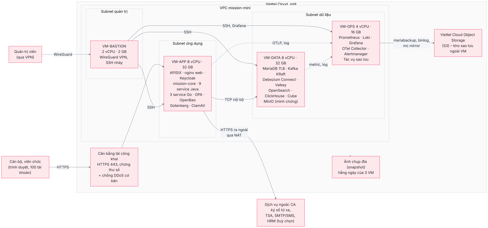
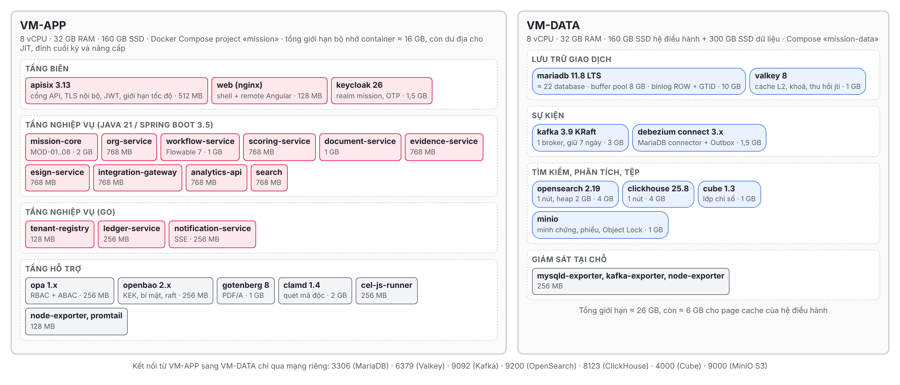
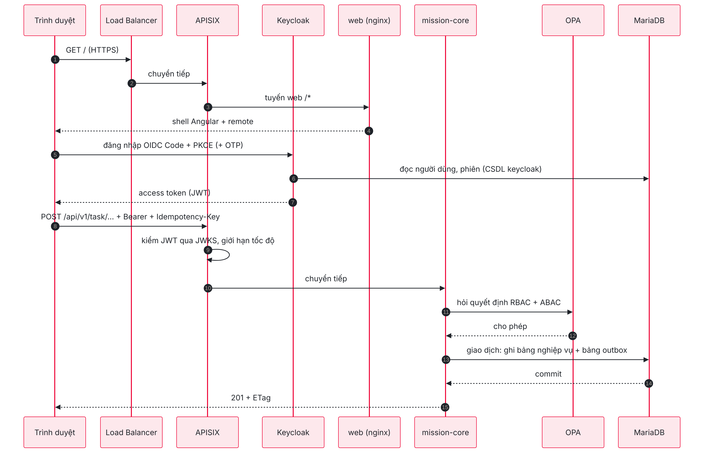
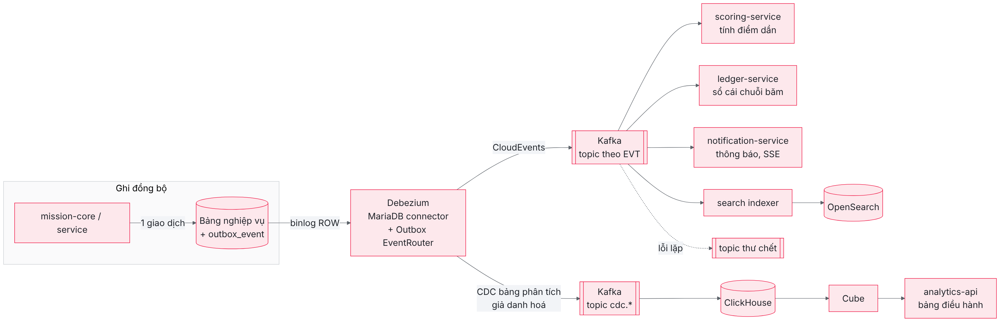
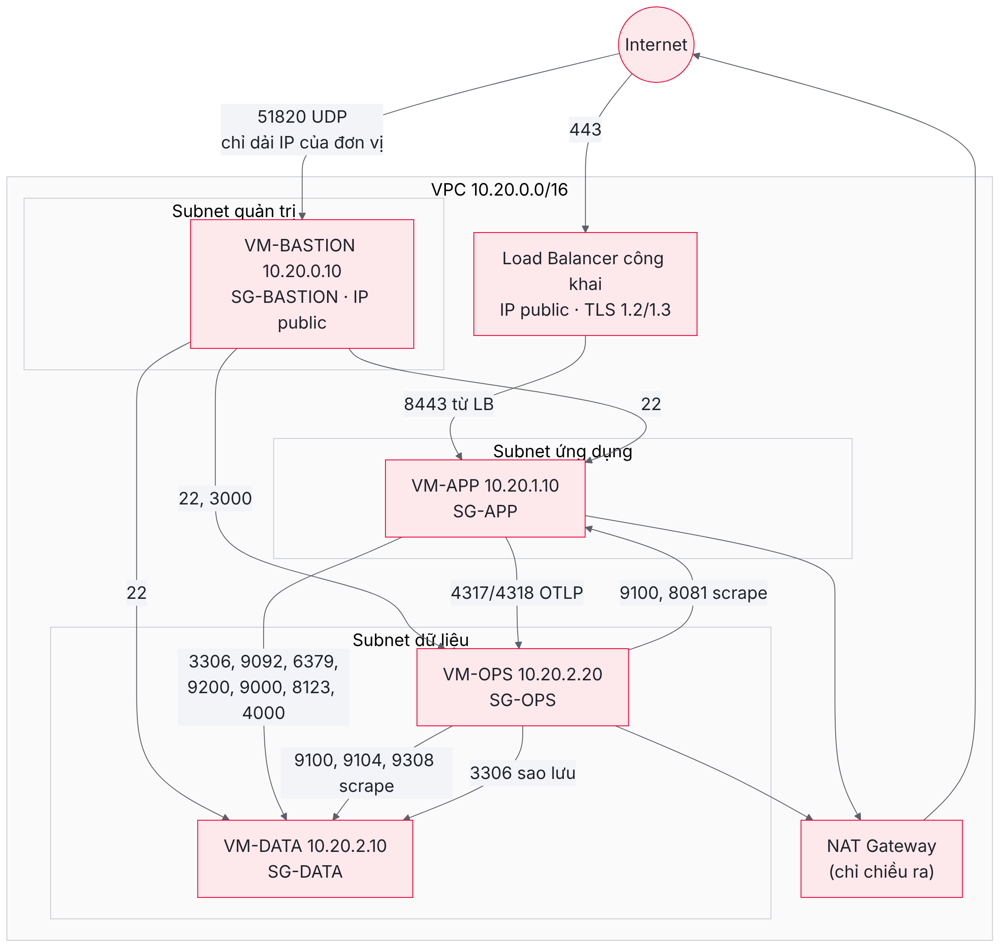
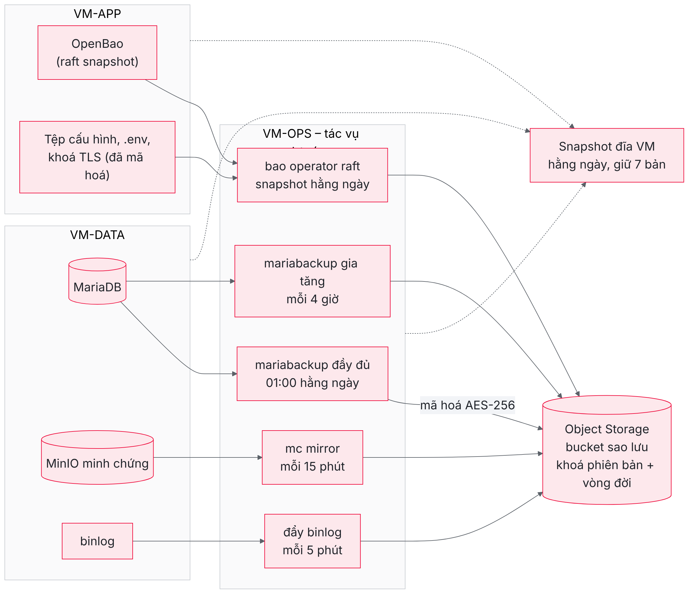
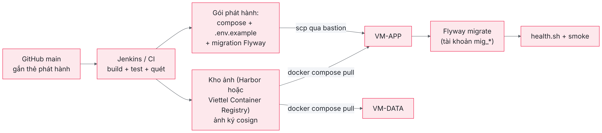
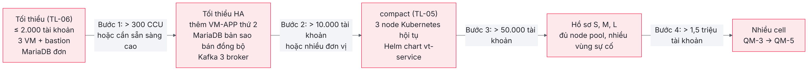

# Thông tin tài liệu {-}

## Kiểm soát phiên bản {-}

| Phiên bản | Ngày | Người thực hiện | Nội dung thay đổi |
|---|---|---|---|
| 1.0 | 26/10/2026 | Nhóm kiến trúc hạ tầng và vận hành | Bản đầu tiên: kiến trúc triển khai tối thiểu cho một đơn vị 100 người dùng trên Viettel Cloud, cơ sở dữ liệu MariaDB theo yêu cầu của chủ đầu tư, danh mục công nghệ, cấu hình hạ tầng, mạng, sao lưu, bảo mật, chi phí ước tính, phạm vi chuyển đổi từ PostgreSQL sang MariaDB và đường nâng cấp |

## Tài liệu liên quan {-}

| Mã | Tên tài liệu | Quan hệ với TL-06 |
|---|---|---|
| Baseline | Cơ sở thiết kế chung | Danh mục SVC, MOD, EVT, NFR, quy ước API mục 13; TL-06 giữ nguyên toàn bộ mã định danh |
| TL-01 | Thiết kế kiến trúc chi tiết | Kiến trúc lai modular monolith, microservice và cell; TL-06 là bản thu gọn của kiến trúc này cho một đơn vị |
| TL-03 | Thiết kế CSDL và đồng bộ dữ liệu | Schema, bảng, outbox, CDC; TL-06 chương 5 ánh xạ các schema này sang MariaDB |
| TL-04 | Triển khai, hiệu năng, dự phòng và ATTT | Biện pháp SEC, quy trình OPS, kịch bản DR; TL-06 chọn tập con áp dụng được ở quy mô nhỏ |
| TL-05 | Định cỡ hệ thống theo các quy mô triển khai | Hồ sơ `compact`, `S`, `M`, `L` và bậc QM-1 đến QM-5; TL-06 bổ sung một mức nhỏ hơn hồ sơ `compact` |
| Repo `mission-web` | Mã nguồn và cấu hình `infra/dev` (Docker Compose khoảng 32 container) | TL-06 bám đúng tập ảnh container, phiên bản và tham số bộ nhớ đang chạy thật trên môi trường dev |

## Quyết định đầu vào của tài liệu {-}

Tài liệu này được lập theo yêu cầu của anh Hoàng Khắc Hiếu ngày 26/10/2026 với ba quyết định đầu vào. Thứ nhất, quy mô triển khai là một đơn vị với 100 người dùng, hạ tầng thuê trên Viettel Cloud. Thứ hai, cơ sở dữ liệu quan hệ của bản tối thiểu là MariaDB thay cho PostgreSQL; quyết định này chỉ áp dụng cho bản tối thiểu mô tả ở đây và không thay đổi stack của bản đầy đủ trong TL-01 đến TL-05. Thứ ba, sản phẩm bàn giao là tệp PDF có sơ đồ được vẽ thật ở những chỗ cần minh hoạ. Theo quy tắc YC-PT-18 của sổ tay yêu cầu, các lựa chọn công nghệ còn lại được nhóm thiết kế tự quyết theo tiêu chí được khuyến nghị, còn hỗ trợ và miễn phí, đồng thời ghi rõ lý do ngay trong tài liệu.

# Giới thiệu

## Mục đích của tài liệu

Bộ tài liệu thiết kế TL-01 đến TL-05 mô tả nền tảng đánh giá cán bộ theo OKR và KPI ở quy mô quốc gia: 6,5 triệu tài khoản, 300.000 người dùng đồng thời, chia thành nhiều cell, chạy trên Kubernetes với các cụm PostgreSQL, Kafka, Ceph và OpenSearch nhiều nút. Kiến trúc đó là cần thiết cho quy mô quốc gia nhưng quá lớn và quá tốn kém cho một đơn vị chỉ có khoảng một trăm cán bộ, viên chức, chẳng hạn một sở, một trường đại học, một bệnh viện hay một đơn vị sự nghiệp muốn dùng nền tảng độc lập trước khi tham gia hệ thống chung.

TL-06 là thiết kế triển khai mức thấp (Low-Level Design, LLD) cho trường hợp đó. Tài liệu trả lời cụ thể bốn câu hỏi mà đội hạ tầng và bộ phận dự toán của đơn vị cần: hệ thống được bố trí lên những máy nào và các thành phần nói chuyện với nhau ra sao; dùng những công nghệ nào, phiên bản nào; mỗi máy cần cấu hình bao nhiêu vCPU, bộ nhớ, ổ đĩa, mạng được chia thế nào, sao lưu và bảo mật làm ra sao; và chi phí thuê hạ tầng trên Viettel Cloud khoảng bao nhiêu mỗi tháng. Ngoài ra, vì chủ đầu tư chọn MariaDB cho bản tối thiểu trong khi mã nguồn hiện tại được viết cho PostgreSQL, tài liệu dành riêng chương 5 để mô tả cấu hình MariaDB và chương 6 để xác định phạm vi chuyển đổi mã nguồn tương ứng.

## Phạm vi

TL-06 bao trùm môi trường sản xuất của một đơn vị: ba máy ảo chạy ứng dụng, dữ liệu và giám sát, một máy ảo nhảy (bastion) cho quản trị, cân bằng tải công khai, mạng riêng ảo (VPC), kho đối tượng dùng làm kho sao lưu ngoài máy ảo, cùng các quy trình triển khai, sao lưu, khôi phục và vận hành tối thiểu. Tài liệu không bao trùm môi trường phát triển (đã có ở `infra/dev`), môi trường kiểm thử riêng của đơn vị (có thể dựng bằng chính cấu hình này với máy nhỏ hơn), trợ lý AI và OCR (tắt bằng cờ tính năng ở bản tối thiểu), và các hệ thống bên ngoài như CA ký số, hệ thống quản lý văn bản hay cơ sở dữ liệu cán bộ (chỉ mô tả điểm kết nối).

## Giả định đầu vào

Bảng sau liệt kê các giả định mà mọi con số trong tài liệu dựa vào. Khi giả định thay đổi, người dùng tài liệu nên đối chiếu lại chương 7 (cấu hình hạ tầng), chương 11 (chi phí) và chương 13 (đường nâng cấp).

| Mã | Giả định | Giá trị | Căn cứ |
|---|---|---|---|
| GT-01 | Số tài khoản | 100 cán bộ, viên chức, thiết kế dư tới 2.000 tài khoản | Yêu cầu của chủ đầu tư; dư địa gấp 20 lần để không phải nâng cấp khi đơn vị mở rộng |
| GT-02 | Số người dùng đồng thời ở giờ cao điểm | 50, thiết kế 100 (toàn bộ người dùng cùng đăng nhập ngày hạn nộp) | Tỷ lệ 5% CCU của TL-05 không áp dụng cho đơn vị nhỏ; chọn kịch bản xấu nhất |
| GT-03 | Số tenant | 1 (đơn vị là một tenant duy nhất) | Mô hình silo của TL-01, ADR-07 |
| GT-04 | Minh chứng | 8 tệp mỗi người mỗi quý, trung bình 1 MB, giữ 10 năm | Baseline mục 3.1 |
| GT-05 | Cam kết sẵn sàng | 99,5% mỗi tháng (khoảng 3,6 giờ gián đoạn), chấp nhận một vùng sự cố | Đơn vị nhỏ, không yêu cầu 99,9% như cell SaaS |
| GT-06 | Mục tiêu khôi phục | RPO ≤ 15 phút; RTO ≤ 4 giờ khi hỏng một máy ảo; RTO ≤ 24 giờ khi mất cả vùng | Giữ RPO của NFR-05, nới RTO theo mức ngoại lệ đã chấp nhận cho hồ sơ `compact` ở TL-05 mục 9.2 |
| GT-07 | Hạ tầng | Viettel Cloud, một vùng (Hà Nội hoặc TP.HCM), máy ảo gói T2.Gen | Yêu cầu của chủ đầu tư |
| GT-08 | Cơ sở dữ liệu quan hệ | MariaDB 11.8 LTS, một instance | Yêu cầu của chủ đầu tư ngày 26/10/2026 |
| GT-09 | Trợ lý AI, OCR | Tắt | Không có GPU, không cần ở quy mô này |
| GT-10 | Truy cập của người dùng | Qua Internet bằng HTTPS, có thể giới hạn theo dải IP của đơn vị | Cán bộ làm việc tại cơ quan và từ xa |

## Cách đọc tài liệu

Chương 2 giải thích tải thật của một đơn vị 100 người và các nguyên tắc dùng để thu gọn kiến trúc đầy đủ. Chương 3 trình bày kiến trúc triển khai bằng các sơ đồ tổng thể, sơ đồ bố trí container, luồng xử lý một yêu cầu và luồng sự kiện. Chương 4 liệt kê danh mục công nghệ. Chương 5 là thiết kế cơ sở dữ liệu MariaDB, chương 6 là phạm vi chuyển đổi mã nguồn từ PostgreSQL. Chương 7 là cấu hình hạ tầng trên Viettel Cloud gồm máy ảo, ổ đĩa và mạng. Chương 8 là sao lưu và khôi phục, chương 9 là an toàn thông tin, chương 10 là giám sát, triển khai và vận hành. Chương 11 ước tính chi phí. Chương 12 tổng hợp những gì đã lược bỏ so với bản đầy đủ và rủi ro chấp nhận, chương 13 mô tả đường nâng cấp. Phụ lục chứa các tệp cấu hình mẫu và nguồn tham khảo giá.

Người chỉ cần con số để lập dự toán có thể đọc mục 7.1 rồi chuyển sang chương 11. Người cài đặt nên đọc chương 3, 5, 7, 8 và phụ lục. Người thẩm định nên đọc chương 2, 6 và 12, vì ở đó nêu rõ những gì bị đánh đổi.

# Mô hình tải và nguyên tắc thu gọn

## Tải thật của một đơn vị 100 người

Để chọn cấu hình đúng, trước hết cần thấy tải của một đơn vị 100 người nhỏ đến mức nào so với các hồ sơ của TL-05. Áp dụng định luật Little như baseline mục 3.1: với 100 người dùng đồng thời (kịch bản xấu nhất, GT-02) và thời gian suy nghĩ trung bình 20 giây giữa hai yêu cầu, cổng API nhận khoảng 5 yêu cầu mỗi giây; nhân hệ số đột biến 2 của ngày hạn nộp được 10 yêu cầu mỗi giây. Tỷ lệ đọc ghi 80/20 cho khoảng 2 yêu cầu ghi mỗi giây, sinh khoảng 3 sự kiện mỗi giây vào Kafka. Luồng duyệt BPMN, với mỗi người khoảng 2 tiến trình và 8 user task mỗi quý, chỉ tạo 1.600 user task mỗi quý, tức trung bình chưa tới một user task mỗi phút kể cả ngày cao điểm.

Dung lượng cũng rất nhỏ. Minh chứng của 100 người, 8 tệp mỗi quý, 1 MB mỗi tệp cho 3,2 GB mỗi năm và khoảng 32 GB sau 10 năm. Dữ liệu nghiệp vụ trong cơ sở dữ liệu, kể cả nhật ký kiểm toán và sổ cái, ước tính dưới 5 GB mỗi năm. Như vậy, nếu lấy hồ sơ `compact` của TL-05 (50.000 tài khoản, 2.500 CCU, khoảng 80 vCPU ở đỉnh) làm mốc, bản tối thiểu chỉ có tải bằng khoảng 0,4% về số yêu cầu và 0,2% về số tài khoản.

| Đại lượng | Bản tối thiểu (TL-06) | Hồ sơ `compact` (TL-05) | Tỷ lệ |
|---|---|---|---|
| Tài khoản thiết kế | 100, dư tới 2.000 | 50.000 | 0,2% đến 4% |
| Người dùng đồng thời | 100 | 2.500 | 4% |
| Yêu cầu mỗi giây ở đỉnh đột biến | khoảng 10 | khoảng 250 | 4% |
| Sự kiện Kafka mỗi giây | khoảng 3 | khoảng 75 | 4% |
| Minh chứng sau 10 năm | khoảng 32 GB | 1,6 TB sau 3 năm | rất nhỏ |
| vCPU cần ở đỉnh | dưới 4 vCPU cho xử lý nghiệp vụ | khoảng 80 vCPU | 5% |

Điều quan trọng rút ra từ bảng này là ở quy mô 100 người, ràng buộc chính không còn là năng lực xử lý mà là **bộ nhớ thường trú của các tiến trình**. Hệ thống có khoảng mười service Java, mỗi service là một máy ảo JVM chiếm từ 400 MB đến 1,5 GB dù không có tải, cộng Keycloak, Kafka, OpenSearch và ClickHouse cũng là những tiến trình có mức bộ nhớ nền đáng kể. Vì vậy cấu hình máy ảo trong TL-06 được định cỡ chủ yếu theo tổng giới hạn bộ nhớ của container, lấy từ các tham số `mem_limit` và `-Xmx` đang chạy thật trong `infra/dev/docker-compose.yml` và `.env.example`, chứ không theo công thức RPS chia năng lực mỗi pod như TL-05.

## Nguyên tắc thu gọn

Việc thu gọn tuân theo năm nguyên tắc, để bản tối thiểu vẫn là cùng một sản phẩm với bản đầy đủ và có thể nâng cấp mà không viết lại.

Nguyên tắc thứ nhất là **giữ nguyên mã nguồn ứng dụng và hợp đồng API**. Mọi service SVC-01 đến SVC-17 đang có trong repo vẫn được triển khai bằng đúng ảnh container của bản đầy đủ, chỉ khác tham số cấu hình. Người dùng cuối thấy cùng một giao diện, cùng quy trình QT, cùng màn hình SCR. Ngoại lệ duy nhất là phần truy cập cơ sở dữ liệu phải chuyển sang MariaDB, được khoanh vùng ở chương 6.

Nguyên tắc thứ hai là **gộp hạ tầng thay vì bỏ chức năng**. Thay vì bỏ Kafka, OpenSearch hay ClickHouse (làm mất chức năng sự kiện, tìm kiếm, bảng điều hành), bản tối thiểu chạy mỗi thành phần với một nút duy nhất và bộ nhớ nhỏ nhất đủ dùng. Thành phần nào chỉ phục vụ quy mô lớn mà không mang chức năng nghiệp vụ, như Istio, cụm điều phối toàn cục, cell router, Thanos hay Ceph, thì được bỏ.

Nguyên tắc thứ ba là **dùng Docker Compose thay cho Kubernetes**. Ở quy mô ba máy ảo, Kubernetes (kể cả k3s) thêm một lớp vận hành gồm control plane, etcd, CNI, ingress controller, operator CSDL mà đội hạ tầng của một đơn vị nhỏ khó duy trì, trong khi lợi ích chính của nó là tự co giãn và tự phục hồi trên nhiều nút thì không dùng tới. Docker Compose đã là công cụ chạy toàn bộ stack trên môi trường dev dùng chung (quy tắc YC-HT-01), có sẵn `healthcheck`, `restart: unless-stopped`, giới hạn bộ nhớ và các script triển khai lại đã được kiểm chứng. Đường lên Kubernetes được giữ ở chương 13.

Nguyên tắc thứ tư là **một tenant, một bộ dữ liệu**. Đơn vị là tenant duy nhất nên không cần cell, không cần định tuyến tenant giữa các cell, không cần phân vùng theo tenant. Cột `tenant_id` vẫn được giữ trong mọi bảng để dữ liệu chuyển được sang hệ thống chung sau này mà không phải biến đổi.

Nguyên tắc thứ năm là **giữ nguyên các kiểm soát an toàn thông tin có tính nghiệp vụ**: xác thực OIDC với OTP, phân quyền RBAC và ABAC qua OPA, mã hoá phong bì dữ liệu C2 bằng khoá trong OpenBao, sổ cái chỉ ghi có chuỗi băm, quét mã độc minh chứng, nhật ký kiểm toán. Những gì được nới là các biện pháp phục vụ khả dụng cao (nhiều vùng sự cố, bản sao ấm) và các biện pháp chỉ có ý nghĩa khi có nhiều tenant.

## Tổng hợp giữ, gộp, tắt và bỏ

Bảng dưới đây cho cái nhìn một trang về số phận của từng nhóm thành phần của bản đầy đủ khi chuyển sang bản tối thiểu. Chi tiết của phần bị bỏ và rủi ro tương ứng được trình bày ở chương 12.

| Nhóm thành phần | Bản đầy đủ (TL-01, TL-04) | Bản tối thiểu (TL-06) | Xử lý |
|---|---|---|---|
| Cổng API SVC-01 | APISIX nhiều replica, etcd, WAF Coraza | APISIX 1 instance, cấu hình tĩnh `apisix.yaml` (không cần etcd) | Gộp |
| Định danh SVC-02 | Keycloak cụm, CSDL riêng | Keycloak 1 instance, database `keycloak` trong MariaDB | Gộp |
| Danh bạ tenant SVC-03 | Toàn cục, nhiều cell | 1 instance, chỉ có 1 tenant | Giữ, cấu hình tối giản |
| Lõi nghiệp vụ SVC-05 và các microservice SVC-04, 06 đến 13, 15, 16 | Nhiều pod, HPA, KEDA | 1 container mỗi service, giới hạn bộ nhớ cố định | Giữ |
| Trợ lý AI SVC-14 | GPU, vLLM, pgvector | Không triển khai | Tắt bằng cờ tính năng |
| Giao diện SVC-17 | CDN + nginx | nginx sau APISIX | Giữ |
| CSDL quan hệ | 6 cụm PostgreSQL (CloudNativePG), PgBouncer | 1 instance MariaDB 11.8, kết nối trực tiếp qua pool HikariCP | Thay và gộp |
| Kafka, Debezium, Apicurio | 3 đến 6 broker, Connect nhiều worker, Apicurio trên PostgreSQL | 1 broker KRaft, 1 worker Connect với MariaDB connector, Apicurio lưu trên Kafka (`kafkasql`) hoặc tắt | Gộp |
| Valkey | Cluster 3 shard | 1 instance, có AOF | Gộp |
| OpenSearch | Nhiều nút | 1 nút, heap 2 GB | Gộp |
| ClickHouse, Cube, Superset | Nhiều shard, Superset nhúng | ClickHouse 1 nút, Cube 1 instance; Superset không triển khai | Gộp, bỏ Superset |
| Kho đối tượng | Ceph RGW, erasure coding | MinIO 1 nút trên đĩa dữ liệu, sao chép sang Object Storage của Viettel Cloud | Thay |
| Bí mật, khoá | OpenBao HA, HSM | OpenBao 1 nút lưu raft, khoá ký số gọi dịch vụ ký từ xa của CA | Gộp |
| Lưới dịch vụ, mTLS | Istio ambient | Không có; mạng riêng giữa VM, TLS ở biên | Bỏ |
| Quan sát | Prometheus mỗi cell, Thanos, Loki, Tempo, Grafana | Prometheus, Loki, Grafana, Alertmanager trên VM-OPS; Tempo tuỳ chọn | Gộp |
| Điều phối | Kubernetes, Argo CD, Cluster API, Kyverno | Docker Compose, script triển khai có sẵn trong repo | Thay |
| Dự phòng | Bản sao ấm ở TTDL phía Nam | Sao lưu ngoài máy ảo sang Object Storage, snapshot đĩa | Thay |

# Kiến trúc triển khai

## Sơ đồ tổng thể

Hình 3.1 trình bày kiến trúc triển khai tổng thể. Toàn bộ hệ thống nằm trong một VPC trên Viettel Cloud, chia làm ba subnet. Người dùng truy cập qua cân bằng tải công khai bằng HTTPS; cân bằng tải chỉ chuyển tiếp tới VM-APP. Quản trị viên truy cập qua VPN WireGuard trên VM-BASTION và chỉ từ đó mới SSH được vào các máy còn lại. VM-DATA chứa toàn bộ trạng thái của hệ thống; VM-OPS chứa giám sát và các tác vụ sao lưu, đẩy dữ liệu sao lưu ra Object Storage nằm ngoài các máy ảo.

{width=16.5cm}

Có ba lý do để tách ra ba máy ảo thay vì dồn tất cả vào một máy lớn. Lý do thứ nhất là **tách trạng thái khỏi phần không trạng thái**: VM-APP không giữ dữ liệu nào ngoài cấu hình, nên khi hỏng có thể dựng lại trong vòng một giờ từ ảnh container và gói cấu hình; chỉ VM-DATA cần quy trình khôi phục dữ liệu. Lý do thứ hai là **cô lập tài nguyên**: các JVM của tầng ứng dụng không tranh bộ nhớ và page cache với MariaDB, Kafka và OpenSearch, vốn hoạt động tốt nhất khi có bộ nhớ đệm hệ điều hành ổn định. Lý do thứ ba là **giám sát và sao lưu phải sống sót khi máy được giám sát hỏng**: nếu Prometheus và tác vụ sao lưu nằm trên VM-DATA, sự cố của VM-DATA sẽ làm mất luôn khả năng quan sát và cảnh báo về chính sự cố đó. Phương án một máy ảo vẫn khả thi và được so sánh về chi phí ở chương 11, nhưng không được khuyến nghị.

## Bố trí container trên từng máy ảo

Hình 3.2 cho thấy các container chạy trên VM-APP và VM-DATA cùng giới hạn bộ nhớ của từng container. Các giới hạn này lấy từ giá trị đang chạy trên môi trường dev (`JAVA_MEM_LIMIT=768m`, `MISSION_CORE_MEM_LIMIT` nâng từ 1,5 GB lên 2 GB cho sản xuất, `WORKFLOW_SERVICE_MEM_LIMIT=1g`, `DOCUMENT_SERVICE_MEM_LIMIT=1g`), vốn đã được kiểm chứng qua đợt kiểm thử toàn bộ chức năng ngày 25 và 26/10/2026.

{width=16.5cm}

Trên VM-APP, các container được chia thành bốn tầng. Tầng biên gồm APISIX, nginx phục vụ giao diện Angular và Keycloak; đây là những thành phần duy nhất mà cân bằng tải chuyển tiếp yêu cầu vào. Tầng nghiệp vụ Java gồm mission-core với tám module MOD-01 đến MOD-08 và chín microservice; tầng nghiệp vụ Go gồm tenant-registry, ledger-service và notification-service. Tầng hỗ trợ gồm OPA cho quyết định phân quyền, OpenBao giữ khoá mã hoá dữ liệu, Gotenberg dựng PDF/A cho các mẫu phiếu, clamd quét mã độc minh chứng và cel-js-runner đánh giá biểu thức CEL phía máy chủ. Tổng giới hạn bộ nhớ khoảng 16 GB trên máy 32 GB, phần còn lại dành cho JIT, luồng, bộ đệm ngoài heap, đỉnh khi tính điểm hàng loạt cuối kỳ và khoảng trống để chạy song song hai phiên bản khi nâng cấp.

Trên VM-DATA, MariaDB được cấp phần lớn bộ nhớ: 8 GB cho InnoDB buffer pool trong giới hạn container 10 GB. Với tổng dữ liệu dưới 20 GB trong vài năm đầu, phần dữ liệu nóng nằm trọn trong bộ nhớ. Kafka và Debezium Connect chiếm khoảng 4,5 GB, OpenSearch và ClickHouse mỗi thành phần 4 GB, Valkey, Cube và MinIO mỗi thành phần khoảng 1 GB. Tổng giới hạn khoảng 26 GB, còn khoảng 6 GB cho page cache của hệ điều hành, phục vụ Kafka và các tệp phân đoạn của OpenSearch.

Hai máy dùng hai project Compose riêng (`mission` và `mission-data`) để có thể khởi động lại, nâng cấp tầng ứng dụng mà không đụng tới tầng dữ liệu. Các service trên VM-APP kết nối sang VM-DATA bằng địa chỉ IP riêng qua biến môi trường đã có sẵn trong mã (`DB_HOST`, `KAFKA_BOOTSTRAP_SERVERS`, `VALKEY_HOST`, `OPENSEARCH_URL`…), nên không cần sửa mã để tách hai máy.

## Luồng xử lý một yêu cầu của người dùng

Hình 3.3 mô tả đường đi của một thao tác ghi điển hình, ví dụ cán bộ cập nhật tiến độ nhiệm vụ. Trình duyệt tải giao diện qua cân bằng tải và APISIX, đăng nhập với Keycloak theo luồng OIDC Authorization Code có PKCE và bước OTP, nhận access token dạng JWT. Mỗi lời gọi API mang token và khoá `Idempotency-Key` theo quy ước API mục 13 của baseline. APISIX kiểm chữ ký JWT bằng JWKS của Keycloak và áp giới hạn tốc độ, rồi chuyển tới mission-core. mission-core hỏi OPA quyết định phân quyền, ghi bảng nghiệp vụ và bảng outbox trong cùng một giao dịch MariaDB, rồi trả kết quả kèm `ETag` để lần cập nhật sau gửi `If-Match`.

{width=16.5cm}

Toàn bộ luồng này giống hệt bản đầy đủ, chỉ khác ở chỗ không có Istio và PgBouncer ở giữa. Ở 10 yêu cầu mỗi giây, độ trễ thêm của mỗi bước nằm trong vài mili giây, nên các chỉ tiêu NFR-03 (API đọc p95 ≤ 300 ms, API ghi p95 ≤ 800 ms) được đáp ứng với dư địa lớn; ràng buộc thực tế là thời gian khởi động lạnh của JVM sau mỗi lần nâng cấp, được xử lý bằng `healthcheck` readiness và khởi động lần lượt.

## Luồng sự kiện và đồng bộ dữ liệu

Hình 3.4 mô tả cơ chế outbox và CDC được giữ nguyên từ TL-03, chỉ thay nguồn đọc từ WAL của PostgreSQL sang binlog của MariaDB. Khi một giao dịch ghi bảng `outbox_event`, Debezium đọc binlog ở định dạng ROW, dùng bộ chuyển đổi Outbox EventRouter để phát sự kiện CloudEvents vào topic Kafka theo mã EVT. Các consumer gồm scoring-service tính điểm dần, ledger-service ghi sổ cái chuỗi băm, notification-service đẩy thông báo qua SSE và bộ lập chỉ mục tìm kiếm ghi vào OpenSearch. Một connector thứ hai đọc các bảng phục vụ phân tích, giả danh hoá bằng plugin `TenantPseudonymize` có sẵn trong repo (`analytics/cdc/smt`), ghi vào topic `cdc.*` để ClickHouse nạp, Cube tính chỉ số và analytics-api phục vụ bảng điều hành.

{width=16.5cm}

Giữ Kafka và Debezium ở quy mô 100 người có vẻ dư thừa, nhưng đây là lựa chọn có chủ ý. Bỏ Kafka đồng nghĩa phải viết lại cơ chế giao tiếp giữa mission-core và scoring-service, ledger-service, notification-service, search, analytics, tức là tạo ra một nhánh mã riêng cho bản tối thiểu và mất khả năng nâng cấp liền mạch. Ở chế độ một broker KRaft, Kafka chỉ chiếm khoảng 3 GB bộ nhớ và gần như không dùng CPU ở 3 sự kiện mỗi giây.

# Danh mục công nghệ

## Bảng công nghệ và phiên bản

Bảng sau liệt kê toàn bộ công nghệ của bản tối thiểu. Cột phiên bản ghi đúng phiên bản đang dùng trong `infra/dev/docker-compose.yml` hoặc trong mã nguồn, trừ MariaDB là thành phần mới do chủ đầu tư chọn. Mọi thành phần đều dùng giấy phép mã nguồn mở, không phát sinh chi phí bản quyền; riêng MinIO dùng giấy phép AGPL 3.0, được chấp nhận vì chỉ chạy nội bộ và không sửa mã của MinIO.

| Lớp | Công nghệ | Phiên bản | Giấy phép | Vai trò ở bản tối thiểu |
|---|---|---|---|---|
| Hệ điều hành | Ubuntu Server LTS | 24.04 | Tự do | Hệ điều hành của cả bốn máy ảo; có bản vá bảo mật tới 2029 |
| Chạy container | Docker Engine, Docker Compose v2 | 27.x, 2.x | Apache 2.0 | Chạy và giám sát vòng đời container |
| Giao diện | Angular, PrimeNG, Native Federation, Formly, cel-js | 21, 21 | MIT | Shell `fe-shell` và các remote, phục vụ tĩnh qua nginx |
| Máy chủ web tĩnh | nginx (ảnh `deploy/web`) | 1.27 | BSD | Phục vụ giao diện, header CSP và Trusted Types |
| Cổng API | Apache APISIX | 3.13 | Apache 2.0 | Định tuyến `/api/v1/<module>`, kiểm JWT, giới hạn tốc độ, chế độ cấu hình tĩnh |
| Định danh | Keycloak | 26.4 | Apache 2.0 | SSO OIDC, OTP, giao diện đăng nhập `mission`, quản trị người dùng trong ứng dụng (ADR-34) |
| Phân quyền | Open Policy Agent | 1.4 | Apache 2.0 | RBAC và ABAC bằng Rego, gói chính sách sinh từ ma trận phân quyền |
| Bí mật, khoá | OpenBao | 2.2 | MPL 2.0 | KEK cho mã hoá phong bì C2, chỉ mục mù, kho bí mật `kv-v2` |
| Lõi nghiệp vụ | Java 21, Spring Boot 3.5, Spring Modulith | 21 LTS, 3.5 | Apache 2.0, GPL+CE | mission-core và các service Java |
| Luồng duyệt | Flowable (nhúng trong workflow-service) | 7.x | Apache 2.0 | BPMN và DMN tầng 2, saga tầng 3 |
| Service Go | Go | 1.23 | BSD | tenant-registry, ledger-service, notification-service |
| CSDL quan hệ | **MariaDB Community Server** | **11.8 LTS** | GPL 2.0 | Toàn bộ dữ liệu giao dịch, Keycloak và Flowable |
| Di trú lược đồ | Flyway | theo `platform-bom` | Apache 2.0 | Migration của từng database, tài khoản `mig_*` |
| Bộ đệm | Valkey | 8 | BSD | Cache L2, khoá phân tán, thu hồi `jti`, luồng thông báo |
| Sự kiện | Apache Kafka (KRaft) | 3.9.1 | Apache 2.0 | Truyền sự kiện EVT, CDC phân tích |
| CDC | Debezium Connect | 3.x (MariaDB connector) | Apache 2.0 | Đọc binlog, Outbox EventRouter |
| Lược đồ sự kiện | Apicurio Registry | 3.3 | Apache 2.0 | Lưu lược đồ Avro/JSON; ở bản tối thiểu dùng kho `kafkasql` để không phụ thuộc CSDL |
| Tìm kiếm | OpenSearch (có `analysis-icu`) | 2.19 | Apache 2.0 | Tìm kiếm toàn văn tiếng Việt |
| Phân tích | ClickHouse, Cube | 25.8, 1.3 | Apache 2.0 | Kho phân tích một nút, lớp chỉ số chuẩn cho bảng điều hành |
| Kho đối tượng | MinIO | bản ghim trong compose | AGPL 3.0 | Minh chứng, phiếu PDF, Object Lock |
| Dựng tài liệu | Gotenberg, docx4j, OpenPDF | 8 | Apache 2.0, LGPL | Sinh Mẫu 1A đến 1D, 2, 3 và PDF/A |
| Quét mã độc | ClamAV (clamd) | 1.4 | GPL 2.0 | Quét minh chứng trước khi chấp nhận |
| Quan sát | OpenTelemetry Collector, Prometheus, Loki, Grafana, Alertmanager | 0.119, 3.1, 3.3, 11.5 | Apache 2.0, AGPL (Grafana, Loki) | Metric, log, cảnh báo; Tempo cho trace là tuỳ chọn |
| Sao lưu | mariabackup, restic, MinIO Client `mc` | theo MariaDB 11.8; 0.17; bản đi kèm MinIO | GPL, BSD, AGPL | Sao lưu đầy đủ, gia tăng, binlog, đồng bộ minh chứng ra Object Storage |
| VPN quản trị | WireGuard | theo nhân Ubuntu | GPL 2.0 | Kênh quản trị duy nhất vào VPC |
| Tường lửa máy | nftables qua `ufw`, kết hợp Security Group | theo Ubuntu | GPL | Lớp lọc thứ hai sau Security Group |

## Lý do chọn một số công nghệ

**MariaDB 11.8 LTS.** Chủ đầu tư chọn MariaDB cho bản tối thiểu. Trong các nhánh MariaDB, 11.8 là nhánh hỗ trợ dài hạn (LTS) mới nhất tại thời điểm viết, có kiểu `UUID` gốc, kiểu `INET6`, cột sinh ảo có chỉ mục, phân vùng gốc, `JSON_TABLE` và bảng có phiên bản hệ thống (system-versioned tables), đủ để thay phần lớn tính năng PostgreSQL mà mã đang dùng (chương 6). Keycloak 26 hỗ trợ chính thức MariaDB, Debezium 3 có connector MariaDB riêng, Flowable chạy được trên MariaDB với kiểu CSDL `mysql`. Nếu nhóm vận hành của đơn vị đã quen một nhánh LTS khác (ví dụ 11.4), tài liệu vẫn áp dụng được, chỉ cần kiểm lại các hàm UUID và vector.

**Docker Compose thay Kubernetes.** Đã giải thích ở mục 2.2. Bổ sung một điểm thực tế: repo đã có `infra/dev/scripts/trien-khai-lai.sh`, `deploy-backend.sh`, `health.sh`, `smoke-backend.sh` và `gen-env.sh`, đã chạy ổn định trên môi trường dev dùng chung. Bản tối thiểu dùng lại các script này với tệp compose sản xuất, giảm đáng kể công viết mới.

**APISIX chế độ tĩnh.** APISIX hỗ trợ chế độ `standalone` đọc tuyến từ tệp `apisix.yaml`, chính là chế độ đang dùng ở môi trường dev (INF-22). Chế độ này bỏ được etcd, một thành phần cần ba nút để an toàn.

**MinIO kết hợp Object Storage của Viettel Cloud.** Mã của evidence-service và document-service dùng giao diện S3 với Object Lock để bảo đảm minh chứng không bị sửa. MinIO trên VM-DATA cung cấp đúng giao diện đó với độ trễ thấp và không phụ thuộc hạ tầng bên ngoài. Bản sao của bucket được đồng bộ ra Object Storage của Viettel Cloud, nằm ngoài vùng sự cố của máy ảo. Nếu Object Storage của Viettel Cloud được xác nhận hỗ trợ Object Lock theo chuẩn S3, đơn vị có thể bỏ MinIO và trỏ thẳng hai service vào đó (chỉ đổi cấu hình), giảm một thành phần phải vận hành.

**Ký số qua dịch vụ ký từ xa.** Bản đầy đủ dùng HSM trong vùng bảo mật. Ở bản tối thiểu, esign-service dùng bộ kết nối ký từ xa (MySign hoặc Viettel-CA) đã có trong thiết kế SVC-10, nên khoá ký nằm ở HSM của nhà cung cấp chữ ký số, đơn vị không phải mua HSM. Dấu thời gian lấy từ TSA của CA theo RFC 3161.

# Thiết kế cơ sở dữ liệu MariaDB

## Bố trí database

Trong PostgreSQL, mỗi module và mỗi service sở hữu một schema riêng trong một database, kèm ba loại tài khoản `mig_<schema>` (di trú), `svc_<schema>` (ứng dụng) và `cdc_<schema>` (CDC). Trong MariaDB, khái niệm schema và database là một, nên mỗi schema PostgreSQL được ánh xạ thành một database MariaDB cùng tên, giữ nguyên quy ước tài khoản. Cách ánh xạ này giữ được ranh giới sở hữu dữ liệu của TL-03 và quy tắc ArchUnit của mission-core, vì mỗi module vẫn chỉ được cấp quyền trên database của mình.

| Database MariaDB | Nguồn PostgreSQL | Chủ sở hữu | Ghi chú |
|---|---|---|---|
| `okr`, `task`, `product`, `appraisal`, `policy`, `dossier`, `oversight`, `config` | 8 schema của mission-core (MOD-01 đến MOD-08) | mission-core | Mỗi module một DataSource như hiện tại |
| `org_replica`, `modulith`, `keyring` | schema phụ của mission-core | mission-core | Bản sao cây tổ chức, bảng sự kiện Spring Modulith, khoá dữ liệu |
| `org` | schema `org` | org-service | Cây tổ chức hai trục thời gian |
| `flowable` | database `flowable` | workflow-service | Lược đồ Flowable cho MySQL/MariaDB |
| `scoring`, `docgen`, `evidence`, `esign`, `integ`, `notify` | schema cùng tên | service cùng tên | |
| `registry` | schema `registry` | tenant-registry | Chỉ một tenant |
| `ledger` | database `ledger` | ledger-service | Tài khoản riêng, chỉ được `INSERT` và `SELECT` |
| `keycloak` | database `keycloak` | Keycloak | Keycloak tự tạo lược đồ khi khởi động lần đầu |

Tổng cộng khoảng 22 database trong một instance. Đây là con số bình thường đối với MariaDB, không ảnh hưởng hiệu năng vì InnoDB dùng chung buffer pool cho mọi database.

## Cấu hình instance

Instance MariaDB chạy trong container trên VM-DATA, thư mục dữ liệu gắn vào ổ dữ liệu riêng định dạng XFS, binlog gắn vào thư mục riêng trên cùng ổ để tác vụ sao lưu đọc được. Các tham số chính và lý do được nêu dưới đây; tệp cấu hình đầy đủ nằm ở phụ lục B.

| Tham số | Giá trị | Lý do |
|---|---|---|
| `character_set_server`, `collation_server` | `utf8mb4`, `utf8mb4_uca1400_vietnamese_ai_ci` | Lưu đủ tiếng Việt có dấu và biểu tượng; sắp xếp, so sánh theo quy tắc tiếng Việt, không phân biệt dấu khi tìm |
| `default_storage_engine` | InnoDB | Giao dịch ACID, khoá dòng |
| `innodb_buffer_pool_size` | 8G | Chứa trọn dữ liệu nóng (dưới 20 GB tổng dữ liệu) |
| `innodb_log_file_size` | 1G | Giảm tần suất checkpoint khi tính điểm hàng loạt |
| `innodb_flush_log_at_trx_commit`, `sync_binlog` | 1, 1 | Không mất giao dịch đã xác nhận khi mất điện (yêu cầu của sổ cái và phiếu đánh giá) |
| `transaction_isolation` | `READ-COMMITTED` | Cùng mức cô lập mặc định của PostgreSQL mà mã đang giả định; giảm khoá khoảng (gap lock) |
| `log_bin`, `binlog_format`, `binlog_row_image` | bật, `ROW`, `FULL` | Bắt buộc cho Debezium và khôi phục tới thời điểm |
| `gtid_strict_mode`, `server_id` | `ON`, 1 | Định vị binlog ổn định cho Debezium và bản sao sau này |
| `binlog_expire_logs_seconds` | 604800 (7 ngày) | Binlog cũ hơn đã nằm trong kho sao lưu |
| `max_connections` | 400 | Ngân sách kết nối ở mục 5.3 cộng dư 50% |
| `sql_mode` | `STRICT_TRANS_TABLES,ERROR_FOR_DIVISION_BY_ZERO,NO_ENGINE_SUBSTITUTION,NO_ZERO_DATE` | Hành vi chặt như PostgreSQL, không tự cắt dữ liệu |
| `lower_case_table_names` | 1 | Tránh lỗi khác biệt hoa thường giữa tên bảng trong mã và trên đĩa |
| `require_secure_transport` | `ON` | Mọi kết nối từ VM-APP sang đều qua TLS |
| `default_time_zone` | `+00:00` | Lưu thời gian theo UTC, giao diện hiển thị theo giờ Việt Nam |

## Ngân sách kết nối

Bản đầy đủ đặt PgBouncer giữa ứng dụng và PostgreSQL vì PostgreSQL tạo một tiến trình cho mỗi kết nối. MariaDB dùng luồng cho mỗi kết nối và có thread pool, nên ở vài trăm kết nối không cần bộ gộp kết nối bên ngoài; các service kết nối thẳng qua pool HikariCP (Java) hoặc pool của `database/sql` (Go). Kích thước pool được hạ so với bản đầy đủ vì tải rất thấp.

| Thành phần | Số instance | Kết nối mỗi instance | Tổng |
|---|---|---|---|
| mission-core (8 DataSource theo module, mỗi DataSource 4 kết nối, `task` 8) | 1 | 36 | 36 |
| 9 service Java khác | 9 | 10 | 90 |
| 3 service Go | 3 | 10 | 30 |
| Keycloak | 1 | 20 | 20 |
| Flowable trong workflow-service (pool riêng của engine) | 1 | 20 | 20 |
| Debezium (2 connector) | 1 | 4 | 4 |
| Tác vụ sao lưu, exporter, quản trị | – | – | 20 |
| **Tổng** | | | **220** |

Giới hạn `max_connections=400` cho dư địa khoảng 80% để chạy song song hai phiên bản của một service trong lúc nâng cấp.

## Tài khoản và phân quyền trong CSDL

Mỗi database có ba tài khoản theo quy ước của TL-03. Tài khoản `mig_<db>` có quyền DDL, chỉ được dùng bởi Flyway trong lúc triển khai và bị khoá (`ACCOUNT LOCK`) khi không triển khai. Tài khoản `svc_<db>` chỉ có quyền `SELECT`, `INSERT`, `UPDATE`, `DELETE` trên database của mình; riêng `svc_ledger` không có `UPDATE` và `DELETE` để bảo toàn tính chỉ ghi của sổ cái. Tài khoản `cdc_mission` dùng chung cho Debezium có quyền `REPLICATION SLAVE`, `REPLICATION CLIENT`, `BINLOG MONITOR` và `SELECT` trên các bảng outbox, bảng phân tích. Mọi tài khoản gắn với dải IP của subnet ứng dụng (`'svc_task'@'10.20.1.%'`) và bắt buộc TLS (`REQUIRE SSL`). Mật khẩu sinh ngẫu nhiên bằng `gen-env.sh`, lưu trong OpenBao và tệp `.env` quyền 600, không bao giờ ghi vào tài liệu hay kho mã.

## Cách ly tenant khi không có RLS

Bản đầy đủ dựa vào Row Level Security (RLS) của PostgreSQL làm lớp bảo vệ thứ hai: mỗi giao dịch đặt `app.tenant_id` qua `set_config`, và chính sách RLS chặn mọi dòng của tenant khác ngay cả khi mã ứng dụng quên điều kiện lọc. MariaDB không có RLS. Ở bản tối thiểu, rủi ro này được xử lý theo hai lớp. Lớp thứ nhất mang tính cấu trúc: hệ thống chỉ có một tenant duy nhất (GT-03), nên không tồn tại dữ liệu của tenant khác để lộ; đây là mô hình silo mà TL-01 ADR-07 đã thừa nhận là mức cách ly mạnh nhất. Lớp thứ hai giữ thói quen đúng trong mã: mọi truy vấn vẫn mang điều kiện `tenant_id`, và ở tầng ứng dụng bộ lọc tenant của Hibernate (`@TenantId` hoặc `@Filter`) cùng một biến phiên MariaDB `@app_tenant_id` thay cho `set_config`, để khi chuyển dữ liệu sang hệ thống nhiều tenant sau này không có dòng nào thiếu `tenant_id`. Chi tiết nằm ở mục 6.3.

## Phân vùng và lưu giữ

Bản đầy đủ phân vùng các bảng lớn (nhật ký kiểm toán, sự kiện outbox, lịch sử check-in) theo tháng bằng `pg_partman`. Ở 100 người, các bảng này chỉ có vài trăm nghìn dòng mỗi năm, nên bản tối thiểu không bắt buộc phân vùng. Để giữ cơ chế xoá theo hạn lưu giữ của thư viện `retention`, các bảng outbox và nhật ký vẫn được phân vùng `RANGE` theo tháng bằng phân vùng gốc của MariaDB, với một sự kiện định kỳ (`EVENT`) tạo trước phân vùng của ba tháng tới và gỡ phân vùng đã quá hạn lưu giữ. Outbox chỉ cần giữ 7 ngày sau khi Debezium đọc xong; nhật ký kiểm toán và sổ cái giữ tối thiểu 10 năm theo NFR-09 và không bao giờ bị gỡ, chỉ được lưu trữ lạnh bằng bản sao lưu.

# Phạm vi chuyển đổi mã nguồn từ PostgreSQL sang MariaDB

## Hiện trạng phụ thuộc

Mã nguồn hiện tại được viết cho PostgreSQL 17 và dùng khá sâu các tính năng riêng của PostgreSQL. Bảng dưới đây là kết quả khảo sát trực tiếp repo `mission-web` ngày 26/10/2026 (đếm tệp có chứa cấu trúc tương ứng, không tính thư mục `target`). Con số này cho thấy chuyển sang MariaDB là một hạng mục phát triển thật sự, không phải chỉ đổi chuỗi kết nối.

| Phụ thuộc PostgreSQL | Số tệp liên quan | Nơi xuất hiện |
|---|---|---|
| Tệp migration SQL (Flyway) | 165 tệp, khoảng 23.200 dòng | `backend/**/db/migration`, `services-go/**/db/migration` |
| Row Level Security (`ENABLE ROW LEVEL SECURITY`, `CREATE POLICY`) | 34 và 44 tệp migration | Hầu hết các schema nghiệp vụ |
| `set_config` / `current_setting('app.tenant_id')` | 88 tệp migration, 55 tệp mã | Chính sách RLS, bộ đặt ngữ cảnh tenant |
| Kiểu `jsonb` và toán tử JSON | 60 tệp migration, 109 tệp mã | Policy Pack, biểu mẫu động, payload sự kiện |
| Hàm, trigger PL/pgSQL | 29 tệp có `plpgsql`, 19 tệp có `CREATE TRIGGER` | Kiểm bất biến, cập nhật phiên bản, chuỗi băm |
| Ràng buộc loại trừ (`EXCLUDE USING gist`), kiểu khoảng `tstzrange`, `daterange`, tiện ích `btree_gist` | 8, 8 và 3 tệp | Cây tổ chức hai trục thời gian, kỳ đánh giá không chồng lấn |
| `pg_partman` và `PARTITION BY` | 11 và 25 tệp | Bảng outbox, nhật ký, lịch sử |
| Mảng (`text[]`, `uuid[]`) | 11 tệp | Danh sách đơn vị, vai trò |
| `INSERT … ON CONFLICT` | 2 tệp migration, 81 tệp mã | Idempotency, upsert |
| Khoá tư vấn (`pg_advisory_*`) | 22 tệp mã | Khoá phân tán cho job định kỳ |
| `FOR UPDATE SKIP LOCKED` | 17 tệp mã | Hàng đợi công việc trong CSDL |
| `LISTEN` / `pg_notify` | 2 tệp mã | Thông báo nội bộ |
| Truy vấn SQL viết tay (JDBC, native query, pgx) | khoảng 280 tệp | Mã Java và Go |
| Kiểm thử dùng `PostgreSQLContainer` | 80 tệp | Kiểm thử tích hợp Java |
| Driver Go `pgx` | 4 module Go | tenant-registry, notification, ledger, outbox-replay |
| Cấu hình hạ tầng | Keycloak `KC_DB=postgres`, Apicurio `postgresql`, Debezium PostgreSQL connector, `migrate-roles.sh` | `infra/dev`, `deploy/charts` |

## Cách thay thế từng tính năng

Bảng sau nêu cách thay thế được khuyến nghị cho từng nhóm phụ thuộc. Nguyên tắc chung là thay ở mức thư viện dùng chung (`vt-platform-starter`, `vt-db-migration`, `vtplatform` của Go) trước, để các service hưởng lợi mà không phải sửa rải rác.

| Tính năng PostgreSQL | Thay thế trên MariaDB 11.8 | Mức công việc |
|---|---|---|
| `jsonb`, chỉ mục GIN | Kiểu `JSON` (lưu `LONGTEXT` có ràng buộc `JSON_VALID`), truy vấn bằng `JSON_VALUE`, `JSON_EXTRACT`; trường hay lọc được tách thành cột sinh ảo có chỉ mục | Vừa: đổi kiểu trong migration, đổi toán tử `->>`, `@>` trong truy vấn, đổi `JdbcTypeCode(SqlTypes.JSON)` sang ánh xạ chuỗi JSON |
| RLS và `set_config` | Bỏ chính sách RLS; bộ lọc tenant ở Hibernate và điều kiện `tenant_id` bắt buộc trong truy vấn viết tay; biến phiên `SET @app_tenant_id` cho trigger cần ngữ cảnh | Vừa: tập trung ở `vt-platform-starter`; thêm kiểm thử tự động bảo đảm mọi truy vấn có điều kiện tenant |
| PL/pgSQL, trigger | Viết lại bằng cú pháp thủ tục, trigger của MariaDB (`DELIMITER`, `SIGNAL SQLSTATE`); một số bất biến chuyển lên tầng ứng dụng | Lớn: 29 tệp, cần kiểm thử hồi quy từng bất biến |
| `EXCLUDE USING gist` với khoảng thời gian | Tách khoảng thành hai cột `valid_from`, `valid_to`; kiểm chồng lấn bằng trigger `BEFORE INSERT/UPDATE` cộng khoá dòng của thực thể cha; với dữ liệu lịch sử hệ thống dùng bảng `WITH SYSTEM VERSIONING` | Lớn: cây tổ chức hai trục thời gian là phần nhạy cảm nhất |
| `pg_partman` | Phân vùng `RANGE` gốc và `EVENT` định kỳ tạo, gỡ phân vùng | Nhỏ |
| Mảng | Cột `JSON` chứa mảng, hoặc bảng con chuẩn hoá khi cần lọc | Vừa |
| `ON CONFLICT … DO UPDATE/NOTHING` | `INSERT … ON DUPLICATE KEY UPDATE`, `INSERT IGNORE` | Vừa: 81 tệp mã, phần lớn đi qua lớp idempotency dùng chung |
| `uuid`, `gen_random_uuid()` | Kiểu `UUID` gốc của MariaDB; UUID sinh ở ứng dụng (UUIDv7) như hiện tại | Nhỏ |
| `timestamptz` | `TIMESTAMP(6)` lưu UTC (phạm vi tới năm 2106 ở MariaDB 11.5 trở lên) hoặc `DATETIME(6)` với quy ước UTC | Nhỏ, cần thống nhất trong `vt-db-migration` |
| `pg_advisory_lock` | `GET_LOCK()` / `RELEASE_LOCK()` của MariaDB, hoặc khoá phân tán trên Valkey đã có sẵn | Nhỏ |
| `FOR UPDATE SKIP LOCKED` | MariaDB hỗ trợ `SKIP LOCKED` từ 10.6 | Gần như không đổi |
| `LISTEN/NOTIFY` | Thay bằng Valkey Pub/Sub hoặc sự kiện Kafka | Nhỏ |
| Driver Go `pgx` | `github.com/go-sql-driver/mysql` với `database/sql` | Vừa: 4 module |
| Kiểm thử tích hợp | `MariaDBContainer` của Testcontainers; giữ bộ kiểm thử chạy song song trên cả hai CSDL nếu duy trì hai nhánh | Vừa |
| Debezium | `io.debezium.connector.mariadb.MariaDbConnector`, cấu hình `database.include.list`, `table.include.list`; Outbox EventRouter và plugin giả danh hoá giữ nguyên | Nhỏ |
| Keycloak | `KC_DB=mariadb`, `KC_DB_URL=jdbc:mariadb://…/keycloak` | Rất nhỏ, hỗ trợ chính thức |
| Flowable | `flowable.database-type=mysql`, lược đồ Flowable cho MySQL; tắt `database-schema-update` như hiện tại và tạo lược đồ bằng Flyway | Nhỏ, cần chạy bộ kiểm thử luồng duyệt |
| Apicurio Registry | Chuyển kho sang `kafkasql` (lưu trong topic Kafka) để khỏi phụ thuộc CSDL | Rất nhỏ |
| Spring Modulith event publication | Bộ `spring-modulith-starter-jdbc` hỗ trợ MySQL/MariaDB; tạo bảng bằng migration | Nhỏ |
| Hibernate | `MariaDBDialect`, driver `org.mariadb.jdbc` | Nhỏ |

## Thay RLS bằng kiểm soát ở tầng ứng dụng

Vì RLS là lớp phòng thủ chiều sâu được nhiều tài liệu bảo mật của bộ TL nhắc tới (SEC trong TL-04, trang wiki 17 và 20), cách thay cần được mô tả cụ thể để người thẩm định chấp nhận. Bản tối thiểu áp ba biện pháp. Một là thư viện `vt-platform-starter` gắn bộ lọc tenant cho mọi thực thể có cột `tenant_id` và tự đặt giá trị từ token đã xác thực; thực thể không có cột này phải được khai báo ngoại lệ có lý do. Hai là một phép kiểm tĩnh trong pipeline (cùng kiểu với quy tắc Semgrep về tenant đã có trong `backend/semgrep`) chặn build khi một truy vấn SQL viết tay đọc bảng có `tenant_id` mà không có điều kiện tương ứng. Ba là ở mức cấu trúc, đơn vị chạy trong một instance riêng, nên ngay cả khi có lỗi lập trình cũng không thể đọc dữ liệu của đơn vị khác. Khi đơn vị nâng lên mô hình nhiều tenant dùng chung (chương 13), hệ thống phải quay về PostgreSQL có RLS, không được chạy nhiều tenant trên MariaDB với chỉ một lớp kiểm soát ở ứng dụng.

## Ước tính khối lượng và cách tổ chức

Ước tính sơ bộ (suy luận từ số tệp ở mục 6.1, chưa có đo thực tế) cho phần chuyển đổi là khoảng 6 đến 9 tuần công của hai kỹ sư backend, chia thành bốn gói. Gói thứ nhất, khoảng 1 tuần, là thư viện dùng chung: dialect, kiểu JSON, UUID, thời gian, idempotency, khoá phân tán, bộ lọc tenant, `MariaDBContainer` cho kiểm thử. Gói thứ hai, khoảng 3 đến 4 tuần, là viết lại 165 tệp migration thành bộ migration MariaDB, trong đó cây tổ chức hai trục thời gian, sổ cái và Policy Pack cần thời gian nhiều nhất. Gói thứ ba, khoảng 2 đến 3 tuần, là sửa truy vấn viết tay trong khoảng 280 tệp mã và 4 module Go. Gói thứ tư, khoảng 1 tuần, là hạ tầng (Keycloak, Flowable, Debezium, Apicurio, script `migrate-roles.sh` phiên bản MariaDB) và chạy lại bộ hành trình kiểm thử đầu cuối hiện có.

Có hai cách tổ chức mã. Cách thứ nhất là duy trì hai bộ migration song song (`db/migration/postgresql` và `db/migration/mariadb`) và cho mã ứng dụng trung lập với CSDL; cách này giữ được một sản phẩm nhưng mọi thay đổi lược đồ sau này phải viết hai lần và kiểm thử trên cả hai. Cách thứ hai là tách nhánh phát hành riêng cho bản MariaDB; cách này nhanh hơn ban đầu nhưng nhánh riêng sẽ tụt hậu so với bản chính. Nhóm thiết kế khuyến nghị cách thứ nhất nếu dự kiến có từ hai đơn vị trở lên dùng bản tối thiểu, và lưu ý rằng chi phí duy trì hai CSDL là chi phí lâu dài, cần được tính vào quyết định cuối cùng.

## Phương án dự phòng về CSDL

Vì phạm vi chuyển đổi ở mục 6.4 lớn hơn nhiều so với phần còn lại của bản tối thiểu, tài liệu ghi nhận một phương án dự phòng để chủ đầu tư cân nhắc khi lập kế hoạch: giữ PostgreSQL 17 một instance trên chính VM-DATA với cùng cấu hình máy ảo, cùng chi phí hạ tầng, và không phải chuyển đổi mã. Toàn bộ chương 3, 4, 7 đến 13 của tài liệu áp dụng nguyên vẹn cho phương án này, chỉ thay mục MariaDB bằng PostgreSQL và công cụ sao lưu `mariabackup` bằng `pgBackRest` hoặc `barman`. Tài liệu không chọn thay chủ đầu tư; phương án chính vẫn là MariaDB như yêu cầu.

# Cấu hình hạ tầng trên Viettel Cloud

## Máy ảo

Bảng sau là cấu hình máy ảo khuyến nghị, quy về các gói máy chủ ảo T2.Gen đang được Viettel IDC công bố giá tham khảo (nguồn ở phụ lục C). Cột "Gói gần nhất" giúp bộ phận mua sắm đặt hàng nhanh; khi Viettel Cloud cho phép cấu hình tuỳ chọn, có thể đặt đúng số liệu ở cột cấu hình.

| Máy ảo | Vai trò | vCPU | RAM | Ổ hệ điều hành | Ổ dữ liệu | Gói gần nhất |
|---|---|---|---|---|---|---|
| VM-APP | Tầng biên, tầng nghiệp vụ, tầng hỗ trợ (hình 3.2) | 8 | 32 GB | 160 GB SSD | – | T2.Gen 06 (8 vCPU, 32 GB, 160 GB) |
| VM-DATA | MariaDB, Kafka, Debezium, Valkey, OpenSearch, ClickHouse, Cube, MinIO | 8 | 32 GB | 160 GB SSD | 300 GB SSD gắn thêm, XFS | T2.Gen 06 + ổ gắn thêm |
| VM-OPS | Prometheus, Loki, Grafana, Alertmanager, OTel Collector, tác vụ sao lưu, kho ảnh nội bộ (tuỳ chọn) | 4 | 16 GB | 100 GB SSD | – | T2.Gen 04 (4 vCPU, 16 GB, 100 GB) |
| VM-BASTION | WireGuard, SSH nhảy | 2 | 2 GB | 20 GB SSD | – | Cloud Server 2 (2 vCPU, 2 GB) |
| **Tổng** | | **22** | **82 GB** | **440 GB** | **300 GB** | |

Cách tính ổ dữ liệu 300 GB của VM-DATA như sau. MariaDB cần khoảng 20 GB dữ liệu và 15 GB binlog 7 ngày trong 3 năm đầu; MinIO cần khoảng 10 GB minh chứng sau 3 năm; Kafka giữ 7 ngày với vài GB; OpenSearch và ClickHouse mỗi thành phần dưới 10 GB; cộng vùng đệm 50 GB cho bản sao lưu cục bộ tạm trước khi đẩy lên Object Storage. Tổng khoảng 120 GB, chọn 300 GB để có dư địa hơn hai lần và đủ chạy ba năm mà không phải mở rộng. Ổ dữ liệu nên chọn loại SSD có IOPS cao nhất mà gói cho phép, vì MariaDB với `sync_binlog=1` nhạy với độ trễ ghi.

CPU được chọn dư nhiều so với tải (mục 2.1) vì hai thời điểm cần nhiều CPU ngắn hạn: khởi động cùng lúc mười JVM sau khi nâng cấp (mỗi JVM dùng 1 đến 2 vCPU trong 30 đến 60 giây) và đợt tính lại điểm, sinh phiếu PDF hàng loạt cuối kỳ. Với 8 vCPU, cả hai việc đều hoàn tất trong vài phút.

## Mạng

Hình 7.1 mô tả mạng của bản tối thiểu. VPC dùng dải `10.20.0.0/16`, chia ba subnet: quản trị `10.20.0.0/24`, ứng dụng `10.20.1.0/24` và dữ liệu `10.20.2.0/24`. Chỉ hai điểm có địa chỉ IP công khai: cân bằng tải (cổng 443) và VM-BASTION (cổng UDP 51820 của WireGuard, chỉ mở cho dải IP của đơn vị). Các máy còn lại không có IP công khai và đi ra Internet qua NAT Gateway, phục vụ kéo ảnh container, cập nhật hệ điều hành, gọi dịch vụ ký số, TSA, SMTP.

{width=14.5cm}

Security Group được đặt theo nguyên tắc mặc định từ chối, chỉ mở các luồng liệt kê dưới đây. Trên mỗi máy, `ufw` lặp lại cùng các quy tắc như một lớp lọc thứ hai, phòng khi Security Group bị cấu hình sai. Lưu ý quan trọng rút ra từ môi trường dev: Docker công bố cổng sẽ đi vòng qua `ufw`, vì vậy mọi cổng trong tệp compose sản xuất phải gắn vào địa chỉ IP riêng cụ thể của máy (`10.20.2.10:3306:3306`), không gắn `0.0.0.0`, và sau mỗi lần triển khai phải chạy `scripts/kiem-tra-cong.sh` để xác nhận.

| Security Group | Chiều vào cho phép | Nguồn | Mục đích |
|---|---|---|---|
| SG-LB | TCP 443 | Internet (hoặc dải IP của đơn vị nếu chỉ dùng nội bộ) | Người dùng truy cập |
| SG-BASTION | UDP 51820 | Dải IP công khai của đơn vị | VPN quản trị |
| SG-APP | TCP 8443 | SG-LB | Lưu lượng người dùng tới APISIX |
| SG-APP | TCP 22 | SG-BASTION | Quản trị |
| SG-APP | TCP 9100, 8081, 9091 | SG-OPS | Prometheus thu thập metric |
| SG-DATA | TCP 3306, 6379, 9092, 9200, 8123, 4000, 9000 | SG-APP | Ứng dụng dùng dữ liệu |
| SG-DATA | TCP 3306, 9000 | SG-OPS | Sao lưu MariaDB, đồng bộ MinIO |
| SG-DATA | TCP 9100, 9104, 9308 | SG-OPS | Metric hệ điều hành, MariaDB, Kafka |
| SG-DATA | TCP 22 | SG-BASTION | Quản trị |
| SG-OPS | TCP 4317, 4318, 3100 | SG-APP, SG-DATA | Nhận trace, metric OTLP và log |
| SG-OPS | TCP 22, 3000 | SG-BASTION | Quản trị, Grafana |

Chiều ra của SG-APP, SG-DATA, SG-OPS chỉ mở TCP 443 tới Internet qua NAT (kho ảnh, kho gói hệ điều hành, CA ký số, TSA, Object Storage) và TCP 587 tới máy chủ thư điện tử của đơn vị cho thông báo.

## Tên miền và chứng thư

Đơn vị cần một tên miền con, ví dụ `okr.<tên-miền-đơn-vị>.gov.vn`, trỏ bản ghi A tới IP công khai của cân bằng tải. Chứng thư TLS nên là chứng thư do CA công cộng được trình duyệt tin cậy cấp; nếu đơn vị dùng tên miền `.gov.vn`, có thể dùng chứng thư của nhà cung cấp chứng thư số mà đơn vị đã có hợp đồng. Chứng thư được gắn ở cân bằng tải; đoạn từ cân bằng tải tới APISIX dùng TLS nội bộ với chứng thư tự cấp, để lưu lượng trong VPC cũng được mã hoá. Keycloak được cấu hình `KC_HOSTNAME` bằng đúng tên miền công khai, vì token mang trường `iss` theo địa chỉ đăng nhập và các service kiểm `iss` này (bài học đã ghi ở `infra/dev/README.md`).

## Cân bằng tải

Ở bản tối thiểu chỉ có một VM-APP nên cân bằng tải không làm nhiệm vụ chia tải mà làm ba việc khác: giữ IP công khai cố định độc lập với máy ảo (thay VM-APP không phải đổi DNS), kết thúc TLS với chứng thư công cộng, và cung cấp lớp chống DDoS cơ bản của Viettel Cloud. Nếu dịch vụ cân bằng tải không có sẵn trong gói, phương án thay thế là gắn IP công khai thẳng vào VM-APP và để APISIX kết thúc TLS; phương án này rẻ hơn nhưng mất ba lợi ích nêu trên, nên chỉ dùng khi bắt buộc.

# Sao lưu và khôi phục

## Chiến lược

Bản tối thiểu không có bản sao ấm, nên sao lưu là cơ chế duy nhất bảo vệ dữ liệu khi mất máy ảo hay mất vùng. Chiến lược gồm ba lớp độc lập, minh hoạ ở hình 8.1. Lớp thứ nhất là sao lưu logic theo từng thành phần, do tác vụ trên VM-OPS thực hiện và đẩy lên Object Storage, cho phép khôi phục tới thời điểm với RPO 15 phút. Lớp thứ hai là snapshot đĩa của cả bốn máy ảo hằng ngày bằng dịch vụ của Viettel Cloud, cho phép dựng lại nhanh cả máy. Lớp thứ ba là gói cấu hình và mã triển khai nằm trong kho Git, cho phép dựng lại VM-APP từ đầu.

{width=14.5cm}

## Lịch sao lưu và thời gian giữ

| Đối tượng | Phương pháp | Tần suất | Giữ | Đích |
|---|---|---|---|---|
| MariaDB, đầy đủ | `mariabackup --backup` qua kết nối tới VM-DATA, nén zstd, mã hoá AES-256 bằng restic | 01:00 hằng ngày | 35 bản ngày, 12 bản tháng, 10 bản năm | Object Storage, bucket `mission-backup` |
| MariaDB, gia tăng | `mariabackup --incremental-basedir` | Mỗi 4 giờ | Tới bản đầy đủ kế tiếp | Object Storage |
| Binlog MariaDB | Sao chép tệp binlog đã đóng (`FLUSH BINARY LOGS` mỗi 5 phút) | Mỗi 5 phút | 35 ngày | Object Storage |
| MinIO (minh chứng, phiếu) | `mc mirror --watch` sang bucket sao chép, bật phiên bản và khoá phiên bản | Liên tục, đối soát mỗi 15 phút | Theo hạn lưu giữ hồ sơ (≥ 10 năm) | Object Storage, bucket `mission-evidence-replica` |
| OpenBao | `bao operator raft snapshot save`, mã hoá | Hằng ngày và sau mỗi lần xoay khoá | 90 ngày | Object Storage |
| Cấu hình triển khai (`compose`, `apisix.yaml`, `.env` đã mã hoá, chính sách OPA, realm Keycloak xuất ra) | restic | Hằng ngày và sau mỗi lần triển khai | 90 ngày | Object Storage |
| Snapshot đĩa VM | Dịch vụ snapshot của Viettel Cloud | Hằng ngày 02:00 | 7 bản | Kho snapshot của Viettel Cloud |
| Kafka, OpenSearch, ClickHouse | Không sao lưu riêng | – | – | Dựng lại từ MariaDB: Kafka từ outbox và CDC, OpenSearch bằng lập chỉ mục lại, ClickHouse bằng nạp lại CDC |

Khoá mã hoá của restic và mật khẩu sao lưu được lưu ở hai nơi: OpenBao (để tác vụ tự động dùng) và một bản giấy hoặc thiết bị lưu khoá ngoại tuyến do lãnh đạo đơn vị giữ, vì nếu mất OpenBao cùng lúc mất dữ liệu thì không còn cách nào giải mã bản sao lưu. Bucket sao lưu bật khoá phiên bản (object lock) chế độ tuân thủ 35 ngày, để ngay cả tài khoản quản trị bị chiếm quyền cũng không xoá được bản sao lưu gần nhất, một biện pháp chống mã độc tống tiền.

## Mục tiêu và kịch bản khôi phục

| Sự cố | Cách khôi phục | RPO | RTO mục tiêu |
|---|---|---|---|
| Một container lỗi | Docker tự khởi động lại theo `restart: unless-stopped`; cảnh báo nếu lặp quá 3 lần | 0 | Vài phút |
| Xoá nhầm dữ liệu nghiệp vụ | Khôi phục bản đầy đủ gần nhất vào instance tạm, áp binlog tới trước thời điểm xoá, chép bảng cần thiết về | Tới từng giao dịch | 2 đến 4 giờ |
| Hỏng VM-APP | Dựng máy mới từ snapshot hoặc từ ảnh Ubuntu, chạy script triển khai với gói cấu hình | 0 (không có dữ liệu) | 1 giờ |
| Hỏng VM-DATA | Dựng máy từ snapshot gần nhất, áp binlog từ Object Storage tới thời điểm sự cố; hoặc dựng mới và khôi phục `mariabackup` + binlog, đồng bộ MinIO từ bản sao, dựng lại Kafka, OpenSearch, ClickHouse | ≤ 15 phút | ≤ 4 giờ |
| Mất cả vùng Viettel Cloud | Dựng bốn máy ở vùng còn lại từ cấu hình trong Git, khôi phục từ Object Storage (bucket sao chép liên vùng nếu có, nếu không thì bản sao lưu ngoài Viettel Cloud ở mục 8.4) | ≤ 15 phút đến 24 giờ tuỳ nơi giữ bản sao | ≤ 24 giờ |
| Mã độc tống tiền | Cô lập, dựng hạ tầng mới, khôi phục từ bucket có khoá phiên bản | ≤ 15 phút | ≤ 24 giờ |

## Bản sao ngoài nhà cung cấp

Object Storage và máy ảo cùng thuộc Viettel Cloud nên một sự cố ở mức nhà cung cấp có thể ảnh hưởng cả hai. Đơn vị nên giữ thêm một bản sao lưu đầy đủ mỗi tuần ở nơi khác, ví dụ máy chủ lưu trữ tại trụ sở đơn vị hoặc bucket ở vùng Viettel Cloud còn lại nếu dịch vụ hỗ trợ sao chép liên vùng. Dung lượng mỗi bản dưới 20 GB nên việc tải về qua Internet là khả thi.

## Diễn tập khôi phục

Một bản sao lưu chưa từng được khôi phục thử thì chưa chứng minh được gì. Mỗi quý, đơn vị thực hiện một lần diễn tập: dựng VM-DATA tạm từ Object Storage trong một VPC thử nghiệm, khôi phục MariaDB tới một thời điểm chọn ngẫu nhiên trong tuần trước, đối chiếu số dòng của các bảng chính và tính toàn vẹn chuỗi băm của sổ cái bằng công cụ kiểm tra của ledger-service, rồi ghi thời gian thực tế so với RTO mục tiêu. Kết quả ghi vào sổ vận hành theo quy trình OPS-18 của TL-04.

# An toàn thông tin

## Phân loại hệ thống và mức áp dụng

Bản đầy đủ đề xuất hồ sơ cấp độ 4 theo Nghị định 85/2016 và Thông tư 12/2022 vì quy mô quốc gia và tính chất dữ liệu cán bộ. Một hệ thống phục vụ nội bộ một đơn vị 100 người thường được đề xuất ở cấp độ 2 hoặc 3 tuỳ tính chất dữ liệu (suy luận, cần đơn vị chuyên trách an toàn thông tin của chủ quản xác định). TL-06 thiết kế để đáp ứng yêu cầu cấp độ 3 về kỹ thuật, vì chênh lệch chi phí giữa cấp độ 2 và 3 ở quy mô này chủ yếu nằm ở quy trình chứ không ở hạ tầng.

## Các biện pháp theo lớp

| Lớp | Biện pháp ở bản tối thiểu | Tương ứng bản đầy đủ |
|---|---|---|
| Biên mạng | Chỉ cân bằng tải và bastion có IP công khai; Security Group mặc định từ chối; `ufw` trên từng máy; giới hạn tốc độ ở APISIX theo người dùng và theo IP; chống DDoS cơ bản của Viettel Cloud; tuỳ chọn WAF của nhà cung cấp | WAF Coraza trong APISIX, Anti-DDoS của TTDL |
| Quản trị | WireGuard với khoá riêng từng quản trị viên; SSH chỉ bằng khoá, tắt đăng nhập mật khẩu và `root`; `sudo` có nhật ký; mọi phiên quản trị đi qua bastion | Bastion, PAM, ghi phiên |
| Định danh, xác thực | Keycloak với OIDC Code + PKCE; **bật OTP cho mọi tài khoản** (môi trường dev đang tắt OTP theo quyết định riêng cho dev, bản sản xuất phải bật lại bằng `tat-otp-dev.sh --bat` hoặc cấu hình realm sản xuất); chính sách mật khẩu đầy đủ và danh sách mật khẩu cấm; step-up cho thao tác ký và phê duyệt | Giống bản đầy đủ, thêm VNeID |
| Phân quyền | OPA với chính sách sinh từ ma trận phân quyền; giao diện chỉ hiện chức năng có quyền (YC-PT-21); máy chủ luôn kiểm lại | Giống bản đầy đủ |
| Cách ly dữ liệu | Một tenant, một instance; bộ lọc tenant ở ứng dụng (mục 6.3) | RLS PostgreSQL |
| Mã hoá khi truyền | TLS 1.2/1.3 ở biên; TLS nội bộ LB tới APISIX; TLS bắt buộc tới MariaDB (`require_secure_transport`), Kafka (listener SSL), OpenSearch | mTLS toàn bộ qua Istio ambient |
| Mã hoá khi lưu | Mã hoá phong bì dữ liệu C2 bằng KEK trong OpenBao (giữ nguyên mã); ổ đĩa máy ảo mã hoá nếu Viettel Cloud hỗ trợ, nếu không thì mã hoá ổ dữ liệu bằng LUKS với khoá mở từ OpenBao; bản sao lưu mã hoá bằng restic | HSM, mã hoá ổ cứng vật lý |
| Toàn vẹn | Sổ cái chỉ ghi có chuỗi băm và niêm phong Merkle, dấu thời gian TSA; minh chứng lưu SHA-256 và Object Lock | Giống bản đầy đủ |
| Ký số | Ký từ xa qua MySign hoặc Viettel-CA; khoá ký ở HSM của CA | HSM riêng của cell |
| Mã độc | ClamAV quét mọi minh chứng; cập nhật chữ ký tự động qua NAT | Giống bản đầy đủ |
| Chuỗi cung ứng | Ảnh container dựng từ pipeline có quét lỗ hổng, ký cosign; máy chủ chỉ kéo ảnh có chữ ký hợp lệ; ghim phiên bản theo digest | Kyverno kiểm chữ ký trong Kubernetes |
| Bí mật | `.env` quyền 600 thuộc tài khoản triển khai, sinh bằng `gen-env.sh`; bí mật ứng dụng trong OpenBao; không ghi bí mật vào Git, wiki, nhật ký (YC-HT-02) | External Secrets Operator + OpenBao |
| Nhật ký, kiểm toán | Nhật ký kiểm toán nghiệp vụ trong CSDL và sổ cái; log ứng dụng tập trung ở Loki có che dữ liệu nhạy cảm; giữ 90 ngày nóng, 1 năm trong Object Storage (NFR-09) | SIEM tập trung, SOC |
| Vá lỗi | `unattended-upgrades` cho bản vá bảo mật của Ubuntu; cập nhật ảnh container theo bản phát hành của dự án; Keycloak, MariaDB, Kafka nâng cấp theo bản vá trong nhánh | Theo chu kỳ phát hành LTS |

## Bảng kiểm trước khi vận hành chính thức

Trước khi mở cho người dùng, đội triển khai đi qua bảng kiểm sau và lưu bằng chứng (ảnh chụp, kết quả lệnh) vào hồ sơ nghiệm thu. Bảng kiểm gồm: không còn cổng nào nghe trên `0.0.0.0` ngoài cổng của APISIX trên địa chỉ riêng (kết quả `kiem-tra-cong.sh`); OTP đã bật và kiểm bằng một tài khoản thử; chế độ dữ liệu giả lập (`WEB_USE_MOCK_API`) đã tắt; tài khoản và dữ liệu thử của dev không có trong realm và CSDL sản xuất; mật khẩu quản trị Keycloak, MariaDB, OpenBao, MinIO là giá trị ngẫu nhiên mới; OpenBao không chạy ở chế độ `-dev` (môi trường dev đang chạy chế độ này, giữ khoá trong bộ nhớ); `ESIGN` trỏ tới nhà cung cấp ký thật thay vì bộ giả lập và SoftHSM; TSA trỏ tới TSA thật; một lần khôi phục thử đã thành công; quét lỗ hổng bằng công cụ của đơn vị chủ quản không còn lỗ hổng mức cao.

# Giám sát, triển khai và vận hành

## Giám sát và cảnh báo

VM-OPS chạy ngăn xếp quan sát rút gọn từ TL-04: OTel Collector nhận metric, log và trace qua OTLP từ các service (cấu hình `OTEL_EXPORTER_OTLP_ENDPOINT` đã có sẵn trong mã), Prometheus thu thập metric từ exporter, Loki lưu log, Grafana hiển thị và Alertmanager gửi cảnh báo qua thư điện tử hoặc nhóm chat của đội vận hành. Tempo cho trace là tuỳ chọn; khi bật, chỉ lấy mẫu 10% để giữ dung lượng nhỏ. Prometheus giữ metric 30 ngày, Loki giữ log 90 ngày trên đĩa của VM-OPS, log cũ hơn được đẩy lên Object Storage và giữ tới 1 năm.

Tập cảnh báo tối thiểu gồm: một container không khoẻ quá 5 phút hoặc khởi động lại quá 3 lần mỗi giờ; tỷ lệ lỗi 5xx ở APISIX vượt 2% trong 5 phút; độ trễ p95 của API đọc vượt 300 ms hoặc API ghi vượt 800 ms trong 10 phút (NFR-03); dung lượng đĩa bất kỳ vượt 80%; bộ nhớ khả dụng của máy dưới 10%; MariaDB có truy vấn chạy quá 30 giây hoặc số kết nối vượt 80% `max_connections`; độ trễ consumer Kafka vượt 1.000 bản ghi hoặc connector Debezium không ở trạng thái `RUNNING`; tác vụ sao lưu không thành công trong 26 giờ hoặc binlog chưa đẩy trong 30 phút; chứng thư TLS còn dưới 21 ngày; chữ ký ClamAV chưa cập nhật trong 3 ngày.

## Quy trình triển khai và nâng cấp

Hình 10.1 mô tả đường đi của một bản phát hành từ kho mã tới máy chủ. Pipeline Jenkins hiện có của dự án dựng ảnh, chạy kiểm thử, quét lỗ hổng và ký ảnh; ảnh được đẩy lên kho ảnh (Viettel Container Registry nếu đơn vị thuê, hoặc một Harbor nhỏ trên VM-OPS). Gói phát hành gồm tệp compose sản xuất, `.env.example`, cấu hình APISIX, chính sách OPA và các migration Flyway, được chép lên VM-APP qua bastion.

{width=16cm}

Mỗi lần nâng cấp đi theo trình tự cố định: thông báo bảo trì cho người dùng nếu bản phát hành có migration làm khoá bảng; chạy sao lưu đầy đủ thủ công; mở khoá tài khoản `mig_*`, chạy Flyway cho từng database theo thứ tự phụ thuộc rồi khoá lại; kéo ảnh mới và khởi động lần lượt từng service với `docker compose up -d <service>`, chờ healthcheck readiness xanh mới chuyển service kế tiếp; chạy `health.sh` và `smoke-backend.sh`; mở giao diện và đăng nhập bằng tài khoản kiểm tra. Khi có lỗi, quay lui bằng cách gắn lại thẻ ảnh của bản trước; nếu migration không tương thích ngược, khôi phục CSDL từ bản sao lưu vừa chạy. Thời gian gián đoạn mỗi lần nâng cấp dự kiến 5 đến 15 phút, nên lịch nâng cấp đặt ngoài giờ hành chính.

## Vận hành định kỳ

| Tần suất | Công việc |
|---|---|
| Hằng ngày | Xem bảng tổng quan Grafana và hộp cảnh báo; kiểm kết quả sao lưu đêm trước |
| Hằng tuần | Kiểm bản vá hệ điều hành đã áp; xem truy vấn chậm của MariaDB; tải bản sao lưu đầy đủ ra nơi lưu ngoài nhà cung cấp |
| Hằng tháng | Rà tài khoản người dùng và quyền quản trị; xoay mật khẩu tài khoản dịch vụ theo chính sách; kiểm dung lượng và xu hướng tăng |
| Hằng quý | Diễn tập khôi phục (mục 8.5); xoay khoá KEK trong OpenBao; rà bảng kiểm an toàn thông tin |
| Cuối kỳ đánh giá | Theo dõi tải tăng trong 3 ngày cuối; tạm hoãn mọi nâng cấp không khẩn cấp; sao lưu thủ công trước và sau khi khoá kỳ |

## Nhân lực vận hành

Bản tối thiểu được thiết kế để một kỹ sư hệ thống của đơn vị vận hành bán thời gian (ước tính 4 đến 8 giờ mỗi tuần sau giai đoạn ổn định), có hỗ trợ của nhà cung cấp giải pháp khi nâng cấp phiên bản. Kỹ sư này cần thành thạo Linux, Docker Compose, sao lưu khôi phục MariaDB và đọc bảng điều khiển Grafana; không cần kiến thức Kubernetes.

# Chi phí ước tính

## Giá tham khảo đã tra được

Viettel IDC không công bố bảng giá đầy đủ cho mọi dịch vụ đám mây trên trang công khai; giá máy chủ ảo gói T2.Gen dưới đây lấy từ trang tổng hợp giá dịch vụ lưu trữ whtop.com (dữ liệu cập nhật ngày 20/04/2026) và trang đại lý của Viettel, chưa ghi rõ đã gồm thuế giá trị gia tăng hay chưa. Giá ổ đĩa gắn thêm, Object Storage, cân bằng tải, NAT Gateway và snapshot **chưa tra được giá công khai**, nên được ghi là giả định và đánh dấu rõ để bộ phận mua sắm thay bằng báo giá chính thức.

| Gói | Cấu hình | Giá tham khảo mỗi tháng |
|---|---|---|
| Cloud Server 2 | 2 vCPU, 2 GB, 20 GB SSD | 299.000 đ |
| T2.Gen 04 | 4 vCPU, 16 GB, 100 GB SSD | 2.000.000 đ |
| T2.Gen 05 | 8 vCPU, 16 GB, 120 GB SSD | 2.450.000 đ |
| T2.Gen 06 | 8 vCPU, 32 GB, 160 GB SSD | 4.100.000 đ |
| T2.Gen 07 | 16 vCPU, 32 GB, 200 GB SSD | 5.000.000 đ |
| T2.Gen 08 | 16 vCPU, 64 GB, 240 GB SSD | 8.300.000 đ |
| T2.Gen 09 | 32 vCPU, 96 GB, 300 GB SSD | 13.000.000 đ |

## Dự toán phương án khuyến nghị

| Hạng mục | Cấu hình | Đơn giá tháng | Thành tiền tháng | Căn cứ |
|---|---|---|---|---|
| VM-APP | T2.Gen 06 | 4.100.000 | 4.100.000 | Giá tham khảo |
| VM-DATA | T2.Gen 06 | 4.100.000 | 4.100.000 | Giá tham khảo |
| Ổ dữ liệu VM-DATA | 300 GB SSD | khoảng 2.000 đ/GB | 600.000 | **Giả định** |
| VM-OPS | T2.Gen 04 | 2.000.000 | 2.000.000 | Giá tham khảo |
| VM-BASTION | Cloud Server 2 | 299.000 | 299.000 | Giá tham khảo |
| Cân bằng tải công khai | 1 bộ, 1 IP | – | 500.000 | **Giả định** |
| NAT Gateway | 1 | – | 300.000 | **Giả định** |
| Object Storage | khoảng 300 GB gồm sao lưu và bản sao minh chứng | khoảng 1.000 đ/GB | 300.000 | **Giả định** |
| Snapshot đĩa | 7 bản cho khoảng 740 GB đĩa, tính theo phần thay đổi | – | 400.000 | **Giả định** |
| **Tổng mỗi tháng** | | | **khoảng 12,6 triệu đồng** | |
| **Tổng mỗi năm** | | | **khoảng 151 triệu đồng** | Chưa gồm VAT nếu giá tham khảo chưa gồm VAT |

Các khoản chưa tính trong bảng gồm: chứng thư TLS cho tên miền (thường vài trăm nghìn tới vài triệu đồng mỗi năm, hoặc miễn phí nếu đơn vị đã có); thuê bao ký số từ xa cho những cán bộ ký phiếu (tính theo số chứng thư, thường chỉ lãnh đạo và người được giao); dịch vụ WAF nếu đơn vị chọn bật; dịch vụ SMS nếu dùng thông báo qua tin nhắn; và chi phí nhân lực vận hành. Ước tính sai số của dự toán là cộng trừ 30% cho tới khi có báo giá chính thức của Viettel IDC, chủ yếu do các khoản giả định.

## So sánh với phương án một máy ảo

Phương án dồn VM-APP, VM-DATA và VM-OPS vào một máy T2.Gen 08 (16 vCPU, 64 GB, 240 GB) cộng ổ dữ liệu 300 GB, bastion, cân bằng tải, NAT, Object Storage và snapshot có tổng khoảng 10,7 triệu đồng mỗi tháng, tức rẻ hơn khoảng 1,9 triệu đồng mỗi tháng (khoảng 23 triệu đồng mỗi năm). Đổi lại, phương án này mất ba lợi ích đã nêu ở mục 3.1: một sự cố của máy làm mất đồng thời ứng dụng, dữ liệu và khả năng giám sát; JVM và MariaDB tranh bộ nhớ; và nâng cấp hệ điều hành buộc dừng toàn bộ. Nhóm thiết kế khuyến nghị phương án ba máy ảo; phương án một máy chỉ phù hợp cho môi trường thử nghiệm hoặc giai đoạn chạy thí điểm ngắn.

# Những gì lược bỏ và rủi ro chấp nhận

Bản tối thiểu đánh đổi một số thuộc tính của bản đầy đủ để giảm chi phí và độ phức tạp. Bảng dưới đây liệt kê từng đánh đổi, hệ quả và biện pháp bù, để chủ đầu tư chấp nhận có ý thức thay vì phát hiện khi có sự cố.

| Lược bỏ so với bản đầy đủ | Hệ quả | Biện pháp bù | Mức rủi ro còn lại |
|---|---|---|---|
| Không có nhiều vùng sự cố, không có bản sao ấm | Mất VM-DATA làm dừng dịch vụ tới 4 giờ; mất vùng tới 24 giờ | Sao lưu ba lớp, binlog 5 phút, snapshot, diễn tập quý | Trung bình, chấp nhận theo GT-05, GT-06 |
| Một instance cho mỗi thành phần | Không tự chuyển đổi dự phòng; nâng cấp có gián đoạn ngắn | Healthcheck và tự khởi động lại; nâng cấp ngoài giờ | Thấp |
| MariaDB thay PostgreSQL | Mất RLS, `EXCLUDE` constraint, một phần ràng buộc toàn vẹn ở mức CSDL; mã phải chuyển đổi và có thể phát sinh lỗi mới | Bộ lọc tenant và phép kiểm tĩnh (mục 6.3); trigger kiểm chồng lấn; chạy lại toàn bộ hành trình kiểm thử | Trung bình, phụ thuộc chất lượng chuyển đổi |
| Không có Kubernetes | Không tự co giãn, không tự lập lịch lại khi hỏng máy | Tải thấp hơn nhiều lần năng lực; script dựng lại máy | Thấp |
| Không có Istio, mTLS nội bộ toàn phần | Lưu lượng giữa các container trên cùng máy không mã hoá | Container cùng máy dùng mạng Docker riêng; lưu lượng giữa máy đi TLS | Thấp |
| Không có HSM riêng | Khoá ký phụ thuộc nhà cung cấp chữ ký số | Ký từ xa qua CA có HSM được cấp phép | Thấp |
| Không có Superset nhúng, AI, OCR | Thiếu báo cáo tự do và trợ lý AI | Bảng điều hành chuẩn qua Cube và analytics-api vẫn đủ | Thấp, có thể bật sau |
| Không có SOC, SIEM tập trung | Phát hiện tấn công chậm hơn | Cảnh báo cơ bản, log tập trung, có thể đẩy log sang SIEM của chủ quản | Trung bình |

# Đường nâng cấp

## Ngưỡng và các bước

Hình 13.1 tóm tắt đường đi từ bản tối thiểu lên các hồ sơ của TL-05. Mỗi bước được kích hoạt bởi một ngưỡng đo được, theo cùng tinh thần các ngưỡng NG-xx của TL-05 chương 11.

{width=16.5cm}

**Bước 1, tối thiểu có sẵn sàng cao.** Áp dụng khi đơn vị yêu cầu khả dụng trên 99,5% hoặc khi người dùng đồng thời vượt khoảng 300, CPU trung bình giờ cao điểm của VM-APP vượt 60% hoặc bộ nhớ khả dụng thường xuyên dưới 15%. Thêm VM-APP thứ hai sau cân bằng tải (các service không giữ trạng thái nên chạy song song được, chỉ cần Keycloak bật cụm qua Infinispan và notification-service dùng Valkey làm kênh chung); thêm một máy MariaDB bản sao bán đồng bộ (semi-sync replication) có thể chuyển vai trò bằng MaxScale; nâng Kafka lên 3 broker. Mã nguồn không đổi.

**Bước 2, chuyển sang hồ sơ `compact` của TL-05.** Áp dụng khi số tài khoản vượt khoảng 10.000 hoặc khi nhiều đơn vị muốn dùng chung một hệ thống. Ở bước này hệ thống chuyển sang Kubernetes với Helm chart `vt-service` đã có trong `deploy/charts`, và **quay về PostgreSQL** theo stack của bản đầy đủ, vì mô hình nhiều tenant cần RLS (mục 6.3) và các công cụ vận hành CSDL của hồ sơ `compact` (CloudNativePG, sao lưu barman-cloud) được thiết kế cho PostgreSQL. Dữ liệu chuyển từ MariaDB sang PostgreSQL bằng một tác vụ di chuyển có kiểm đối soát (ví dụ dùng Debezium đọc MariaDB và ghi sang PostgreSQL, hoặc xuất nhập theo bảng); vì mọi bảng đều đã có `tenant_id` và UUID, dữ liệu của đơn vị nhập được vào hệ thống chung mà không phải đổi khoá.

**Bước 3 và 4.** Từ hồ sơ `compact` trở lên, đường nâng cấp đi theo đúng TL-05: nâng hồ sơ cell lên `S`, `M`, `L` khi số tài khoản vượt ngưỡng NG-04, và thêm cell theo bậc QM-3 đến QM-5.

## Điều kiện để nâng cấp liền mạch

Để các bước trên không phải viết lại hệ thống, bản tối thiểu phải giữ bốn điều kiện trong suốt thời gian vận hành: không sửa mã ứng dụng riêng cho đơn vị ngoài phần chuyển đổi CSDL đã khoanh ở chương 6; khác biệt nghiệp vụ của đơn vị chỉ thể hiện bằng cấu hình (Policy Pack, UI Pack, biểu mẫu động) theo YC-TK-11 và YC-PT-14; mọi bảng giữ cột `tenant_id` và khoá UUID; và phiên bản của đơn vị luôn đi theo bản phát hành chung của dự án, không giữ nhánh riêng quá hai bản phát hành.

# Kế hoạch dựng hệ thống {-}

Phần này tóm tắt trình tự dựng hệ thống lần đầu để đội triển khai lập lịch. Thời gian ước tính giả định phần chuyển đổi MariaDB ở chương 6 đã hoàn tất và có bản phát hành chạy được trên MariaDB.

| Bước | Công việc | Thời gian |
|---|---|---|
| 1 | Đặt hàng tài nguyên trên Viettel Cloud: VPC, ba subnet, bốn máy ảo, ổ dữ liệu, cân bằng tải, NAT, Object Storage; tạo Security Group theo mục 7.2 | 1 ngày, phụ thuộc thủ tục |
| 2 | Cài Ubuntu, cứng hoá cơ bản (SSH, `ufw`, `unattended-upgrades`), cài Docker; dựng WireGuard trên bastion | 1 ngày |
| 3 | Dựng VM-DATA: MariaDB với cấu hình phụ lục B, tạo database và tài khoản; Kafka, Debezium, Valkey, OpenSearch, ClickHouse, Cube, MinIO | 1 ngày |
| 4 | Dựng VM-OPS: Prometheus, Loki, Grafana, Alertmanager, tác vụ sao lưu; chạy thử một vòng sao lưu và khôi phục | 1 ngày |
| 5 | Dựng VM-APP: sinh `.env` bằng `gen-env.sh`, khởi tạo OpenBao (chế độ raft, không `-dev`), chạy Flyway, khởi động các service, đăng ký connector Debezium | 1 đến 2 ngày |
| 6 | Cấu hình tên miền, chứng thư, cân bằng tải; cấu hình realm Keycloak sản xuất với OTP; nạp cây tổ chức và tài khoản của đơn vị | 1 ngày |
| 7 | Kiểm thử chấp nhận: chạy bộ hành trình kiểm thử đầu cuối, đi qua bảng kiểm mục 9.3, diễn tập khôi phục | 2 ngày |
| 8 | Đào tạo quản trị viên đơn vị, bàn giao sổ vận hành | 1 ngày |
| **Tổng** | | **khoảng 2 tuần làm việc** |

# Phụ lục A. Biến môi trường định cỡ cho bản tối thiểu {-}

Các biến dưới đây bổ sung hoặc ghi đè giá trị trong `infra/dev/.env.example` khi dựng tệp `.env` cho VM-APP. Chỉ ghi tên biến và giá trị không bí mật; mật khẩu do `gen-env.sh` sinh.

```bash
# Memory limits and JVM heap (VM-APP)
JAVA_MEM_LIMIT=768m
JAVA_XMX=384m
MISSION_CORE_MEM_LIMIT=2g
MISSION_CORE_XMX=1280m
WORKFLOW_SERVICE_MEM_LIMIT=1g
WORKFLOW_SERVICE_XMX=640m
DOCUMENT_SERVICE_MEM_LIMIT=1g
DOCUMENT_SERVICE_XMX=640m
KEYCLOAK_MEM_LIMIT=1536m

# VM-DATA endpoints over the private network
DB_KIND=mariadb
DB_HOST=10.20.2.10
DB_PORT=3306
VALKEY_HOST=10.20.2.10
KAFKA_BOOTSTRAP_SERVERS=10.20.2.10:9093   # SSL listener
OPENSEARCH_URL=https://10.20.2.10:9200
S3_ENDPOINT=http://10.20.2.10:9000
OTEL_EXPORTER_OTLP_ENDPOINT=http://10.20.2.20:4318

# Keycloak on MariaDB
KC_DB=mariadb
KC_DB_URL=jdbc:mariadb://10.20.2.10:3306/keycloak?sslMode=verify-full
KC_HOSTNAME=https://okr.<ten-mien-don-vi>.gov.vn

# Apicurio stored in Kafka (no SQL database)
APICURIO_STORAGE_KIND=kafkasql

# Production mode
WEB_AUTH_ENABLED=true
WEB_USE_MOCK_API=false
EVIDENCE_SCAN_ENABLED=true
AI_ENABLED=false
BIND_ADDRESS=10.20.1.10
```

# Phụ lục B. Tệp cấu hình MariaDB mẫu {-}

```ini
# /etc/mysql/mariadb.conf.d/90-mission.cnf  (VM-DATA, MariaDB 11.8 LTS)
[mariadbd]
bind-address                    = 10.20.2.10
port                            = 3306
datadir                         = /data/mariadb
character_set_server            = utf8mb4
collation_server                = utf8mb4_uca1400_vietnamese_ai_ci
default_time_zone               = '+00:00'
lower_case_table_names          = 1
sql_mode                        = STRICT_TRANS_TABLES,ERROR_FOR_DIVISION_BY_ZERO,NO_ENGINE_SUBSTITUTION,NO_ZERO_DATE
transaction_isolation           = READ-COMMITTED

# InnoDB
innodb_buffer_pool_size         = 8G
innodb_log_file_size            = 1G
innodb_flush_log_at_trx_commit  = 1
innodb_flush_method             = O_DIRECT
innodb_file_per_table           = ON
innodb_io_capacity              = 2000

# Connections
max_connections                 = 400
thread_handling                 = pool-of-threads
wait_timeout                    = 600
max_statement_time              = 30

# Binlog for Debezium and point-in-time recovery
server_id                       = 1
log_bin                         = /data/binlog/mariadb-bin
binlog_format                   = ROW
binlog_row_image                = FULL
binlog_row_metadata             = FULL
gtid_strict_mode                = ON
sync_binlog                     = 1
binlog_expire_logs_seconds      = 604800

# TLS required
require_secure_transport        = ON
ssl_cert                        = /etc/mysql/tls/server.crt
ssl_key                         = /etc/mysql/tls/server.key
ssl_ca                          = /etc/mysql/tls/ca.crt

# Slow query log
slow_query_log                  = ON
long_query_time                 = 1
```

Cấu hình connector Debezium cho outbox (rút gọn, giữ các tham số chuyển đổi đang có trong `vt-platform-starter`):

```json
{
  "name": "mission-outbox",
  "config": {
    "connector.class": "io.debezium.connector.mariadb.MariaDbConnector",
    "database.hostname": "10.20.2.10",
    "database.port": "3306",
    "database.user": "cdc_mission",
    "database.password": "${file:/secrets/cdc.properties:password}",
    "database.server.id": "5401",
    "database.ssl.mode": "required",
    "topic.prefix": "mission",
    "database.include.list": "okr,task,product,appraisal,policy,dossier,oversight,config,org,scoring,evidence,esign,docgen,integ,notify,registry",
    "table.include.list": ".*\\.outbox_event",
    "schema.history.internal.kafka.bootstrap.servers": "kafka:9092",
    "schema.history.internal.kafka.topic": "_schema-history.mission",
    "transforms": "outbox",
    "transforms.outbox.type": "io.debezium.transforms.outbox.EventRouter",
    "tombstones.on.delete": "false"
  }
}
```

# Phụ lục C. Nguồn tham khảo giá {-}

Giá máy chủ ảo trong chương 11 được tra ngày 26/10/2026 từ các nguồn công khai sau; đây là giá tham khảo, không thay báo giá chính thức của Viettel IDC.

| Nguồn | Nội dung |
|---|---|
| whtop.com, trang gói của viettelidc.com.vn (T2.Gen 04 đến T2.Gen 09, cập nhật 20/04/2026) | Cấu hình và giá tháng của các gói T2.Gen |
| lapmangviettel24h.vn/cloud-viettel | Gói Base (Cloud Server 1, 2, 3) và T2.Gen 01, 03, 05 |
| giaiphapdoanhnghiepviettel.vn/dich-vu-may-chu-ao-cloud-server | Gói Cloud Server cơ bản |

Các dịch vụ Object Storage, cân bằng tải, NAT Gateway, snapshot và ổ đĩa gắn thêm không có giá công khai tại thời điểm tra cứu; các con số tương ứng trong chương 11 là giả định và cần thay bằng báo giá.

# Phụ lục D. Ma trận truy vết {-}

| Yêu cầu hoặc mã nguồn | Nội dung | Mục của TL-06 |
|---|---|---|
| NFR-03 | Độ trễ API | 2.1, 3.3, 10.1 |
| NFR-04, NFR-05 | Khả dụng, RPO, RTO | GT-05, GT-06, chương 8, chương 12 |
| NFR-08 | An toàn thông tin | Chương 9 |
| NFR-09 | Lưu giữ | 5.6, 8.2, 10.1 |
| NFR-11 | Trải nghiệm | Giữ nguyên giao diện SVC-17 (mục 2.2) |
| ADR-07 | Mô hình cell, silo | 2.2, 5.5, 6.3 |
| TL-03 | Schema, outbox, CDC | 3.4, chương 5, chương 6 |
| TL-04 | SEC, OPS, DR | Chương 8, 9, 10 |
| TL-05 | Hồ sơ `compact`, ngưỡng NG | 2.1, chương 13 |
| YC-HT-01, YC-HT-02 | Docker Compose, bí mật trong `.env` | 2.2, 5.4, 9.2 |
| YC-PT-18 | Tự chọn công nghệ | Chương 4 |
| YC-TK-05 | Định cỡ theo quy mô | Chương 2, 7, 11 |
