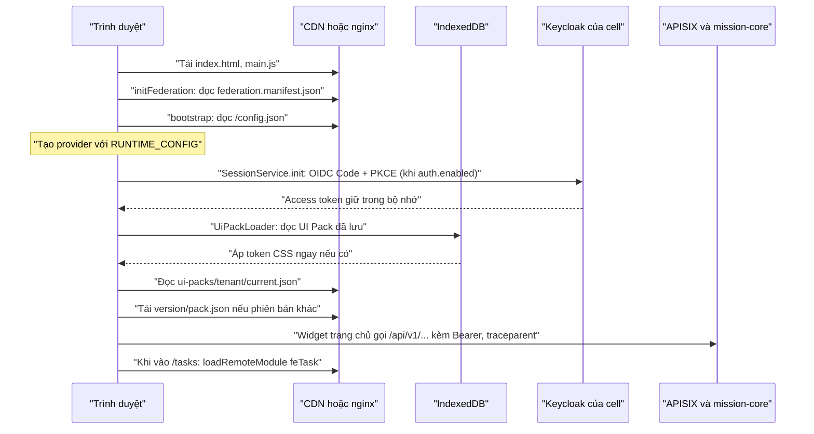

> Nguồn: Baseline mục 5 (SVC-17) và 5.2; TL-01 mục SVC-17 "Phục vụ và nhúng", mục 4 "Luồng một request", chương 7 (G1); TL-02 QT-18 BR-18-12; mã nguồn `frontend/` và `deploy/web/` tại thời điểm viết.

# Kiến trúc frontend

Trang này mô tả phân hệ web SVC-17 `web-frontend` theo hai góc nhìn: thiết kế đã chốt trong bộ tài liệu, và hiện trạng mã trong `frontend/`. Hai góc nhìn được tách rõ để người đọc biết phần nào là mục tiêu, phần nào đã có thật. Khi hai bên lệch nhau, tài liệu thiết kế (TL) là nguồn sự thật và mã phải được đưa về đúng thiết kế, trừ khi một quyết định mới được ghi ở [Quyết định và câu hỏi mở](14-quyet-dinh-va-cau-hoi-mo.md).

## Mô hình shell và remote

Phân hệ web dùng mô hình micro-frontend với Native Federation (thư viện `@angular-architects/native-federation`, cơ chế liên kết module dựa trên import map và ES module chuẩn thay cho Module Federation của webpack). Một ứng dụng chủ (host) tên `fe-shell` chịu trách nhiệm khung giao diện, đăng nhập, nạp cấu hình và UI Pack, còn mỗi miền nghiệp vụ là một ứng dụng con (remote) được triển khai độc lập. Shell biết remote nằm ở đâu nhờ tệp kê khai (manifest) `federation.manifest.json`, và chỉ nạp mã của remote khi người dùng điều hướng tới tuyến tương ứng hoặc khi bố cục trang chủ cần một widget của remote đó.

ADR-10 chọn Angular 21 với Native Federation và PrimeNG vì đội ngũ đã quen Angular; phương án React với Module Federation nêu ở slide 37 của báo cáo BGĐ phù hợp về kỹ thuật nhưng đòi đào tạo lại. Hệ quả tiêu cực mà ADR-10 ghi nhận là Native Federation còn mới hơn Module Federation, nên đội phải theo dõi phiên bản thư viện sát sao. Trong mã hiện tại, phiên bản Native Federation được ghim chính xác ở `21.2.6` vì lý do này.

Lý do tách remote là để mỗi miền có thể phát hành độc lập mà không dựng lại toàn bộ ứng dụng, đồng thời giữ cho lần tải đầu nhỏ: người chỉ dùng "Việc của tôi" không phải tải mã của Config Studio. TL-01 đặt điều kiện xem lại kiến trúc này khi số remote vượt 15, khi đó cần gom remote theo miền.

## Danh mục remote, plugin và thư viện (baseline 5.2)

Baseline mục 5.2 liệt kê đầy đủ các thành phần của SVC-17. Bảng dưới ghép danh mục đó với quy trình và màn hình mà mỗi remote phụ trách. Ánh xạ màn hình lấy từ các tuyến "đã lên kế hoạch" trong `fe-shell/src/app/app.routes.ts`; với những remote mà mã chưa ghi rõ, ánh xạ là suy luận theo tên miền và được đánh dấu.

| Thành phần | Loại | Quy trình, màn hình phụ trách | Trạng thái trong mã |
|---|---|---|---|
| `fe-shell` | Host | QT-00 (SCR-0001 qua Keycloak, SCR-0002 trang chủ SDUI), khung, menu, UI Pack | Đã có |
| `fe-task` | Remote | QT-05, QT-06 (SCR-0503, SCR-0601 đã có bản đầu); widget `vt.widget.myTasksToday` | Đã có, cổng dev 4201 |
| `fe-okr` | Remote | QT-02, QT-03 (SCR-0201, SCR-0202, SCR-0203, SCR-0301) | Tuyến `/okr` chờ |
| `fe-task` hoặc remote riêng | Remote | QT-04 (SCR-0401, SCR-0402, SCR-0403); mã đặt tạm ở tuyến `/plans` | Chưa chốt remote (suy luận: thuộc `fe-task` vì cùng MOD-02) |
| `fe-evidence` | Remote | QT-07 (SCR-0701, SCR-0703) | Tuyến `/evidence` chờ |
| `fe-appraisal` | Remote | QT-09, QT-10 (SCR-0901 đến SCR-0904, SCR-1001, SCR-1002) | Tuyến `/appraisal` chờ |
| `fe-dossier` | Remote | QT-11 (SCR-1101, SCR-1102) | Tuyến `/dossier` chờ |
| `fe-oversight` | Remote | QT-12, QT-13, QT-14 (SCR-1201, SCR-1202, SCR-1301, SCR-1302, SCR-1401) | Tuyến `/oversight` chờ |
| `fe-dashboard` | Remote | QT-16 (SCR-1601 đến SCR-1603) | Tuyến `/dashboard` chờ, chặn theo vai trò |
| `fe-config-studio` | Remote | QT-15, QT-18 (SCR-1501 đến SCR-1504, SCR-1801, SCR-1802) | Tuyến `/config-studio` chờ |
| `fe-admin` | Remote | QT-01, QT-08 (SCR-0101 đến SCR-0104, SCR-0801) | Tuyến `/admin` chờ |
| `fe-plugin-yte`, `fe-plugin-giaoduc`, `fe-plugin-llvt` | Plugin chuyên ngành | Widget, trang chuyên môn nạp theo manifest của tenant (ADR-05 lớp 4) | Chưa có |
| `@vt/design-system` | Thư viện | Preset PrimeNG + token, `ThemeService` | Đã có |
| `@vt/sdui-renderer` | Thư viện | Dựng bố cục SDUI từ UI Pack, registry component | Đã có |
| `@vt/form-engine` | Thư viện | Formly + JSON Schema + cel-js | Đã có bản đầu |
| `@vt/auth` | Thư viện | OIDC Code + PKCE, phiên, guard | Đã có |
| `@vt/telemetry` | Thư viện | OTel web + Faro (hiện có `traceparent` và đo LCP/INP tối thiểu) | Bản tối thiểu |
| `@vt/api-client` | Thư viện | Cấu hình lúc chạy, interceptor, client API, mock | Có trong mã, không có trong baseline 5.2 |

Hai điểm trong bảng cần lưu ý. SCR-1803 (chế độ Đảng viên cao tuổi trên di động) và SCR-0302, SCR-0504, SCR-0702 là màn hình di động thuộc SVC-18 Flutter, nhưng web vẫn phải có bố cục co giãn và chế độ cao tuổi tương đương (TL-02 SCR-1803 ghi thiết bị "Điện thoại (Flutter); web di động"). Thư viện `@vt/api-client` là bổ sung của mã, không có trong baseline 5.2; TL-01 còn nêu thêm `@vt/e2ee` cho mã hoá đầu cuối C3, cũng chưa có trong baseline. Hai điểm lệch này được ghi ở trang 14.

## Tệp kê khai Native Federation

Tệp `federation.manifest.json` ánh xạ tên remote (theo quy ước camelCase như `feTask`) tới địa chỉ tệp `remoteEntry.json` của remote. Shell gọi `initFederation('federation.manifest.json')` trong `main.ts` để dựng import map trước khi nạp bất kỳ mã Angular nào. Theo thiết kế, manifest do CDN hoặc tenant cấp, nhờ đó tenant có plugin chuyên ngành (ví dụ Sở Y tế với `fe-plugin-yte`) nhận được manifest khác tenant khác mà không cần bản build riêng. BR-18-12 quy định plugin chỉ được nạp khi có trong manifest của tenant, bản dựng đã được ký và quét như một service.

Ở môi trường dev, manifest nằm sẵn trong `fe-shell/public/` và trỏ tới remote `fe-task` chạy trên cổng 4201. Khi đóng gói bằng Docker, tệp này được sinh lại lúc container khởi động từ biến môi trường `FE_TASK_URL` (xem mục "Phục vụ tĩnh" bên dưới). Hàm `remoteRoutes()` trong `fe-shell/src/app/remotes.ts` bọc `loadRemoteModule()`: khi remote không nạp được, shell hiển thị trang `RemoteUnavailablePage` thay vì vỡ toàn ứng dụng. Đây là cách hiện thực yêu cầu khả dụng NFR-04 ở phía trình duyệt.

## Cấu hình lúc chạy `/config.json`

Nguyên tắc 8 của TL-01 là "một bản build cho mọi môi trường và tenant": cấu hình phụ thuộc môi trường được nạp lúc chạy thay vì nhúng lúc build (đáp ứng tiêu chí K6, C9 của bản đánh giá kiến trúc). TL-01 mục SVC-17 ghi rằng `/config.json` do nginx sinh từ biến môi trường, gồm URL IdP, URL API và mã cell.

Trong mã, giao diện `RuntimeConfig` của `@vt/api-client` định nghĩa các khoá sau. Bảng chỉ mô tả ý nghĩa, không ghi giá trị cụ thể của môi trường nào.

| Khoá | Ý nghĩa |
|---|---|
| `cell` | Mã cell phục vụ tenant, ví dụ `CELL-G4`, ở dev là `DEV`; hiển thị trên thanh trên |
| `tenant` | Mã tenant mặc định khi chưa phân giải được từ tên miền |
| `apiBaseUrl` | Gốc API của cell; giá trị `/api` nghĩa là gọi cùng nguồn qua APISIX |
| `uiPackBaseUrl` | Gốc phục vụ UI Pack (CDN), mặc định `/ui-packs` |
| `auth.enabled`, `auth.issuer`, `auth.clientId`, `auth.scope` | Cấu hình OIDC với Keycloak; tắt ở dev khi không có Keycloak |
| `useMockApi` | Bật dữ liệu giả lập khi `mission-core` chưa sẵn sàng |
| `telemetry.otlpEndpoint`, `telemetry.sampleRatio` | Tuỳ chọn, dành cho tích hợp OTel/Faro |

Hàm `loadRuntimeConfig()` đọc `/config.json` với `cache: 'no-cache'` và trộn với giá trị mặc định; nếu tệp không đọc được, ứng dụng vẫn chạy với cấu hình mặc định và ghi cảnh báo. `bootstrap.ts` gọi hàm này trước `bootstrapApplication`, rồi cung cấp kết quả qua token `RUNTIME_CONFIG` cho mọi provider.

## Phục vụ tĩnh, CDN và Cache-Control

TL-01 mục SVC-17 quy định mọi tệp tĩnh có tên chứa băm nội dung và được phục vụ với `Cache-Control: public, max-age=31536000, immutable`; chỉ `index.html` và `federation.manifest.json` có `max-age=60`. Lý do là trình duyệt và CDN có thể giữ mã đã băm vĩnh viễn, còn các tệp điều khiển phiên bản phải được làm mới nhanh để bản phát hành mới có hiệu lực trong khoảng một phút. TL-01 mục CDN ước lần tải đầu khoảng 1,2 MB nén và lưu lượng CDN khoảng 72 TB mỗi tháng (số ước tính); minh chứng không đi qua CDN mà dùng URL ký có hạn 5 phút.

Cấu hình `deploy/web/nginx.conf` hiện tại theo đúng nguyên tắc này: tệp `.js`, `.css`, phông, ảnh nhận `max-age=31536000, immutable`, còn `index.html`, `federation.manifest.json`, `remoteEntry.json`, `config.json`, `current.json` nhận `max-age=60`. Riêng UI Pack có quy tắc bộ đệm chi tiết hơn (`current.json` có thêm `stale-while-revalidate=600` và ETag theo thiết kế), trình bày ở [Giao diện theo tenant](03-giao-dien-theo-tenant.md).

`deploy/web/Dockerfile` dựng `fe-task` rồi `fe-shell` trong một giai đoạn Node 22, sau đó chép kết quả vào ảnh `nginx-unprivileged` chạy không root trên cổng 8080. Remote `fe-task` được đặt dưới đường dẫn `/remotes/fe-task` cùng nguồn với shell. Tập lệnh `40-runtime-config.sh` chạy khi container khởi động và sinh `config.json`, `federation.manifest.json` từ biến môi trường `CELL`, `TENANT`, `API_BASE_URL`, `UI_PACK_BASE_URL`, `AUTH_ENABLED`, `AUTH_ISSUER`, `AUTH_CLIENT_ID`, `USE_MOCK_API`, `FE_TASK_URL`. Chi tiết triển khai xem [Hạ tầng dev và triển khai](12-ha-tang-dev-va-trien-khai.md).

## Nhúng vào cổng khác: `<vt-okr-app>`

TL-01 mục SVC-17 yêu cầu ứng dụng nhúng được vào cổng của tenant hoặc của vOffice dưới dạng web component `<vt-okr-app>` dựng bằng Angular Elements, dùng SSO OIDC; khi đăng xuất, ứng dụng gọi `end_session_endpoint` của Keycloak thay vì trỏ về trang đăng nhập riêng của hệ cũ. Chỉ thị CSP `frame-ancestors` cho phép các nguồn cổng của tenant (xem [Bảo mật frontend](08-bao-mat-frontend.md)). Mã hiện tại chưa có web component này; phần đăng xuất qua `end_session_endpoint` đã có trong `SessionService.logout()`.

## Luồng khởi động

Sơ đồ dưới tóm tắt thứ tự khởi động của shell theo mã hiện tại, đối chiếu với TL-01 mục 4 (bước 1 và 2 của luồng một request: shell, remote và UI Pack nằm trong bộ đệm, kiểm ETag với CDN).

Thứ tự trên có hai ràng buộc kỹ thuật. Thứ nhất, `main.ts` chỉ được gọi `initFederation` rồi `import('./bootstrap')`; mọi import thư viện dùng chung (kể cả `@vt/*`) phải nằm trong `bootstrap.ts` trở đi, vì import map chỉ tồn tại sau bước dựng federation. Thứ hai, `UiPackLoader.load()` chạy trong `provideAppInitializer` để token của tenant được áp trước khi giao diện hiển thị, tránh hiện tượng nháy màu mặc định.

## Hiện trạng mã

Tại thời điểm viết, workspace `frontend/` là một Angular workspace (không dùng Nx) gồm hai ứng dụng và sáu thư viện, với các phiên bản chính sau: Angular 21.2, Native Federation 21.2.6, PrimeNG 21.1.10 với preset Aura qua `@primeuix/themes`, `@ngx-formly/core` và `@ngx-formly/primeng` 10.0.1, `cel-js` 0.8, `angular-oauth2-oidc` 21, TypeScript 5.9, Vitest 4 cho kiểm thử đơn vị. Thư viện được ánh xạ qua `paths` trong `tsconfig.json` tới `projects/<thư-viện>/src/public-api.ts`, nên shell và remote dùng mã nguồn thư viện trực tiếp, không cần build thư viện trước.

Shell (`fe-shell`) đã có khung giao diện `ShellLayout` với thanh trên, menu bên lọc theo vai trò, liên kết bỏ qua tới nội dung chính, nhãn cell, nút chuyển "Chữ lớn" và đăng xuất. Trang chủ `HomePage` (SCR-0002) dựng bố cục từ UI Pack qua `<vt-sdui-outlet layout="home">`. Shell đăng ký bốn widget SDUI: `vt.widget.myTasksToday` (nạp từ `fe-task/widgets`), `vt.widget.okrProgress`, `vt.widget.pendingApprovals`, `vt.widget.announcement`. Các tuyến của remote chưa có trỏ tới trang `PlannedPage` ghi giai đoạn và mã SCR dự kiến.

Remote `fe-task` công bố hai module: `./routes` (tuyến `''` là SCR-0503 "Việc của tôi", tuyến `':id'` là chi tiết nhiệm vụ) và `./widgets` (widget `MyTasksTodayWidget`). Client `TaskApi` trong `@vt/api-client` gọi `/api/v1/tasks/mine`, `/api/v1/tasks/{id}` và `POST /api/v1/tasks/{id}/progress` kèm `If-Match`; khi `useMockApi` bật, dữ liệu lấy từ `mock/mock-tasks.ts`.

Những phần thiết kế chưa có trong mã gồm: kiểm chữ ký UI Pack (đang là `TODO(ADR-05)` trong `UiPackLoader`), nạp plugin theo manifest của tenant, web component `<vt-okr-app>`, gọi `registry/resolve` để định tuyến cell, Faro RUM đầy đủ, ngân sách kích thước theo TL-01 (cấu hình `budgets` trong `angular.json` vẫn là mặc định 500 kB cảnh báo, 1 MB lỗi) và các remote còn lại.

## Liên quan

- [Tổng quan hệ thống](01-tong-quan-he-thong.md)
- [Giao diện theo tenant](03-giao-dien-theo-tenant.md)
- [Quy ước API](06-quy-uoc-api.md)
- [Xác thực và phân quyền](07-xac-thuc-phan-quyen.md)
- [Hiệu năng và trải nghiệm](09-hieu-nang-va-trai-nghiem.md)
- [Quy ước mã nguồn](10-quy-uoc-ma-nguon.md)
- [Hạ tầng dev và triển khai](12-ha-tang-dev-va-trien-khai.md)
