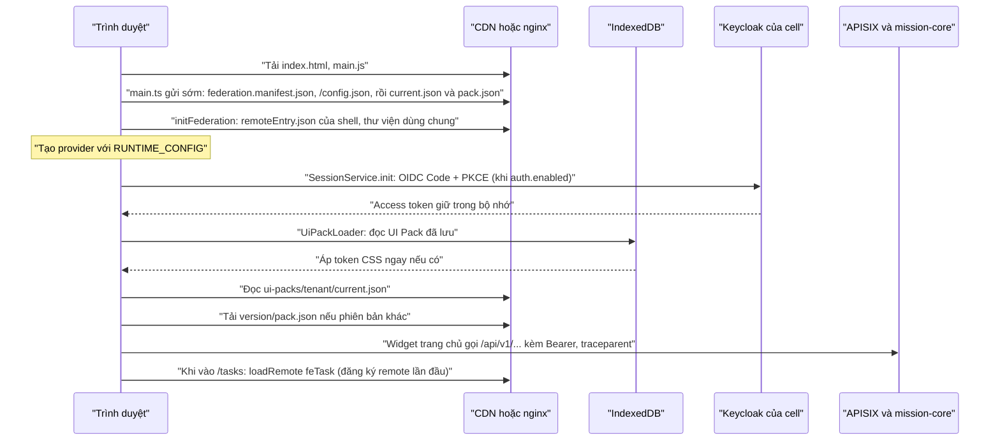

> Nguồn: Baseline mục 5 (SVC-17) và 5.2; TL-01 mục SVC-17 "Phục vụ và nhúng", mục 4 "Luồng một request", chương 7 (G1); TL-02 QT-18 BR-18-12; mã nguồn `frontend/` và `deploy/web/` tại thời điểm viết.

# Kiến trúc frontend

Trang này mô tả phân hệ web SVC-17 `web-frontend` theo hai góc nhìn: thiết kế đã chốt trong bộ tài liệu, và hiện trạng mã trong `frontend/`. Hai góc nhìn được tách rõ để người đọc biết phần nào là mục tiêu, phần nào đã có thật. Khi hai bên lệch nhau, tài liệu thiết kế (TL) là nguồn sự thật và mã phải được đưa về đúng thiết kế, trừ khi một quyết định mới được ghi ở [Quyết định và câu hỏi mở](14-quyet-dinh-va-cau-hoi-mo.md).

## Mô hình shell và remote

Phân hệ web dùng mô hình micro-frontend với Native Federation (thư viện `@angular-architects/native-federation`, cơ chế liên kết module dựa trên import map và ES module chuẩn thay cho Module Federation của webpack). Một ứng dụng chủ (host) tên `fe-shell` chịu trách nhiệm khung giao diện, đăng nhập, nạp cấu hình và UI Pack, còn mỗi miền nghiệp vụ là một ứng dụng con (remote) được triển khai độc lập. Shell biết remote nằm ở đâu nhờ tệp kê khai (manifest) `federation.manifest.json`, và chỉ nạp mã của remote khi người dùng điều hướng tới tuyến tương ứng hoặc khi bố cục trang chủ cần một widget của remote đó.

ADR-10 chọn Angular 21 với Native Federation và PrimeNG vì đội ngũ đã quen Angular; phương án React với Module Federation nêu ở slide 37 của báo cáo BGĐ phù hợp về kỹ thuật nhưng đòi đào tạo lại. Hệ quả tiêu cực mà ADR-10 ghi nhận là Native Federation còn mới hơn Module Federation, nên đội phải theo dõi phiên bản thư viện sát sao. Trong mã hiện tại, phiên bản Native Federation được ghim chính xác ở `21.2.6` vì lý do này.

Lý do tách remote là để mỗi miền có thể phát hành độc lập mà không dựng lại toàn bộ ứng dụng, đồng thời giữ cho lần tải đầu nhỏ: người chỉ dùng "Việc của tôi" không phải tải mã của Config Studio. TL-01 đặt điều kiện xem lại kiến trúc này khi số remote vượt 15, khi đó cần gom remote theo miền.

## Danh mục remote, plugin và thư viện (baseline 5.2)

Baseline mục 5.2 liệt kê đầy đủ các thành phần của SVC-17. Bảng dưới ghép danh mục đó với quy trình và màn hình mà mỗi remote phụ trách. Ánh xạ màn hình lấy từ các tuyến "đã lên kế hoạch" trong `fe-shell/src/app/app.routes.ts`; với những remote mà mã chưa ghi rõ, ánh xạ là suy luận theo tên miền và được đánh dấu.

| Thành phần | Loại | Quy trình, màn hình phụ trách | Trạng thái trong mã |
|---|---|---|---|
| `fe-shell` | Host | QT-00 (SCR-0001 qua Keycloak, SCR-0002 trang chủ SDUI), khung, menu, UI Pack | Đã có |
| `fe-task` | Remote | QT-05, QT-06 (SCR-0503, SCR-0601 đã có bản đầu); widget `vt.widget.myTasksToday` | Đã có, cổng dev 4201 |
| `fe-okr` | Remote | QT-02, QT-03 (SCR-0201, SCR-0202, SCR-0203, SCR-0301) | Khung (WEB-015), cổng dev 4202 |
| `fe-task` hoặc remote riêng | Remote | QT-04 (SCR-0401, SCR-0402, SCR-0403); mã đặt tạm ở tuyến `/plans` | Chưa chốt remote (suy luận: thuộc `fe-task` vì cùng MOD-02) |
| `fe-evidence` | Remote | QT-07 (SCR-0701, SCR-0703) | Khung (WEB-015), cổng dev 4203 |
| `fe-appraisal` | Remote | QT-09, QT-10 (SCR-0901 đến SCR-0904, SCR-1001, SCR-1002) | Khung (WEB-015), cổng dev 4204 |
| `fe-dossier` | Remote | QT-11 (SCR-1101, SCR-1102) | Khung (WEB-015), cổng dev 4205 |
| `fe-oversight` | Remote | QT-12, QT-13, QT-14 (SCR-1201, SCR-1202, SCR-1301, SCR-1302, SCR-1401) | Khung (WEB-015), cổng dev 4206 |
| `fe-dashboard` | Remote | QT-16 (SCR-1601 đến SCR-1603) | Khung (WEB-015), cổng dev 4207, chặn theo vai trò |
| `fe-config-studio` | Remote | QT-15, QT-18 (SCR-1501 đến SCR-1504, SCR-1801, SCR-1802) | Khung (WEB-015), cổng dev 4208, chặn theo vai trò |
| `fe-admin` | Remote | QT-01, QT-08 (SCR-0101 đến SCR-0104, SCR-0801) | Khung (WEB-015), cổng dev 4209, chặn theo vai trò |
| `fe-plugin-yte`, `fe-plugin-giaoduc`, `fe-plugin-llvt` | Plugin chuyên ngành | Widget, trang chuyên môn nạp theo manifest của tenant (ADR-05 lớp 4) | Chưa có |
| `@vt/design-system` | Thư viện | Preset PrimeNG + token, `ThemeService` | Đã có |
| `@vt/sdui-renderer` | Thư viện | Dựng bố cục SDUI từ UI Pack, registry component | Đã có |
| `@vt/form-engine` | Thư viện | Formly + JSON Schema + cel-js | Đã có bản đầu |
| `@vt/auth` | Thư viện | OIDC Code + PKCE, phiên, guard | Đã có |
| `@vt/telemetry` | Thư viện | OTel web + Faro (hiện có `traceparent` và đo LCP/INP tối thiểu) | Bản tối thiểu |
| `@vt/api-client` | Thư viện | Cấu hình lúc chạy, interceptor, client API, mock | Có trong mã, không có trong baseline 5.2 |

Hai điểm trong bảng cần lưu ý. SCR-1803 (chế độ Đảng viên cao tuổi trên di động) và SCR-0302, SCR-0504, SCR-0702 là màn hình di động thuộc SVC-18 Flutter (ứng dụng di động đã bỏ khỏi phạm vi ngày 24/10/2026, wiki 14), nên web phải có bố cục co giãn và chế độ cao tuổi tương đương (TL-02 SCR-1803 ghi thiết bị "Điện thoại (Flutter); web di động"). Thư viện `@vt/api-client` là bổ sung của mã, không có trong baseline 5.2; TL-01 còn nêu thêm `@vt/e2ee` cho mã hoá đầu cuối C3, cũng chưa có trong baseline. Hai điểm lệch này được ghi ở trang 14.

## Tệp kê khai Native Federation

Tệp `federation.manifest.json` ánh xạ tên remote (theo quy ước camelCase như `feTask`) tới địa chỉ tệp `remoteEntry.json` của remote. Từ WEB-052, `main.ts` đọc manifest rồi gọi `initFederation({})`, tức chỉ dựng import map của chính shell trước khi nạp mã Angular; remote được đăng ký sau, khi cần (xem đoạn dưới). Theo thiết kế, manifest do CDN hoặc tenant cấp, nhờ đó tenant có plugin chuyên ngành (ví dụ Sở Y tế với `fe-plugin-yte`) nhận được manifest khác tenant khác mà không cần bản build riêng. BR-18-12 quy định plugin chỉ được nạp khi có trong manifest của tenant, bản dựng đã được ký và quét như một service.

Ở môi trường dev, manifest nằm sẵn trong `fe-shell/public/` và trỏ tới từng remote chạy trên cổng dev của nó (`fe-task` 4201, tám remote khung 4202 đến 4209). Khi đóng gói bằng Docker, tệp này được sinh lại lúc container khởi động từ danh mục `frontend/tools/remotes/remotes.json` và các biến môi trường `FE_<TEN>_URL` (xem mục "Phục vụ tĩnh" bên dưới). Trước WEB-052, `initFederation` tải `remoteEntry.json` của cả chín remote trước khi shell khởi động. Từ WEB-052, hàm `loadRemote()` trong `fe-shell/src/app/federation-remotes.ts` tra URL trong manifest và gọi `loadRemoteModule({ remoteEntry, exposedModule })`, nên mỗi remote chỉ được tải `remoteEntry.json` và bổ sung import map ở lần đầu một tuyến hoặc widget của nó được nạp (trang chủ chỉ đăng ký `fe-task`). Tuyến và widget phải nạp remote qua `loadRemote()`, không gọi `loadRemoteModule('feX', …)` theo tên vì remote chưa đăng ký sẽ báo lỗi. Hàm `remoteRoutes()` trong `fe-shell/src/app/remotes.ts` bọc `loadRemote()`: khi remote không nạp được, shell hiển thị trang `RemoteUnavailablePage` thay vì vỡ toàn ứng dụng. Đây là cách hiện thực yêu cầu khả dụng NFR-04 ở phía trình duyệt.

## Cấu hình lúc chạy `/config.json`

Nguyên tắc 8 của TL-01 là "một bản build cho mọi môi trường và tenant": cấu hình phụ thuộc môi trường được nạp lúc chạy thay vì nhúng lúc build (đáp ứng tiêu chí K6, C9 của bản đánh giá kiến trúc). TL-01 mục SVC-17 ghi rằng `/config.json` do nginx sinh từ biến môi trường, gồm URL IdP, URL API và mã cell.

Trong mã, giao diện `RuntimeConfig` của `@vt/api-client` định nghĩa các khoá sau. Bảng chỉ mô tả ý nghĩa, không ghi giá trị cụ thể của môi trường nào.

| Khoá | Ý nghĩa |
|---|---|
| `cell` | Mã cell phục vụ tenant, ví dụ `CELL-G4`, ở dev là `DEV`; hiển thị trên thanh trên |
| `tenant` | Mã tenant mặc định khi chưa phân giải được từ tên miền |
| `apiBaseUrl` | Gốc API của cell; giá trị `/api` nghĩa là gọi cùng nguồn qua APISIX |
| `uiPackBaseUrl` | Gốc phục vụ UI Pack (CDN), mặc định `/ui-packs` |
| `auth.enabled`, `auth.issuer`, `auth.clientId`, `auth.scope` | Cấu hình OIDC với Keycloak; tắt ở dev khi không có Keycloak |
| `useMockApi` | Bật dữ liệu giả lập khi `mission-core` chưa sẵn sàng |
| `telemetry.otlpEndpoint`, `telemetry.sampleRatio` | Tuỳ chọn, dành cho tích hợp OTel/Faro |

Hàm `loadRuntimeConfig()` đọc `/config.json` với `cache: 'no-cache'` và trộn với giá trị mặc định; nếu tệp không đọc được, ứng dụng vẫn chạy với cấu hình mặc định và ghi cảnh báo. `bootstrap.ts` gọi hàm này trước `bootstrapApplication`, rồi cung cấp kết quả qua token `RUNTIME_CONFIG` cho mọi provider.

## Phục vụ tĩnh, CDN và Cache-Control

TL-01 mục SVC-17 quy định mọi tệp tĩnh có tên chứa băm nội dung và được phục vụ với `Cache-Control: public, max-age=31536000, immutable`; chỉ `index.html` và `federation.manifest.json` có `max-age=60`. Lý do là trình duyệt và CDN có thể giữ mã đã băm vĩnh viễn, còn các tệp điều khiển phiên bản phải được làm mới nhanh để bản phát hành mới có hiệu lực trong khoảng một phút. TL-01 mục CDN ước lần tải đầu khoảng 1,2 MB nén và lưu lượng CDN khoảng 72 TB mỗi tháng (số ước tính); minh chứng không đi qua CDN mà dùng URL ký có hạn 5 phút.

Cấu hình `deploy/web/nginx.conf` hiện tại theo đúng nguyên tắc này: tệp `.js`, `.css`, phông, ảnh nhận `max-age=31536000, immutable`, còn `index.html`, `federation.manifest.json`, `remoteEntry.json`, `config.json`, `current.json` nhận `max-age=60`. Riêng UI Pack có quy tắc bộ đệm chi tiết hơn (`current.json` có thêm `stale-while-revalidate=600` và ETag theo thiết kế), trình bày ở [Giao diện theo tenant](03-giao-dien-theo-tenant.md).

`deploy/web/Dockerfile` chạy `npm run build:all` (mọi remote trong `remotes.json` rồi `fe-shell`) trong một giai đoạn Node 22, ghép kết quả bằng `workspace.mjs assemble`, sau đó chép vào ảnh `nginx-unprivileged` chạy không root trên cổng 8080. Mỗi remote được đặt dưới `/remotes/<project>` cùng nguồn với shell, và `nginx.conf` trả 404 cho tệp thiếu dưới `/remotes/` thay vì rơi về `index.html`. Tập lệnh `40-runtime-config.sh` chạy khi container khởi động và sinh `config.json`, `federation.manifest.json` từ biến môi trường `CELL`, `TENANT`, `API_BASE_URL`, `UI_PACK_BASE_URL`, `AUTH_ENABLED`, `AUTH_ISSUER`, `AUTH_CLIENT_ID`, `USE_MOCK_API` và `FE_<TEN>_URL` cho từng remote (như `FE_TASK_URL`, `FE_OKR_URL`, `FE_CONFIG_STUDIO_URL`). Chi tiết triển khai xem [Hạ tầng dev và triển khai](12-ha-tang-dev-va-trien-khai.md).

## Nhúng vào cổng khác: `<vt-okr-app>`

TL-01 mục SVC-17 yêu cầu ứng dụng nhúng được vào cổng của tenant hoặc của vOffice dưới dạng web component `<vt-okr-app>` dựng bằng Angular Elements, dùng SSO OIDC; khi đăng xuất, ứng dụng gọi `end_session_endpoint` của Keycloak thay vì trỏ về trang đăng nhập riêng của hệ cũ. Chỉ thị CSP `frame-ancestors` cho phép các nguồn cổng của tenant (xem [Bảo mật frontend](08-bao-mat-frontend.md)).

WEB-013 hiện thực yêu cầu này bằng project `fe-embed`, một host Native Federation thứ hai bên cạnh shell. Gói build được đặt ở `/embed/` của máy chủ web (Dockerfile chép `dist/fe-embed/browser` vào đó). Cổng chỉ cần hai thẻ:

```html
<script src="https://<máy chủ web>/embed/vt-okr-app.js" nonce="<nonce của cổng>"></script>
<vt-okr-app tenant="<mã tenant>" route="tasks" ngCspNonce="<nonce của cổng>"></vt-okr-app>
```

Bộ nạp `vt-okr-app.js` (tệp tĩnh, không qua build) lấy mọi tệp theo địa chỉ của chính nó, chép nonce của thẻ script sang các thẻ nó thêm, bật chế độ shim của es-module-shims rồi nạp `main.js`. `main.ts` của `fe-embed` đọc `config.json` và `federation.manifest.json` ở gốc ứng dụng (thư mục cha của `/embed/`), gọi `initFederation` với `deployUrl` là `/embed/`, rồi `bootstrap.ts` dựng ứng dụng bằng `createApplication` và đăng ký phần tử bằng `createCustomElement`. Vì ứng dụng chạy trong trang của cổng, mọi địa chỉ tương đối trong `config.json` (`apiBaseUrl`, `uiPackBaseUrl`, URL remote) được đổi sang tuyệt đối theo gốc ứng dụng (`embed-config.ts`). Router dùng `MemoryLocationStrategy`: không đọc, không ghi thanh địa chỉ của cổng; `href` của liên kết trỏ tới cùng màn hình ở ứng dụng đầy đủ, nên mở thẻ mới vẫn đúng chỗ. Thuộc tính `route` chọn màn hình mở đầu (mặc định `tasks`, chỉ nhận đường dẫn nội bộ), sự kiện `routeChange` báo cho cổng đường dẫn nội bộ mỗi lần đổi màn hình. Thuộc tính `tenant` chỉ được đọc lúc khởi động (từ phần tử đầu tiên trên trang) để chọn UI Pack; tenant thật vẫn lấy theo token. Mỗi trang chỉ nên có một phần tử, vì các phần tử dùng chung một router.

Phần nhúng hiện chỉ mở mục "Việc của tôi" (`/tasks` của fe-task, chặn theo cùng nhóm chức năng SCR-0401, SCR-0501, SCR-0502, SCR-0503, SCR-0601, SCR-0602 như shell); tuyến khác hiện lời mời mở ứng dụng đầy đủ ở thẻ mới. Thanh nhỏ phía trên có nút "Chữ lớn" (chế độ cao tuổi, `aria-pressed`) và liên kết "Mở ứng dụng đầy đủ". Kiểu toàn cục của phần nhúng chỉ đặt biến `--vt-*` và kiểu dưới thẻ `vt-okr-app`, không đặt cho `html`, `body` hay thẻ chung.

Đăng nhập một lần: `RuntimeConfig.auth.redirectUri` (tuỳ chọn, mới ở WEB-013) cho phép Keycloak trả về đúng trang của cổng; phần nhúng đặt giá trị này bằng địa chỉ trang cổng (bỏ truy vấn và `#`). Khi người dùng đã đăng nhập cổng bằng cùng IdP, lượt chuyển sang Keycloak trả về ngay không hỏi lại. Đăng xuất vẫn qua `end_session_endpoint`. Trang thử `frontend/projects/fe-embed/demo/index.html` mô phỏng một cổng ở nguồn khác với CSP nonce và `strict-dynamic`; máy chủ phục vụ trang thay `__APP_ORIGIN__` và `__CSP_NONCE__`.

Điều kiện phía cổng và máy chủ khi tích hợp thật (suy luận từ cách chạy trong cùng trang):

- CSP của trang cổng phải cho phép nguồn máy chủ web Mission trong `script-src` (hoặc dùng nonce kèm `'strict-dynamic'` như trang thử), `style-src` (kèm nonce qua thuộc tính `ngCspNonce`), `font-src`, `img-src`, và cho phép nguồn máy chủ web, API của cell, IdP trong `connect-src`. Nếu cổng bật Trusted Types, cần thêm chính sách `native-federation` và `es-module-shims`.
- Client `mission-web` trên Keycloak phải khai địa chỉ trang cổng trong "Valid redirect URIs" và nguồn cổng trong "Web origins"; APISIX phải cho CORS từ nguồn cổng với header `Authorization`, `Idempotency-Key`, `If-Match`, `traceparent`, `baggage` (TL-04 D7 đã nêu CORS theo danh sách cổng của tenant).
- Kiểu CSS của cổng đặt theo tên thẻ chung (ví dụ `header { ... }`) sẽ áp cả vào nội dung nhúng, vì phần nhúng không dùng Shadow DOM: PrimeNG chèn kiểu vào `document.head` nên không áp được bên trong shadow root. Cổng nên đặt kiểu theo lớp; nếu không sửa được, dùng cách nhúng khung `<iframe>` trỏ tới ứng dụng đầy đủ, khi đó nguồn cổng phải có trong `CSP_FRAME_ANCESTORS`.


## Luồng khởi động

Sơ đồ dưới tóm tắt thứ tự khởi động của shell theo mã hiện tại, đối chiếu với TL-01 mục 4 (bước 1 và 2 của luồng một request: shell, remote và UI Pack nằm trong bộ đệm, kiểm ETag với CDN).



Thứ tự trên có hai ràng buộc kỹ thuật. Thứ nhất, `main.ts` chỉ được gọi `initFederation` rồi `import('./bootstrap')`; mọi import thư viện dùng chung (kể cả `@vt/*`) phải nằm trong `bootstrap.ts` trở đi, vì import map chỉ tồn tại sau bước dựng federation. Các yêu cầu gửi sớm của WEB-052 (`fe-shell/src/early-fetch.ts`) vì thế chỉ dùng `fetch` của trình duyệt; `UiPackLoader` dùng lại kết quả qua token `UI_PACK_PREFETCH` khi gốc và tenant khớp cấu hình. Thứ hai, `UiPackLoader.load()` chạy trong `provideAppInitializer` để token của tenant được áp trước khi giao diện hiển thị, tránh hiện tượng nháy màu mặc định.

## Cờ tính năng phía web (WEB-076)

Tính năng mới được phát hành dần theo tenant bằng cờ tính năng. Khi khởi động, shell gọi `GET /api/v1/ui/feature-flags` (bản cờ đã tính cho người dùng, `EffectiveFeatureFlagMap`) qua `FeatureFlagService` (thư viện `@vt/api-client`) và nạp lại mỗi khi người dùng đổi phân công. Một cờ chỉ có hiệu lực khi `enabled` bật và thời điểm hiện tại nằm trong khoảng `validFrom`–`validTo` nếu có khai báo. Giao diện dùng cờ theo ba cách: chỉ thị `*vtFeature="'khoa.co'"` để ẩn hoặc hiện một khối, `canMatch: [featureFlagGuard('khoa.co')]` để chặn một tuyến, và trường `flag` của mục menu trong `fe-shell/src/app/layout/nav.ts`.

Mọi lỗi khi nạp cờ (403, lỗi mạng, 5xx) đều được coi là mọi cờ tắt. Nhờ vậy một tính năng chưa phát hành không bao giờ lộ ra chỉ vì máy chủ trả lỗi. Cờ phía web chỉ quyết định ẩn hay hiện; máy chủ vẫn phải tự kiểm cờ ở API.

Hợp đồng đã có `GET /ui/feature-flags` cho mọi người dùng đã đăng nhập; `/config/feature-flags` chỉ dành cho màn hình quản trị cờ. Từ WEB-072 web đọc đường dẫn đúng hợp đồng, nhưng mission-core chưa cài thao tác này nên khi chạy với máy chủ thật mọi cờ tắt cho tới khi backend bổ sung; khi chạy giả lập, tham số trang `?ff=khoa1,khoa2` bật thêm cờ để thử giao diện.

## Thông báo, tìm kiếm và xử lý lỗi toàn cục (WEB-012)

Thanh trên của shell có ba phần mới, đều dựng trong `fe-shell/src/app/layout/`.

Chuông thông báo (`NotificationBell` cùng dịch vụ `NotificationCenter`) chỉ hiện với người dùng có quyền `SCR-0002.doc-thong-bao` theo ma trận phân quyền. Dịch vụ tải danh sách bằng `GET /api/v1/notifications` rồi mở luồng SSE `GET /api/v1/notifications/stream`. Luồng được đọc qua `HttpClient` (không dùng `EventSource`) để vẫn đi qua interceptor gắn Bearer, `traceparent` và cell: client `NotificationApi` trong `@vt/api-client` yêu cầu `observe: 'events'` với `reportProgress`, cắt phần văn bản mới của từng sự kiện tiến trình và đưa vào `SseParser`. Khi luồng đứt, dịch vụ nối lại kèm `Last-Event-ID`, giãn cách theo trường `retry` của máy chủ hoặc 5, 10, 20, 40 rồi 60 giây, và chờ sự kiện `online` khi mất mạng. Sự kiện `notification` thêm thông báo mới vào đầu danh sách; sự kiện `unread` đặt lại số chưa đọc và tải lại danh sách khi máy chủ gửi cờ `reload`; sự kiện `job` để `JobTracker` của WEB-007 dùng; sự kiện khác bị bỏ qua. Bảng thông báo là nút mở rộng có `aria-expanded`, đóng bằng Esc (trả tiêu điểm về chuông) hoặc bấm ra ngoài; liên kết sâu chỉ được điều hướng khi là đường dẫn nội bộ (`safeInternalLink`).

Ô tìm kiếm toàn cục (`GlobalSearch`) là combobox theo mẫu WAI-ARIA, tự dựng thay vì dùng AutoComplete của PrimeNG để giữ gói tải đầu của shell nhỏ. Ô gọi `GET /api/v1/search` qua `SearchApi` sau 300 ms kể từ lần gõ cuối và khi có từ hai ký tự, tô đậm đoạn khớp, điều hướng bằng phím mũi tên và Enter. Ma trận phân quyền hiện chỉ có dòng API cho tìm kiếm (AC-04 đến AC-10), chưa có khoá chức năng giao diện, nên ô hiện với mọi người dùng đã đăng nhập và tự ẩn khi máy chủ trả 403 (suy luận; cần bổ sung khoá chức năng vào `ma-tran.json`). Ở màn hình hẹp hơn 720 px, ô thu thành nút "Tìm kiếm" và mở phủ thanh trên. Giả lập của hai API nằm ở `api-client/src/mock/notifications/` và `mock/search/` (tìm không phân biệt dấu trên dữ liệu nhiệm vụ, văn bản nguồn và danh mục công việc).

Xử lý lỗi toàn cục gồm bốn phần. `GlobalErrorHandler` thay `ErrorHandler` của Angular: ghi console, gửi lỗi vào Faro qua `pushTelemetryError` của `@vt/telemetry` kèm tuyến hiện tại và loại lỗi, bỏ qua `HttpErrorResponse` vì lỗi API đã do `ProblemPresenter` xử lý. Lỗi tải chunk (thường do vừa phát hành bản mới) và lỗi bất ngờ hiện dải thông báo `AppStatusBanner` có nút "Tải lại trang"; dải này cũng báo mất mạng và có mạng trở lại. Lỗi điều hướng chuyển sang trang `/loi` thân thiện mà không đổi địa chỉ trên thanh trình duyệt. Shell cung cấp `MessageService` và đặt `<p-toast>` để `ProblemPresenter.present()` của mọi remote hiện được toast.

## Hiện trạng mã

Tại thời điểm viết, workspace `frontend/` là một Angular workspace (không dùng Nx) gồm hai ứng dụng và sáu thư viện, với các phiên bản chính sau: Angular 21.2, Native Federation 21.2.6, PrimeNG 21.1.10 với preset Aura qua `@primeuix/themes`, `@ngx-formly/core` và `@ngx-formly/primeng` 10.0.1, `cel-js` 0.8, `angular-oauth2-oidc` 21, TypeScript 5.9, Vitest 4 cho kiểm thử đơn vị. Thư viện được ánh xạ qua `paths` trong `tsconfig.json` tới `projects/<thư-viện>/src/public-api.ts`, nên shell và remote dùng mã nguồn thư viện trực tiếp, không cần build thư viện trước.

Shell (`fe-shell`) đã có khung giao diện `ShellLayout` với thanh trên, menu bên lọc theo vai trò, liên kết bỏ qua tới nội dung chính, nhãn cell, nút chuyển "Chữ lớn" và đăng xuất. Trang chủ `HomePage` (SCR-0002) dựng bố cục từ UI Pack qua `<vt-sdui-outlet layout="home">`. Shell đăng ký bốn widget SDUI: `vt.widget.myTasksToday` (nạp từ `fe-task/widgets`), `vt.widget.okrProgress`, `vt.widget.pendingApprovals`, `vt.widget.announcement`. Các tuyến của remote chưa có trỏ tới trang `PlannedPage` ghi giai đoạn và mã SCR dự kiến.

Remote `fe-task` công bố hai module: `./routes` (tuyến `''` là SCR-0503 "Việc của tôi", tuyến `':id'` là chi tiết nhiệm vụ) và `./widgets` (widget `MyTasksTodayWidget`). Client `TaskApi` trong `@vt/api-client` gọi `/api/v1/tasks/mine`, `/api/v1/tasks/{id}` và `POST /api/v1/tasks/{id}/progress` kèm `If-Match`; khi `useMockApi` bật, dữ liệu lấy từ `mock/mock-tasks.ts`.

Những phần thiết kế chưa có trong mã gồm: kiểm chữ ký UI Pack (đang là `TODO(ADR-05)` trong `UiPackLoader`), nạp plugin theo manifest của tenant, web component `<vt-okr-app>`, gọi `registry/resolve` để định tuyến cell, Faro RUM đầy đủ, ngân sách kích thước theo TL-01 (cấu hình `budgets` trong `angular.json` vẫn là mặc định 500 kB cảnh báo, 1 MB lỗi) và các remote còn lại.

## Liên quan

- [Tổng quan hệ thống](01-tong-quan-he-thong.md)
- [Giao diện theo tenant](03-giao-dien-theo-tenant.md)
- [Quy ước API](06-quy-uoc-api.md)
- [Xác thực và phân quyền](07-xac-thuc-phan-quyen.md)
- [Hiệu năng và trải nghiệm](09-hieu-nang-va-trai-nghiem.md)
- [Quy ước mã nguồn](10-quy-uoc-ma-nguon.md)
- [Hạ tầng dev và triển khai](12-ha-tang-dev-va-trien-khai.md)
